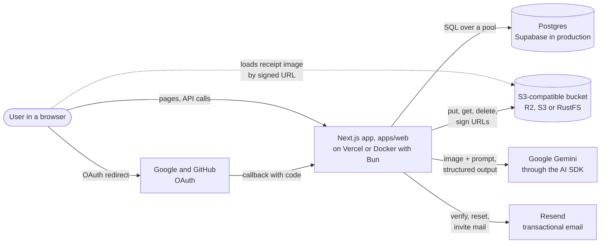
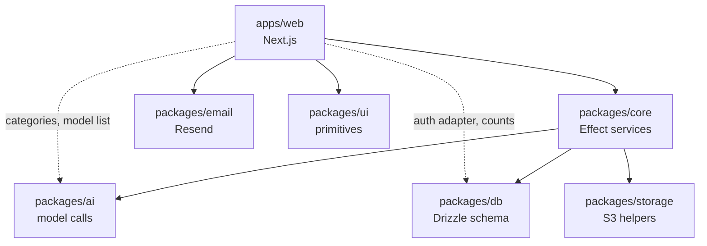

# Architecture

Receipt OCR turns a photo or PDF of a receipt into structured rows (merchant, date, category, currency, totals and
line items) that a user can check, correct and export as CSV. It is a Bun and Turborepo monorepo: one Next.js app and
six internal packages.

This folder documents what the code does today. Work that is only planned is marked **Planned** and links to its plan.
When the code and this page disagree, the code wins; fix the page in the same PR (see [Keeping this current](#keeping-this-current)).

## Contents

- [The system at a glance](#the-system-at-a-glance)
- [Apps and packages](#apps-and-packages)
- [Terms used in these pages](#terms-used-in-these-pages)
- [Reading order](#reading-order)
- [Working principles](#working-principles)
- [What is planned, not built](#what-is-planned-not-built)

## The system at a glance

One Next.js app does everything: it serves the pages, handles sign-in, accepts uploads, calls the model and writes the
results. There is no separate worker or queue today.

| External service      | What the app uses it for                                     | Configured by                                                    |
| --------------------- | ------------------------------------------------------------ | ---------------------------------------------------------------- |
| Postgres              | Every table: auth, workspaces, receipts, usage ledger, admin | `DATABASE_URL` (app), `DIRECT_URL` (migrations)                  |
| S3-compatible storage | The uploaded receipt files; the bucket stays private         | `S3_*`                                                           |
| Google Gemini         | Reading the receipt into the extraction schema               | `GOOGLE_GENERATIVE_AI_API_KEY`, `GEMINI_MODEL`, Admin → Settings |
| Resend                | Verification, password reset, invitation and support mail    | `RESEND_API_KEY`, `EMAIL_FROM`, `SUPPORT_EMAIL`                  |
| Google, GitHub OAuth  | Optional social sign-in                                      | `GOOGLE_CLIENT_ID`/`_SECRET`, `GITHUB_CLIENT_ID`/`_SECRET`       |

Every service except Postgres and auth is optional at runtime: without a Gemini key the app still serves history and
exports, and without Resend mail is logged instead of sent. The full variable list is in
[deployment.md](../deployment.md#4-environment-variables).

## Apps and packages

Arrows point from a package to what it imports; dashed arrows are narrow imports of a few helpers. The web app is the only thing that runs; the packages are TypeScript
source it compiles in (`transpilePackages` in [next.config.ts](../../apps/web/next.config.ts)).

`apps/web` imports `packages/ai` directly only through its two dependency-free entry points: the category list
(`@receipt-ocr/ai/categories`) and the model list (`@receipt-ocr/ai/models`, for the admin settings page). It imports
`packages/db` directly for Better Auth's adapter and a few membership counts. All receipt work goes through
`packages/core`.

| Path                                         | Role                                                                                                   | Page                     |
| -------------------------------------------- | ------------------------------------------------------------------------------------------------------ | ------------------------ |
| [`apps/web`](../../apps/web)                 | Pages, route handlers, server actions, Better Auth config. Thin adapters over core.                    | [web.md](web.md)         |
| [`packages/core`](../../packages/core)       | The receipt workflow, receipt groups, quota, usage ledger, settings, admin writes. Effect TS services. | [core.md](core.md)       |
| [`packages/ai`](../../packages/ai)           | One model call: schema, prompt, error kinds, usage, the model list and its prices.                     | [ai.md](ai.md)           |
| [`packages/db`](../../packages/db)           | Drizzle schema for every table and the shared connection pool.                                         | [db.md](db.md)           |
| [`packages/storage`](../../packages/storage) | S3 client, object keys, signed read URLs.                                                              | [storage.md](storage.md) |
| [`packages/email`](../../packages/email)     | Resend sender and HTML/text templates.                                                                 | [email.md](email.md)     |
| [`packages/ui`](../../packages/ui)           | shadcn-style primitives on Base UI, Tailwind v4 theme tokens.                                          | [ui.md](ui.md)           |
| `bench/`, `scripts/`, `docker/`, `.github/`  | OCR benchmark, load test, dependency checks, images, CI and deploys.                                   | [tooling.md](tooling.md) |

## Terms used in these pages

| Term             | Meaning                                                                                                                                                           |
| ---------------- | ----------------------------------------------------------------------------------------------------------------------------------------------------------------- |
| Workspace        | A Better Auth **organization**. Receipts belong to a workspace; every member can read them. Every user gets a personal one.                                       |
| Workspace role   | `member.role`: exactly one of `owner`, `admin` or `member` (enforced by `assertWorkspaceRole`). Decides who may edit or delete receipts and manage members.       |
| Platform admin   | A user with `user.role = 'admin'` (Better Auth admin plugin). Sees `/admin`. Unrelated to the workspace role.                                                     |
| Scope            | `{ organizationId, userId, role }` for one request, resolved through `member` on every request.                                                                   |
| Round            | One upload or one retry of a receipt. `receipts.attempts` counts them; each gets an `ocr_rounds` row.                                                             |
| Call             | One model call inside a round. Each gets an `ocr_calls` row with tokens, latency and cost.                                                                        |
| Chain            | The ordered list of models an admin configured. The first that works reads the receipt; the rest are fallbacks.                                                   |
| Usage ledger     | `ocr_rounds` + `ocr_calls`. Append-only; quota and cost are counted from it, never from `receipts`.                                                               |
| Wide event       | One JSON log line per request (or background run) holding everything about it: ids, timings, model, cost, outcome. See [`lib/log.ts`](../../apps/web/lib/log.ts). |
| Advisory lock    | A Postgres lock on a number, not a row (`pg_advisory_xact_lock`). Used per user so one user's quota checks run one at a time; released at commit.                 |
| Instant / queued | The two upload modes: read in the request, or respond `202` and read after the response.                                                                          |

## Reading order

**Beginner path.** Read these in order; each takes a few minutes.

1. This page, for the shape of the system.
2. [Upload, extraction and result](flows/upload-and-extraction.md): the one flow the product exists for.
3. [web.md](web.md): where pages and routes live, and how a request reaches core.
4. [core.md](core.md): the services behind every route.
5. [Data model](data-model.md): the tables those services read and write.

**Deep dives**, in any order:

- [Sign-up, sign-in and invitations](flows/auth.md)
- [Retry](flows/retry.md) and the attempt guard
- [Background jobs](flows/jobs.md): the Postgres queue, leases, retries and cooldowns
- [Admin actions and the audit log](flows/admin-actions.md)
- [Admin operations and jobs](flows/admin-operations.md): charts, their sources, and the job actions
- [Settings cache](flows/settings-cache.md)
- [CI, deployment and migrations](flows/deployment.md)
- [ai.md](ai.md) (model boundary, prices), [db.md](db.md), [storage.md](storage.md), [email.md](email.md),
  [ui.md](ui.md), [tooling.md](tooling.md)

Related documents outside this folder: [STATUS.md](../STATUS.md) (what is shipped and what is next),
[deployment.md](../deployment.md) (operator steps), [plans](../plans) and [reviews](../reviews).

## Working principles

These hold across the codebase. Each package page lists its own invariants as well. The security reasoning behind
several of them is in the [security audit](../reviews/2026-11-06-security-audit.md).

1. **Route handlers and server actions are thin adapters.** They check the session, origin and input, then run one
   Effect program from `packages/core` and map its typed error to a status code
   ([`runRoute`](../../apps/web/lib/http.ts)). Workflow logic lives in core so a future worker can reuse it.
2. **Every receipt query is scoped to the caller's workspace.** The scope is resolved from `member` on every request,
   not taken from the session ([`resolveScope`](../../packages/core/src/workspace.ts)).
3. **Usage is an append-only ledger.** Quota, the global cap and cost read `ocr_rounds` and `ocr_calls`, so deleting
   a receipt or a workspace refunds nothing ([`usage.ts`](../../packages/core/src/usage.ts)).
4. **Only the current attempt may write a result.** Completion and failure match on `status = 'processing'` and the
   attempt number, so a stale or duplicate run writes nothing
   ([`currentAttempt`](../../packages/core/src/repository.ts)).
5. **`packages/ai` is the provider boundary.** It makes one call with one model and classifies the failure; core owns
   the chain, deadlines and fallback. Nothing outside `packages/ai` imports the AI SDK.
6. **Every admin change has an audit row.** Core changes write it in the same transaction; Better Auth changes write
   it first and add a `_failed` row if the call fails.
7. **Missing configuration turns a feature off, not the app.** Each service reads its own config when used, so a
   missing key fails only that feature with `NotConfigured` ([`config.ts`](../../packages/core/src/config.ts)).
8. **Fail closed on limits.** Unknown plans get the default plan's limits, and an unreadable settings row falls back
   to code defaults, never to unlimited.

## What is planned, not built

| Planned                                     | Today                                                                                   | Plan                                                                                                                                                                                        |
| ------------------------------------------- | --------------------------------------------------------------------------------------- | ------------------------------------------------------------------------------------------------------------------------------------------------------------------------------------------- |
| Worker app and cron drain for the job queue | The [job queue](flows/jobs.md) is run by the upload, retry and poll routes in `after()` | [Durable background jobs](../plans/2026-11-06-jobs-queue.md), Tracks B to D; also [extraction cost and accuracy, section 5](../plans/2026-11-06-extraction-cost-accuracy.md#5-batch--async) |
| Observability (Axiom logs, PostHog, Sentry) | One JSON wide event per request on stdout                                               | [Observability](../plans/2026-11-06-observability.md)                                                                                                                                       |
| Usage screens for customers and admins      | Rollup queries exist in `usage.ts`; only the daily meter is shown                       | [Usage design](../plans/2026-11-06-usage-design.md)                                                                                                                                         |
| Passkeys and two-factor                     | Email/password and OAuth only                                                           | [Passkeys and 2FA](../plans/2026-11-06-passkeys-2fa.md)                                                                                                                                     |
| Second AI provider                          | Google Gemini and the offline fixture                                                   | [AI usage and models](../plans/2026-11-06-ai-usage-models.md)                                                                                                                               |
| Seats and per-workspace quota               | Quota is per user per UTC day                                                           | [Members and admin](../plans/2026-11-06-members-admin-plan.md)                                                                                                                              |
| Home currency and FX conversion             | Amounts `numeric(12,2)`, currency defaults to USD, no conversion                        | [Currencies and FX](../plans/2026-11-06-currencies-fx.md)                                                                                                                                   |

## Keeping this current

Update the relevant page and its diagram in the same PR as an architectural change: a new package or service, a new
table or constraint, a changed flow, a new external dependency. [AGENTS.md](../../AGENTS.md) says the same.
