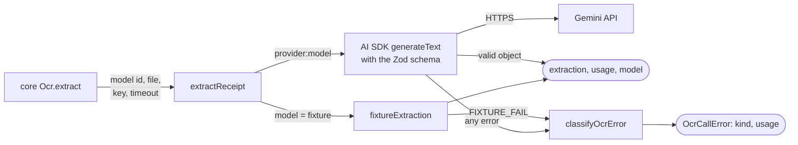

# packages/ai

The provider boundary. It makes **one** extraction call with **one** model through the
[AI SDK](https://ai-sdk.dev), validates the output against a Zod schema, reports token usage, and classifies any
failure into a small set of kinds. It also holds the list of models an admin may choose and their prices.

It does not choose models, retry across models, enforce deadlines across a chain or write anything. That is
[packages/core](core.md)'s job.

## Contents

- [Public API](#public-api)
- [Key modules](#key-modules)
- [Data flow](#data-flow)
- [Design principles and invariants](#design-principles-and-invariants)
- [How to test it](#how-to-test-it)
- [Common changes](#common-changes)

## Public API

| Entry point                  | Exports                                                                                                                                                     |
| ---------------------------- | ----------------------------------------------------------------------------------------------------------------------------------------------------------- |
| `@receipt-ocr/ai`            | `extractReceipt`, `receiptExtractionSchema`, `ReceiptExtraction`, `OcrCallError`, `classifyOcrError`, `OCR_FAILURE_KINDS`, `ModelId`, plus everything below |
| `@receipt-ocr/ai/models`     | `OCR_PROVIDERS`, `OCR_MODELS`, `ocrModel`, `priceAt`, `costOf`, `priceCall`, `ExtractionUsage`. No runtime imports                                          |
| `@receipt-ocr/ai/categories` | `RECEIPT_CATEGORIES`, `CATEGORY_DESCRIPTIONS`, `normalizeCategory`, `parseCategory`. No runtime imports                                                     |

The two sub-entry points are dependency-free so client components can import them without pulling the AI SDK into
the browser bundle.

```ts
extractReceipt({
  model: "google:gemini-3.8-flash", // `provider:model`, or "fixture"
  file: { data, mediaType },
  keys: { google: apiKey },
  timeoutMs,
  maxRetries,
  abortSignal,
}): Promise<{ extraction; usage; model }> // throws OcrCallError
```

## Key modules

| File                                                   | What it holds                                                                                           |
| ------------------------------------------------------ | ------------------------------------------------------------------------------------------------------- |
| [`extract.ts`](../../packages/ai/src/extract.ts)       | The prompt, the provider registry (one per key set), `generateText` with `Output.object`, usage mapping |
| [`schema.ts`](../../packages/ai/src/schema.ts)         | `receiptExtractionSchema`: the single definition of an extraction, with length caps                     |
| [`errors.ts`](../../packages/ai/src/errors.ts)         | `OCR_FAILURE_KINDS`, `classifyOcrError`, `OcrCallError`                                                 |
| [`models.ts`](../../packages/ai/src/models.ts)         | Providers, the model allowlist, effective-dated prices, `costOf`                                        |
| [`categories.ts`](../../packages/ai/src/categories.ts) | The twelve canonical categories and their descriptions (fed to the model)                               |
| [`fixture.ts`](../../packages/ai/src/fixture.ts)       | Offline provider: same bytes give the same canned receipt; bytes containing `FIXTURE_FAIL` fail         |

## Data flow

Both outcomes go back to core: a result, or an `OcrCallError` that core turns into an attempt and decides whether
to try the next model.



Failure kinds and how they are decided ([`errors.ts`](../../packages/ai/src/errors.ts)):

| Kind             | From                                                                             | Core falls back? |
| ---------------- | -------------------------------------------------------------------------------- | ---------------- |
| `timeout`        | HTTP 408, `TimeoutError` or `AbortError`                                         | Yes              |
| `rate-limited`   | HTTP 429                                                                         | Yes              |
| `provider-error` | HTTP 5xx, network errors, the fixture's simulated failure, anything unrecognised | Yes              |
| `not-configured` | HTTP 401, 403, 404, missing key, unknown model or provider                       | Yes              |
| `invalid-output` | No object, no content, schema or JSON parse failure                              | No               |
| `bad-image`      | Any other 4xx (400, 413, 422): the provider refused the input                    | No               |

## Design principles and invariants

- **One call, no routing.** `extractReceipt` never tries a second model. Core decides from the failure kind.
- **Usage is read before output.** Reading `result.output` throws on an empty or truncated reply, which was still
  billed, so `usage` is captured first. A schema failure's usage is recovered from `NoObjectGeneratedError`.
- **Reasoning tokens are inside output tokens.** `priceCall` charges `outputTokens` only; adding `reasoningTokens`
  would double-count. Cached input is charged at the cached rate and subtracted from input.
- **Unknown is not free.** `costOf` returns `null` (not 0) when the model, a price for that day, or the token counts
  are missing. Core stores the null.
- **Prices are effective-dated.** Each model lists price rows newest first; `priceAt` picks the first row whose
  `from` day is on or before the call's UTC day. A price change is a new row, so old calls keep their old price.
- **Error messages never contain receipt contents.** `OcrCallError.message` is the kind plus an HTTP status; the AI
  SDK's own messages can embed model output. The original error is kept as a non-enumerable `cause`.
- **Output is bounded.** `maxOutputTokens` is 16,384, the schema caps string lengths and allows at most 300 items, so
  a crafted image can't produce unbounded cost or rows.
- **The model list is an allowlist.** Admin settings validate model ids against `OCR_MODELS`; a typo can't reach a
  provider.

## How to test it

`bun run test` runs [`extract.test.ts`](../../packages/ai/src/extract.test.ts) (with a mock model through
`extractWith`), [`errors.test.ts`](../../packages/ai/src/errors.test.ts),
[`models.test.ts`](../../packages/ai/src/models.test.ts) and
[`categories.test.ts`](../../packages/ai/src/categories.test.ts). None calls a provider. For real accuracy, latency
and cost, use the [OCR benchmark](tooling.md#ocr-benchmark).

## Common changes

### Add a model from an existing provider

1. Add an entry to `OCR_MODELS` in [`models.ts`](../../packages/ai/src/models.ts) with its id
   (`google:<model>`), label and a price row dated the day you checked the provider's pricing page.
2. Run the benchmark against it: `bun run bench:ocr --models google:<model>`.
3. Deploy. An admin turns it on and orders it in **Admin → Settings → OCR models**; nothing else changes.

### Add a provider

1. Install the AI SDK provider package (exact pin, at least 7 days old).
2. In [`models.ts`](../../packages/ai/src/models.ts): add the id to `OcrProviderId`, an entry to `OCR_PROVIDERS` with
   its `keyEnv`, and its models.
3. In [`extract.ts`](../../packages/ai/src/extract.ts): add it to `buildRegistry` (the `satisfies` clause makes this
   a type error until you do).
4. In core: pass its key in `Ocr.Live` ([`ocr.ts`](../../packages/core/src/ocr.ts)) and report its availability in
   `providerAvailability` ([`settings.ts`](../../packages/core/src/settings.ts)).
5. Add the key variable to `.env.example`, `turbo.json` and [deployment.md](../deployment.md).
6. Add new failure mappings to `classifyOcrError` if the provider reports errors differently.

**Planned:** Anthropic and OpenAI providers and a capabilities field per model
([AI usage and models](../plans/2026-11-06-ai-usage-models.md)).

### Change the extraction schema

Change [`schema.ts`](../../packages/ai/src/schema.ts). If a field is stored in a column, update `ReceiptRepo.complete`
([`repository.ts`](../../packages/core/src/repository.ts)), the receipts table (a migration) and the CSV export. The
whole extraction is also stored as `receipts.raw_json`.
