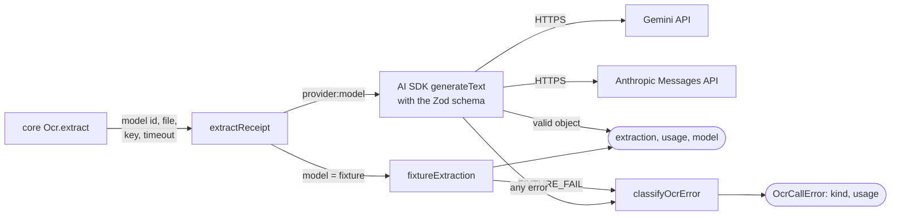

# packages/ai

The provider boundary. It makes **one** extraction call with **one** model through the
[AI SDK](https://ai-sdk.dev), validates the output against a Zod schema, reports token usage, and classifies any
failure into a small set of kinds. It also holds the list of models an admin may choose and their prices.

It does not choose models, retry across models, enforce deadlines across a chain or write anything. That is
[packages/core](core.md)'s job.

## Contents

- [Public API](#public-api)
- [Key modules](#key-modules)
- [Data flow](#data-flow)
- [Design principles and invariants](#design-principles-and-invariants)
- [How to test it](#how-to-test-it)
- [Common changes](#common-changes)

## Public API

| Entry point                  | Exports                                                                                                                                                     |
| ---------------------------- | ----------------------------------------------------------------------------------------------------------------------------------------------------------- |
| `@receipt-ocr/ai`            | `extractReceipt`, `receiptExtractionSchema`, `ReceiptExtraction`, `OcrCallError`, `classifyOcrError`, `OCR_FAILURE_KINDS`, `ModelId`, plus everything below |
| `@receipt-ocr/ai/models`     | `OCR_PROVIDERS`, `OCR_MODELS`, `ocrModel`, `priceAt`, `costOf`, `priceCall`, `ExtractionUsage`. No runtime imports                                          |
| `@receipt-ocr/ai/categories` | `RECEIPT_CATEGORIES`, `CATEGORY_DESCRIPTIONS`, `normalizeCategory`, `parseCategory`. No runtime imports                                                     |

The two sub-entry points are dependency-free so client components can import them without pulling the AI SDK into
the browser bundle.

```ts
extractReceipt({
  model: "google:gemini-3.8-flash", // `provider:model`, or "fixture"
  file: { data, mediaType },
  keys: { google: googleKey, anthropic: anthropicKey },
  timeoutMs,
  maxRetries,
  abortSignal,
}): Promise<{ extraction; usage; model }> // throws OcrCallError
```

## Key modules

| File                                                   | What it holds                                                                                                                     |
| ------------------------------------------------------ | --------------------------------------------------------------------------------------------------------------------------------- |
| [`extract.ts`](../../packages/ai/src/extract.ts)       | The prompt, the provider registry (one per key set), per-model Claude options, `generateText` with `Output.object`, usage mapping |
| [`schema.ts`](../../packages/ai/src/schema.ts)         | `receiptExtractionSchema`: the single definition of an extraction, with length caps                                               |
| [`errors.ts`](../../packages/ai/src/errors.ts)         | `OCR_FAILURE_KINDS`, `classifyOcrError`, `OcrCallError`                                                                           |
| [`models.ts`](../../packages/ai/src/models.ts)         | Providers, the model allowlist, effective-dated prices, `costOf`                                                                  |
| [`categories.ts`](../../packages/ai/src/categories.ts) | The twelve canonical categories and their descriptions (fed to the model)                                                         |
| [`fixture.ts`](../../packages/ai/src/fixture.ts)       | Offline provider: same bytes give the same canned receipt; bytes containing `FIXTURE_FAIL` fail                                   |

## Data flow

Both outcomes go back to core: a result, or an `OcrCallError` that core turns into an attempt and decides whether
to try the next model.



Failure kinds and how they are decided ([`errors.ts`](../../packages/ai/src/errors.ts)):

| Kind             | From                                                                                                                                           | Core falls back? |
| ---------------- | ---------------------------------------------------------------------------------------------------------------------------------------------- | ---------------- |
| `timeout`        | HTTP 408, `TimeoutError` or `AbortError`                                                                                                       | Yes              |
| `rate-limited`   | HTTP 429                                                                                                                                       | Yes              |
| `provider-error` | HTTP 5xx (Anthropic 529 overloaded included), network errors, a refusal or safety stop, the fixture's simulated failure, anything unrecognised | Yes              |
| `not-configured` | HTTP 401, 403, 404, missing key, unknown model or provider, a file type the model can't read (HEIC on Claude)                                  | Yes              |
| `invalid-output` | No object, no content, schema or JSON parse failure                                                                                            | No               |
| `bad-image`      | Any other 4xx (400, 413, 422): the provider refused the input                                                                                  | No               |

## Design principles and invariants

- **One call, no routing.** `extractReceipt` never tries a second model. Core decides from the failure kind.
- **Usage is read before output.** Reading `result.output` throws on an empty or truncated reply, which was still
  billed, so `usage` is captured first. A schema failure's usage is recovered from `NoObjectGeneratedError`.
- **Reasoning tokens are inside output tokens.** `priceCall` charges `outputTokens` only; adding `reasoningTokens`
  would double-count. Cached input is charged at the cached rate and subtracted from input.
- **Unknown is not free.** `costOf` returns `null` (not 0) when the model, a price for that day, or the token counts
  are missing. Core stores the null.
- **Prices are effective-dated.** Each model lists price rows newest first; `priceAt` picks the first row whose
  `from` day is on or before the call's UTC day. A price change is a new row, so old calls keep their old price.
- **Error messages never contain receipt contents.** `OcrCallError.message` is the kind plus an HTTP status; the AI
  SDK's own messages can embed model output. The original error is kept as a non-enumerable `cause`.
- **Output is bounded.** `maxOutputTokens` is 16,384, the schema caps string lengths and allows at most 300 items, so
  a crafted image can't produce unbounded cost or rows.
- **A refusal is a failure.** A `content-filter` finish (Claude's `stop_reason: "refusal"`, Gemini's safety stop) is
  `provider-error` with its usage, even if the text parses: it is never stored as an extraction.
- **The model list is an allowlist.** Admin settings validate model ids against `OCR_MODELS`; a typo can't reach a
  provider.

## Anthropic (Claude)

Three models, none in the default chain: `anthropic:claude-haiku-5-5`, `anthropic:claude-sonnet-5-5`,
`anthropic:claude-opus-5-5` (bare ids, never date-suffixed). An admin adds them in **Admin → Settings → OCR models**
once `ANTHROPIC_API_KEY` is set. The request settings live in `ANTHROPIC_OPTIONS` in
[`extract.ts`](../../packages/ai/src/extract.ts), one entry per model:

- **Structured output** through `output_config.format` (a JSON schema), set explicitly with
  `structuredOutputMode: "outputFormat"`. The SDK's older path was a forced `json` tool call, and Sonnet 5.5 and
  Opus 5.5 answer forced `tool_choice` with HTTP 400. The request has no `tools` and no `tool_choice`.
- **Effort `low`** on all three. Reading a receipt is transcription; the API defaults are `medium` (Haiku 5.5,
  Opus 5.5) and `high` (Sonnet 5.5). Raise it per model only if the benchmark shows a gain worth the tokens.
- **No `thinking` field, no sampling parameters.** Thinking stays adaptive (Sonnet 5.5 and Opus 5.5 reject
  `disabled` and `budget_tokens`); non-default temperature, top-p or top-k are a 400. No assistant prefill.
- **Files:** images as base64 image blocks (JPEG, PNG, GIF, WebP); PDFs as a base64 `document` block. Uploads are at
  most 10 MB (about 13.4 MB base64) and 10 pages, inside Anthropic's 32 MB request and 600-page limits. HEIC/HEIF is
  not accepted: the call fails before any request as `not-configured`, so the chain moves on to a model that can read
  it. A chain with only Claude models can't read HEIC uploads.
- **Errors:** 429 is `rate-limited` with its `retry-after`; 529 and other 5xx `provider-error`; 400 `bad-image`
  (the SDK does not retry it); 401/403 `not-configured`.
- **Usage:** Anthropic's `input_tokens` exclude cache reads and writes; the ledger's `inputTokens` is their sum,
  with `cache_read_input_tokens` and `cache_creation_input_tokens` split out, and thinking tokens inside output.
- **Prices:** Haiku 5.5 $0.10 / $0.50 per MTok up to a 100K-token prompt and $0.50 / $2.50 for the whole call
  beyond (`longContext`); Sonnet 5.5 $2 / $10 and Opus 5.5 $4 / $20, cache reads $0.20 for both. Haiku 5.5 has no
  published cache-read rate, so it is unset and cache reads would be charged as input (an upper bound); no request
  sets `cache_control`, so there are none today. Cache writes are likewise unset (charged as input).
- **Not used:** Anthropic's server-side refusal `fallbacks`. Core's chain is the fallback, and a fallback served by
  another model inside one call would be recorded under the wrong model and price.

## How to test it

`bun run test` runs [`extract.test.ts`](../../packages/ai/src/extract.test.ts) (with a mock model through
`extractWith`), [`extract.anthropic.test.ts`](../../packages/ai/src/extract.anthropic.test.ts) (the real Anthropic
provider over a mocked `fetch`: the request body each Claude model gets, usage, refusal and HTTP error mapping), [`errors.test.ts`](../../packages/ai/src/errors.test.ts),
[`models.test.ts`](../../packages/ai/src/models.test.ts) and
[`categories.test.ts`](../../packages/ai/src/categories.test.ts). None calls a provider. For real accuracy, latency
and cost, use the [OCR benchmark](tooling.md#ocr-benchmark).

## Common changes

### Add a model from an existing provider

1. Add an entry to `OCR_MODELS` in [`models.ts`](../../packages/ai/src/models.ts) with its id
   (`google:<model>`), label and a price row dated the day you checked the provider's pricing page.
2. Run the benchmark against it: `bun run bench:ocr --models google:<model>`.
3. Deploy. An admin turns it on and orders it in **Admin → Settings → OCR models**; nothing else changes.

### Add a provider

1. Install the AI SDK provider package (exact pin, at least 7 days old).
2. In [`models.ts`](../../packages/ai/src/models.ts): add the id to `OcrProviderId`, an entry to `OCR_PROVIDERS` with
   its `keyEnv`, and its models.
3. In [`extract.ts`](../../packages/ai/src/extract.ts): add it to `buildRegistry` (the `satisfies` clause makes this
   a type error until you do).
4. In core: nothing for a provider with a `keyEnv`; `Ocr.Live` ([`ocr.ts`](../../packages/core/src/ocr.ts)) and
   `providerAvailability` ([`settings.ts`](../../packages/core/src/settings.ts)) read every `keyEnv`.
5. Add the key variable to both `.env.example` files, `docker-compose.yml`, [deployment.md](../deployment.md) and the
   [runbook](../runbook.md) rotation table.
6. Add new failure mappings to `classifyOcrError` if the provider reports errors differently.

Core reads keys and availability by looping over `OCR_PROVIDERS[].keyEnv`, so step 4 is only needed for a provider
with no key env var.

**Planned:** OpenAI and a capabilities field per model (file types, so core can skip a step instead of failing it)
([AI usage and models](../plans/2026-11-06-ai-usage-models.md)).

### Change the extraction schema

Change [`schema.ts`](../../packages/ai/src/schema.ts). If a field is stored in a column, update `ReceiptRepo.complete`
([`repository.ts`](../../packages/core/src/repository.ts)), the receipts table (a migration) and the CSV export. The
whole extraction is also stored as `receipts.raw_json`.
