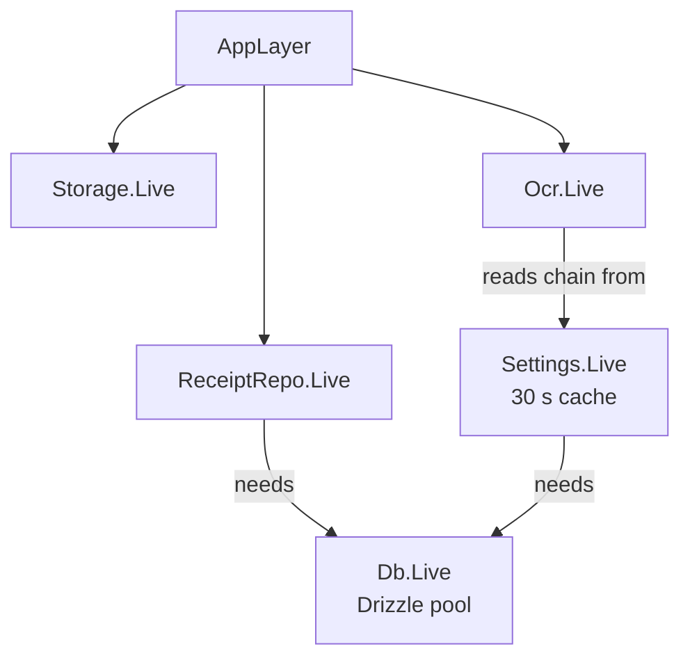
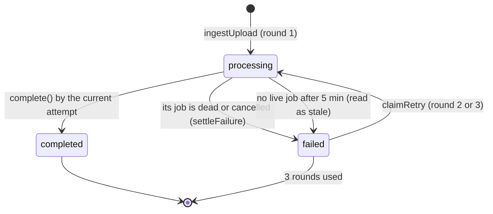

# packages/core

The backend workflow, written as [Effect](https://effect.website) services: receipt ingestion and extraction, the
model chain, quota, the usage ledger, runtime settings, workspace resolution and admin writes. The web app runs these
programs; a future worker would run the same ones.

## Contents

- [Effect in two minutes](#effect-in-two-minutes)
- [Services and layers](#services-and-layers)
- [Public API](#public-api)
- [Key modules](#key-modules)
- [Data flow](#data-flow)
- [Design principles and invariants](#design-principles-and-invariants)
- [How to test it](#how-to-test-it)
- [Common changes](#common-changes)

## Effect in two minutes

If you have not used Effect: an `Effect<A, E, R>` is a description of work that succeeds with `A`, fails with a typed
error `E`, and needs services `R` to run. Nothing happens until a runtime runs it.

- **Services** are declared with `Context.Tag` (for example `ReceiptRepo`) and provided by a **Layer**
  (`ReceiptRepo.Live`).
- **Errors** are classes made with `Data.TaggedError`, so a caller can switch on `error._tag`.
- `Effect.gen(function* () { ... })` reads like async code: `yield*` an effect to get its value.

The web app builds one runtime from `AppLayer` ([`lib/runtime.ts`](../../apps/web/lib/runtime.ts)) and runs programs
with `runtime.runPromise` or `runPromiseExit`.

## Services and layers

| Service                                                                  | Provides                                                                                       |
| ------------------------------------------------------------------------ | ---------------------------------------------------------------------------------------------- |
| `Db` ([`services.ts`](../../packages/core/src/services.ts))              | The Drizzle client and `use(query)`, which turns a rejected query into `DbError`               |
| `Storage` ([`services.ts`](../../packages/core/src/services.ts))         | `put`, `get`, `remove`, `signedUrl` over [packages/storage](storage.md). Reads `S3_*` per call |
| `ReceiptRepo` ([`repository.ts`](../../packages/core/src/repository.ts)) | Every receipt query and write, all scoped to a workspace                                       |
| `Ocr` ([`ocr.ts`](../../packages/core/src/ocr.ts))                       | `extract(file)` runs the chain; `ready` fails with `NotConfigured` when no model can run       |
| `Settings` ([`settings.ts`](../../packages/core/src/settings.ts))        | Plan limits and the OCR chain from `app_settings`, cached 30 s; `save` with audit              |

`AppLayer` in [`index.ts`](../../packages/core/src/index.ts) wires them: `Settings` and `Db` are provided once and
shared, so there is one pool and one settings cache per process.

## Public API

Everything is exported from `@receipt-ocr/core`. Two import-free entry points exist for client components:
`@receipt-ocr/core/plans` (plan defaults) and `@receipt-ocr/core/upload-limits` (size and type limits).

| Area        | Exports                                                                                                                     |
| ----------- | --------------------------------------------------------------------------------------------------------------------------- |
| Pipeline    | `ingestUpload`, `runExtraction`, `settleFailure`, `claimRetry`, `deleteReceipt`, `purgeReceiptFiles`, `getReceiptWithImage` |
| Jobs        | `JobQueue`, `enqueueJob`, `tick`, `cancelJob`, `JOB_REGISTRY`, `receiptExtract`, `backoffMs`, `liveReceiptJob`, job errors  |
| Quota       | `userPlan`, `quotaLimits`, `checkQuota`, `enforceQuota`, `quotaGate`, `decideQuota`, `quotaMessage`                         |
| Usage       | `countUsage`, `lockUserQuota`, `usageByDay`, `usageByModel`, `usageByWorkspace`, `receiptCalls`, `receiptsReadSince`        |
| Workspace   | `resolveScope`, `ensurePersonalWorkspace`, `hitRateLimit`, `parseWorkspaceName`, `personalWorkspaceName`                    |
| Admin       | `deleteWorkspace`, `prepareUserDeletion`, `setMemberRole`, `removeMember`, `cancelInvitation`, `setUserPlan`, `recordAudit` |
| Admin reads | `adminOverview`, `listUsers`, `userDetail`, `listWorkspaces`, `workspaceDetail`, `listAudit`, `findUser`, `findWorkspace`   |
| Settings    | `Settings`, `providerAvailability`, `planTableSchema`, `ocrRoutingSchema`                                                   |
| Errors      | `InvalidInput`, `NotFound`, `Conflict`, `QuotaExceeded`, `NotConfigured`, `DbError`, `StorageError`, `OcrError`             |

## Key modules

| File                                                                                           | What it holds                                                                                             |
| ---------------------------------------------------------------------------------------------- | --------------------------------------------------------------------------------------------------------- |
| [`pipeline.ts`](../../packages/core/src/pipeline.ts)                                           | The two stages (ingest, extract), retry claim, delete, and building `ocr_calls` rows                      |
| [`repository.ts`](../../packages/core/src/repository.ts)                                       | `ReceiptRepo`: scoped reads, insert under quota, complete and fail under the attempt guard, staleness     |
| [`jobs/`](../../packages/core/src/jobs)                                                        | The job queue: store and claim SQL, `tick`, the `receipt.extract` kind ([Background jobs](flows/jobs.md)) |
| [`ocr.ts`](../../packages/core/src/ocr.ts)                                                     | `runChain`: shared deadline, per-step timeout, which failures fall back                                   |
| [`quota.ts`](../../packages/core/src/quota.ts)                                                 | Turning usage counts into a verdict and a user-facing message                                             |
| [`usage.ts`](../../packages/core/src/usage.ts)                                                 | The ledger's counting rules in SQL, the per-user advisory lock, rollups for usage pages                   |
| [`settings.ts`](../../packages/core/src/settings.ts)                                           | Zod schemas for plan limits and the chain, the cached loader, `save`                                      |
| [`plans.ts`](../../packages/core/src/plans.ts)                                                 | Plan defaults (Free 20 a day, Pro 1,000), `FREE_FAILED_ROUNDS = 5`                                        |
| [`files.ts`](../../packages/core/src/files.ts)                                                 | Magic-byte sniffing and upload validation                                                                 |
| [`workspace.ts`](../../packages/core/src/workspace.ts)                                         | Scope resolution, personal workspace creation, a fixed-window rate limiter                                |
| [`admin.ts`](../../packages/core/src/admin.ts), [`audit.ts`](../../packages/core/src/audit.ts) | Admin writes with their audit row in one transaction                                                      |
| [`admin-queries.ts`](../../packages/core/src/admin-queries.ts)                                 | Reads for the admin pages                                                                                 |
| [`config.ts`](../../packages/core/src/config.ts)                                               | `DATABASE_URL`, `S3_*`, `OCR_DAILY_CAP` via Effect `Config`                                               |

## Data flow

The receipt lifecycle, as `receipts.status` sees it. A row is inserted straight into `processing`; `uploaded` exists
in the enum but the current code never writes it.

"Stale" is computed when reading, not written: a row still `processing` five minutes after `updated_at` with no live
job (none, or one long overdue, see [Background jobs](flows/jobs.md#orphaned-jobs)) is shown as `failed` with a "took
too long" message and can be retried (`STALE_AFTER_MS` in [`jobs/live.ts`](../../packages/core/src/jobs/live.ts)).
While its job is queued or running, a receipt reads as `processing` however long it waits.

The full sequences are in [Upload, extraction and result](flows/upload-and-extraction.md) and [Retry](flows/retry.md).

## Design principles and invariants

**Workspace scoping on every query.** `ReceiptRepo` builds every `where` from `inScope` (id and `organization_id`) or
`filterWhere` (always `organization_id`). Writes by users go through `writable`, which also requires
`user_id = caller` unless the caller's workspace role is `owner` or `admin` (`canManageAnyReceipt` splits on commas
and fails closed; roles are written exactly as `owner`, `admin` or `member` since `assertWorkspaceRole` guards every
write in Better Auth). A receipt whose uploader was
deleted (`user_id` null) can only be changed by an owner or admin. Non-UUID ids return "not found" before reaching
Postgres.

**Two stages, the second by id only.** `ingestUpload` validates, stores, inserts and enqueues the `receipt.extract`
job in the same transaction. `runExtraction` (one attempt) takes only a receipt id, scope and round and loads
everything else from the database and the bucket, so any runner of the [job queue](flows/jobs.md) can call it. It
records each attempt's calls and never marks the receipt failed; the job's final-failure hook does that through
`settleFailure`.

**The attempt guard.** `complete` and `fail` update only where `status = 'processing'` and `attempts` equals the round
that started the work (`currentAttempt`). A run that lost a race (the receipt was retried, deleted, or already
finished) matches no row and writes nothing to `receipts`.

**Quota ledger semantics.** In plain terms: each user may read a set number of receipts per UTC day and per minute,
and the count comes from a log of every attempt that is never edited or deleted. Usage is counted from `ocr_rounds` and `ocr_calls` ([`usage.ts`](../../packages/core/src/usage.ts)):

| Window                           | Counts                                                                                                                                                                                        |
| -------------------------------- | --------------------------------------------------------------------------------------------------------------------------------------------------------------------------------------------- |
| A user's UTC day                 | Distinct receipts with a successful call today, plus rounds still in flight (their job is live, or no calls yet and under 5 minutes old), plus finished failed paid rounds beyond the first 5 |
| A user's last 60 seconds         | Every round started, failed or not                                                                                                                                                            |
| Global UTC day (`OCR_DAILY_CAP`) | Every round started by anyone, plus every automatic retry attempt that called a model; only counted when the cap is set                                                                       |

- A round row is written when the upload or retry is accepted, in the same transaction as the quota check, under
  `pg_advisory_xact_lock(7301, hashtext(user_id))`. Parallel uploads by one user queue on that lock, so a burst can't
  all pass the check.
- Call rows are written when each attempt ends (with `complete` on success, on their own after a failed attempt),
  priced at write time and never recomputed. An attempt that failed before any model ran gets one row with a null
  model and zero cost.
- Automatic retries reuse their round: they add `ocr_calls` rows (`job_attempt` 2 to 4), never `ocr_rounds` rows.
- Deleting a receipt does not delete ledger rows (no foreign key on `receipt_id`). Deleting a workspace or user sets
  their ids to null. Nothing refunds quota.
- The route also runs a read-only check (`enforceQuota`) before storing the file, to refuse early. The check under the
  lock is the one that counts.
- Quota is per user, even though receipts belong to a workspace.

**Chain and fallback.** `runChain` in [`ocr.ts`](../../packages/core/src/ocr.ts):

- The active chain is the saved chain filtered to steps that are enabled and whose provider has a key.
- All steps share a 50 s deadline (`OCR_DEADLINE_MS`), well under the receipt job's 90 s lease. Each step gets
  `min(step.timeoutMs, time left)`, and no step starts with under 2 s left.
- Inside one step the AI SDK retries once (`STEP_MAX_RETRIES = 1`).
- `timeout`, `rate-limited`, `provider-error` and `not-configured` fall through to the next model. `invalid-output`
  and `bad-image` stop the chain: the image is usually the problem, and another model would cost another call.
- Every attempt, successful or not, is returned with its kind, latency and usage, and becomes an `ocr_calls` row.

**Settings fail closed.** A missing, invalid or unreadable `app_settings` row falls back to code defaults, never to
"unlimited". See [Settings cache](flows/settings-cache.md).

**Admin writes are atomic with their audit row.** `transact` runs the change and `insertAudit` in one transaction;
throwing `Conflict`, `NotFound` or `InvalidInput` inside rolls it back. Member changes lock all member rows of the
workspace (`FOR UPDATE`) so the "at least one owner" check can't race another admin.

**Files after rows.** Deletes remove database rows first and stored objects afterwards. A failed object delete is
logged with its key (`receipt.object_delete_failed`, `admin.purge_failed`) rather than failing the request; an
orphaned object costs storage only. On ingest, if the insert fails the just-stored object is removed.

## How to test it

| What                                      | Command                                                                                               |
| ----------------------------------------- | ----------------------------------------------------------------------------------------------------- |
| Unit tests (`*.test.ts`, mocked services) | `bun run test`                                                                                        |
| Against Postgres and RustFS               | `bun run --filter @receipt-ocr/core test:int` with `DATABASE_URL` and `S3_*` set to a throwaway stack |

Unit tests provide fake layers (for example [`pipeline.test.ts`](../../packages/core/src/pipeline.test.ts),
[`ocr.test.ts`](../../packages/core/src/ocr.test.ts) with a test clock). The integration suites
[`receipts.int.test.ts`](../../packages/core/src/receipts.int.test.ts) and
[`admin.int.test.ts`](../../packages/core/src/admin.int.test.ts) run real transactions, locks and cascades; CI runs
them in the e2e job.

## Common changes

### Add a receipt query

Add a method to the `ReceiptRepo` tag type and its `Live` implementation. Start the `where` from `inScope`,
`filterWhere` or `eq(receipts.organizationId, scope.organizationId)`. For a user-initiated write, use `writable`.

### Change a quota rule

Change `usedSinceSql` or `countUsage` in [`usage.ts`](../../packages/core/src/usage.ts) and the decision in
`decideQuota` ([`quota.ts`](../../packages/core/src/quota.ts)). Keep counting from the ledger, not `receipts`. Update
[`quota.test.ts`](../../packages/core/src/quota.test.ts), the receipts integration test, and the table above.

### Add a failure kind that should fall back

Add it to `OCR_FAILURE_KINDS` in [packages/ai](ai.md), to `OCR_CALL_STATUSES` in packages/db (a migration, because of
the `CHECK` constraint), and to `FALLBACK_KINDS` in [`ocr.ts`](../../packages/core/src/ocr.ts) if another model is
worth trying.

### Add an admin write

See [Admin actions](flows/admin-actions.md#add-an-admin-action).
