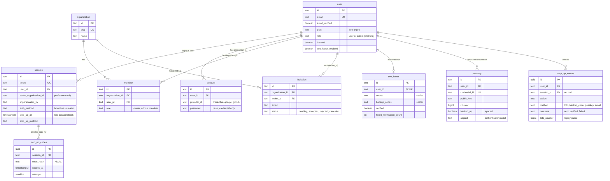
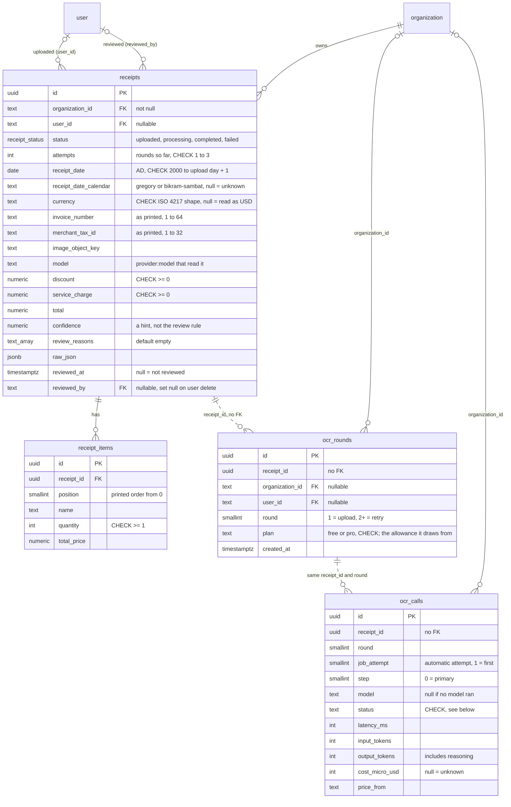
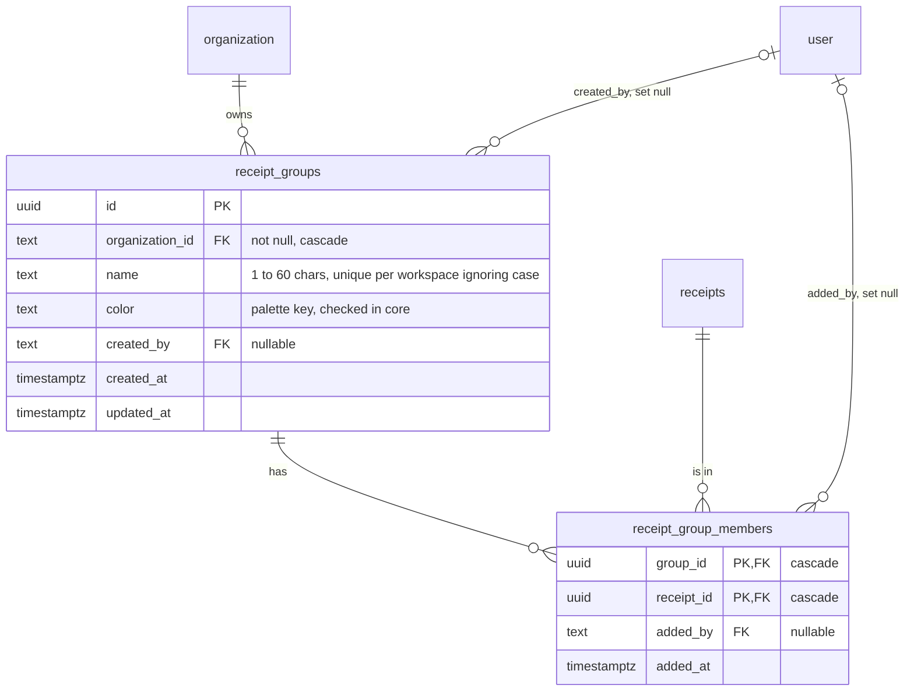
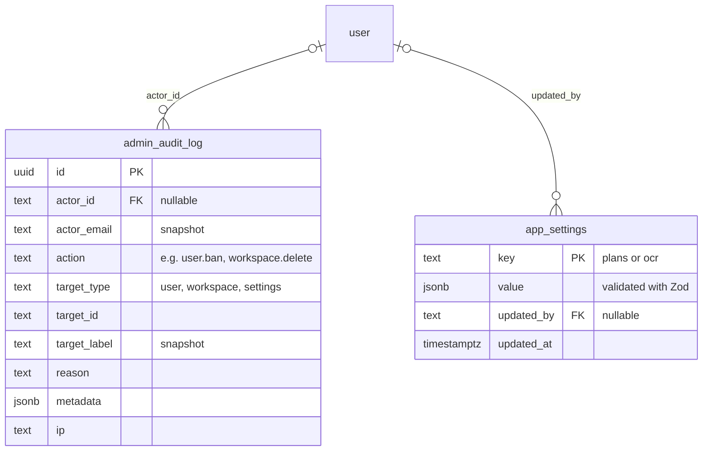
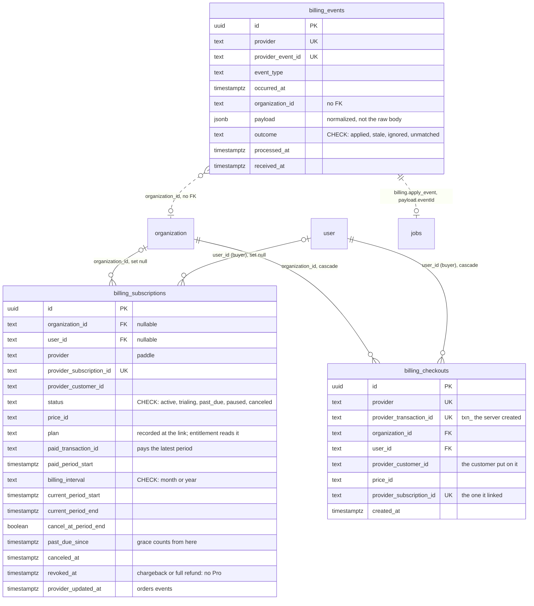
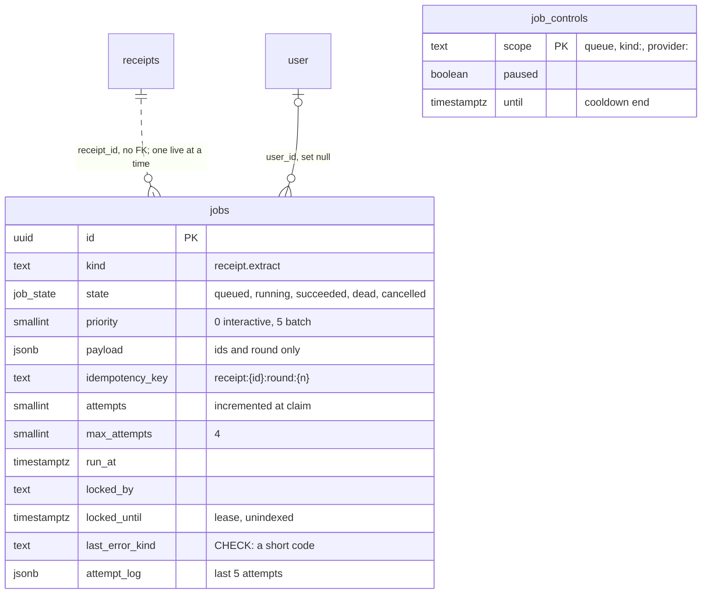
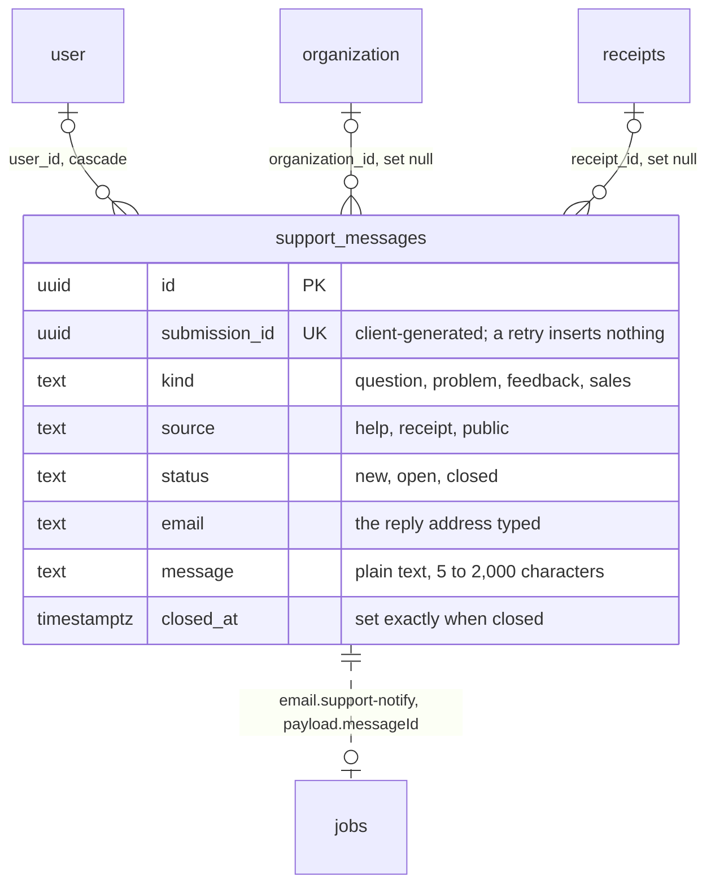

# Data model

Every table lives in one Postgres database, defined in [packages/db](db.md)
([`index.ts`](../../packages/db/src/index.ts), [`auth-schema.ts`](../../packages/db/src/auth-schema.ts)). The diagrams
below are split by concern; each shows only the columns that matter for relationships and rules. The schema files are
the full reference.

## Contents

- [Users, sessions and workspaces](#users-sessions-and-workspaces)
- [Receipts and the usage ledger](#receipts-and-the-usage-ledger)
- [Receipt groups](#receipt-groups)
- [Admin tables](#admin-tables)
- [Billing](#billing)
- [Background jobs](#background-jobs)
- [Support messages](#support-messages)
- [What happens on delete](#what-happens-on-delete)
- [Unique indexes and checks](#unique-indexes-and-checks)
- [Other indexes](#other-indexes)

## Users, sessions and workspaces

These are Better Auth's tables (core, organization plugin, admin plugin). A workspace is an `organization`.

`two_factor` is the twoFactor plugin's table: the secret and backup codes are sealed with the auth secret
(XChaCha20-Poly1305, versioned with `BETTER_AUTH_SECRETS`), never hashed, because the plugin must read them back.
`step_up_events` is the "confirm it's you" audit trail and also feeds the lockout and TOTP replay checks; it keeps rows
when the session ends (`session_id` set null) and goes with the user. It holds the client IP of each check. There is
no time-based pruning yet (proposed: 90 days, a follow-up in STATUS). `step_up_codes` holds only an HMAC of each
emailed code.

Also owned by Better Auth, with no foreign keys: `verification` (hashed email-verification and reset tokens) and
`rate_limit` (fixed-window counters for auth endpoints, also used by the app's own limiters through `hitRateLimit`).

Notes:

- `session.active_organization_id` has no foreign key. The app treats it as a preference and resolves the real
  workspace through `member` on every request ([`resolveScope`](../../packages/core/src/workspace.ts)).
- `account.access_token`, `refresh_token` and `id_token` are encrypted with the auth secret
  (`encryptOAuthTokens` in [`lib/auth.ts`](../../apps/web/lib/auth.ts)).
- `user.plan` is never accepted from the client (`input: false`); only an admin action changes it. Set to `pro` it is a comp: the workspaces that user owns count as Pro (see [Billing](flows/billing.md#plans-are-per-workspace)).

## Receipts and the usage ledger

`ocr_rounds` and `ocr_calls` also have a nullable `user_id` foreign key to `user` (left out of the diagram for
readability). Dashed lines are links by value, not foreign keys.

How the ledger is used:

- One `ocr_rounds` row per accepted upload or retry, written under the quota check and the per-user lock.
- One `ocr_calls` row per model call when the round ends, or a single row with a null model when it failed before
  any model ran (no stored file, nothing configured). A step skipped before any request (`unsupported-file`, e.g.
  HEIC on Claude) also has a null model, with its provider and step kept: `model is not null` means "a model was
  called" to quota, the global cap, latency and cost rollups, and a skip costs nothing.
- `ocr_rounds.plan` is the plan of the workspace when the round was accepted (`free` by default). Free usage counts a
  user's `free` rounds across all workspaces; Pro usage counts a workspace's `pro` rounds. See
  [Plans and limits](flows/billing.md#plans-and-limits).
- Quota, the global daily cap and cost rollups read only these two tables. See
  [core: quota ledger semantics](core.md#design-principles-and-invariants).
- Neither table has free-text columns, so neither can hold receipt contents or provider messages.

**Dates.** `receipts.receipt_date` is a plain `date` in the AD calendar, the only stored date: sorting, filters, the
dashboard and the CSV's `receipt_date` all use it. `receipt_date_calendar` records the calendar the receipt printed
(`gregory`, or `bikram-sambat` when a BS date was printed, alone or beside an AD one; Unicode `u-ca` identifiers).
Null means unknown (no date, or read before printed dates were kept) and reads as `gregory`. Bikram Sambat is never
stored: it is `adToBs(receipt_date)` from the vendored month table in `@receipt-ocr/calendar`, shown BS-first
("9 Shrawan 2080 · 25 Jul 2023") and exported as `receipt_date_bs` (`2080.04.09`) only for BS receipts. At
completion the date resolver (`resolveReceiptDate`) turns what was printed into that one day, bounded by the
2000-01-01 to upload day + 1 window the CHECK enforces
([research](../reviews/2026-11-12-dates-and-fields-research.md),
[decision table](../reviews/2026-11-12-extraction-review.md#decision-table-resolver-packagescore-pure)).

**Fields.** `invoice_number` (EN 16931 BT-1) and `merchant_tax_id` (BT-31) are kept as printed, not unique, and
never logged (a sole trader's PAN is personal data). `discount` (BT-107) and `service_charge` (BT-108) are positive
document-level amounts the totals check uses: `subtotal − discount + service_charge + tax + tip = total`.
`receipt_items.position` is the printed order; items are read `ORDER BY position, ctid`. Extraction v3 fills these;
before it, they stay null.

**Needs review** is `status = 'completed' AND review_reasons <> '{}' AND reviewed_at IS NULL` (History filter and
the Home count, and every warning badge). `review_reasons` holds the codes of the deterministic checks that failed,
decided in `packages/core/src/review-reasons.ts`: `reviewReasons()` at completion, `editedReasons()` on an edit. The
codes are `no_merchant`, `no_date`, `no_total`, `no_currency`, `totals_mismatch`, and the resolver's
`date_ambiguous`, `date_conflict` and `date_implausible`. The totals check is exact to the cent, except that a
whole-number total may be up to 0.99 off (bills rounded to the unit). An edit rechecks only the reasons that read a
changed field; a changed date or calendar drops the date reasons. `low_confidence` is set only by migration
`0003_receipt_fields`, on receipts below 0.9 confidence, and edits keep it; reviewing the receipt is what clears it
from Needs review. The model's `confidence` is a hint only. There is no CHECK on the values: readers show a generic
line for a code they don't know.

`receipts.reviewed_at` and `reviewed_by` record that someone who may edit the receipt confirmed it looks right
(`PATCH /api/receipts/[id]` with `{ reviewed }`, migration `0002_receipt_review`). Saving an edit to a completed
receipt sets them too, in the same update, so a correction counts as a review. A reviewed receipt leaves "Needs
review", its checks card shows as one "Reviewed by" line, and its line items lose their hard-to-read marks. Undo
clears the review; a new extraction (`complete`, after a retry) clears both columns.

Merchants group on a key that ignores case, whitespace and punctuation (`packages/core/src/merchant-key.ts`): the
Spending page's top merchants, and the receipt search, which matches that key as well as the plain text.

## Receipt groups

- A group is a named collection in one workspace ("Berlin trip", "Taxes 2026"); a receipt can be in several.
- `receipt_group_members` has no `organization_id`. Core only inserts rows it selects by joining `receipts` and
  `receipt_groups` on `organization_id`, so a receipt and a group from different workspaces can never be linked
  ([groups](core.md#receipt-groups)).
- Limits (constants in core, enforced under a per-workspace advisory lock): 100 groups per workspace, 20 groups per
  receipt.

## Admin tables

The `plans` value holds, per plan, `workspaces`, `receiptsPerDay`, `receiptsPerMonth` (null = none), `poolPerDay` (null
= none), `receiptsPerMinute` and `batchMax` (images in one
upload batch, 1 to 20 on save). `scope` (`user` or `workspace`) is also stored per plan but is not editable in the admin form. A row saved before `receiptsPerMonth`, `poolPerDay` or `scope` existed reads with that plan's default; a row saved before `batchMax` existed reads as 10; a stored value over 20 reads as 20, so
the other limits in the row still apply.

`admin_audit_log` stores the actor's email and the target's label as text, so an entry still reads after either is
deleted. `target_id` is not a foreign key for the same reason.

`user_credentials` (and `receipts.storage_source`) exist for a bring-your-own-key feature that is not built; nothing
reads or writes them.

## Billing

Written only by the `billing.apply_event` job (subscriptions), the webhook route (events) and `createCheckout`
(checkouts). All three tables have row-level security on and no policies, like every table. The flow is in [Billing](flows/billing.md).

- `billing_subscriptions` has one row per provider subscription. A workspace is Pro while it has an entitled row (see
  [entitlement](flows/billing.md#entitlement)). A workspace can have several rows after a cancel and a new subscribe.
  It holds ids, status and dates only: no card, address or tax data. A row grants Pro only while its `plan` (recorded
  when it links at a Pro price) is `pro` and `revoked_at` is null. `paid_transaction_id` is the transaction paying for
  the latest period: only a full refund of that one revokes.
- `billing_events` is the webhook log. The unique index on `(provider, provider_event_id)` makes a redelivery a no-op.
  `payload` is the provider-neutral event the job applies; the raw body is never stored. `outcome` and `processed_at`
  are null until the job has run. `organization_id` has no foreign key, so the log outlives a deleted workspace.
- `billing_checkouts` holds every checkout transaction the server created. A new subscription links only to one of
  these, for the same workspace, buyer and customer, and the portal opens only for a customer recorded here for the
  buyer. The rows go with their workspace or buyer.
- An admin comp is not a row here: it is `user.plan = 'pro'`.

## Background jobs

- `jobs` has storage parameters set by hand at the end of the baseline migration: `fillfactor = 80` (room for HOT heartbeats) and aggressive
  per-table autovacuum.
- `organization_id` and `receipt_id` are plain values: the job record outlives a deleted receipt or workspace.
  `user_id` is set to null when the account is deleted; the payload keeps the id until a retention purge (planned,
  Track D of the [jobs plan](../plans/2026-11-06-jobs-queue.md)).
- How the queue uses them: [Background jobs](flows/jobs.md).

## Support messages

- Written by `submitSupportMessage` in [packages/core](core.md) (`support.ts`) from `/api/contact`. The row and its
  `email.support-notify` job commit together; the job carries only the row id, so the text never sits in `jobs`.
- `receipt_id` is stored only when the receipt is in the sender's active workspace, so a message can't point support
  at another workspace's receipt.
- A signed-in sender may store 10 messages in 24 hours (`SUPPORT_USER_CAP`), counted on `user_id` inside the
  insert's transaction; over it the insert rolls back.
- `message` may quote receipt contents: it is never logged or sent to analytics. Telemetry gets `kind`,
  `support_source`, `has_receipt` and `message_length`.
- Account deletion: `user_id` cascades, and `prepareUserDeletion` also deletes rows whose `email` matches the
  account's address, ignoring case (signed-out messages). The copy in the support mailbox is outside both.
- Triaged in `/admin/support`: `setSupportStatus` moves `new`, `open` and `closed` with an audit row, setting
  `closed_at` on close and clearing it on reopen.
- Retention: the daily `maintenance.purge` job deletes a message 12 months after `closed_at`, or 12 months after
  `created_at` if it is never closed (`SUPPORT_RETENTION_MONTHS`); the privacy page states the period.
- No retention purge yet: closed messages are to be deleted 12 months after `closed_at` by a `maintenance.purge` job.

## What happens on delete

| When this is deleted | Rows that cascade (are deleted)                                                                                                                                                 | Rows that stay with the id set to null                                                                                                                                                                                                                       |
| -------------------- | ------------------------------------------------------------------------------------------------------------------------------------------------------------------------------- | ------------------------------------------------------------------------------------------------------------------------------------------------------------------------------------------------------------------------------------------------------------ |
| A user               | `session`, `account`, `member`, `invitation` they sent, `user_credentials`, `two_factor`, `passkey`, `step_up_events`, `step_up_codes`, `billing_checkouts`, `support_messages` | `receipts.user_id`, `receipts.reviewed_by`, `ocr_rounds.user_id`, `ocr_calls.user_id`, `jobs.user_id`, `receipt_groups.created_by`, `receipt_group_members.added_by`, `admin_audit_log.actor_id`, `app_settings.updated_by`, `billing_subscriptions.user_id` |
| A workspace          | `member`, `invitation`, `receipts` (and through them `receipt_items`), `receipt_groups`, `billing_checkouts`                                                                    | `ocr_rounds.organization_id`, `ocr_calls.organization_id`, `billing_subscriptions.organization_id`, `support_messages.organization_id`                                                                                                                       |
| A receipt            | `receipt_items`, its `receipt_group_members` rows                                                                                                                               | `support_messages.receipt_id`; the ledger has no foreign key to `receipts` and keeps its rows                                                                                                                                                                |

Two rules sit on top of the cascades, in [packages/core](core.md):

- Before a user is deleted, `prepareUserDeletion` deletes workspaces where they are the only member, and refuses if
  they are the only owner of a workspace that has other members. It also deletes the support messages sent from the
  account's address while signed out.
- Stored files are deleted from the bucket after their rows are gone (`purgeReceiptFiles`, `deleteWorkspace`). The
  database cascade alone would leave them behind.

## Unique indexes and checks

| Table                   | Constraint                                                                                                                                                                                    | Why                                                                                                                                                                 |
| ----------------------- | --------------------------------------------------------------------------------------------------------------------------------------------------------------------------------------------- | ------------------------------------------------------------------------------------------------------------------------------------------------------------------- |
| `user`                  | `user_email_idx` on `email`                                                                                                                                                                   | One account per address                                                                                                                                             |
| `session`               | `session_token_idx` on `token`                                                                                                                                                                | Session lookup                                                                                                                                                      |
| `organization`          | `organization_slug_idx` on `slug`                                                                                                                                                             | Personal workspaces use the user id as slug, with a random suffix on collision                                                                                      |
| `member`                | `member_org_user_idx` on `(organization_id, user_id)`                                                                                                                                         | One membership per user per workspace                                                                                                                               |
| `two_factor`            | `two_factor_user_id_idx` on `user_id`                                                                                                                                                         | One authenticator per user                                                                                                                                          |
| `passkey`               | `passkey_credential_id_idx` on `credential_id`                                                                                                                                                | A WebAuthn credential belongs to one account                                                                                                                        |
| `step_up_events`        | `method` and `outcome` checks                                                                                                                                                                 | Only the known methods and `sent` / `verified` / `failed`                                                                                                           |
| `ocr_rounds`            | `ocr_rounds_receipt_round_idx` on `(receipt_id, round)`                                                                                                                                       | A round is recorded once                                                                                                                                            |
| `ocr_rounds`            | `ocr_rounds_plan_check`: `plan in ('free', 'pro')`                                                                                                                                            | Only known plans; `plan` defaults to `free` (migration `0001_billing`)                                                                                              |
| `billing_subscriptions` | `billing_subscriptions_provider_id_idx` on `(provider, provider_subscription_id)`                                                                                                             | One row per provider subscription; the apply job finds it by this key                                                                                               |
| `billing_subscriptions` | `billing_subscriptions_status_check`, `billing_subscriptions_interval_check`                                                                                                                  | Only the five stored statuses; interval `month` or `year` or null                                                                                                   |
| `billing_checkouts`     | `billing_checkouts_provider_transaction_idx` on `(provider, provider_transaction_id)`                                                                                                         | One row per checkout transaction; the apply job matches a new subscription's transaction by this key                                                                |
| `billing_checkouts`     | `billing_checkouts_provider_subscription_idx` on `(provider, provider_subscription_id)`                                                                                                       | A checkout links at most one subscription                                                                                                                           |
| `billing_events`        | `billing_events_provider_event_idx` on `(provider, provider_event_id)`                                                                                                                        | A webhook delivered twice is stored once                                                                                                                            |
| `billing_events`        | `billing_events_outcome_check`                                                                                                                                                                | Only `applied`, `stale`, `ignored`, `unmatched`, or null before the job runs                                                                                        |
| `ocr_calls`             | `ocr_calls_receipt_round_attempt_step_idx` on `(receipt_id, round, job_attempt, step)`                                                                                                        | An attempt's calls written twice (a lost commit acknowledgement, then the failure path) are billed once (`onConflictDoNothing`); each automatic retry keeps its own |
| `jobs`                  | `jobs_idempotency_idx` on `idempotency_key`, where queued or running                                                                                                                          | A replayed upload or double-clicked retry enqueues nothing                                                                                                          |
| `jobs`                  | `jobs_receipt_live_idx` on `receipt_id`, where queued or running and `kind like 'receipt.%'`                                                                                                  | At most one live job per receipt; also serves every live-job lookup by receipt                                                                                      |
| `jobs`                  | `jobs_last_error_kind_check`: `~ '^[a-z0-9.-]{1,40}$'`                                                                                                                                        | Error codes only, never a message that could hold receipt contents                                                                                                  |
| `ocr_calls`             | `ocr_calls_status_check`: `status in (...)`                                                                                                                                                   | Only `ok`, the eight AI failure kinds and `storage-error`                                                                                                           |
| `receipts`              | `receipts_receipt_date_check`: from `2000-01-01` to `(created_at at time zone 'UTC')::date + 1`                                                                                               | No misread or Bikram Sambat year stored as AD; the dashboard's `created_at` scan bound relies on the upper limit                                                    |
| `receipts`              | `receipts_currency_check`: `~ '^[A-Z]{3}$'`                                                                                                                                                   | One spelling per currency, so totals group without normalising per row                                                                                              |
| `receipts`              | `receipts_attempts_check`: `between 1 and 3`                                                                                                                                                  | The retry cap, `MAX_EXTRACTION_ATTEMPTS` in `packages/db`                                                                                                           |
| `receipts`              | `receipts_receipt_date_calendar_check`: `in ('gregory', 'bikram-sambat')`                                                                                                                     | One spelling per calendar. Added `NOT VALID` in `0003`; the next migration validates it, as it does each check below                                                |
| `receipts`              | `receipts_invoice_number_check` (1 to 64), `receipts_merchant_tax_id_check` (1 to 32)                                                                                                         | No empty strings (null means not printed) and nothing past what the field asks for                                                                                  |
| `receipts`              | `receipts_discount_check`, `receipts_service_charge_check`: `>= 0`                                                                                                                            | One sign convention: both are amounts, and the totals check subtracts or adds them                                                                                  |
| `receipt_items`         | `receipt_items_quantity_check`: `>= 1`                                                                                                                                                        | Core rounds a weight or a 0 up to 1, and reads one over 1,000,000 as 1                                                                                              |
| `receipt_items`         | `receipt_items_position_check`: `>= 0`                                                                                                                                                        | Printed order from 0                                                                                                                                                |
| `receipt_groups`        | `receipt_groups_org_name_idx` on `(organization_id, lower(name))`                                                                                                                             | Group names are unique per workspace, ignoring case                                                                                                                 |
| `receipt_group_members` | Primary key on `(group_id, receipt_id)`                                                                                                                                                       | A receipt is in a group once                                                                                                                                        |
| `app_settings`          | Primary key on `key`                                                                                                                                                                          | One row per setting, upserted on save                                                                                                                               |
| `support_messages`      | `support_messages_submission_idx` on `submission_id`; checks on `kind`, `source`, `status`, the lengths of `name`, `email` and `message`, and `(status = 'closed') = (closed_at is not null)` | A double tap or retried request stores one message; only known values (migration `0006_support_messages`)                                                           |

## Other indexes

| Index                                                                                                                                                                                                                                                    | Serves                                                                                                                                                      |
| -------------------------------------------------------------------------------------------------------------------------------------------------------------------------------------------------------------------------------------------------------- | ----------------------------------------------------------------------------------------------------------------------------------------------------------- |
| `receipts_org_created_at_idx`                                                                                                                                                                                                                            | History, newest first, per workspace; the dashboard's scan                                                                                                  |
| `receipts_org_receipt_date_idx` (`organization_id, receipt_date`)                                                                                                                                                                                        | History's date filters                                                                                                                                      |
| `receipts_user_created_at_idx`                                                                                                                                                                                                                           | A user's uploads, the set-null on account delete                                                                                                            |
| `receipts_created_at_idx`                                                                                                                                                                                                                                | Admin upload charts and counts across workspaces                                                                                                            |
| `receipts_reviewed_by_idx` (`reviewed_by` where not null)                                                                                                                                                                                                | The set-null on account delete; partial, since most receipts are never reviewed                                                                             |
| `receipt_items_receipt_id_idx`                                                                                                                                                                                                                           | Loading items, cascade delete                                                                                                                               |
| `ocr_rounds_user_created_at_idx`                                                                                                                                                                                                                         | Per-user quota windows                                                                                                                                      |
| `ocr_rounds_org_created_at_idx` (`organization_id, created_at`)                                                                                                                                                                                          | A Pro workspace's day and month counts; also the set-null when a workspace is deleted (replaces `ocr_rounds_organization_id_idx`, migration `0001_billing`) |
| `ocr_rounds_created_at_idx`                                                                                                                                                                                                                              | Global daily cap                                                                                                                                            |
| `ocr_calls_user_id_idx`, `jobs_user_id_idx`                                                                                                                                                                                                              | The set-null when an account is deleted                                                                                                                     |
| `billing_checkouts_user_idx` (`user_id, created_at`), `billing_checkouts_org_idx`                                                                                                                                                                        | A buyer's last customer and the portal check; the cascades on account and workspace delete                                                                  |
| `billing_subscriptions_org_idx`, `billing_events_org_idx` (`organization_id, received_at`)                                                                                                                                                               | A workspace's subscriptions and events; the set-null on workspace delete                                                                                    |
| `invitation_inviter_id_idx`, `admin_audit_log_actor_id_idx`                                                                                                                                                                                              | The cascade or set-null when a user is deleted                                                                                                              |
| `ocr_calls_org_created_at_idx`                                                                                                                                                                                                                           | Workspace usage rollups                                                                                                                                     |
| `ocr_calls_created_at_idx`                                                                                                                                                                                                                               | Platform-wide usage rollups, retry attempts for the global cap                                                                                              |
| `jobs_runnable_idx` (`priority, run_at` where queued)                                                                                                                                                                                                    | The claim                                                                                                                                                   |
| `jobs_running_idx` (`user_id` where running)                                                                                                                                                                                                             | Per-user running cap, reaper                                                                                                                                |
| `jobs_state_finished_idx`, `jobs_org_created_idx`                                                                                                                                                                                                        | Admin lists and retention (planned)                                                                                                                         |
| `receipt_group_members_receipt_id_idx`                                                                                                                                                                                                                   | Groups of a receipt, the History group filter, cascade on receipt delete                                                                                    |
| `admin_audit_log_created_at_idx`, `admin_audit_log_target_idx`                                                                                                                                                                                           | Audit log, newest first and per target                                                                                                                      |
| `support_messages_status_created_idx` (`status, created_at desc`), `support_messages_user_created_idx` (`user_id, created_at` where not null), `support_messages_email_idx` (`lower(email)`), `support_messages_org_idx`, `support_messages_receipt_idx` | The admin list by status, the per-user cap and the cascade, deletion by address, the set-nulls on workspace and receipt delete                              |
