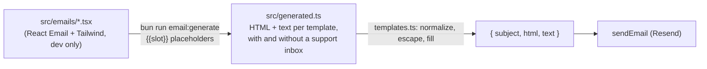

# packages/email

Sends transactional mail through [Resend](https://resend.com) and builds the messages. The templates are written with
[React Email](https://react.email) but rendered at build time: production only fills slots in prerendered HTML and
text, with no React Email, Tailwind or React render in the server bundle. Sending never throws: the caller decides
whether an undelivered message is an error.

## Public API

| Export (from [`src/index.ts`](../../packages/email/src/index.ts) and [`src/templates.ts`](../../packages/email/src/templates.ts))                                                   | Does                                                                                                               |
| ----------------------------------------------------------------------------------------------------------------------------------------------------------------------------------- | ------------------------------------------------------------------------------------------------------------------ |
| `sendEmail(config, { to, subject, html, text, replyTo? })` (`config.replyTo`, set from `SUPPORT_EMAIL`, is the default Reply-To)                                                    | Returns `{ delivered: true, id }` or `{ delivered: false, reason: "not_configured" or "failed" }`                  |
| `verificationEmail(ctx, { url, expiresInSeconds })`                                                                                                                                 | `{ subject, html, text }` for "confirm your email"                                                                 |
| `passwordResetEmail(ctx, { url, expiresInSeconds })`                                                                                                                                | Same for a reset link                                                                                              |
| `invitationEmail(ctx, { organizationName, inviterEmail, url, expiresInSeconds })`                                                                                                   | Same for a workspace invitation                                                                                    |
| `deleteAccountEmail(ctx, { url, expiresInSeconds, resetUrl })`                                                                                                                      | The account-deletion confirmation link (single use; red button)                                                    |
| `passwordChangedEmail(ctx, { resetUrl })`                                                                                                                                           | "Your password was changed", with the reset page and support contact                                               |
| `emailChangeEmail(ctx, { currentEmail, newEmail, url, resetUrl, expiresInSeconds })`                                                                                                | To the current address: approve a change from `currentEmail` to `newEmail` (`url` is Better Auth's approval link)  |
| `stepUpCodeEmail(ctx, { code, expiresInSeconds })`                                                                                                                                  | The 6-digit "Confirm it's you" code for an account with no second factor (never in the subject)                    |
| `twoFactorEnabledEmail`, `twoFactorDisabledEmail` (`byAdmin` picks the reset copy), `backupCodesRegeneratedEmail`, `passkeyAddedEmail`, `passkeyRemovedEmail` `(ctx, { resetUrl })` | Factor-change notices, with the reset page and support contact                                                     |
| `passwordSetEmail(ctx, { resetUrl })`, `signInConnectedEmail` / `signInDisconnectedEmail` `(ctx, { resetUrl, provider: "Google" or "GitHub" })`                                     | Sign-in method notices: a first password set, a provider connected or disconnected                                 |
| `supportMessageEmail(ctx, { senderName, from, topicLabel, message })`                                                                                                               | A contact-form message for the support inbox                                                                       |
| `contactReplyEmail(ctx, { name, topicPhrase })`, `greetingName(raw)`                                                                                                                | The auto-reply to a contact-form sender: first name (cleaned; "there" if link-like or empty) and topic, no message |
| `welcomeEmail(ctx, { receiptsPerDay })`                                                                                                                                             | The one-time welcome: three steps, the plan's daily limit, a "Scan a receipt" button to `/app/upload`              |
| `testEmail(ctx)`                                                                                                                                                                    | The admin console's delivery check                                                                                 |
| `escapeHtml(value)`, `absoluteUrl(value)`                                                                                                                                           | The escaping and link check the templates use                                                                      |

All template functions are synchronous. `ctx` is an `EmailContext`: `{ appUrl, supportEmail? }`. The package reads no
environment; the web app builds it once as `emailContext` in [`lib/env.ts`](../../apps/web/lib/env.ts) from
`BETTER_AUTH_URL` and `SUPPORT_EMAIL`. Links, the logo (`<appUrl>/brand/email-logo.png`) and the privacy link all hang
off `appUrl`, so a preview deployment's mail points at the preview. Without `supportEmail` the "Questions?" and
"contact us" lines point at the in-app support button instead of a mailbox.

## Who sends what

| Message          | Sent from                                                                                                                                                                                                                                | When undelivered in production                                          |
| ---------------- | ---------------------------------------------------------------------------------------------------------------------------------------------------------------------------------------------------------------------------------------- | ----------------------------------------------------------------------- |
| Verification     | Better Auth `sendVerificationEmail` in [`lib/auth.ts`](../../apps/web/lib/auth.ts)                                                                                                                                                       | The auth request fails                                                  |
| Welcome          | `email.welcome` job ([`jobs/kinds/welcome-email.ts`](../../packages/core/src/jobs/kinds/welcome-email.ts)), queued once per new account; sent through `WelcomeMailer` in [`lib/welcome-mailer.ts`](../../apps/web/lib/welcome-mailer.ts) | Retried by the queue (5 attempts), then dead; the account is unaffected |
| Password reset   | Better Auth `sendResetPassword`                                                                                                                                                                                                          | The auth request fails                                                  |
| Invitation       | Organization plugin `sendInvitationEmail`                                                                                                                                                                                                | The invite request fails                                                |
| Delete account   | Better Auth `sendDeleteAccountVerification`                                                                                                                                                                                              | Logged only (Better Auth 1.7.18 drops callback errors; see STATUS)      |
| Email change     | Better Auth `sendChangeEmailConfirmation`, to the current address                                                                                                                                                                        | Logged only (Better Auth 1.7.18 drops callback errors; see STATUS)      |
| Password changed | `onPasswordReset` and the `/change-password` after hook                                                                                                                                                                                  | Logged (`auth.notice_sent`); the change stands                          |
| Step-up code     | `sendStepUpCode` in [`lib/step-up.ts`](../../apps/web/lib/step-up.ts)                                                                                                                                                                    | The dialog says the email couldn't be sent                              |
| Factor notices   | [`lib/auth-two-factor.ts`](../../apps/web/lib/auth-two-factor.ts) hooks; admin Reset 2FA in `app/admin/actions.ts`                                                                                                                       | Logged; the change stands                                               |
| Support message  | [`api/contact/route.ts`](../../apps/web/app/api/contact/route.ts), to `SUPPORT_EMAIL`, reply-to the sender                                                                                                                               | The route returns `503`                                                 |
| Contact reply    | `email.contact-reply` job, queued by `/api/contact` after the support message (1 per address, 3 per IP a day); sent through `ContactReplyMailer` in [`lib/contact-reply-mailer.ts`](../../apps/web/lib/contact-reply-mailer.ts)          | Retried by the queue (3 attempts), then dead; the message still arrived |
| Test email       | Admin settings, [`lib/test-email.ts`](../../apps/web/lib/test-email.ts)                                                                                                                                                                  | The admin sees "failed"                                                 |

In `lib/auth.ts`, `deliver()` throws when a message is not delivered and `NODE_ENV` is production, so a user is never
told "check your inbox" for mail that was not sent. Link lifetimes are constants there (`VERIFY_LINK_SECONDS`, which
also signs the email-change approval link; `RESET_LINK_SECONDS`; `INVITATION_SECONDS`; `DELETE_TOKEN_SECONDS` in
`lib/step-up.ts`), passed both to Better Auth and to the templates, so the copy can't drift from the real expiry.

## How templates are built

- **Sources.** [`src/emails/templates.tsx`](../../packages/email/src/emails/templates.tsx) defines each message with
  [`layout.tsx`](../../packages/email/src/emails/layout.tsx) and [`theme.ts`](../../packages/email/src/emails/theme.ts).
  Every value arrives as a string.
- **Generate.** [`scripts/generate.ts`](../../packages/email/scripts/generate.ts) renders each template twice (with and
  without a support inbox), passing `{{name}}` placeholders, and writes
  [`src/generated.ts`](../../packages/email/src/generated.ts). It is committed, so builds (Vercel, Docker), typecheck
  and tests need no generation step and no React Email. `bun run email:check` (CI, "Lint, format, dependencies") fails
  when it is stale, and a unit test compares it with a fresh render too.
- **Slot placement is checked.** The generator fails if a placeholder is unknown, sits in a `<style>` block, or is
  free text inside an attribute. Only URL kinds may sit in an attribute, and only at the start of its value (or right
  after `mailto:`).
- **Runtime fill** ([`src/render.ts`](../../packages/email/src/render.ts)). Each slot has a kind: `url` and `origin`
  must be absolute http(s) (`absoluteUrl`), `email` must look like an address (safe after `mailto:`), `line` is
  collapsed to one line (`oneLine`), and `multiline` (the contact message) keeps line breaks and drops other control
  characters. Values are then HTML-escaped in the HTML part and placed as-is in the text part, in one pass, so a value
  containing `{{x}}` is never expanded.
- **Golden tests.** For every template and variant, `fill(prerendered)` equals a direct React render of the source with
  the same values.

## Message format

Every template uses one `Layout`, the shape well-branded transactional mail converges on (Linear, Vercel, Stripe,
Notion; React Email's [templates](https://react.email/templates)):

1. **Header:** the logo (`/brand/email-logo.png`, 32×32) and the `Receipt` + accent `OCR` wordmark as live text.
2. **One heading** (`h1`) that says what the mail is about.
3. **A short body**, one or two sentences.
4. **At most one primary action**, then its expiry and a "Button not working? Open this link:" fallback whose visible
   text is the host (and short path), never the token. The full URL is in the `href` and the plain-text part. The
   delete-account button is red; every other one is emerald.
5. **A security note** ("Didn't ask for this? Ignore this email."). Security notices carry "Didn't ask for this?" with the
   reset link and the support contact.
6. **Footer:** why you got this, where replies go (Reply-To is the support inbox), app name, site and privacy links.

Each message also has a hidden preheader and a hand-written plain-text part in the same order, with the action link as
the first URL. Subjects and preheaders are fixed text (the contact-form subject uses an allowlisted topic label):
workspace names and addresses are user input, and the inbox list is where a phishing lure would be read first.

### Light-first, dark-safe

- The design is light (zinc neutrals, emerald `#047857` button with white text at 5.5:1; red `#b91c1c` at 6.5:1).
  Clients that apply their own dark mode (Gmail apps, Outlook) invert light designs predictably; a dark design gets
  inverted into a light one
  ([Litmus dark-mode guide](https://www.litmus.com/blog/the-ultimate-guide-to-dark-mode-for-email-marketers)).
- `<meta name="color-scheme" content="light dark">`, `supported-color-schemes` and `dark:` Tailwind variants (compiled
  to `@media (prefers-color-scheme: dark)` rules with `!important`) give Apple Mail, iOS Mail and other supporting
  clients a designed dark theme from the app's own tokens (`#0a0a0b` canvas, `#141416` card, `#34d399` accent,
  `#f87171` destructive). Support for the media query is partial
  ([caniemail](https://www.caniemail.com/features/css-at-media-prefers-color-scheme/)), which is why the light design
  must stand on its own.
- The logo is the logo PNG (emerald tile, dark glyph), legible on both backgrounds without a swap. No SVG: Gmail
  rasterizes or drops it ([caniemail](https://www.caniemail.com/features/image-svg/)). It is decorative (`alt=""`)
  because the wordmark beside it is text, so image-blocking clients still show the name.
- The canvas colour sits on a full-width table, not `<body>`, because Gmail strips body styles.

## Design principles and invariants

- **Optional by configuration.** Without `RESEND_API_KEY` and `EMAIL_FROM`, `sendEmail` logs
  `email.not_configured` and returns `delivered: false`. In development (`logUndelivered`) it also logs the recipient
  and text, so reset and invite links stay usable locally. Elsewhere it logs the event only, because those links are
  credentials.
- **Logs carry no address, subject or body.**
- **Interpolated values are normalized and escaped** (above). Workspace names are also restricted to plain text by
  [`parseWorkspaceName`](../../packages/core/src/workspace-name.ts).
- **No tracking pixels or remote fonts.** The only remote resource is the logo.
- **No React Email at runtime.** `react-email`, `@react-email/render`, `react` and `react-dom` are dev dependencies of
  this package; the runtime imports only `generated.ts`, `render.ts` and `resend`.

## Dependencies

Runtime: `resend`. Dev: `react-email` (components and the `Tailwind` inliner) and `@react-email/render`, from the
Resend team ([resend/react-email](https://github.com/resend/react-email)), plus React at the web app's pins. React
Email 6 folded the `@react-email/*` component packages, now deprecated on npm, into `react-email`. Resend's SDK only
mentions `@react-email/render` as an optional peer for its unused `react` option.

## How to test it

- [`templates.test.ts`](../../packages/email/src/templates.test.ts): generated output is current; per template and
  variant, golden equality with a direct React render, structure (`lang`, presentational tables, one `h1`,
  colour-scheme meta, dark media rules, hidden preheader), absolute links, the single logo image, plain text; hostile
  input (markup, quotes, CRLF, `javascript:` links, `{{slot}}` look-alikes, 2,000-character names) never breaks out;
  tokens never visible. [`index.test.ts`](../../packages/email/src/index.test.ts) covers sending and logging.
- `apps/web/lib/auth.int.test.ts` and `step-up.int.test.ts` send through the real templates against Postgres.
- `bun run email:preview [--out dir]` writes every template as `.html` and `.txt` with sample data (to
  `.email-preview/`, git-ignored). Open the HTML and switch the colour scheme to check dark mode.
- For real delivery, Resend's test recipients (`delivered@resend.dev` and others, listed in
  [`.env.example`](../../.env.example)) accept mail without sending it.

## Common changes

- **Change copy or design.** Edit `src/emails/*`, run `bun run email:generate`, commit `src/generated.ts`.
- **Add a message.** Add a definition to [`src/emails/templates.tsx`](../../packages/email/src/emails/templates.tsx)
  (`Layout`, one heading, at most one `Action`, a `Note`, a footer `reason`, and a matching `plainText()`), declare any
  new slot and its kind in `SLOT_KINDS` ([`render.ts`](../../packages/email/src/render.ts)), add a function to
  [`templates.ts`](../../packages/email/src/templates.ts), regenerate, and add it to the `cases` table in the tests and
  to the preview script.
