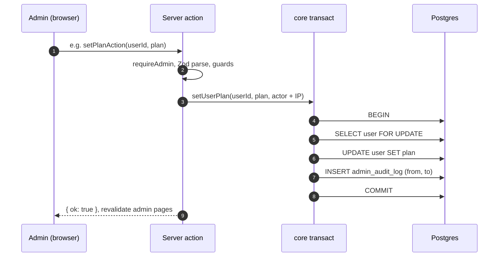
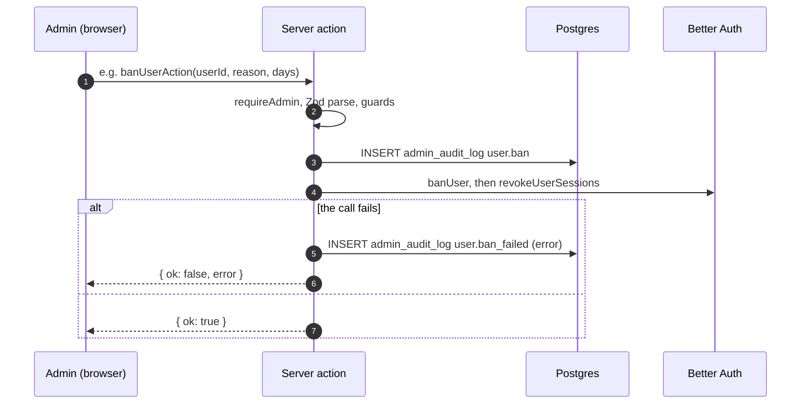
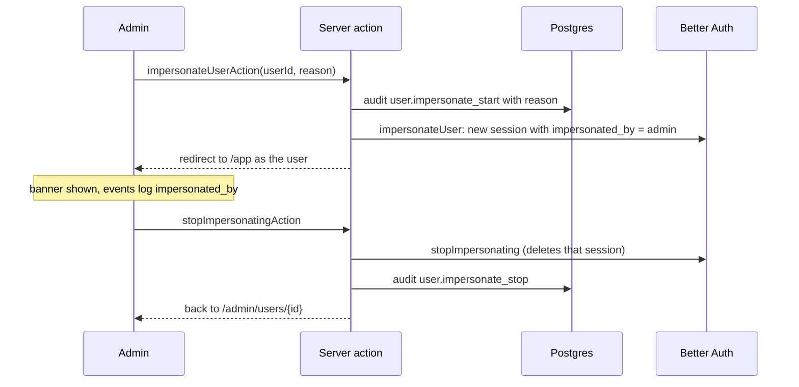

# Admin actions and the audit log

The admin panel at `/admin` is for **platform admins** (`user.role = 'admin'`), not workspace owners. Every change it
makes is a server action in [`app/admin/actions.ts`](../../../apps/web/app/admin/actions.ts), and every change leaves
a row in `admin_audit_log`, shown at `/admin/audit`.

## Contents

- [Who can get in](#who-can-get-in)
- [The two write patterns](#the-two-write-patterns)
- [Every action](#every-action)
- [Guards](#guards)
- [Impersonation](#impersonation)
- [Add an admin action](#add-an-admin-action)

## Who can get in

- [`proxy.ts`](../../../apps/web/proxy.ts) redirects visitors with no session cookie to sign-in.
- [`app/admin/layout.tsx`](../../../apps/web/app/admin/layout.tsx) calls `requireAdmin()`; a signed-in non-admin gets
  a 404, so the panel's existence isn't revealed. The layout is `force-dynamic`, so no admin page is cached.
- Every action calls `requireAdmin()` again through `context()`. The browser is never trusted to have checked.
- The first admin comes from `ADMIN_EMAILS` (after verification) or a SQL update
  ([deployment.md, First admin](../../deployment.md#6-first-admin)).

## The two write patterns

Changes to app data go through core and commit with their audit row. Changes that Better Auth owns (roles, bans,
sessions, impersonation) can't join our transaction, so the audit row is written first.

The second pattern can leave an audit row for a change that then failed, but never a change without a row.

Errors returned to the browser are safe messages only: Zod's first issue, a core `InvalidInput`, `Conflict` or
`NotFound`, a Better Auth `APIError` message, or a generic line. Anything else is logged as `admin.action_failed`.

## Every action

| Action (audit `action`)                                  | Pattern                | What it does                                                                                     |
| -------------------------------------------------------- | ---------------------- | ------------------------------------------------------------------------------------------------ |
| `setRoleAction` (`user.role`)                            | Better Auth            | Make a user a platform admin or not                                                              |
| `setPlanAction` (`user.plan`)                            | core                   | Free or Pro; applies on the next request (plans are read from the database, not the session)     |
| `banUserAction` (`user.ban`)                             | Better Auth            | Ban for 1, 7 or 30 days or indefinitely, with a reason; signs them out everywhere                |
| `unbanUserAction` (`user.unban`)                         | Better Auth            | Lift a ban                                                                                       |
| `revokeUserSessionsAction` (`user.sessions_revoke`)      | Better Auth            | Sign out of every device                                                                         |
| `revokeUserSessionAction` (`user.session_revoke`)        | Better Auth            | Sign out of one session                                                                          |
| `resendVerificationAction` (`user.verification_resend`)  | Better Auth            | Send a new verification email                                                                    |
| `deleteUserAction` (`user.delete`)                       | core, then Better Auth | `prepareUserDeletion` with its audit row, then `removeUser`; a failure adds `user.delete_failed` |
| `impersonateUserAction` (`user.impersonate_start`)       | Better Auth            | Sign in as the user, with a reason of at least 10 characters                                     |
| `setMemberRoleAction` (`workspace.member_role`)          | core                   | Change a member's workspace role; keeps at least one owner                                       |
| `removeMemberAction` (`workspace.member_remove`)         | core                   | Remove a member; their receipts stay                                                             |
| `cancelInvitationAction` (`workspace.invitation_cancel`) | core                   | Cancel a pending invitation                                                                      |
| `deleteWorkspaceAction` (`workspace.delete`)             | core                   | Delete the workspace (cascade), then its stored files                                            |
| `savePlansAction` (`settings.plans`)                     | core                   | Save plan limits; see [Settings cache](settings-cache.md)                                        |
| `saveOcrAction` (`settings.ocr`)                         | core                   | Save the model chain                                                                             |

Core writes are in [`packages/core/src/admin.ts`](../../../packages/core/src/admin.ts) and
[`settings.ts`](../../../packages/core/src/settings.ts); `insertAudit` and `transact` are in
[`audit.ts`](../../../packages/core/src/audit.ts). Reads for the admin pages are in
[`admin-queries.ts`](../../../packages/core/src/admin-queries.ts).

## Guards

| Guard                                                          | Where                                                                                             |
| -------------------------------------------------------------- | ------------------------------------------------------------------------------------------------- |
| Can't act on yourself (role, ban, delete, impersonate)         | `notSelf` in `actions.ts`                                                                         |
| Admins can't be banned, deleted or impersonated; demote first  | `notAdmin` in `actions.ts`                                                                        |
| Deleting a user or workspace requires typing its email or name | `confirm` field, checked on the server                                                            |
| Ban and impersonation need a written reason                    | Zod, stored in `admin_audit_log.reason`                                                           |
| A workspace keeps at least one owner                           | `setMemberRole`, `removeMember`, `prepareUserDeletion`, under `FOR UPDATE` on all its member rows |
| A deleted workspace's files are removed after the rows         | `deleteWorkspace` locks the organization row so no receipt is added meanwhile                     |

Every audit row stores the actor's id and email, the target's id and a label (email or workspace name), optional
reason and metadata (for example `from` and `to`), and the client IP resolved like the auth rate limiter.

## Impersonation

## Add an admin action

1. **Core first** if it changes app data: add a function in [`admin.ts`](../../../packages/core/src/admin.ts) that
   runs the change and `insertAudit` inside one `transact`. Throw `NotFound`, `Conflict` or `InvalidInput` inside to
   roll back with a safe message. Lock the rows a check depends on (`FOR UPDATE`).
2. **The server action** in [`actions.ts`](../../../apps/web/app/admin/actions.ts): wrap it in `run(name, ...)`,
   parse input with Zod, apply `notSelf` / `notAdmin` where it fits, then call `core(...)`. For a Better Auth call,
   use `audited(ctx, entry, call)` instead.
3. Pick a dotted action name (`target.verb`) and add a label for it in
   [`components/admin/audit-list.tsx`](../../../apps/web/components/admin/audit-list.tsx) if the list needs one.
4. `revalidatePath` the pages that show the change.
5. Test: a unit test in [`actions.test.ts`](../../../apps/web/app/admin/actions.test.ts) for input and guards, and
   [`admin.int.test.ts`](../../../packages/core/src/admin.int.test.ts) for the transaction.
