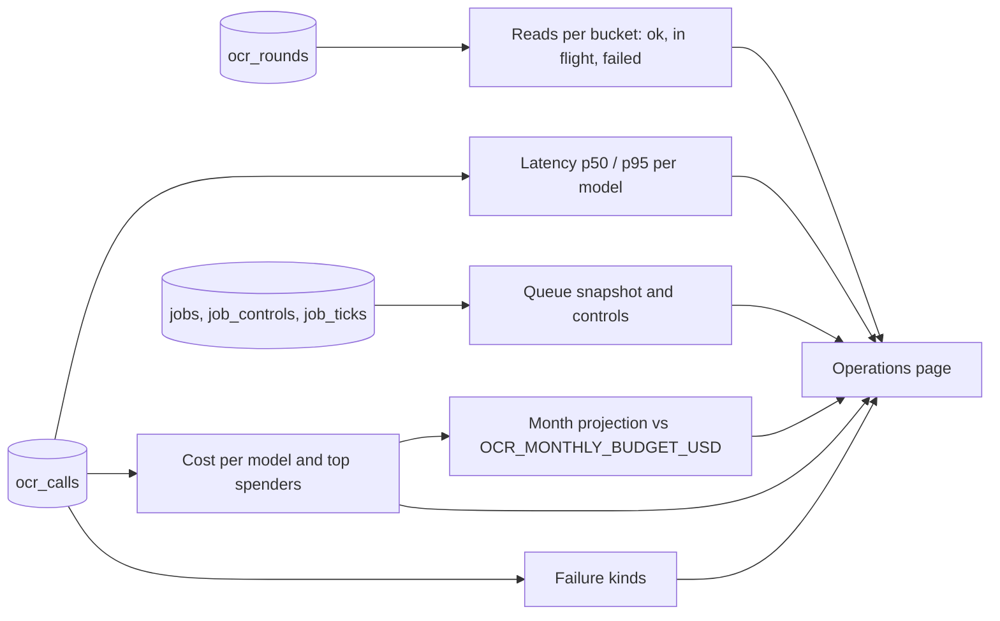

# Admin operations and jobs

Two admin pages for running the service: **Operations** (`/admin/operations`) shows how it is doing, **Jobs**
(`/admin/jobs`) lists the queue and lets an admin act on it. Both sit behind `requireAdmin()` like the rest of
[the admin panel](admin-actions.md); a non-admin gets a 404.

## Where each number comes from

Read-only queries live in [`packages/core/src/admin-ops.ts`](../../../packages/core/src/admin-ops.ts), one statement
each, over 24 hours (hourly buckets) or 7 and 30 days (daily), zero-filled by the shared
[`time-buckets`](../../../packages/core/src/analytics/time-buckets.ts) helper. Nothing is rolled up: every range
answers in well under 200 ms at 100k calls.

Range and compare live in the URL (Zod-validated); the page refreshes every 30 seconds while the tab is visible. The
Axiom, Sentry and PostHog links show only key names, never values.

## Job actions

Each action is a server action in [`app/admin/jobs/actions.ts`](../../../apps/web/app/admin/jobs/actions.ts) that
calls `requireAdmin()`, validates input with Zod and runs one core transaction in
[`packages/core/src/jobs/admin.ts`](../../../packages/core/src/jobs/admin.ts) together with its `admin_audit_log` row.

| Action (audit `action`)                   | What it does                                                                                                                                                                                                                     |
| ----------------------------------------- | -------------------------------------------------------------------------------------------------------------------------------------------------------------------------------------------------------------------------------- |
| Re-run (`job.rerun`)                      | Dead jobs only. Same round, no new `ocr_rounds` row, audited as `quota: "not-charged"`. Refused if the user has retried since, or at the daily cap. Extends `max_attempts` so new calls get fresh attempt numbers and are billed |
| Cancel (`job.cancel`)                     | Queued jobs only                                                                                                                                                                                                                 |
| Pause, resume (`job.pause`, `job.resume`) | Scope `queue` or `kind:<kind>`; a pause holds until resumed                                                                                                                                                                      |
| Clear cooldown (`job.cooldown_clear`)     | Resuming `provider:<id>` clears its cooldown; providers cannot be paused                                                                                                                                                         |

These are operator tools: see the runbook entry [Jobs stuck or dead](../../runbook.md#jobs-stuck-or-dead). The queue
itself is described in [Background jobs](jobs.md).
