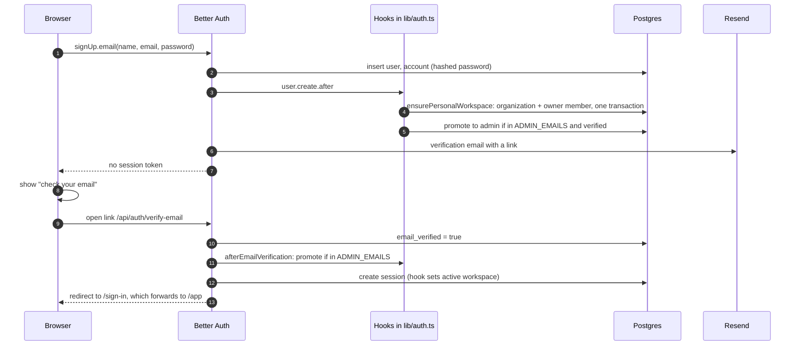
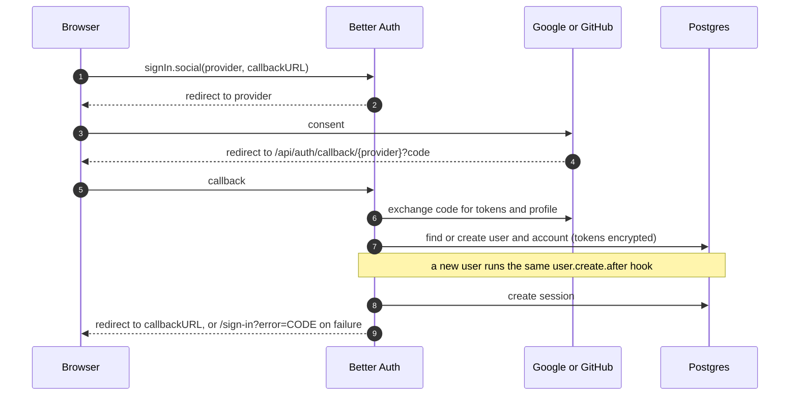
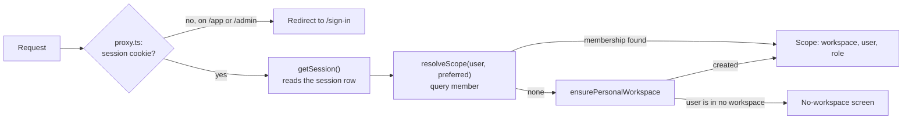
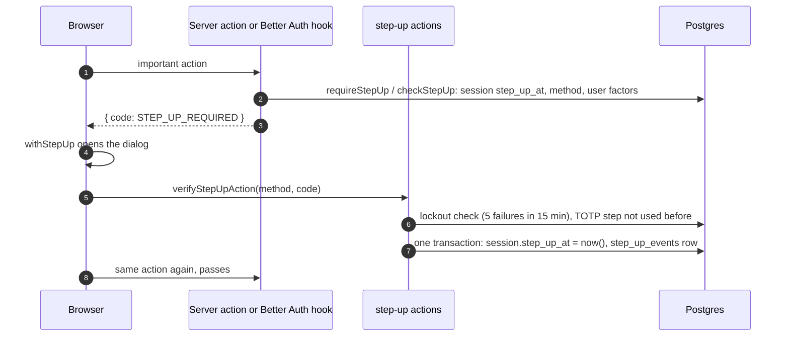
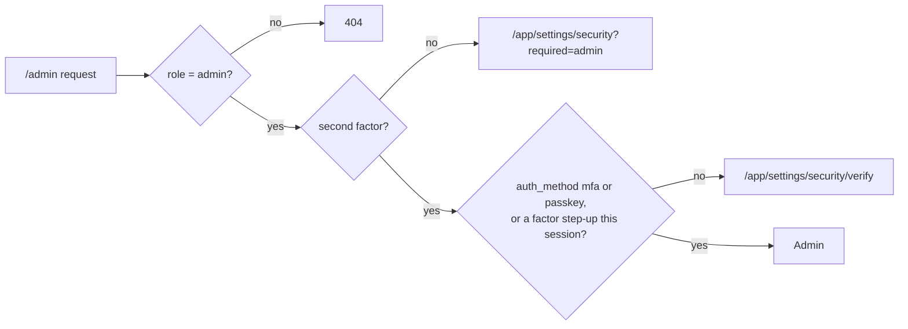
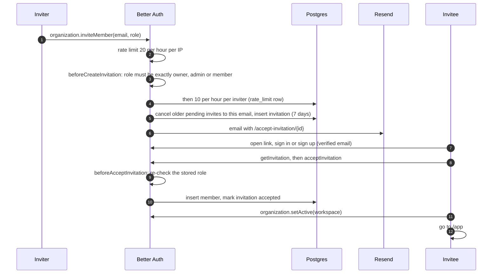

# Sign-up, sign-in and invitations

Authentication is [Better Auth](https://better-auth.com), configured in [`lib/auth.ts`](../../../apps/web/lib/auth.ts)
and served at `/api/auth/*`. It stores users, sessions, accounts, workspaces (organizations), members and
invitations in Postgres through the Drizzle adapter. The plugins: **organization** (workspaces), **admin**
(platform roles, bans, impersonation), **twoFactor** (authenticator apps and backup codes), **passkey**
(`@better-auth/passkey`, WebAuthn) and `nextCookies` (cookies from server actions). The two-factor, passkey and
step-up wiring lives in [`lib/auth-two-factor.ts`](../../../apps/web/lib/auth-two-factor.ts).

## Contents

- [What is configured](#what-is-configured)
- [Email sign-up](#email-sign-up)
- [Email sign-in](#email-sign-in)
- [Google or GitHub sign-in](#google-or-github-sign-in)
- [Every request after sign-in](#every-request-after-sign-in)
- [Two-step sign-in](#two-step-sign-in)
- ["Confirm it's you" (step-up)](#confirm-its-you-step-up)
- [Passkeys](#passkeys)
- [Admins](#admins)
- [Invitations](#invitations)
- [Password reset and account deletion](#password-reset-and-account-deletion)

## What is configured

| Setting                       | Value                                                                             |
| ----------------------------- | --------------------------------------------------------------------------------- |
| Passwords                     | 8 to 128 characters; all sessions revoked on reset                                |
| Email verification            | Required in production (`AUTH_REQUIRE_EMAIL_VERIFICATION`, default true there)    |
| Sessions                      | 7 days, refreshed daily; cookie cache off, so every read checks the session row   |
| Rate limits (database-backed) | Sign-in 5 per minute, sign-up 3 per minute, invite 20 per hour, per client IP     |
| Tokens at rest                | Verification and reset tokens hashed; OAuth tokens encrypted with the auth secret |
| Social providers              | Google and GitHub, each on only when its ID and secret are both set               |
| First admin                   | `ADMIN_EMAILS`, granted only once that address is verified                        |
| Two-step sign-in              | TOTP (6 digits, 30 s, ±1 step) and 10 backup codes, sealed with the auth secret   |
| Step-up                       | Fresh for 10 minutes per session; factor first, emailed code only without one     |

Client IPs for rate limits come from `TRUSTED_IP_HEADERS` and `TRUSTED_PROXIES` ([`lib/env.ts`](../../../apps/web/lib/env.ts)),
so the app's own limiters ([`clientIp`](../../../apps/web/lib/http.ts)) and Better Auth's agree.

## Email sign-up



- The personal workspace is named "&lt;name&gt;'s Workspace", with the user id as slug
  ([`workspace.ts`](../../../packages/core/src/workspace.ts), [`workspace-name.ts`](../../../packages/core/src/workspace-name.ts)).
  If that hook fails, the next request self-heals it (see below).
- Admin is granted only after verification, so registering someone else's address first gains nothing.
- Without verification required (local dev, CI), sign-up returns a session at once.

## Email sign-in

[`components/auth/credentials-form.tsx`](../../../apps/web/components/auth/credentials-form.tsx) calls
`signIn.email`. On success Better Auth sets the session cookie and the form navigates to the `redirect` target, which
[`lib/redirect.ts`](../../../apps/web/lib/redirect.ts) restricts to same-origin paths. If the address is not verified,
Better Auth answers `EMAIL_NOT_VERIFIED` and sends a fresh link (`sendOnSignIn`); the form shows "check your email".

## Google or GitHub sign-in



An OAuth profile can arrive already verified, so the bootstrap-admin check also runs in the create hook.

## Every request after sign-in



- `session.active_organization_id` is a preference. `resolveScope` picks that workspace if the user is still a member,
  otherwise their oldest membership. Better Auth does not clear the preference on a removed member's other sessions,
  so trusting it would keep their access.
- Banned users and revoked sessions fail `getSession` on the next request. The cookie cache is off in
  [`lib/auth.ts`](../../../apps/web/lib/auth.ts) (with it on, a revoked session kept working on `/api/auth/*` for the
  cache's lifetime, GHSA-fvxx), and server reads also pass `disableCookieCache: true`.
- `/admin` additionally requires `user.role = 'admin'` (`requireAdmin`), and answers 404 otherwise. With
  `ADMIN_MFA_ENFORCE` on (production) it also needs a second factor, [below](#admins).
- Each new session records how it was created in `session.auth_method` (`password`, `mfa`, `oauth`, `email_link`,
  `passkey`, `impersonation`), set in `databaseHooks.session.create.before` by
  [`auth-method.ts`](../../../apps/web/lib/auth-method.ts). A rotated session (2FA on or off) keeps its predecessor's.

## Two-step sign-in

Turned on in **Settings → Security** ([`two-factor-card.tsx`](../../../apps/web/components/security/two-factor-card.tsx)):
password (if the account has one), then a QR code with the key also shown as text, then a code from the app. Only that
first verified code sets `user.two_factor_enabled`, so an abandoned set-up leaves no half-on account. The 10 backup
codes are shown once, to copy or download.

```mermaid
sequenceDiagram
  autonumber
  participant B as Browser
  participant BA as Better Auth
  participant DB as Postgres

  B->>BA: signIn.email(email, password)
  BA->>DB: create session, then twoFactor's after-hook deletes it
  BA->>DB: verification rows: 2fa-<id> (user id) and its attempt counter, 10 min
  BA-->>B: { twoFactorRedirect } + signed two_factor cookie
  B->>B: /sign-in/two-factor
  B->>BA: twoFactor.verifyTotp(code, trustDevice?) or verifyBackupCode
  BA->>DB: 5 tries per challenge; 10 failures lock the account 15 min
  BA->>DB: create session (auth_method = mfa)
  BA-->>B: session cookie (+ 30-day trust_device cookie if ticked)
```

- Google and GitHub sign-ins aren't asked for the code (the plugin only hooks password sign-in). For those users
  the authenticator still guards step-up and admin access, and the Security page says so.
- Turning it off needs the password and a fresh step-up. A `user.update.after` hook then deletes every
  `verification` row holding the user id, which forgets all trusted devices, not only the current one.
- An impersonation session can't call any `/two-factor/*` or `/passkey/*` endpoint (`IMPERSONATING`), so an admin
  can't enrol their own authenticator on a customer's account.
- Emails: "two-step sign-in is on", "is off", "new backup codes" and "was reset by an administrator". A failed send is
  logged and never fails the change.

## "Confirm it's you" (step-up)

Important actions need a check passed in the last 10 minutes on **this session**. The state is two session columns,
`step_up_at` and `step_up_method`, so nothing can be carried to another session. The policy is pure and unit-tested
([`step-up/policy.ts`](../../../packages/core/src/step-up/policy.ts)):

| Account                   | Can verify with                       |
| ------------------------- | ------------------------------------- |
| Has a passkey             | The passkey (a fresh passkey sign-in) |
| Has an authenticator app  | App code or a backup code             |
| No second factor          | A 6-digit code emailed to them        |
| Platform admin, no factor | Nothing: must enrol first             |



- **One server gate.** `requireStepUp(session, action)` in
  [`step-up-check.ts`](../../../apps/web/lib/step-up-check.ts) for server actions (every admin mutation calls it in
  `run()`), and a global Better Auth `hooks.before` for auth endpoints, mapped in
  [`step-up-paths.ts`](../../../apps/web/lib/step-up-paths.ts): `/delete-user`, `/change-email`, `/change-password`,
  `/two-factor/disable`, `/two-factor/generate-backup-codes`, `/passkey/delete-passkey`, `/organization/delete`,
  owner grants through `/organization/update-member-role` or `/organization/invite-member`, and every mutating
  `/admin/*` endpoint. Calling the API directly can't skip it.
- **One client dialog.** [`step-up.tsx`](../../../apps/web/components/step-up/step-up.tsx): `withStepUp(call)` runs the
  call, opens the dialog only when the server says `STEP_UP_REQUIRED`, and retries once.
- **Codes.** TOTP is checked by our RFC 6238 helper ([`totp.ts`](../../../apps/web/lib/totp.ts)) against the
  decrypted plugin secret, so the matched time step is stored and can't be replayed. Backup codes go through the
  plugin (single use, compare-and-swap). Emailed codes are `randomInt` 6 digits, stored as an HMAC under the auth
  secret and bound to the session, 10 minutes, 5 guesses, at most 3 sends per 10 minutes.
- **Audit.** Every send, pass and failure is a `step_up_events` row and an `auth.step_up` wide event.

## Passkeys

- rpID is the host of `BETTER_AUTH_URL` (production `receipt-ocr.bhimraj.com.np`) and the expected origin is exactly
  that origin; resident keys and user verification are required, so a passkey alone is a two-factor sign-in.
- Added in Settings → Security (needs a fresh step-up and Better Auth's session `freshAge`), renamed and removed
  there; removing needs a step-up. Each add and remove emails the user.
- Sign-in: "Use a passkey" on `/sign-in`, and autofill through `autocomplete="username webauthn"` with conditional
  mediation where the browser supports it. The session gets `auth_method = passkey`.
- As a step-up: the dialog runs a passkey sign-in; an after-hook on `/passkey/verify-authentication` marks the new
  session verified, keeps the previous session's active workspace and deletes the previous session.
- Rate limits per IP: authenticate options 20/min, verify 10/min, register options 10/min.

## Admins



Enforced in `requireAdmin()` ([`session.ts`](../../../apps/web/lib/session.ts)), so every admin page and action
inherits it. `ADMIN_MFA_ENFORCE=false` is the emergency off switch; it is on by default in production. Admins never
get the emailed code. An admin can reset another user's two-step sign-in (Admin → Users → user → Reset 2FA): one
transaction removes the authenticator, trusted devices and every session and writes `user.two_factor_reset` to the
audit log; the user is emailed.

## Invitations

Owners and admins of a workspace invite people from **Settings → Members**
([`invite-form.tsx`](../../../apps/web/components/members/invite-form.tsx)).



[`accept-invitation.tsx`](../../../apps/web/components/auth/accept-invitation.tsx) handles the invitee side: redirect
to sign-in with a return path, resend verification, accept, decline, or sign out to switch account. Workspace names in
the email are escaped and restricted to plain text (`validateWorkspaceName` in
[`auth-guards.ts`](../../../apps/web/lib/auth-guards.ts)).

Every role that reaches a membership is checked by `assertWorkspaceRole`
([`auth-guards.ts`](../../../apps/web/lib/auth-guards.ts)) in four organization hooks: `beforeCreateInvitation`,
`beforeAcceptInvitation`, `beforeAddMember` and `beforeUpdateMemberRole`. The role must be exactly `owner`, `admin` or
`member`. Better Auth 1.7.14 accepts comma lists with padding such as `"admin, owner"` (GHSA-c85h), which would let a
workspace admin create an owner.

Creating extra workspaces is limited by plan: `organizationLimit` counts workspaces the user **owns** against the
plan's `workspaces` limit, read fresh from the database.

## Password reset and account deletion

- **Reset:** `/forgot-password` asks Better Auth to email a reset link (token stored hashed); `/reset-password` sets
  the new password and revokes every session.
- **Delete own account** (Settings): Better Auth's `deleteUser` runs the `beforeDelete` hook, which calls core's
  `prepareUserDeletion`. Workspaces where the user is the only member are deleted with their files; deletion is
  refused while they are the only owner of a workspace with other members. Receipts they uploaded to shared
  workspaces stay, with no uploader.
- **Delete a workspace** (owner): the `beforeDeleteOrganization` hook deletes its stored files first, then the
  cascade removes members, invitations and receipts.

Plan and decisions: [passkeys and two-factor](../../plans/2026-11-06-passkeys-2fa.md).
