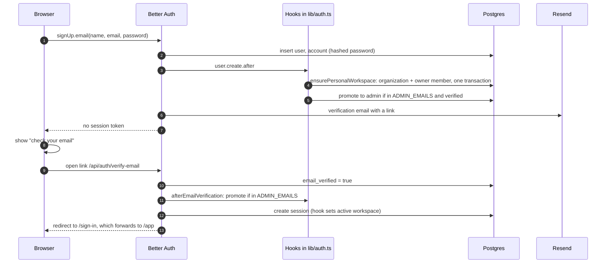
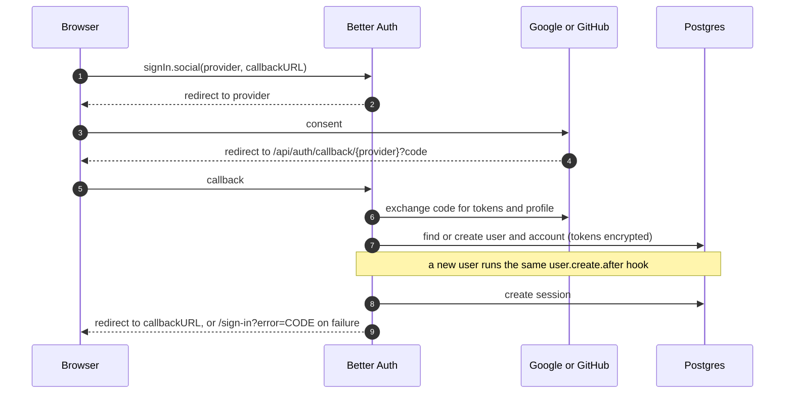
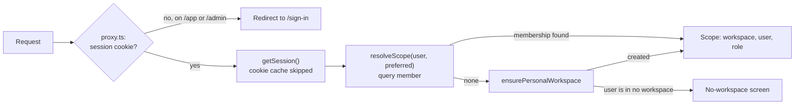
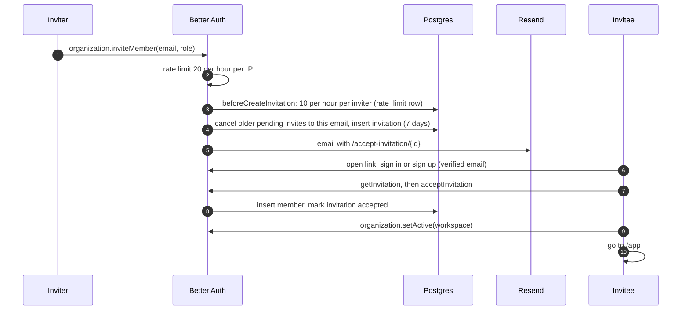

# Sign-up, sign-in and invitations

Authentication is [Better Auth](https://better-auth.com), configured in [`lib/auth.ts`](../../../apps/web/lib/auth.ts)
and served at `/api/auth/*`. It stores users, sessions, accounts, workspaces (organizations), members and
invitations in Postgres through the Drizzle adapter. Three plugins are on: **organization** (workspaces), **admin**
(platform roles, bans, impersonation) and `nextCookies` (cookies from server actions).

## Contents

- [What is configured](#what-is-configured)
- [Email sign-up](#email-sign-up)
- [Email sign-in](#email-sign-in)
- [Google or GitHub sign-in](#google-or-github-sign-in)
- [Every request after sign-in](#every-request-after-sign-in)
- [Invitations](#invitations)
- [Password reset and account deletion](#password-reset-and-account-deletion)

## What is configured

| Setting                       | Value                                                                             |
| ----------------------------- | --------------------------------------------------------------------------------- |
| Passwords                     | 8 to 128 characters; all sessions revoked on reset                                |
| Email verification            | Required in production (`AUTH_REQUIRE_EMAIL_VERIFICATION`, default true there)    |
| Sessions                      | 7 days, refreshed daily; cookie cache 5 minutes, but server reads skip it         |
| Rate limits (database-backed) | Sign-in 5 per minute, sign-up 3 per minute, invite 20 per hour, per client IP     |
| Tokens at rest                | Verification and reset tokens hashed; OAuth tokens encrypted with the auth secret |
| Social providers              | Google and GitHub, each on only when its ID and secret are both set               |
| First admin                   | `ADMIN_EMAILS`, granted only once that address is verified                        |

Client IPs for rate limits come from `TRUSTED_IP_HEADERS` and `TRUSTED_PROXIES` ([`lib/env.ts`](../../../apps/web/lib/env.ts)),
so the app's own limiters ([`clientIp`](../../../apps/web/lib/http.ts)) and Better Auth's agree.

## Email sign-up

- The personal workspace is named "&lt;name&gt;'s Workspace", with the user id as slug
  ([`workspace.ts`](../../../packages/core/src/workspace.ts), [`workspace-name.ts`](../../../packages/core/src/workspace-name.ts)).
  If that hook fails, the next request self-heals it (see below).
- Admin is granted only after verification, so registering someone else's address first gains nothing.
- Without verification required (local dev, CI), sign-up returns a session at once.

## Email sign-in

[`components/auth/credentials-form.tsx`](../../../apps/web/components/auth/credentials-form.tsx) calls
`signIn.email`. On success Better Auth sets the session cookie and the form navigates to the `redirect` target, which
[`lib/redirect.ts`](../../../apps/web/lib/redirect.ts) restricts to same-origin paths. If the address is not verified,
Better Auth answers `EMAIL_NOT_VERIFIED` and sends a fresh link (`sendOnSignIn`); the form shows "check your email".

## Google or GitHub sign-in

An OAuth profile can arrive already verified, so the bootstrap-admin check also runs in the create hook.

## Every request after sign-in

- `session.active_organization_id` is a preference. `resolveScope` picks that workspace if the user is still a member,
  otherwise their oldest membership. Better Auth does not clear the preference on a removed member's other sessions,
  so trusting it would keep their access.
- Banned users and revoked sessions fail `getSession` on the next request, because server reads pass
  `disableCookieCache: true`.
- `/admin` additionally requires `user.role = 'admin'` (`requireAdmin`), and answers 404 otherwise.

## Invitations

Owners and admins of a workspace invite people from **Settings → Members**
([`invite-form.tsx`](../../../apps/web/components/members/invite-form.tsx)).

[`accept-invitation.tsx`](../../../apps/web/components/auth/accept-invitation.tsx) handles the invitee side: redirect
to sign-in with a return path, resend verification, accept, decline, or sign out to switch account. Workspace names in
the email are escaped and restricted to plain text (`validateWorkspaceName` in
[`auth-guards.ts`](../../../apps/web/lib/auth-guards.ts)).

Creating extra workspaces is limited by plan: `organizationLimit` counts workspaces the user **owns** against the
plan's `workspaces` limit, read fresh from the database.

## Password reset and account deletion

- **Reset:** `/forgot-password` asks Better Auth to email a reset link (token stored hashed); `/reset-password` sets
  the new password and revokes every session.
- **Delete own account** (Settings): Better Auth's `deleteUser` runs the `beforeDelete` hook, which calls core's
  `prepareUserDeletion`. Workspaces where the user is the only member are deleted with their files; deletion is
  refused while they are the only owner of a workspace with other members. Receipts they uploaded to shared
  workspaces stay, with no uploader.
- **Delete a workspace** (owner): the `beforeDeleteOrganization` hook deletes its stored files first, then the
  cascade removes members, invitations and receipts.

**Planned:** passkeys and TOTP two-factor ([plan](../../plans/2026-11-06-passkeys-2fa.md)), and bot protection with
Cloudflare Turnstile ([STATUS follow-ups](../../STATUS.md#known-follow-ups)).
