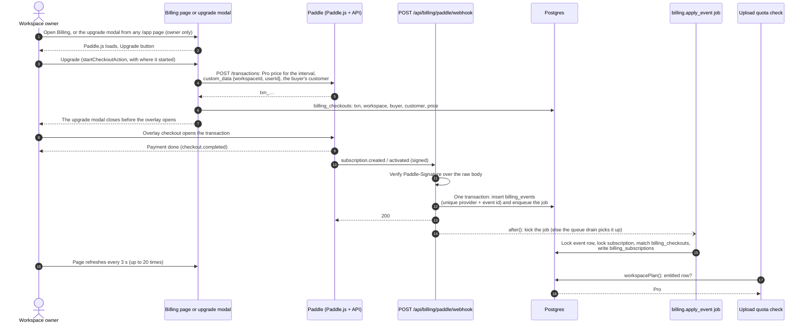

# Billing

How a workspace becomes Pro, and how the plan decides how many receipts it may scan. Payment is handled by Paddle
Billing, which is the merchant of record: it takes the payment, adds tax and sends invoices. The app never sees a card
number. The app only learns about a subscription from signed webhooks, and keeps normalized fields (ids, status, dates).

The code is in [`packages/core/src/billing`](../../../packages/core/src/billing), the quota rules in
[`quota.ts`](../../../packages/core/src/quota.ts) and [`usage.ts`](../../../packages/core/src/usage.ts), and the web side
in [`apps/web/app/api/billing`](../../../apps/web/app/api/billing) and
[`apps/web/app/app/settings/billing`](../../../apps/web/app/app/settings/billing).

## Contents

- [Plans are per workspace](#plans-are-per-workspace)
- [From checkout to plan](#from-checkout-to-plan)
- [Upgrade offer](#upgrade-offer)
- [Entitlement](#entitlement)
- [Ordering and idempotency](#ordering-and-idempotency)
- [Plans and limits](#plans-and-limits)
- [Failure modes](#failure-modes)
- [Security notes](#security-notes)
- [Configuration](#configuration)
- [Runbook](#runbook)
- [How scan packs will fit](#how-scan-packs-will-fit)

## Plans are per workspace

A plan belongs to a workspace, not to a user. `workspacePlan(organizationId)` in
[`service.ts`](../../../packages/core/src/billing/service.ts) returns Pro when:

- the workspace has a `billing_subscriptions` row that is entitled (see [Entitlement](#entitlement)), or
- an owner of the workspace has `user.plan = 'pro'`. This is an admin comp. It is stored on the user, so no webhook can
  undo it.

Anything else is Free. The rules:

1. **One subscription covers exactly one workspace.** Pro never spreads to the owner's other workspaces. A new
   workspace always starts on Free, even when its owner has a Pro workspace. (The admin comp is the one exception: it
   applies to every workspace the comped user owns.)
2. **Free: one owned workspace, and the Free allowance is per person.** The ownership cap is checked on the server in
   `beforeCreateOrganization`
   ([`assertCanCreateWorkspace`](../../../apps/web/lib/auth-guards.ts)), not only in the UI. Better Auth's own
   `organizationLimit` returns `false` (no limit) so that our hook runs and its message is shown. Free scans (20 a day, 30 a month) are
   counted per user across all workspaces, so a second workspace adds no scans.
3. **Pro: the allowance is a pool per workspace.** Its members share 500 scans per UTC calendar month and 200 per UTC
   day. Pro scans never use a member's personal Free allowance, and Free scans never use the Pro pool.
4. **Members per workspace: Free 3, Pro 10.** `memberLimitCheck` in
   [`service.ts`](../../../packages/core/src/billing/service.ts) counts members plus pending invitations, so sending
   many invites can't overshoot. Accepting counts members only, so a workspace at the limit takes no one else. No lock
   is taken (Better Auth inserts after the hook, outside our transaction): invites sent at the same moment can leave
   extra pending invitations, but those can't become members past the limit; only two accepts in the same instant
   could overshoot it, by one. Better Auth's own `membershipLimit` (100) stays as the outer fuse, which is why an
   admin can't set more than 100.
5. **A Pro owner may own up to 2 workspaces.** `accountPlan(userId)` is Pro when the user is comped or owns at least one
   Pro workspace. It only lifts the ownership cap (Free 1, Pro 2). The extra workspace stays Free until it gets its own
   subscription.

## From checkout to plan

Steps in words:

1. **Checkout.** Only an owner sees the Upgrade button. The server action `startCheckoutAction`
   ([`actions.ts`](../../../apps/web/app/app/settings/billing/actions.ts)) checks the owner again and refuses an
   unverified email. The Paddle customer is the one on the owner's last checkout, else found or created by their email.
   The server creates the transaction with that customer, the configured price for the chosen interval and
   `custom_data { workspaceId, userId }`, and records it in `billing_checkouts` (transaction id, workspace, buyer,
   customer, price) before the browser gets the id. The browser opens that `txn_…` id in Paddle's overlay; Paddle copies
   the custom data and the customer to the subscription, and names the transaction in `subscription.created`. Billing's button and the [upgrade modal](#upgrade-offer) share
   [`use-pro-checkout.ts`](../../../apps/web/components/billing/use-pro-checkout.ts). If Pro still isn't on after the
   page has refreshed 20 times (about a minute), Billing (or a toast, from the modal) says the payment was received,
   to reload in a few minutes and to use the support button if it stays Free.
2. **Webhook.** [`receiveWebhook`](../../../packages/core/src/billing/service.ts) verifies the signature, parses the body
   into a provider-neutral `BillingEvent`, and calls `recordBillingEvent`. That function inserts the `billing_events`
   row and enqueues the `billing.apply_event` job in one transaction, so there is never an event without its job.
3. **Response.** The route returns 200 and starts the job with `after()`. If that does not run, the
   [job queue](jobs.md) drain picks the job up.
4. **Apply.** [`applyBillingEvent`](../../../packages/core/src/billing/service.ts) writes the normalized fields to
   `billing_subscriptions`. The job kind is in
   [`kinds/billing-apply.ts`](../../../packages/core/src/jobs/kinds/billing-apply.ts) (8 attempts, 30 s lease, backoff
   5 s up to 10 min). A database error is retried. A stored payload the schema refuses is dead at once (no retries) and
   shows in the admin jobs list.
5. **Plan.** The next upload reads `workspacePlan` fresh from the database (not the session cache), so a webhook or an
   admin change applies at once.

Manage and cancel use Paddle's customer portal. The server action
[`openBillingPortalAction`](../../../apps/web/app/app/settings/billing/actions.ts) calls
`POST /customers/{id}/portal-sessions` and returns short-lived links. They are made per click and never stored. Only
the subscription's buyer (`billing_subscriptions.user_id`) may open them, and only for a customer recorded in
`billing_checkouts` for that buyer; other owners see "Billing for this workspace is managed by {buyer's email}". Once
the buyer's account is gone nobody gets a portal: the page says to use the support button. Such a subscription can't
charge again (deletion needs its cancel scheduled first, and the apply job cancels an orphan that could charge), so
no cancel button is needed. Cancel and update payment method open
Paddle's page for that subscription; invoices open the portal overview. Both billing actions allow 10 clicks a minute
per user. The buyer-only rule covers our buttons, not Paddle: anyone with the buyer's inbox can sign in to the portal
by email, and Paddle's own emails carry cancel and update-payment links.

**Paddle links back to us.** Paddle builds a transaction's payment link (`checkout.url`), the update-payment-method
link in its emails and `subscription.management_urls` from the account's **default payment link** plus
`?_ptxn=txn_…`, and expects that page to load Paddle.js, which opens the checkout on its own
([default payment link](https://developer.paddle.com/build/transactions/default-payment-link)). Without a default
payment link `POST /transactions` fails (`transaction_default_checkout_url_not_set`). The default payment link is
**`/pay`** in both Paddle accounts: public, no sign-in, noindex. With a well-formed `?_ptxn=txn_…` (`txn_` and 26
lowercase letters or digits) and a checkout open to the viewer (as on Billing), it loads Paddle.js, initializes it with the client token (a
server-rendered prop) and opens the overlay for that transaction; `checkout.completed` shows a thank-you with a link to
the app, `checkout.closed` a way to reopen it. Anything else gets a short page linking to `/pricing`, without
Paddle.js or the token. See the security notes for what it may and may not do.

### Webhook responses

| Status | When                                                                                                         |
| ------ | ------------------------------------------------------------------------------------------------------------ |
| 200    | Stored and job enqueued; or a redelivery (nothing new); or an event type we do not subscribe to (not stored) |
| 400    | The body is not valid JSON or not the expected shape                                                         |
| 401    | `Paddle-Signature` is missing, malformed, wrong or too old or new                                            |
| 413    | The body is over 256 KB                                                                                      |
| 503    | Billing is off (any Paddle setting is missing)                                                               |

Paddle retries anything but a 200 within five seconds, so a bad deployment (for example a wrong secret) heals once it
is fixed, but only while the retries last: up to 60 attempts over about two days in live, and **only 3 attempts in
about two minutes in the sandbox**. After that the delivery is `failed` and has to be replayed from the destination's
logs ([handle delivery](https://developer.paddle.com/webhooks/about/respond-to-webhooks)). Events handled:
`subscription.created`, `.updated`, `.activated`, `.canceled`, `.past_due`, `.paused`, `.resumed`,
`transaction.completed`, `adjustment.created` and `adjustment.updated`.

## Upgrade offer

Free workspace owners are offered Pro inside the app, and can buy it without leaving the page
([plan](../../plans/2026-11-08-upgrade-cta.md)). One server gate, `getUpgradeOffer()` in
[`upgrade-offer.ts`](../../../apps/web/lib/upgrade-offer.ts) (the rules in `decideUpgradeOffer`,
[`upgrade-level.ts`](../../../apps/web/lib/upgrade-level.ts)), feeds every surface. It is null for a workspace that
isn't Free (comps included), while an admin impersonates, while the viewer can't check out (billing off, or sandbox
keys on the live site for anyone but a platform admin, so nothing shows on production today), and while the
service-wide cap pauses every plan.

| Level   | When                                       | Surfaces (owners)                                                                                                     |
| ------- | ------------------------------------------ | --------------------------------------------------------------------------------------------------------------------- |
| `quiet` | under 80% (`NEAR_RATIO`) of the month used | None: only the Billing page's Pro card                                                                                |
| `near`  | 80% or more                                | Meter "Upgrade" link (amber bar), Home card (edged, above "To check" on phones)                                       |
| `at`    | blocked by the month, the day or the pool  | Meter button; upload panel's limit state gets the button; banner on other pages (not Home, Upload, Billing, receipts) |

The account menu never offers Pro. Without an offer (checkout closed to the viewer), a Free meter from 80% and the
limit state say "Pro, with 500 scans a month, opens soon." with a "Compare plans" link, and nothing says "Upgrade".
The usage line under the phone's upload buttons from 80% is information, not an offer, so it shows either way.

- **Members** (workspace admins too) get no offer, only "Ask the owner for Pro." at the limit and next to an amber
  meter, and only when Pro is open to everyone.
- **The modal** ([`upgrade-modal.tsx`](../../../apps/web/components/upgrade/upgrade-modal.tsx)) is mounted once in the
  app layout: a dialog from md up, a bottom sheet below. Surfaces open it with the `upgrade-modal:open` window event;
  `/app/...?upgrade=1` (`&via=email`, `&interval=year`) opens it once and is stripped with `replaceState`. Every
  trigger is a real link to Billing, so it works without JavaScript. Paddle.js is mounted when the modal first opens.
  The primary button creates the transaction, closes the modal, and opens Paddle's overlay when the close transition
  ends (an overlay on top of a focus-trapping dialog loses focus and closes the dialog). After payment a toast
  follows the same refresh loop as Billing.
- **Dismissals** ("Not now" on the Home card and the banner, never closing the modal) are in the httpOnly
  `receiptocr.upgrade` cookie (`path=/app`, listed on /cookies), read by the gate, so a hidden card never renders.
  Home quiet: 30 days, then for good the second time; Home near: until the month resets; banner: until uploads open.
- **Events** (server-side, closed sets): `upgrade_cta { action: opened | dismissed, surface, level }` from the
  modal's open and the dismiss action, and `checkout_started { interval, via, level }` from `startCheckoutAction`
  (`via` is the surface, or `billing`). The level is read on the server; the workspace name is never sent.

## Entitlement

`isEntitled(subscription, now)` in [`entitlement.ts`](../../../packages/core/src/billing/entitlement.ts) decides whether a
stored subscription grants Pro. `entitledSql` (in `service.ts`) is the same rule for queries, and a unit test keeps the two in step.

| Stored status        | Grants Pro when                                                                                                                                               |
| -------------------- | ------------------------------------------------------------------------------------------------------------------------------------------------------------- |
| `active`, `trialing` | Always, unless a cancel is scheduled for the period end (`cancel_at_period_end`) and that end has passed (in case the final `canceled` event is late or lost) |
| `past_due`           | For 30 days from `past_due_since` (`PAST_DUE_GRACE_DAYS`), while Paddle retries the card (Retain's default dunning window is 30 days too)                     |
| `canceled`           | Only if `cancel_at_period_end` is set and the period end is still ahead                                                                                       |
| `paused`             | Never                                                                                                                                                         |

Before the status is looked at, a row grants Pro only if its `price_id` is a Pro price (`PADDLE_PRICE_PRO_MONTHLY`,
`PADDLE_PRICE_PRO_YEARLY` or one of `PADDLE_PRICE_PRO_LEGACY`) and `revoked_at` is null (no chargeback or full refund).

`past_due_since` is set from the event's `updated_at` when the status first becomes `past_due`, and kept while it
stays `past_due`. Any other status clears it.

## Ordering and idempotency

| Concern                      | How it is handled                                                                                                                                                                                                                                                                                                                                                                                                                                                                                                                                                                                                                                                                                                                                                                                                                                                                                                                                                                                                                                                                                                                                                                                                    |
| ---------------------------- | -------------------------------------------------------------------------------------------------------------------------------------------------------------------------------------------------------------------------------------------------------------------------------------------------------------------------------------------------------------------------------------------------------------------------------------------------------------------------------------------------------------------------------------------------------------------------------------------------------------------------------------------------------------------------------------------------------------------------------------------------------------------------------------------------------------------------------------------------------------------------------------------------------------------------------------------------------------------------------------------------------------------------------------------------------------------------------------------------------------------------------------------------------------------------------------------------------------------- |
| Same event delivered twice   | `billing_events` has a unique index on `(provider, provider_event_id)`. The second insert does nothing and no second job is enqueued.                                                                                                                                                                                                                                                                                                                                                                                                                                                                                                                                                                                                                                                                                                                                                                                                                                                                                                                                                                                                                                                                                |
| Job runs twice               | The job locks the event row `FOR UPDATE` and skips it if `processed_at` is set (outcome `already-applied`). The job also has an idempotency key `billing:event:<id>`.                                                                                                                                                                                                                                                                                                                                                                                                                                                                                                                                                                                                                                                                                                                                                                                                                                                                                                                                                                                                                                                |
| Events arrive out of order   | Each snapshot carries Paddle's `updated_at`. A snapshot older than the stored one is recorded with outcome `stale` and not applied.                                                                                                                                                                                                                                                                                                                                                                                                                                                                                                                                                                                                                                                                                                                                                                                                                                                                                                                                                                                                                                                                                  |
| Two events, one subscription | A transaction advisory lock per `provider:subscription id` serializes the writes.                                                                                                                                                                                                                                                                                                                                                                                                                                                                                                                                                                                                                                                                                                                                                                                                                                                                                                                                                                                                                                                                                                                                    |
| Which workspace              | A **new** subscription links only when its `transaction_id` is a checkout in `billing_checkouts` for the workspace and buyer its `custom_data` names, its customer is the one recorded there, the buyer is an `owner` of the workspace now, the price is a Pro price, and (sandbox keys on the live site) the buyer is a platform admin, and no other subscription has linked to that checkout (the link records the subscription id on the checkout row, claimed with a conditional update). Otherwise the outcome is `unmatched` with `billing.unmatched_reason` (`unknown_transaction`, `customer_mismatch`, `owner`, `price`, `test_mode`, `transaction_used`), no Pro, and the job logs `billing.unmatched` at warn level with `billing.transaction_id`. Only `subscription.created` names the transaction: an earlier-delivered event of the same subscription waits as `unmatched` (`no_transaction`, info level), and the link stores the newest of those snapshots and marks them `applied`. The customer is fixed at the link: an event naming another customer keeps the stored one and logs `billing.unmatched` (`customer_mismatch`) at warn level. Later events use the stored link and never move it. |
| Refund or chargeback         | `adjustment.created` / `adjustment.updated`. An approved `chargeback`, or an approved `refund` of type `full`, on a stored subscription sets `revoked_at` (Pro ends at once), and the job cancels the subscription with Paddle (`POST /subscriptions/{id}/cancel`, `effective_from: immediately`). A retry asks for the cancel again until Paddle reports `canceled`. Partial refunds, credits and chargeback warnings are `ignored`. One that arrives before its `subscription.created` (no stored row yet) is kept with outcome `unmatched` (`billing.unmatched_reason: subscription`); when the subscription links, the link finds it in `billing_events`, stores the row with `revoked_at` set (no Pro), marks the adjustment `applied` and asks for the cancel. The event log is the pending record, so this holds however late Paddle's retries deliver the `created` event (they run for days), not only within the job's own retries (at most ~11 min).                                                                                                                                                                                                                                                      |
| `transaction.completed`      | Carries no subscription state, so the outcome is `ignored`. The subscription's own events follow.                                                                                                                                                                                                                                                                                                                                                                                                                                                                                                                                                                                                                                                                                                                                                                                                                                                                                                                                                                                                                                                                                                                    |

Outcomes stored in `billing_events.outcome`: `applied`, `stale`, `ignored`, `unmatched`.

The stored payload is the normalized event (ids, status, dates, price id, custom data ids). It is not the raw body, so it
holds no card or address data.

## Plans and limits

This is the one table of limits. Defaults are in [`plans.ts`](../../../packages/core/src/plans.ts). An admin changes the
plan fields in **Admin → Settings → Plan limits** (saved in `app_settings`; a missing or unreadable row falls back to
these defaults). A plan's `scope` (Free: `user`, Pro: `workspace`) is kept from the saved table and is not in the form.

| Limit                  | Free                          | Pro          | How it is counted                                                                                                                                                                                                                                                        | What the user sees when it is hit                                                                                                                                                                        | Where an admin changes it                     |
| ---------------------- | ----------------------------- | ------------ | ------------------------------------------------------------------------------------------------------------------------------------------------------------------------------------------------------------------------------------------------------------------------ | -------------------------------------------------------------------------------------------------------------------------------------------------------------------------------------------------------- | --------------------------------------------- |
| Scans a day            | 20                            | 200          | Free: per person, across all their workspaces. Pro: per workspace, shared by its members. UTC day. Only rounds of that plan (`ocr_rounds.plan`).                                                                                                                         | Free: "You've used all 20 scans for today. You can upload again at 00:00 UTC." Pro: "This workspace has used its 200 scans for today. Uploads open at 00:00 UTC; N of 500 scans are left this month."    | Plan limits, `receiptsPerDay`                 |
| Scans a month          | 30                            | 500          | Same scope as the day limit. UTC calendar month. Empty = no monthly limit.                                                                                                                                                                                               | Free: "You've used all 30 scans on the Free plan this month. They reset on 1 December at 00:00 UTC." Pro: "This workspace has used all 500 scans for this month. They reset on 1 December at 00:00 UTC." | Plan limits, `receiptsPerMonth`               |
| Scope                  | `user`                        | `workspace`  | Whose rounds the day and month limits count. A member's Pro scans never use their Free allowance, and the reverse.                                                                                                                                                       | The usage meter says whose count it shows                                                                                                                                                                | Not editable (kept from the saved table)      |
| Free pool              | 300 a day                     | none         | Every round of that plan today, all users together, failed ones included. A Free pool that is full never blocks Pro.                                                                                                                                                     | "Free scanning is busy today: the Free plan's shared daily capacity is used up. Try again after 00:00 UTC."                                                                                              | Plan limits, `poolPerDay` (empty = none)      |
| Burst a minute         | 10                            | 30           | Each user's rounds in the last 60 seconds, failed ones included, any plan.                                                                                                                                                                                               | "Too many uploads at once. Wait a minute and try again."                                                                                                                                                 | Plan limits, `receiptsPerMinute`              |
| Images in one batch    | 10                            | 10           | Client-side cap on the camera tray plus picked files (1 to 20). The other limits still apply per upload.                                                                                                                                                                 | The picker stops adding files                                                                                                                                                                            | Plan limits, `batchMax`                       |
| Workspaces to own      | 1                             | 2            | Workspaces where the user has the `owner` role. A user is on the Pro cap when they own a Pro workspace or are comped. Checked on the server when creating one.                                                                                                           | "Free accounts can own 1 workspace. A new workspace starts on Free."                                                                                                                                     | Plan limits, `workspaces`                     |
| Members in a workspace | 3                             | 10           | Members plus pending, unexpired invitations (an earlier invite to the same address is replaced, so not counted). Checked when inviting (`beforeCreateInvitation`) and accepting (`beforeAcceptInvitation`, members only); a workspace already over it keeps its members. | "Free workspaces have up to 3 members, counting pending invitations, and Pro workspaces up to 10. …" The invitee sees "This workspace already has 3 members, the most on Free. Ask its owner …"          | Plan limits, `membersPerWorkspace` (1 to 100) |
| All-plans fuse         | `OCR_DAILY_CAP` (about 1,000) | same         | Every round started by anyone today, plus automatic retry attempts that called a model. Only checked when set.                                                                                                                                                           | "Receipt reading is at capacity for today. Try again after 00:00 UTC."                                                                                                                                   | Environment variable `OCR_DAILY_CAP`          |
| Failed-read allowance  | 5 per window                  | 5 per window | The first 5 finished failed reads in a day (and in a month) do not count toward that limit; later ones count like a receipt (`FREE_FAILED_ROUNDS`). Reads still in flight count.                                                                                         | Nothing until the limit above is reached                                                                                                                                                                 | Constant in `plans.ts`                        |

Free's monthly limit exists because 20 a day for 30 days is 600, more than Pro's 500. The daily limit is now the pace
inside the month.

**Check order for one upload** ([`decideQuota`](../../../packages/core/src/quota.ts)); the first refusal decides the
message:

1. Global fuse (`OCR_DAILY_CAP`).
2. The plan's pool for today (Free only).
3. The month, for the plan's scope.
4. The day, for the plan's scope.
5. The user's burst minute.

`UsageCounts` is `{ userMinute, day, month, planDay, globalDay }`, already for the plan's scope.

**Locks.** The round is written in the same transaction as the check, under advisory locks. The user lock is always
taken. On a workspace-scoped plan the workspace lock is taken too, always in that order (user, then workspace), so two
members cannot both take the last scan. The Free pool and the global cap take no lock. Uploads by different users can
pass them together, so each can overshoot by at most the number of uploads in flight at that moment.

**`OCR_DAILY_CAP`:** set it to about 1,000, above the Free pool (300) and the expected Pro use, so it is only an
emergency fuse.

What "used" means is in [core: quota ledger semantics](../core.md#design-principles-and-invariants).

## Failure modes

| What goes wrong                                 | What happens                                                                                                                                                                                                                                                                                                                                                                                                                                                                                                                                                                                                                                                                                                                                          |
| ----------------------------------------------- | ----------------------------------------------------------------------------------------------------------------------------------------------------------------------------------------------------------------------------------------------------------------------------------------------------------------------------------------------------------------------------------------------------------------------------------------------------------------------------------------------------------------------------------------------------------------------------------------------------------------------------------------------------------------------------------------------------------------------------------------------------- |
| A Paddle setting is missing                     | Billing is off: no Upgrade button, no portal link, no Paddle.js, webhook answers 503. Plans still work (Free, and admin comps).                                                                                                                                                                                                                                                                                                                                                                                                                                                                                                                                                                                                                       |
| Wrong webhook secret                            | Every delivery gets 401 and Paddle retries. Nothing is stored. Fix the secret; Paddle's retries then succeed.                                                                                                                                                                                                                                                                                                                                                                                                                                                                                                                                                                                                                                         |
| App down or slow when Paddle calls              | Paddle retries. A repeat is stored once. A late event is ordered by `updated_at`.                                                                                                                                                                                                                                                                                                                                                                                                                                                                                                                                                                                                                                                                     |
| `after()` does not run the job                  | The event row and its job exist. The queue drain applies it within the drain interval.                                                                                                                                                                                                                                                                                                                                                                                                                                                                                                                                                                                                                                                                |
| Database error while applying                   | The job retries up to 8 times with backoff; then it is dead and shows in the admin jobs list. The event row stays unprocessed.                                                                                                                                                                                                                                                                                                                                                                                                                                                                                                                                                                                                                        |
| "The checkout couldn't start"                   | Paddle refused the server's call: log `billing.checkout_failed`, `error.kind` says why. `http-401` is a wrong, revoked or expired `PADDLE_API_KEY` (or one from the other Paddle environment); `http-403` a key missing a permission (`customer.write`, `transaction.write`, `customer_portal_session.write`, `subscription.write`); `http-400` a bad request; `network` or `timeout` Paddle unreachable. `billing.provider_error_code` has Paddle's own `error.code` when it sent one, e.g. `transaction_default_checkout_url_not_set` (no default payment link) or `transaction_checkout_url_domain_is_not_approved`. For those account-setup codes a platform admin sees the fix on the button instead of the generic message; customers never do. |
| Checkout paid but no workspace link             | The transaction isn't one the server recorded for that workspace and buyer (or the workspace was deleted since), the customer differs, the buyer isn't its owner, the price isn't a Pro price, or a non-admin paid on sandbox keys on the live site: outcome `unmatched` (with the reason), no Pro, and `billing.unmatched` at warn level. Find it in `billing_events` and fix by hand (comp or refund).                                                                                                                                                                                                                                                                                                                                              |
| Paddle.js blocked (content blocker)             | The button says "Checkout couldn't load. Turn off content blockers for this page or try another browser."                                                                                                                                                                                                                                                                                                                                                                                                                                                                                                                                                                                                                                             |
| Cancel after a chargeback fails                 | 5xx or 429 retries. A refused key (401/403), or billing off, is dead at once; another 4xx is logged as `billing.cancel_refused`. Pro is already off; cancel the subscription in Paddle by hand.                                                                                                                                                                                                                                                                                                                                                                                                                                                                                                                                                       |
| Final `canceled` event lost                     | A scheduled cancel passes its period end, and `isEntitled` stops granting Pro on its own.                                                                                                                                                                                                                                                                                                                                                                                                                                                                                                                                                                                                                                                             |
| Card fails on renewal                           | `past_due`: Pro stays for 30 days, the billing page shows the end of the grace period and a link to update the payment method. Paddle's emails link to `/pay` to update it. Paddle keeps retrying for its own dunning window (Retain, 30 days by default): keep that window at 30 days or less, or Pro ends while Paddle can still recover the payment.                                                                                                                                                                                                                                                                                                                                                                                               |
| Paddle's API is down when opening the portal    | The action returns "Paddle didn't answer. Try again in a minute." (10 s timeout). Nothing is stored.                                                                                                                                                                                                                                                                                                                                                                                                                                                                                                                                                                                                                                                  |
| Owner tries to delete a workspace with live Pro | Refused with a message to cancel first (`assertNoLiveSubscription`) while its subscription can still charge: any status but `canceled` (so also past due after the grace period, paused and trialing), unless the cancel is already scheduled for the period end. The admin "delete workspace" action refuses the same way.                                                                                                                                                                                                                                                                                                                                                                                                                           |
| User deletes their account with live Pro        | Refused while a subscription that can still charge belongs to a workspace only they are in, or was bought by them (only the buyer opens the portal): "Cancel the Pro subscription for {workspace} first", with a link to Billing. Checked in Settings, on the email request, on the confirm link, and under lock in `prepareUserDeletion` (also the admin delete-user path).                                                                                                                                                                                                                                                                                                                                                                          |
| Workspace deleted anyway                        | `billing_subscriptions.organization_id` is set to null. The row stays as the billing record.                                                                                                                                                                                                                                                                                                                                                                                                                                                                                                                                                                                                                                                          |
| Scheduled cancel removed after a deletion       | A workspace (or the buyer's account) can be deleted once the cancel is scheduled. If the cancel is later removed in Paddle, the next `subscription.updated` finds a row with no workspace or no buyer that can charge again (`canStillCharge`), and the job cancels it with Paddle at once, as after a chargeback. A failed cancel is handled the same way (see above).                                                                                                                                                                                                                                                                                                                                                                               |

## Security notes

- **Signature.** `Paddle-Signature` is `ts=<unix>;h1=<hex>`. The expected value is HMAC-SHA256 over `<ts>:<raw body>`
  with the destination secret, hex encoded. Any `h1` may match (Paddle sends several while a secret rotates). The compare is
  constant time. The timestamp may differ from our clock by 30 seconds in either direction
  (`SIGNATURE_TOLERANCE_SECONDS`). Paddle's SDKs default to 5 seconds; 30 allows for a cold start, and a replay inside
  the window is a no-op because events are stored once by id. The raw body is read before parsing.
- **Body size.** A `Content-Length` over 256 KB is refused with 413 before the body is read; the body is checked again
  in bytes after reading.
- **Owner only.** Checkout and portal links are for workspace owners. Admins and members see the plan read-only. The
  server action checks the role again; the UI is not the control.
- **Impersonation.** While an admin is signed in as another user, the billing page hides the actions and the server
  action refuses.
- **Checkout is made on the server.** The transaction (price and custom data) is created by `startCheckoutAction`, not
  by the browser.
- **Custom data is still not trusted.** Anyone can open a Paddle checkout with our public client token and any items,
  custom data or customer. So a **new** subscription links only to a transaction the server created and recorded in
  `billing_checkouts` for that workspace and buyer, with the customer the server put on it; the buyer must still own
  the workspace and the price must be a Pro price. Every entitlement check also requires a Pro price on the stored
  row. The link is never moved by later events.
- **The portal is bound to the checkout.** A portal session opens only for the buyer, and only for a customer recorded
  in `billing_checkouts` for them, so a stored customer id never reaches the portal on the webhook's word alone. (`billing_events.organization_id` is null when the event is stored and set
  only by the apply job, from the resolved workspace.)
- **Sandbox on the live site.** With `PADDLE_ENV=sandbox` and `VERCEL_ENV=production`, pricing and the landing page
  feature Free and mark Pro "Opens soon", and the billing page offers the checkout only to platform admins, with a
  "Test mode: no real charge" badge. `startCheckoutAction` refuses everyone else, and the apply job links a
  subscription only when its buyer is a platform admin (`sandboxOnProduction` in
  [`config.ts`](../../../packages/core/src/billing/config.ts) is the one check both use).
- **Subscription before checkout.** The billing page decides an owner's view from the subscription first: a payer
  always sees status, renewal and the portal buttons, whatever the checkout state. The portal needs the server's
  Paddle settings (`loadPaddleConfig`), not an open checkout; without them the page says billing is unavailable and how
  to reach Paddle. Members of a Pro workspace see plan, usage and "Managed by the workspace owner" only.
- **Data kept.** Ids, status, dates, interval and price id. No card, address or tax data, and no raw webhook body.
- **No SDK.** The Paddle adapter uses `node:crypto` and `fetch`, so there is no Paddle package to trust or update.
- **Paddle.js.** It loads only when billing is configured and the viewer can check out: on the billing page, in
  the app once an owner opens the upgrade modal (never on page load), and on `/pay` with a well-formed `_ptxn`.
  `Paddle.Initialize` runs once per page ([`paddle-js.ts`](../../../apps/web/components/billing/paddle-js.ts)), since
  `window.Paddle` survives client navigations. The report-only CSP allows
  `https://cdn.paddle.com` (script), `https://buy.paddle.com` and `https://sandbox-buy.paddle.com` (frame) and
  `https://*.paddle.com` (connect) only when `NEXT_PUBLIC_PADDLE_CLIENT_TOKEN` is set at build time
  ([`lib/csp.ts`](../../../apps/web/lib/csp.ts)).
- **Logs.** The webhook adds provider, event type, event id, subscription id and status to its wide event. No email, no
  card data.
- **Product event `plan_changed`.** When an applied event moves its workspace between plans (activated, lapsed past the
  grace period, cancelled), the `billing.apply_event` job's wide event carries `billing.plan_from` and
  `billing.plan_to` (`free` or `pro`) with `organization_id` and the buyer's `user_id`. `fromRecord` in
  [`analytics.ts`](../../../apps/web/lib/telemetry/analytics.ts) sends it to PostHog as `plan_changed { from, to }`.
  Hitting the month or the Free pool also counts as `plan_limit_hit`.

- **`/pay` is public.** It opens a checkout for whatever transaction id the link carries, which is what Paddle's own
  hosted `checkout.url` does: Paddle decides what that transaction shows and accepts, and paying it gives the
  transaction's own items to the transaction's own customer. The page never calls Paddle's API or looks the id up, so
  it can't tell anyone whether an id exists, and has no state to change or rate limit. The id is shape-checked on the
  server and nothing else from the URL reaches the page. It follows the same rule as Billing (`getCheckoutFor`): with
  sandbox keys on the live site only a signed-in platform admin gets Paddle.js and the token. Otherwise anyone could
  take the sandbox token (and the sandbox price ids, which are public in `docs/decisions.md`), open a checkout of
  their own with custom data naming their workspace, pay with a test card and get Pro on the live site. It is outside the analytics allowlist (no page view, no GA),
  sends only its origin as `Referer` to other sites (the site-wide `strict-origin-when-cross-origin`), and logs
  `page.render` with the route only. Paddle's own events never grant Pro; the webhook does.

### Invariants

- **Verified emails.** A first checkout finds the Paddle customer by the owner's email, so `startCheckoutAction` and `createCheckout` refuse an unverified address ("Verify your email address before upgrading."). Later checkouts reuse the customer recorded for that user in `billing_checkouts`.
- **Client token.** `NEXT_PUBLIC_PADDLE_CLIENT_TOKEN` must never be referenced from client code. It is sent only in server-rendered payloads: the billing page's, the app layout's upgrade offer for an owner who can check out, and `/pay`'s with a well-formed `_ptxn` (and read at build time by the CSP).
- **Orphans.** A subscription that can still charge but whose workspace or buyer was deleted logs `billing.orphan_charging` at error level when its next event is applied, and the job then cancels it with Paddle (see the failure modes).

## Pure files

These files import nothing from `@receipt-ocr/db`, Effect or other core modules (only siblings in `billing/`), so they
can move to a `packages/billing` later without untangling core:

- [`billing/provider.ts`](../../../packages/core/src/billing/provider.ts): neutral event types and
  `SUBSCRIPTION_STATUSES` (a test checks it equals `BILLING_STATUSES` in packages/db).
- [`billing/paddle.ts`](../../../packages/core/src/billing/paddle.ts): signature check, event parsing, portal call.
- [`billing/entitlement.ts`](../../../packages/core/src/billing/entitlement.ts): `isEntitled`, the grace period,
  `canStillCharge` (the deletion guard) and `adjustmentRevokesPro`.
- [`billing/config.ts`](../../../packages/core/src/billing/config.ts): `parsePaddleConfig`, `parsePublicPaddleConfig`
  and `parseProPriceIds`, plain functions.
- [`plans.ts`](../../../packages/core/src/plans.ts): plan shape and defaults. Client components import it too.

Everything that touches the database or Effect is in [`billing/service.ts`](../../../packages/core/src/billing/service.ts):
`entitledSql`, `workspacePlan`, `accountPlan`, `chargingWorkspacesOf`, `workspaceCreationCheck`, `loadPaddleConfig` (reads the environment with
Effect `Config`, then calls `parsePaddleConfig`), the webhook receiver and the apply step.

## Configuration

Billing is on only when all the required ones are set. See [Production environment](../../production-environment.md)
for the steps.

| Variable                          | Vercel type | Read              | Meaning                                                                                           |
| --------------------------------- | ----------- | ----------------- | ------------------------------------------------------------------------------------------------- |
| `PADDLE_ENV`                      | Plain       | Build and request | `sandbox` or `production` (anything else turns billing off). Must match the destination's secret  |
| `NEXT_PUBLIC_PADDLE_CLIENT_TOKEN` | Plain       | Build and request | Public client-side token. Needed at build time for the CSP                                        |
| `PADDLE_PRICE_PRO_MONTHLY`        | Plain       | Build and request | Price id of the monthly Pro price                                                                 |
| `PADDLE_PRICE_PRO_YEARLY`         | Plain       | Build and request | Price id of the yearly Pro price                                                                  |
| `PADDLE_PRICE_PRO_LEGACY`         | Plain       | Request           | Optional. Comma-separated retired Pro price ids that existing subscriptions still pay             |
| `PADDLE_API_KEY`                  | Sensitive   | Request only      | Server API key: checkout transactions, portal sessions, cancels. Expires (Paddle default 90 days) |
| `PADDLE_WEBHOOK_SECRET`           | Sensitive   | Request only      | Secret of the webhook destination                                                                 |

**Build time sees no secrets.** Production builds in GitHub Actions after `vercel pull`, which returns Sensitive values
empty. So whatever is decided at build or prerender time (`/pricing` showing the checkout link, the CSP) uses only the
plain values: `loadCheckoutConfig` reads `PADDLE_PUBLIC_KEYS`. The API key and webhook secret are read only at request
time (server actions, the webhook route, the dynamic billing page). `config.test.ts` pins that the build-time check
passes with the secrets empty.

## Runbook

| Situation                      | What to do                                                                                                                                                                                                                                                                                                                                                                                                                                                                                                                                                                                                                                                      |
| ------------------------------ | --------------------------------------------------------------------------------------------------------------------------------------------------------------------------------------------------------------------------------------------------------------------------------------------------------------------------------------------------------------------------------------------------------------------------------------------------------------------------------------------------------------------------------------------------------------------------------------------------------------------------------------------------------------- |
| Refunds and chargebacks        | Refund in Paddle (the transaction, Refund). A **full** refund or an approved chargeback ends Pro at once and the app cancels the subscription in Paddle; check the `billing.apply_event` job in Admin, Jobs. After a **partial** refund, also cancel the subscription in Paddle if Pro should end. Revocation is per subscription: if the owner starts a new checkout for the same workspace, that new subscription grants Pro again.                                                                                                                                                                                                                           |
| Price change                   | Create the new price in Paddle, point `PADDLE_PRICE_PRO_*` at it, and add the old id to `PADDLE_PRICE_PRO_LEGACY` so existing subscribers keep Pro. Email subscribers before they renew at a new price (see STATUS).                                                                                                                                                                                                                                                                                                                                                                                                                                            |
| Buyer must leave or be demoted | The buyer of a subscription that can still charge can't be removed, demoted or leave (Better Auth `beforeRemoveMember`, `beforeUpdateMemberRole` and the `/organization/leave` guard; "{name} pays for Pro on this workspace. Cancel the subscription in Billing, or let it end, before removing them."), because only the buyer can open the portal and cancel. Ask them to cancel in Billing, or wait for the period end after a scheduled cancel. If the buyer's account is gone, nobody can open the portal: change or cancel the subscription in Paddle on the owners' behalf. Platform admins can still remove a member in Admin; cancel in Paddle first. |
| Paid but still Free            | Find the event in `billing_events` (`outcome`, and `billing.unmatched_reason` and `billing.transaction_id` on the job's `billing.unmatched` warning). Compare the transaction with `billing_checkouts`. Comp the workspace's owner in Admin, or refund.                                                                                                                                                                                                                                                                                                                                                                                                         |

Public pages: `/pricing` (Free and Pro, monthly or yearly), `/refunds`, the terms and privacy pages, which name
Paddle as reseller and merchant of record, and `/pay`, the default payment link.

## How scan packs will fit

Scan packs ($5 for 500, $15 for 2,000, valid 12 months) are **not built**. The design leaves room for them:

- A **credit grant** table: workspace, scans bought, scans used or remaining, `expires_at` (12 months after purchase),
  and the provider transaction id.
- The same ingestion path. A pack is a one-time `transaction.completed` that names a pack price. Today that event is
  stored and ignored. A pack handler would be one more branch in `applyBillingEvent`, with the same signature check,
  `billing_events` idempotency and `custom_data.workspaceId` link.
- A round that has used up its monthly allowance draws from the oldest unexpired grant. It records that on
  `ocr_rounds` (a new `plan` or `source` value such as `pack`, or a grant id), so the ledger stays the only thing quota
  counts.
- Quota order gains one step: month exhausted, then pack credit, then block. The daily and burst limits still apply.
- Free workspaces could buy packs too; that is a product decision, not a technical one.
