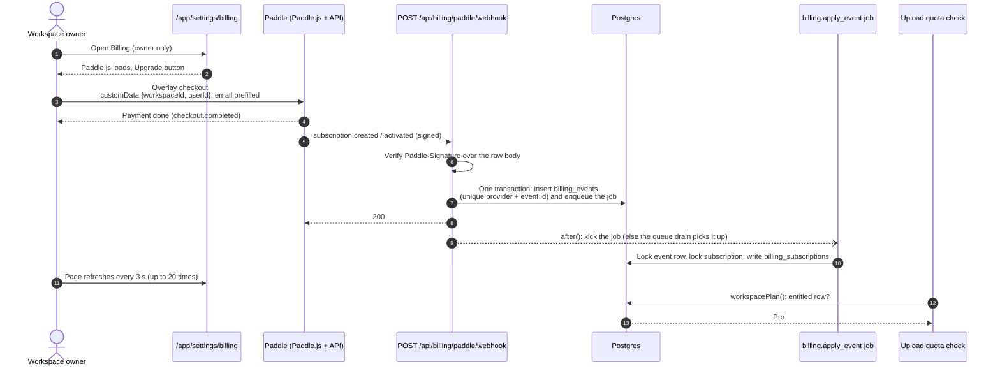

# Billing

How a workspace becomes Pro, and how the plan decides how many receipts it may scan. Payment is handled by Paddle
Billing, which is the merchant of record: it takes the payment, adds tax and sends invoices. The app never sees a card
number. The app only learns about a subscription from signed webhooks, and keeps normalized fields (ids, status, dates).

The code is in [`packages/core/src/billing`](../../../packages/core/src/billing), the quota rules in
[`quota.ts`](../../../packages/core/src/quota.ts) and [`usage.ts`](../../../packages/core/src/usage.ts), and the web side
in [`apps/web/app/api/billing`](../../../apps/web/app/api/billing) and
[`apps/web/app/app/settings/billing`](../../../apps/web/app/app/settings/billing).

## Contents

- [Plans are per workspace](#plans-are-per-workspace)
- [From checkout to plan](#from-checkout-to-plan)
- [Entitlement](#entitlement)
- [Ordering and idempotency](#ordering-and-idempotency)
- [Plans and limits](#plans-and-limits)
- [Failure modes](#failure-modes)
- [Security notes](#security-notes)
- [Configuration](#configuration)
- [How scan packs will fit](#how-scan-packs-will-fit)

## Plans are per workspace

A plan belongs to a workspace, not to a user. `workspacePlan(organizationId)` in
[`service.ts`](../../../packages/core/src/billing/service.ts) returns Pro when:

- the workspace has a `billing_subscriptions` row that is entitled (see [Entitlement](#entitlement)), or
- an owner of the workspace has `user.plan = 'pro'`. This is an admin comp. It is stored on the user, so no webhook can
  undo it.

Anything else is Free. The four rules:

1. **One subscription covers exactly one workspace.** Pro never spreads to the owner's other workspaces. A new
   workspace always starts on Free, even when its owner has a Pro workspace. (The admin comp is the one exception: it
   applies to every workspace the comped user owns.)
2. **Free: one owned workspace, and the Free allowance is per person.** The ownership cap is checked on the server in
   `beforeCreateOrganization`
   ([`assertCanCreateWorkspace`](../../../apps/web/lib/auth-guards.ts)), not only in the UI. Better Auth's own
   `organizationLimit` returns `false` (no limit) so that our hook runs and its message is shown. Free scans (20 a day, 100 a month) are
   counted per user across all workspaces, so a second workspace adds no scans.
3. **Pro: the allowance is a pool per workspace.** Its members share 500 scans per UTC calendar month and 200 per UTC
   day. Pro scans never use a member's personal Free allowance, and Free scans never use the Pro pool.
4. **A Pro owner may own up to 2 workspaces.** `accountPlan(userId)` is Pro when the user is comped or owns at least one
   Pro workspace. It only lifts the ownership cap (Free 1, Pro 2). The extra workspace stays Free until it gets its own
   subscription.

## From checkout to plan

Steps in words:

1. **Checkout.** Only an owner sees the Upgrade button. The browser opens Paddle's overlay with the workspace id and
   user id as custom data. See [`checkout-button.tsx`](../../../apps/web/components/billing/checkout-button.tsx).
2. **Webhook.** [`receiveWebhook`](../../../packages/core/src/billing/service.ts) verifies the signature, parses the body
   into a provider-neutral `BillingEvent`, and calls `recordBillingEvent`. That function inserts the `billing_events`
   row and enqueues the `billing.apply_event` job in one transaction, so there is never an event without its job.
3. **Response.** The route returns 200 and starts the job with `after()`. If that does not run, the
   [job queue](jobs.md) drain picks the job up.
4. **Apply.** [`applyBillingEvent`](../../../packages/core/src/billing/service.ts) writes the normalized fields to
   `billing_subscriptions`. The job kind is in
   [`kinds/billing-apply.ts`](../../../packages/core/src/jobs/kinds/billing-apply.ts) (8 attempts, 30 s lease, backoff
   5 s up to 10 min). A database error is retried. A payload the schema refuses goes to the dead state and shows in the
   admin jobs list.
5. **Plan.** The next upload reads `workspacePlan` fresh from the database (not the session cache), so a webhook or an
   admin change applies at once.

Manage and cancel use Paddle's customer portal. The server action
[`openBillingPortalAction`](../../../apps/web/app/app/settings/billing/actions.ts) calls
`POST /customers/{id}/portal-sessions` and returns short-lived links. They are made per click and never stored.

### Webhook responses

| Status | When                                                                                                         |
| ------ | ------------------------------------------------------------------------------------------------------------ |
| 200    | Stored and job enqueued; or a redelivery (nothing new); or an event type we do not subscribe to (not stored) |
| 400    | The body is not valid JSON or not the expected shape                                                         |
| 401    | `Paddle-Signature` is missing, malformed, wrong or too old or new                                            |
| 413    | The body is over 256 KB                                                                                      |
| 503    | Billing is off (any Paddle setting is missing)                                                               |

Paddle retries 400 and 401 responses, so a bad deployment (for example a wrong secret) heals once it is fixed. Events
handled: `subscription.created`, `.updated`, `.activated`, `.canceled`, `.past_due`, `.paused`, `.resumed` and
`transaction.completed`.

## Entitlement

`isEntitled(subscription, now)` in [`entitlement.ts`](../../../packages/core/src/billing/entitlement.ts) decides whether a
stored subscription grants Pro. `entitledSql` (in `service.ts`) is the same rule for queries, and a unit test keeps the two in step.

| Stored status        | Grants Pro when                                                                                                                                               |
| -------------------- | ------------------------------------------------------------------------------------------------------------------------------------------------------------- |
| `active`, `trialing` | Always, unless a cancel is scheduled for the period end (`cancel_at_period_end`) and that end has passed (in case the final `canceled` event is late or lost) |
| `past_due`           | For 14 days from `past_due_since` (`PAST_DUE_GRACE_DAYS`), while Paddle retries the card                                                                      |
| `canceled`           | Only if `cancel_at_period_end` is set and the period end is still ahead                                                                                       |
| `paused`             | Never                                                                                                                                                         |

`past_due_since` is set from the event's `updated_at` when the status first becomes `past_due`, and kept while it
stays `past_due`. Any other status clears it.

## Ordering and idempotency

| Concern                      | How it is handled                                                                                                                                                                                   |
| ---------------------------- | --------------------------------------------------------------------------------------------------------------------------------------------------------------------------------------------------- |
| Same event delivered twice   | `billing_events` has a unique index on `(provider, provider_event_id)`. The second insert does nothing and no second job is enqueued.                                                               |
| Job runs twice               | The job locks the event row `FOR UPDATE` and skips it if `processed_at` is set (outcome `already-applied`). The job also has an idempotency key `billing:event:<id>`.                               |
| Events arrive out of order   | Each snapshot carries Paddle's `updated_at`. A snapshot older than the stored one is recorded with outcome `stale` and not applied.                                                                 |
| Two events, one subscription | A transaction advisory lock per `provider:subscription id` serializes the writes.                                                                                                                   |
| Which workspace              | The workspace id from `custom_data` links a **new** subscription only, and only if that workspace exists. Otherwise the outcome is `unmatched`. Later events use the stored link and never move it. |
| `transaction.completed`      | Carries no subscription state, so the outcome is `ignored`. The subscription's own events follow.                                                                                                   |

Outcomes stored in `billing_events.outcome`: `applied`, `stale`, `ignored`, `unmatched`.

The stored payload is the normalized event (ids, status, dates, price id, custom data ids). It is not the raw body, so it
holds no card or address data.

## Plans and limits

This is the one table of limits. Defaults are in [`plans.ts`](../../../packages/core/src/plans.ts). An admin changes the
plan fields in **Admin → Settings → Plan limits** (saved in `app_settings`; a missing or unreadable row falls back to
these defaults). A plan's `scope` (Free: `user`, Pro: `workspace`) is kept from the saved table and is not in the form.

| Limit                 | Free                          | Pro          | How it is counted                                                                                                                                                                | What the user sees when it is hit                                                                                                                                                                                                                    | Where an admin changes it                |
| --------------------- | ----------------------------- | ------------ | -------------------------------------------------------------------------------------------------------------------------------------------------------------------------------- | ---------------------------------------------------------------------------------------------------------------------------------------------------------------------------------------------------------------------------------------------------- | ---------------------------------------- |
| Scans a day           | 20                            | 200          | Free: per person, across all their workspaces. Pro: per workspace, shared by its members. UTC day. Only rounds of that plan (`ocr_rounds.plan`).                                 | Free: "You've used all 20 receipts for today. You can upload again after 00:00 UTC." Pro: "Daily limit reached. It resets at midnight UTC. N of 500 scans left this month."                                                                          | Plan limits, `receiptsPerDay`            |
| Scans a month         | 100                           | 500          | Same scope as the day limit. UTC calendar month. Empty = no monthly limit.                                                                                                       | Free: "You've used all 100 scans on the Free plan this month. They reset on 1 December at 00:00 UTC. Upgrade a workspace to Pro for more scans." Pro: "This workspace has used all 500 scans for this month. They reset on 1 December at 00:00 UTC." | Plan limits, `receiptsPerMonth`          |
| Scope                 | `user`                        | `workspace`  | Whose rounds the day and month limits count. A member's Pro scans never use their Free allowance, and the reverse.                                                               | The usage meter says whose count it shows                                                                                                                                                                                                            | Not editable (kept from the saved table) |
| Free pool             | 300 a day                     | none         | Every round of that plan today, all users together, failed ones included. A Free pool that is full never blocks Pro.                                                             | "Free scanning is busy today. Try again tomorrow, or upgrade to Pro."                                                                                                                                                                                | Plan limits, `poolPerDay` (empty = none) |
| Burst a minute        | 10                            | 30           | Each user's rounds in the last 60 seconds, failed ones included, any plan.                                                                                                       | "Too many uploads at once. Wait a minute and try again."                                                                                                                                                                                             | Plan limits, `receiptsPerMinute`         |
| Images in one batch   | 10                            | 10           | Client-side cap on the camera tray plus picked files (1 to 20). The other limits still apply per upload.                                                                         | The picker stops adding files                                                                                                                                                                                                                        | Plan limits, `batchMax`                  |
| Workspaces to own     | 1                             | 2            | Workspaces where the user has the `owner` role. A user is on the Pro cap when they own a Pro workspace or are comped. Checked on the server when creating one.                   | "Free accounts can own 1 workspace. Upgrade a workspace you own to Pro to create another. A new workspace starts on Free."                                                                                                                           | Plan limits, `workspaces`                |
| All-plans fuse        | `OCR_DAILY_CAP` (about 1,000) | same         | Every round started by anyone today, plus automatic retry attempts that called a model. Only checked when set.                                                                   | "Receipt reading is at capacity for today. Try again after 00:00 UTC."                                                                                                                                                                               | Environment variable `OCR_DAILY_CAP`     |
| Failed-read allowance | 5 per window                  | 5 per window | The first 5 finished failed reads in a day (and in a month) do not count toward that limit; later ones count like a receipt (`FREE_FAILED_ROUNDS`). Reads still in flight count. | Nothing until the limit above is reached                                                                                                                                                                                                             | Constant in `plans.ts`                   |

Free's monthly limit exists because 20 a day for 30 days is 600, more than Pro's 500. The daily limit is now the pace
inside the month.

**Check order for one upload** ([`decideQuota`](../../../packages/core/src/quota.ts)); the first refusal decides the
message:

1. Global fuse (`OCR_DAILY_CAP`).
2. The plan's pool for today (Free only).
3. The month, for the plan's scope.
4. The day, for the plan's scope.
5. The user's burst minute.

`UsageCounts` is `{ userMinute, day, month, planDay, globalDay }`, already for the plan's scope.

**Locks.** The round is written in the same transaction as the check, under advisory locks. The user lock is always
taken. On a workspace-scoped plan the workspace lock is taken too, always in that order (user, then workspace), so two
members cannot both take the last scan. The Free pool and the global cap take no lock. Uploads by different users can
pass them together, so each can overshoot by at most the number of uploads in flight at that moment.

**`OCR_DAILY_CAP`:** set it to about 1,000, above the Free pool (300) and the expected Pro use, so it is only an
emergency fuse.

What "used" means is in [core: quota ledger semantics](../core.md#design-principles-and-invariants).

## Failure modes

| What goes wrong                                 | What happens                                                                                                                                     |
| ----------------------------------------------- | ------------------------------------------------------------------------------------------------------------------------------------------------ |
| A Paddle setting is missing                     | Billing is off: no Upgrade button, no portal link, no Paddle.js, webhook answers 503. Plans still work (Free, and admin comps).                  |
| Wrong webhook secret                            | Every delivery gets 401 and Paddle retries. Nothing is stored. Fix the secret; Paddle's retries then succeed.                                    |
| App down or slow when Paddle calls              | Paddle retries. A repeat is stored once. A late event is ordered by `updated_at`.                                                                |
| `after()` does not run the job                  | The event row and its job exist. The queue drain applies it within the drain interval.                                                           |
| Database error while applying                   | The job retries up to 8 times with backoff; then it is dead and shows in the admin jobs list. The event row stays unprocessed.                   |
| Checkout paid but no workspace link             | Custom data was missing or the workspace was deleted: outcome `unmatched`, no Pro. Find it in `billing_events` and fix by hand (comp or refund). |
| Final `canceled` event lost                     | A scheduled cancel passes its period end, and `isEntitled` stops granting Pro on its own.                                                        |
| Card fails on renewal                           | `past_due`: Pro stays for 14 days, the billing page shows the end of the grace period and a link to update the payment method.                   |
| Paddle's API is down when opening the portal    | The action returns "Paddle didn't answer. Try again in a minute." (10 s timeout). Nothing is stored.                                             |
| Owner tries to delete a workspace with live Pro | Refused with a message to cancel first (`assertNoLiveSubscription`). A subscription that is already cancelling can be deleted.                   |
| Workspace deleted anyway (admin)                | `billing_subscriptions.organization_id` is set to null. The row stays as the billing record.                                                     |

## Security notes

- **Signature.** `Paddle-Signature` is `ts=<unix>;h1=<hex>`. The expected value is HMAC-SHA256 over `<ts>:<raw body>`
  with the destination secret, hex encoded. Any `h1` may match (Paddle sends several while a secret rotates). The compare is
  constant time. The timestamp may differ from our clock by 30 seconds in either direction
  (`SIGNATURE_TOLERANCE_SECONDS`). Paddle's SDKs default to 5 seconds; 30 allows for a cold start, and a replay inside
  the window is a no-op because events are stored once by id. The raw body is read before parsing.
- **Body size.** Over 256 KB is refused with 413 before any parsing.
- **Owner only.** Checkout and portal links are for workspace owners. Admins and members see the plan read-only. The
  server action checks the role again; the UI is not the control.
- **Impersonation.** While an admin is signed in as another user, the billing page hides the actions and the server
  action refuses.
- **Custom data is not trusted.** `workspaceId` and `userId` come from the browser, so a buyer could name any
  workspace. They are used only to link a **new** subscription, and only to a workspace that exists. The link is never
  moved by later events. The buyer pays for what they link, so the worst case is paying for someone else's workspace.
  (`billing_events.organization_id` is null when the event is stored and set only by the apply job, from the resolved
  workspace.)
- **Data kept.** Ids, status, dates, interval and price id. No card, address or tax data, and no raw webhook body.
- **No SDK.** The Paddle adapter uses `node:crypto` and `fetch`, so there is no Paddle package to trust or update.
- **Paddle.js.** It loads only on the billing page, and only when billing is configured. The report-only CSP allows
  `https://cdn.paddle.com` (script), `https://buy.paddle.com` and `https://sandbox-buy.paddle.com` (frame) and
  `https://*.paddle.com` (connect) only when `NEXT_PUBLIC_PADDLE_CLIENT_TOKEN` is set at build time
  ([`lib/csp.ts`](../../../apps/web/lib/csp.ts)).
- **Logs.** The webhook adds provider, event type, event id, subscription id and status to its wide event. No email, no
  card data.

## Pure files

These files import nothing from `@receipt-ocr/db`, Effect or other core modules (only siblings in `billing/`), so they
can move to a `packages/billing` later without untangling core:

- [`billing/provider.ts`](../../../packages/core/src/billing/provider.ts): neutral event types and
  `SUBSCRIPTION_STATUSES` (a test checks it equals `BILLING_STATUSES` in packages/db).
- [`billing/paddle.ts`](../../../packages/core/src/billing/paddle.ts): signature check, event parsing, portal call.
- [`billing/entitlement.ts`](../../../packages/core/src/billing/entitlement.ts): `isEntitled` and the grace period.
- [`billing/config.ts`](../../../packages/core/src/billing/config.ts): `parsePaddleConfig`, a plain function.
- [`plans.ts`](../../../packages/core/src/plans.ts): plan shape and defaults. Client components import it too.

Everything that touches the database or Effect is in [`billing/service.ts`](../../../packages/core/src/billing/service.ts):
`entitledSql`, `workspacePlan`, `accountPlan`, `workspaceCreationCheck`, `loadPaddleConfig` (reads the environment with
Effect `Config`, then calls `parsePaddleConfig`), the webhook receiver and the apply step.

## Configuration

Billing is on only when **all** of these are set. See [Production environment](../../production-environment.md) for the
steps.

| Variable                          | Kind   | Meaning                                                     |
| --------------------------------- | ------ | ----------------------------------------------------------- |
| `PADDLE_ENV`                      | Config | `sandbox` or `production` (anything else turns billing off) |
| `PADDLE_API_KEY`                  | Secret | Server API key, used for portal sessions                    |
| `NEXT_PUBLIC_PADDLE_CLIENT_TOKEN` | Config | Public client-side token. Needed at build time for the CSP  |
| `PADDLE_WEBHOOK_SECRET`           | Secret | Secret of the webhook destination                           |
| `PADDLE_PRICE_PRO_MONTHLY`        | Config | Price id of the monthly Pro price                           |
| `PADDLE_PRICE_PRO_YEARLY`         | Config | Price id of the yearly Pro price                            |

Public pages: `/pricing` (Free and Pro, monthly or yearly), `/refunds`, and the terms and privacy pages, which name
Paddle as reseller and merchant of record.

## How scan packs will fit

Scan packs ($5 for 500, $15 for 2,000, valid 12 months) are **not built**. The design leaves room for them:

- A **credit grant** table: workspace, scans bought, scans used or remaining, `expires_at` (12 months after purchase),
  and the provider transaction id.
- The same ingestion path. A pack is a one-time `transaction.completed` that names a pack price. Today that event is
  stored and ignored. A pack handler would be one more branch in `applyBillingEvent`, with the same signature check,
  `billing_events` idempotency and `custom_data.workspaceId` link.
- A round that has used up its monthly allowance draws from the oldest unexpired grant. It records that on
  `ocr_rounds` (a new `plan` or `source` value such as `pack`, or a grant id), so the ledger stays the only thing quota
  counts.
- Quota order gains one step: month exhausted, then pack credit, then block. The daily and burst limits still apply.
- Free workspaces could buy packs too; that is a product decision, not a technical one.
