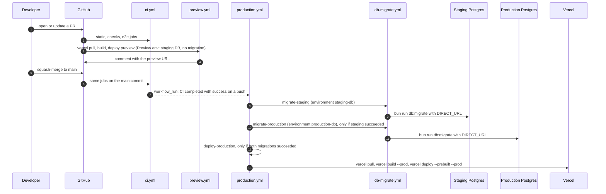
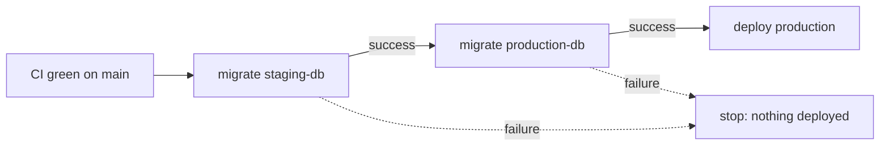
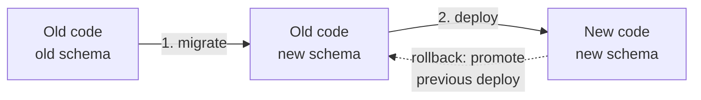
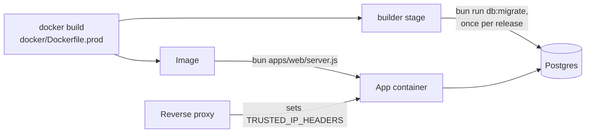

# CI, deployment and migrations

How a change gets from a branch to production, and where database migrations fit. The operator checklist (variables,
backups, rollback, secret rotation) is in [deployment.md](../../deployment.md); this page explains the moving parts.

## From pull request to production

- **CI jobs** ([`ci.yml`](../../../.github/workflows/ci.yml)): `static` runs format, lint, dependency pins, knip and
  audit; `checks` runs typecheck, unit tests and build; `e2e` starts Postgres and RustFS as services, applies every
  migration to an empty database, runs the core and web integration suites, builds, and runs Playwright with the
  fixture OCR provider.
- **Previews** ([`preview.yml`](../../../.github/workflows/preview.yml)) run in the GitHub environment `vercel-preview` (production uses `vercel`) and use the Vercel project's preview environment,
  which points at the staging database. They never migrate it, so a PR's own migration isn't there until it merges.
  The app's origin on a preview is its own host (`VERCEL_BRANCH_URL`, else `VERCEL_URL`) unless `BETTER_AUTH_URL` is
  set, and both preview hosts stay trusted either way ([`lib/env.ts`](../../../apps/web/lib/env.ts)). Dependabot PRs are skipped because they get no secrets.
- **Production** ([`production.yml`](../../../.github/workflows/production.yml)) runs only after CI succeeded on a
  push to `main`, or when started by hand from `main` (a manual run on another branch is skipped). It runs one at a
  time (`cancel-in-progress: false`), migrates and builds the commit CI tested rather than whatever `main` points at
  by then, and deploys only after both migrations succeed.
- The Vercel token is given only to the `pull` and `deploy` steps. The build step runs repository code and gets no
  token. Deploys upload one archive (`--archive=tgz`) to stay under the free plan's file-upload quota.

## Migrations run in CI, first

[`db-migrate.yml`](../../../.github/workflows/db-migrate.yml) is a reusable workflow: given a GitHub environment
(`staging-db` or `production-db`, both limited to `main`), it checks out the commit, installs with the frozen
lockfile and runs `bun run db:migrate` with that environment's `DIRECT_URL` secret. Its job-level `concurrency`
group (`db-migrate-<environment>`, never cancelled while running; a newer queued run replaces a waiting one) keeps
two runs off the same database, whether they come from the
pipeline or from a manual **Database Migration** run, which is the recovery path. `drizzle-kit` applies all pending
files in one transaction, so a failed run changes nothing
([runbook](../../runbook.md#migration-failed-in-ci)).

The order is **migrate, then deploy**, because:

- the new code may need the new schema, and fails without it;
- the old code keeps working against the new schema, as long as migrations only add (nullable or defaulted columns,
  new tables, new indexes) and removals wait for a later release.

A code rollback is "promote the previous deployment" in Vercel; the schema stays, which the old code already ran
against in step 1. Migrations only go forward; a damaged database is restored from the backup taken before migrating.

Two connection strings exist because Supabase's transaction pooler (6543, used by the app as `DATABASE_URL`) can't run
DDL. [`drizzle.config.ts`](../../../apps/web/drizzle.config.ts) uses `DIRECT_URL` when set.

## Self-hosted (Docker)

The same order applies: run the `builder` stage's `bun run db:migrate` (as the compose `migrate` service does), then
start the new image. Off Vercel the app refuses to start in production without `TRUSTED_IP_HEADERS`.

## Boot-time checks

[`instrumentation.ts`](../../../apps/web/instrumentation.ts) calls
[`instrumentation-node.ts`](../../../apps/web/instrumentation-node.ts) when the Node server starts; it imports
[`lib/env.ts`](../../../apps/web/lib/env.ts) and exits the process if that throws. It throws for a half-configured OAuth provider, no `BETTER_AUTH_URL` in production, malformed `BETTER_AUTH_SECRETS` or `TRUSTED_PROXIES`, and (off Vercel) no
`TRUSTED_IP_HEADERS`. A misconfigured deploy fails at start instead of failing every sign-in.

After boot, `onRequestError` in the same file logs any render, route or action failure as `request.error` with the
message (database params redacted) and digest only, and [`app/global-error.tsx`](../../../apps/web/app/global-error.tsx)
renders the last-resort error page.

**Planned:** branch protection on `main` requiring CI (decision 8 in [STATUS](../../STATUS.md)), and source-map upload
in `production.yml` with the [observability plan](../../plans/2026-11-06-observability.md).
