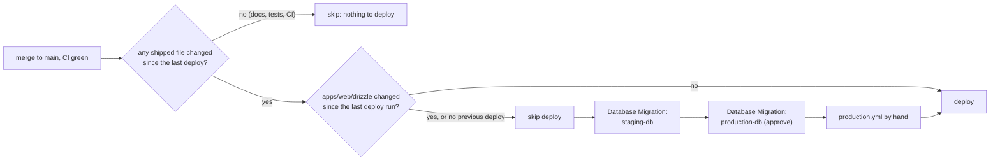
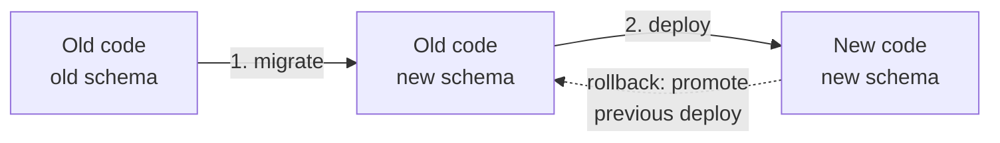
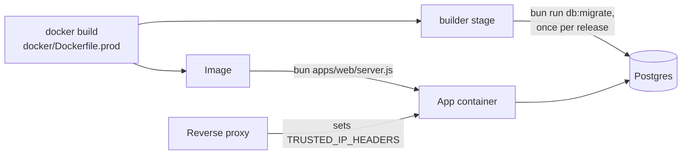

# CI, deployment and migrations

How a change gets from a branch to production, and where database migrations fit. The operator checklist (variables,
backups, rollback, secret rotation) is in [deployment.md](../../deployment.md); this page explains the moving parts.

## From pull request to production

```mermaid
sequenceDiagram
  autonumber
  participant Dev as Developer
  participant GH as GitHub
  participant CI as ci.yml
  participant PV as preview.yml
  participant PR as production.yml
  participant M as db-migrate.yml
  participant SDB as Staging Postgres
  participant DB as Production Postgres
  participant V as Vercel

  Dev->>GH: open or update a PR
  GH->>CI: static, checks, e2e jobs
  Dev->>GH: add the preview label (optional)
  GH->>PV: labeled: vercel pull, build, deploy once (Preview env: staging DB, no migration)
  PV->>GH: comment with the preview URL
  Dev->>GH: squash-merge to main
  GH->>CI: same jobs on the main commit
  CI-->>PR: workflow_run: CI completed with success on a push
  PR->>PR: gate: diff apps/web/drizzle against the last successful deploy run
  alt nothing that ships changed (docs, tests, CI only)
    PR->>GH: skip the deploy; summary says why
  else no migration changes
    PR->>V: vercel pull, vercel build --prod, vercel deploy --prebuilt --prod
  else migrations changed, or no previous deploy
    PR->>GH: skip the deploy; summary says to run Database Migration
    Dev->>M: run by hand on main: staging-db
    M->>SDB: bun run db:migrate with DIRECT_URL
    Dev->>M: run by hand on main: production-db (owner approves)
    M->>DB: bun run db:migrate with DIRECT_URL
    Dev->>PR: run by hand on main
    PR->>PR: gate: CI passed on the commit, production-db ran the same migrations
    PR->>V: vercel pull, vercel build --prod, vercel deploy --prebuilt --prod
  end
```

- **CI jobs** ([`ci.yml`](../../../.github/workflows/ci.yml)): `static` runs format, lint, dependency pins, knip and
  audit; `checks` runs typecheck, unit tests and build; `e2e` starts Postgres and RustFS as services, applies every
  migration to an empty database, runs the core and web integration suites, builds, and runs Playwright with the
  fixture OCR provider.
- **Previews** ([`preview.yml`](../../../.github/workflows/preview.yml)) are label-only until launch, because the free Vercel plan
  allows 100 deployments a day, shared with production. A PR gets one only when it carries the `preview` label, and the
  deploy runs once, when the label is added; later pushes don't redeploy. To refresh, remove and re-add the label. The
  repository variable `PREVIEW_MODE=auto` also deploys pushes to ready-for-review PRs that change something the app
  ships, and a push to the `preview` branch always deploys the fixed preview domains. They run in the GitHub environment `vercel`, like production, and use the Vercel project's preview environment,
  which points at the staging database. They never migrate it, so a PR's own migration isn't there until it merges.
  The app's origin on a preview is its own host (`VERCEL_BRANCH_URL`, else `VERCEL_URL`) unless `BETTER_AUTH_URL` is
  set, and both preview hosts stay trusted either way ([`lib/env.ts`](../../../apps/web/lib/env.ts)). Dependabot PRs are skipped because they get no secrets.
- **Production** ([`production.yml`](../../../.github/workflows/production.yml)) runs only after CI succeeded on a
  push to `main` from this repository, or when started by hand from `main` (a manual run on another branch is
  skipped). It runs one at a time (`cancel-in-progress: false`) and builds the commit CI tested rather than whatever
  `main` points at by then. Its `gate` job skips the automatic deploy when `apps/web/drizzle/` differs from the
  commit of the last run whose `deploy-production` job succeeded (found with `last-deployed-sha.sh` through the Actions
  API; no git tag), or that run can't be found; it also skips when no file that ships changed since that commit
  (`shipped-files.sh` ignores docs, Markdown, tests, benchmarks, repo scripts and CI config, but counts the Vercel CLI
  lockfile); a manual run deploys only if CI passed on its commit and the newest
  successful `production-db` migration run had the same `apps/web/drizzle/`.
- The Vercel token is given only to the `pull` and `deploy` steps. The build step runs repository code and gets no
  token. Deploys upload one archive (`--archive=tgz`) to stay under the free plan's file-upload quota.

## Migrations run by hand, first

[`db-migrate.yml`](../../../.github/workflows/db-migrate.yml) runs only by `workflow_dispatch` on `main`. Given a GitHub
environment (`staging-db` or `production-db`, both limited to `main`; `production-db` needs the owner's approval), it
runs a `preflight` job before approval (the ref is `main`; for `production-db`, the newest successful `staging-db`
run has the same migrations), checks out the commit, installs with the frozen lockfile, validates and masks
`DIRECT_URL` without printing it, and runs `bun run db:migrate`. Its job-level `concurrency` group
(`db-migrate-<environment>`, never cancelled while running; a newer queued run replaces a waiting one) keeps two runs
off the same database. `drizzle-kit` applies all pending files in one transaction, so a failed run changes nothing
([runbook](../../runbook.md#migration-failed)).



The order is **migrate, then deploy**, because:

- the new code may need the new schema, and fails without it;
- the old code, still live while migrations run, keeps working against the new schema, as long as migrations stay
  backward compatible: expand (nullable or defaulted columns, new tables, new indexes), then contract (drops and
  renames) in a later release.



A code rollback is "promote the previous deployment" in Vercel; the schema stays, which the old code already ran
against in step 1. Migrations only go forward; a damaged database is restored from the backup taken before migrating.

Two connection strings exist because Supabase's transaction pooler (6543, used by the app as `DATABASE_URL`) can't run
DDL. [`drizzle.config.ts`](../../../apps/web/drizzle.config.ts) uses `DIRECT_URL` when set.

## Self-hosted (Docker)



The same order applies: run the `builder` stage's `bun run db:migrate` (as the compose `migrate` service does), then
start the new image. Off Vercel the app refuses to start in production without `TRUSTED_IP_HEADERS`.

## Boot-time checks

[`instrumentation.ts`](../../../apps/web/instrumentation.ts) calls
[`instrumentation-node.ts`](../../../apps/web/instrumentation-node.ts) when the Node server starts; it imports
[`lib/env.ts`](../../../apps/web/lib/env.ts) and exits the process if that throws. It throws for a half-configured OAuth provider, no `BETTER_AUTH_URL` in production, malformed `BETTER_AUTH_SECRETS` or `TRUSTED_PROXIES`, and (off Vercel) no
`TRUSTED_IP_HEADERS`. A misconfigured deploy fails at start instead of failing every sign-in.

After boot, `onRequestError` in the same file logs any render, route or action failure as `request.error` with the
message (database params redacted) and digest only, and [`app/global-error.tsx`](../../../apps/web/app/global-error.tsx)
renders the last-resort error page.

**Planned:** branch protection on `main` requiring CI (decision 7 in [STATUS](../../STATUS.md)), and source-map upload
in `production.yml` with the [observability plan](../../plans/2026-11-06-observability.md).
