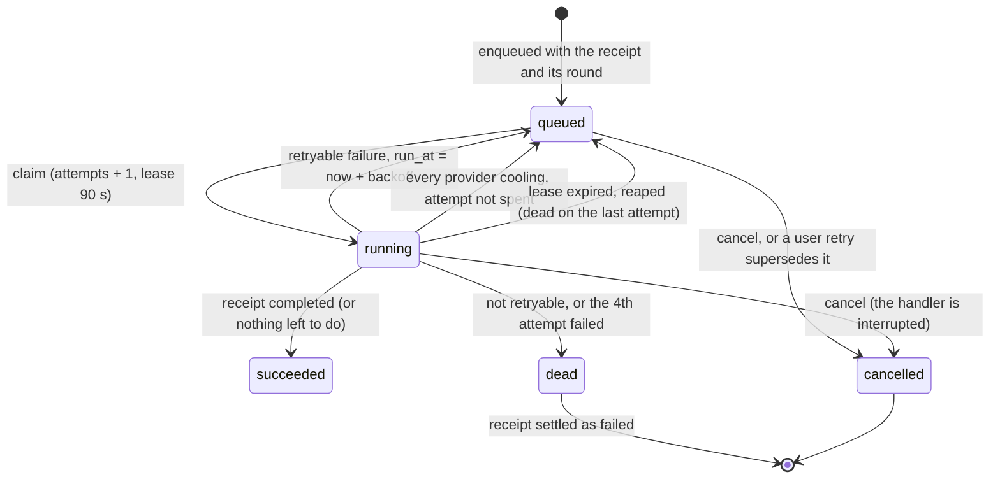
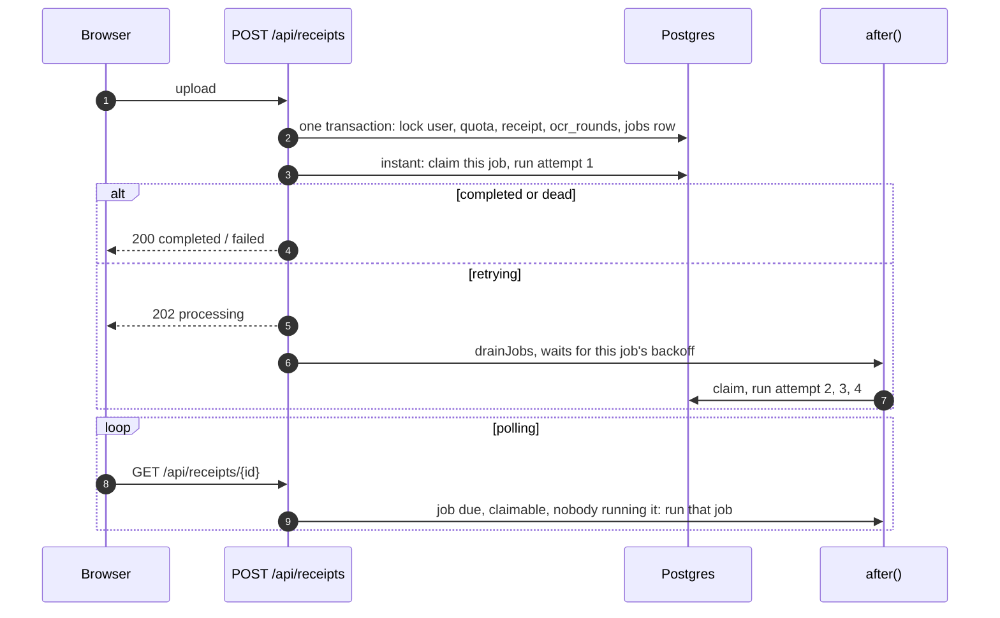

# Background jobs

How a receipt gets read after it is accepted: a durable `receipt.extract` job in Postgres, claimed by whatever runs
the queue, retried with backoff, and only then allowed to fail the receipt. The code is in
[`packages/core/src/jobs`](../../../packages/core/src/jobs); the decision and the alternatives are in the
[jobs plan](../../plans/2026-11-06-jobs-queue.md).

## Contents

- [Two state machines](#two-state-machines)
- [Who runs the queue](#who-runs-the-queue)
- [Claim, lease and fencing](#claim-lease-and-fencing)
- [Retries, dead jobs and cooldowns](#retries-dead-jobs-and-cooldowns)
- [Quota and cost](#quota-and-cost)
- [Orphaned jobs](#orphaned-jobs)
- [Tables](#tables)

## Two state machines

The receipt row stays what the user sees (`processing`, `completed`, `failed`). The job row is how the work runs.

`queued` includes "waiting to retry": `run_at` is then in the future. Only the job's final-failure hook marks the
receipt `failed`, so a failed first attempt leaves the receipt `processing` while the job retries.

## Who runs the queue

`tick(budget)` in [`runner.ts`](../../../packages/core/src/jobs/runner.ts) reaps expired leases, then claims and runs
jobs until nothing is runnable or the budget says stop. Every runner calls it; nothing else changes between them.

| Runner (today)                                    | When                                                          | Budget and waits                                                                           |
| ------------------------------------------------- | ------------------------------------------------------------- | ------------------------------------------------------------------------------------------ |
| `runJobNow` in `POST /api/receipts` instant mode  | First attempt of the upload                                   | In the request, this job only, no waiting                                                  |
| `drainJobs` in `after()` of uploads and retries   | After the response                                            | Until 290 s after the route started; sleeps through backoff only for its own job, 90 s max |
| `kickJob` in `after()` of `GET /api/receipts/:id` | A poll finds the receipt's job due, claimable and not running | That one job only, no waiting; returns at once if it can't claim it                        |

Upload and retry drains also run anyone else's due jobs; the poll kick never does, so poll traffic can't become
queue concurrency. Every unfiltered tick (one that may claim any job of its kinds, such as a drain)
records the time per kind it serves in `job_controls` (scope `tick:<kind>`, at most every 30 s per process per kind),
which the orphan rule below reads. Ticks filtered to a few ids (`runJobNow`, the poll kick) record nothing: they
don't drain anyone else's jobs. A worker app and a cron-triggered drain route come next (Track B of the
plan); they call the same `tick`.

## Claim, lease and fencing

- **Claim** is one statement: lock up to `4n` runnable candidates with `FOR UPDATE SKIP LOCKED`, rank them per user
  with `row_number()`, keep those under the per-user running cap (2), take `n` in priority then `run_at` order, and
  mark them `running` with `attempts + 1` and a lease. Paused kinds and a paused queue (`job_controls`) are skipped.
  Concurrent claimers never wait on each other or claim the same row.
- **Heartbeat** renews the lease every third of it. It touches no indexed column, so it is a HOT update. If it
  matches no row (reaped, cancelled), the handler is interrupted; its `AbortSignal` stops the model call.
- **Fencing.** Every write after the claim matches `id`, `locked_by`, `attempts` and `state = 'running'`. A worker
  whose lease expired, even one that claimed the same job again under the same id, changes nothing. The receipt write
  keeps its own guard (`status = 'processing' and attempts = round`), so a job for an older round can't overwrite a
  newer one.
- **Reaper**, at the start of every tick: running jobs past their lease go back to `queued`, or to `dead` on their
  last attempt (then the receipt is settled, with one `timeout` row for the attempt that never reported).
- Everything is plain statements and transactions: no LISTEN, no session advisory locks, no prepared statements. It
  works through Supabase's transaction pooler.

## Retries, dead jobs and cooldowns

| Failure                                                                                                                                 | Next                                                                                                            |
| --------------------------------------------------------------------------------------------------------------------------------------- | --------------------------------------------------------------------------------------------------------------- |
| `timeout`, `rate-limited`, `provider-error`, storage, DB                                                                                | Retry after backoff, up to 4 attempts                                                                           |
| `invalid-output`, `bad-image`, `not-configured`, `refused`, `unsupported-file`, unreadable stored file, bad payload                     | Dead now (`refused` and `unsupported-file` already tried every model; each has its own receipt message)         |
| A chain where any step hit `timeout`, `rate-limited` or `provider-error`, whatever the last step's kind (e.g. a 429, then HEIC skipped) | Retry after backoff, as that transient kind                                                                     |
| Steps left out for a cooling provider and the rest failed for good (`refused`, `unsupported-file`, ...)                                 | Retry, as `providers-cooling`, once the first left-out provider is back (spends an attempt, so the cap ends it) |
| Every provider in the chain cooling down                                                                                                | Back to `queued` at the cooldown end, attempt not spent                                                         |

- Backoff: `min(10 min, 10 s x 2^(attempt-1))`, jittered to 50 to 100%. A provider's Retry-After (a header, or
  Gemini's `RetryInfo.retryDelay` in the 429 body) is a floor, and so is the cooldown the failure starts (30 s for a
  429 with no hint), so a retry never runs while its own provider is still left out (capped at 10 min). Delays are computed with the database's `now()`, so app and database clock skew doesn't matter.
- A 429 writes a cooldown for the whole provider (`job_controls` scope `provider:<id>`, Retry-After or 30 s, at most
  10 min). Every job reads cooldowns before calling the model and skips cooling providers, so one 429 slows every job
  for that provider, not only the one that hit it.
- Each attempt's calls go to `ocr_calls` with its `job_attempt`, whether it succeeded or not.

## Quota and cost

- The quota is reserved once per round, when the job is enqueued, under the user's advisory lock. Automatic retries
  reuse the round and never touch `ocr_rounds`.
- While a round's own job is live it counts as in flight, whatever calls it has made, so a failed first attempt
  can't make room under the daily limit. Once the job is settled, the usual rules apply (a read counts once; failed
  rounds beyond the first five a day count).
- `OCR_DAILY_CAP` counts rounds plus every retry attempt that called a model, because the cap bounds spend and one
  round can make four attempts. The cap is checked when a round is admitted; rounds already running may finish
  their retries past it.

## Orphaned jobs

A job can be left with nobody running it: a backoff or cooldown longer than the request's budget, or a function
killed at its time limit. Two things cover that until a worker or cron drain exists:

1. The receipt page polls `GET /api/receipts/:id` (for up to 6 minutes of visible polling, past the worst-case
   retry chain of about 4 minutes; "Check again" polls once more). A poll that finds the job queued and due, or
   running past its lease, runs that job in `after()`, unless a pause or the owner's running cap would stop the
   claim anyway. A job nobody polls for waits for the next drain.
2. A job stops counting as live (`liveReceiptJob` in [`live.ts`](../../../packages/core/src/jobs/live.ts), one SQL
   fragment for the stale rule, the quota rule and receipt lookups) only when it is really orphaned:
   - queued, past its `run_at` by more than 5 minutes, **and** no unfiltered tick serving its kind has run anywhere for
     5 minutes, so nothing is draining that kind at all (a kind no handler serves ages out this way too); or
   - running with its lease expired more than 5 minutes ago.

   A job that is only waiting its turn (a backlog, its owner at the running cap, a pause) stays live, because ticks
   keep running, so its receipt reads as processing and its round keeps holding quota. An orphaned job's receipt
   reads as failed, its round frees the quota, and the user's retry cancels the old job.

## Tables

`jobs` and `job_controls` come from migration
[`0000_baseline.sql`](../../../apps/web/drizzle/0000_baseline.sql); see the [data model](../data-model.md#background-jobs).
