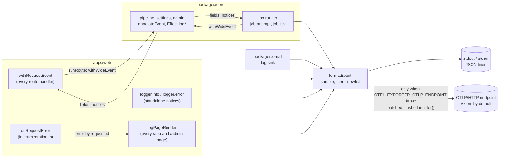

# Observability: wide events

Every unit of work writes **one** JSON line, a wide event, when it finishes: an API request, a server render of an
`/app` or `/admin` page, a job attempt and a queue tick. Code adds facts to the current event instead of writing lines
of its own. The schema, the redaction allowlist, tail sampling and the logger all live in
[`packages/core/src/telemetry`](../../../packages/core/src/telemetry), so core, the web app and a future worker write the
same events. The decision behind this (OTLP as the only transport, Axiom as the default destination) is in the
[observability plan](../../plans/2026-11-06-observability.md#decided-owner-2026-11-06).

## Where events come from

| Event                              | Unit          | Written by                                                                | Sampled when routine                      |
| ---------------------------------- | ------------- | ------------------------------------------------------------------------- | ----------------------------------------- |
| `receipt.upload`, `receipt.retry`… | `request`     | [`withRequestEvent`](../../../apps/web/lib/http.ts), one per API request  | polls, health, session reads, group reads |
| `page.render`                      | `page`        | [`logPageRender`](../../../apps/web/lib/page-event.ts), in `after()`      | every successful render                   |
| `job.attempt`                      | `job_attempt` | [`runner.ts`](../../../packages/core/src/jobs/runner.ts), claim to settle | never                                     |
| `job.tick`                         | `job_tick`    | `runner.ts`, one per drain                                                | idle ticks                                |
| `request.error`                    | `log`         | `onRequestError`; a failed render is also folded into its `page.render`   | never                                     |
| `email.*`, `health.not_ready`, …   | `log`         | standalone notices outside any unit                                       | never                                     |

`job.attempt` replaced `job.run`. It carries the queue wait (`queue.wait_ms`, by the database clock), the outcome,
the OCR model, calls, tokens and cost, and per-step `timings_ms` (`storage.get`, `ai.extract`, `db.complete`). The
request that triggered the run passes its `request_id` and `trigger` (`upload`, `retry`, `poll`, `drain`), so one id
finds a request and every job attempt it caused.

## The schema is the allowlist

[`schema.ts`](../../../packages/core/src/telemetry/schema.ts) lists every key and the kind of value it may hold.
[`sanitize`](../../../packages/core/src/telemetry/redact.ts) runs inside `formatEvent`, before any sink:

- Unknown keys are dropped at any depth; their paths (never their values) go in `dropped_fields`.
- `uuid` values (`receipt_id`, `group_id`, `job_id`, `request_id`) must be UUIDs; `id` values (Better Auth user and
  workspace ids, worker ids) must look like ids (no `@`, no spaces); `token` values like our own codes; `route` values
  lose any query string or hash. Only the schema's own keys count, so `constructor`, `toString` and `__proto__` are
  unknown keys, and map keys that touch a prototype are dropped. Maps and lists are filtered entry by entry and capped (32 keys, 20 items).
- Secret denylist ([`secrets.ts`](../../../packages/core/src/telemetry/secrets.ts)): before an `id`, `token`, `route`,
  `tokens` or `token_map` value is accepted, it is accepted by the allowlist first (so the check never scans long input) and then checked against known secret shapes (Gemini `AIza`, `sk-` keys
  incl. Anthropic, Resend `re_`, 32/40/64-char hex, Google OAuth `GOCSPX-`, AWS `AKIA` key ids, JWTs, Postgres URLs with a password, `Bearer`, GitHub and Vercel
  tokens, private-key PEM headers). A match is written as `[redacted:secret]` and counted in `redacted_secrets`, never
  the value. A 64-hex digest is redacted too: no field logs a file hash, and a new one needs a deliberate kind. A canary
  test pushes every shape through `logger` and `annotateEvent`.
- Only plain objects are walked: an `Error`, a `Map` or a class instance in a group is dropped whole.
- Logging never breaks the work it describes: `logger.emit` and `errorFields` catch their own failures (a throwing
  getter becomes `log.failed` or `error.type: "Unreadable"`).
- Errors are described by [`errorFields`](../../../packages/core/src/telemetry/redact.ts): the tagged error's `type`
  and `kind`, the cause's class and a Postgres SQLSTATE. Never the message or stack, because provider and Drizzle
  messages embed receipt data and bound `params:`.

There is no field for an email, an IP, a user agent, a cookie, a token, a file name, a group name, receipt text, a
prompt or model output. Adding one means adding it to the schema, which is where review happens.

## Sampling

[`sampling.ts`](../../../packages/core/src/telemetry/sampling.ts) decides after the unit has finished. Errors (5xx,
4xx other than 401 and 429, an `error` field, level `error`), slow units (`duration_ms` at or above `LOG_SLOW_MS`,
default 1000) and anything that called a model are always kept. Only routine units are sampled, at `LOG_SAMPLE_RATE`
(default 1, `0.1` in production, never below `0.01` so routine 401s and 429s can't vanish entirely), and a kept sampled line carries `sample_rate` so counts can be weighted back up.

What counts as routine:

- Routes declare it in `withRequestEvent` as a flag or a per-request predicate. Auth GETs are routine only for
  session and list reads (`lib/auth-routine.ts`); OAuth callbacks, email verification and password resets answer
  with redirects that can hide a failure, so they are always logged.
- A 429 response is routine, and a 401 on a routine route is not counted as an error, so a flood can't fill the
  logs. Routes where rejections are the signal opt out with `keepRateLimited`: auth POSTs (sign-in, sign-up,
  password reset: the credential-stuffing signal) and the contact form keep every 429. The CSP-report route skips the event entirely (`skipEvent`) once its per-IP limiter rejects.
- A unit that logged a notice is never routine (requests, page renders and ticks alike).

## Effect code

`withWideEvent(event)` makes `event` the fiber's current event (`CurrentWideEvent`, a `FiberRef`); child fibers inherit
it. `annotateEvent(fields)` merges into it and is a no-op outside one. `WideEventLoggerLive` routes `Effect.log*`
inside a unit into its `notices` (an error raises its level) and outside one into a standalone `unit: "log"` line
through the same allowlist.

## Testing

- [`telemetry.test.ts`](../../../packages/core/src/telemetry/telemetry.test.ts): the allowlist against adversarial
  input (nested objects, emails in messages, cause chains and error names, prototype tricks, caps), `errorFields`,
  sampling, formatting and the Effect logger.
- [`runner.test.ts`](../../../packages/core/src/jobs/runner.test.ts): `job.attempt` and `job.tick`.
- [`http.test.ts`](../../../apps/web/lib/http.test.ts) and the route tests: one request event per request.
- [`otlp.test.ts`](../../../packages/core/src/telemetry/otlp.test.ts): sinks get what stdout gets, sampling and
  the allowlist apply first (a raw Drizzle `params:` message never reaches the exporter), flush scheduling, the OTLP
  mapping, and the throttled failure notice; [`instrumentation-node.test.ts`](../../../apps/web/instrumentation-node.test.ts):
  no endpoint, no SDK import.
- [`wide-events.int.test.ts`](../../../apps/web/lib/wide-events.int.test.ts) (CI `test:int`): one real upload writes
  exactly one request event and one `job.attempt`, with no customer data.

## OTLP export

When `OTEL_EXPORTER_OTLP_ENDPOINT` is set, `register()` in `instrumentation.ts` loads
[`otlp.ts`](../../../packages/core/src/telemetry/otlp.ts) and adds it as an event sink. Unset, the OpenTelemetry SDK is
never imported and nothing leaves the process but stdout.

- **Same events in both places.** `formatEvent` samples and runs the allowlist once; stdout gets the JSON line and
  each sink gets the same object. A sink can't see a field stdout doesn't.
- **Mapping.** `service`, `version`, `env`, `region` and `instance` become the resource attributes `service.name`,
  `service.version`, `deployment.environment.name`, `cloud.region` and `service.instance.id`
  (`OTEL_RESOURCE_ATTRIBUTES` overrides them). `event` becomes `EventName` and the body, `level` the severity (9 info,
  17 error), and the other fields attributes, groups flattened with dots (`ocr.tokens_in`).
- **Off the request path.** Records go into the SDK's batch processor (sent in batches of up to 512; past 2,048 queued,
  new ones are dropped). The first event of a request schedules one `after()` flush (`setFlushScheduler` in `lib/log.ts`), bounded
  at 2 s, so a Vercel function sends its logs before it freezes and the response never waits. Events written outside
  a request go out on the processor's 1 s timer; the Docker server flushes on `SIGTERM`.
- **Failures.** A failed export never fails the work it describes. It is reported as `telemetry.export_failed` on
  stderr at most once a minute, never through the sink (so a broken endpoint can't feed itself). A failed start
  logs `telemetry.start_failed` and the app runs on with stdout only.
- **Transport.** OTLP/HTTP, `http/protobuf` by default or `http/json` (`OTEL_EXPORTER_OTLP_PROTOCOL`); gRPC isn't
  bundled. Endpoint and headers are the standard OTel variables, so switching from Axiom to another backend is a
  change of env only. Setup: [production environment §9b](../../production-environment.md#9b-axiom).
- **Edge.** Only the Node runtime exports. Nothing in the app logs from the edge runtime today.
- `@effect/opentelemetry` isn't needed for logs: every event, Effect or not, already goes through one `emit`. It
  comes with traces, if they are ever wanted.
