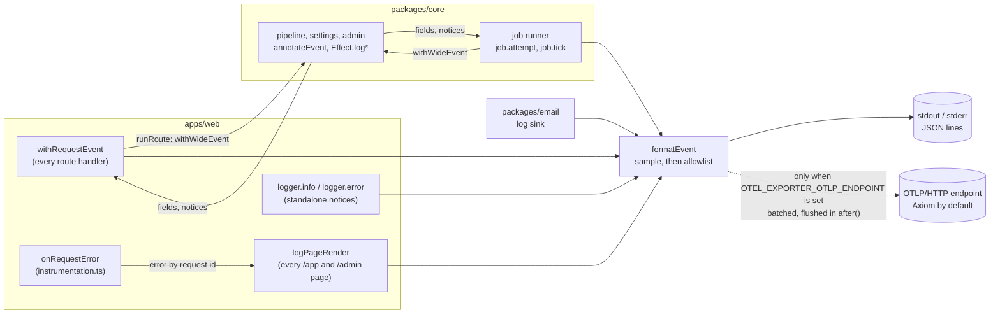

# Observability: wide events

Every unit of work writes **one** JSON line, a wide event, when it finishes: an API request, a server render of an
`/app` or `/admin` page, a job attempt and a queue tick. Code adds facts to the current event instead of writing lines
of its own. The schema, the redaction allowlist, tail sampling and the logger all live in
[`packages/core/src/telemetry`](../../../packages/core/src/telemetry), so core, the web app and a future worker write the
same events. The decision behind this (OTLP as the only transport, Axiom as the default destination) is in the
[observability plan](../../plans/2026-11-06-observability.md#decided-owner-2026-11-06).

## Where events come from

| Event                              | Unit          | Written by                                                                | Sampled when routine                      |
| ---------------------------------- | ------------- | ------------------------------------------------------------------------- | ----------------------------------------- |
| `receipt.upload`, `receipt.retry`… | `request`     | [`withRequestEvent`](../../../apps/web/lib/http.ts), one per API request  | polls, health, session reads, group reads |
| `page.render`                      | `page`        | [`logPageRender`](../../../apps/web/lib/page-event.ts), in `after()`      | every successful render                   |
| `job.attempt`                      | `job_attempt` | [`runner.ts`](../../../packages/core/src/jobs/runner.ts), claim to settle | never                                     |
| `job.tick`                         | `job_tick`    | `runner.ts`, one per drain                                                | idle ticks                                |
| `request.error`                    | `log`         | `onRequestError`; a failed render is also folded into its `page.render`   | never                                     |
| `email.*`, `health.not_ready`, …   | `log`         | standalone notices outside any unit                                       | never                                     |

`job.attempt` replaced `job.run`. It carries the queue wait (`queue.wait_ms`, by the database clock), the outcome,
the OCR model, calls, tokens and cost, and per-step `timings_ms` (`storage.get`, `ai.extract`, `db.complete`). The
request that triggered the run passes its `request_id` and `trigger` (`upload`, `retry`, `poll`, `drain`), so one id
finds a request and every job attempt it caused. Healthy `health.live` and `health.ready` answers aren't written at
all (`skipEvent`): an uptime pinger would otherwise be the largest line in the logs; a failing check always is.

## The schema is the allowlist

[`schema.ts`](../../../packages/core/src/telemetry/schema.ts) lists every key and the kind of value it may hold.
[`sanitize`](../../../packages/core/src/telemetry/redact.ts) runs inside `formatEvent`, before any sink:

- Unknown keys are dropped at any depth; their paths (never their values) go in `dropped_fields`.
- `uuid` values (`receipt_id`, `group_id`, `job_id`, `request_id`) must be UUIDs; `id` values (Better Auth user and
  workspace ids, worker ids) must look like ids (no `@`, no spaces); `token` values like our own codes; `route` values
  lose any query string or hash. Only the schema's own keys count, so `constructor`, `toString` and `__proto__` are
  unknown keys, and map keys that touch a prototype are dropped. Maps and lists are filtered entry by entry and capped (32 keys, 20 items).
- Secret denylist ([`secrets.ts`](../../../packages/core/src/telemetry/secrets.ts)): before an `id`, `token`, `route`,
  `tokens` or `token_map` value is accepted, it is accepted by the allowlist first (so the check never scans long input) and then checked against known secret shapes (Gemini `AIza`, `sk-` keys
  incl. Anthropic, Resend `re_`, 32/40/64-char hex, Google OAuth `GOCSPX-`, AWS `AKIA` key ids, JWTs, Postgres URLs with a password, `Bearer`, GitHub and Vercel
  tokens, private-key PEM headers). A match is written as `[redacted:secret]` and counted in `redacted_secrets`, never
  the value. A 64-hex digest is redacted too: no field logs a file hash, and a new one needs a deliberate kind. A canary
  test pushes every shape through `logger` and `annotateEvent`.
- Only plain objects are walked: an `Error`, a `Map` or a class instance in a group is dropped whole.
- Logging never breaks the work it describes: `logger.emit` and `errorFields` catch their own failures (a throwing
  getter becomes `log.failed` or `error.type: "Unreadable"`).
- Errors are described by [`errorFields`](../../../packages/core/src/telemetry/redact.ts): the tagged error's `type`
  and `kind`, the cause's class and a Postgres SQLSTATE. Never the message or stack, because provider and Drizzle
  messages embed receipt data and bound `params:`.

There is no field for an email, an IP, a user agent, a cookie, a token, a file name, a group name, receipt text, a
prompt or model output. Adding one means adding it to the schema, which is where review happens.

## Sampling

[`sampling.ts`](../../../packages/core/src/telemetry/sampling.ts) decides after the unit has finished. Errors (5xx,
4xx other than 401 and 429, an `error` field, level `error`), slow units (`duration_ms` at or above `LOG_SLOW_MS`,
default 1000) and anything that called a model are always kept. Only routine units are sampled, at `LOG_SAMPLE_RATE`
(default 1, `0.1` in production, never below `0.01` so routine 401s and 429s can't vanish entirely), and a kept sampled line carries `sample_rate` so counts can be weighted back up.

What counts as routine:

- Routes declare it in `withRequestEvent` as a flag or a per-request predicate. Auth GETs are routine only for
  session and list reads (`lib/auth-routine.ts`); OAuth callbacks, email verification and password resets answer
  with redirects that can hide a failure, so they are always logged.
- A 429 response is routine, and a 401 on a routine route is not counted as an error, so a flood can't fill the
  logs. Routes where rejections are the signal opt out with `keepRateLimited`: auth POSTs (sign-in, sign-up,
  password reset: the credential-stuffing signal) and the contact form keep every 429. The CSP-report route skips the event entirely (`skipEvent`) once its per-IP limiter rejects.
- A unit that logged a notice is never routine (requests, page renders and ticks alike).

## Effect code

`withWideEvent(event)` makes `event` the fiber's current event (`CurrentWideEvent`, a `FiberRef`); child fibers inherit
it. `annotateEvent(fields)` merges into it and is a no-op outside one. `WideEventLoggerLive` routes `Effect.log*`
inside a unit into its `notices` (an error raises its level) and outside one into a standalone `unit: "log"` line
through the same allowlist.

## Testing

- [`telemetry.test.ts`](../../../packages/core/src/telemetry/telemetry.test.ts): the allowlist against adversarial
  input (nested objects, emails in messages, cause chains and error names, prototype tricks, caps), `errorFields`,
  sampling, formatting and the Effect logger.
- [`runner.test.ts`](../../../packages/core/src/jobs/runner.test.ts): `job.attempt` and `job.tick`.
- [`http.test.ts`](../../../apps/web/lib/http.test.ts) and the route tests: one request event per request.
- [`otlp.test.ts`](../../../packages/core/src/telemetry/otlp.test.ts): sinks get what stdout gets, sampling and
  the allowlist apply first (a raw Drizzle `params:` message never reaches the exporter), flush scheduling, the OTLP
  mapping, and the throttled failure notice; [`instrumentation-node.test.ts`](../../../apps/web/instrumentation-node.test.ts):
  no endpoint, no SDK import.
- [`wide-events.int.test.ts`](../../../apps/web/lib/wide-events.int.test.ts) (CI `test:int`): one real upload writes
  exactly one request event and one `job.attempt`, with no customer data.

## Sentry

Errors only, and only with a valid `SENTRY_DSN` (`parseSentryDsn`; anything else leaves it off).

- **Server** ([`sentry-server.ts`](../../../apps/web/lib/telemetry/sentry-server.ts)): `@sentry/node`, started in
  `register()` before env validation. No tracing, no OpenTelemetry provider, no module hooks, no default
  integrations: uncaught exceptions, unhandled rejections and what we report. `failureResponse` reports 5xx and
  defects (never expected 4xx, nor an `OcrError` the photo caused: `invalid-output`, `bad-image`, `refused`,
  `unsupported-file`) and `onRequestError` reports render, route and action failures, through
  [`reportError`](../../../apps/web/lib/telemetry/errors.ts). A dead `job.attempt` becomes a `job_dead:<kind>:<error>`
  issue. Reported errors are stand-ins: our `errorFields` as type and message plus the original's stack frames,
  never its message or cause chain (security plan B1: AI SDK errors carry the receipt). Sending is flushed by the
  same `after()` as OTLP.
- **Browser** ([`sentry-client.ts`](../../../apps/web/lib/telemetry/sentry-client.ts)): `@sentry/browser`'s bare
  `BrowserClient` with global handlers, dedupe, event filters (Sentry's default ignore list, and `allowUrls` set to
  our own origin so third-party script errors from Turnstile or GA aren't sent) and navigation/fetch breadcrumbs, loaded in its own chunk from
  `instrumentation-client.ts` after hydration starts. `next.config.ts` inlines the DSN only when it is valid; without
  one the branch is `if ("")` and no Sentry code ships (CI greps `.next/static` to hold that). Error boundaries
  report browser errors; server render errors (they carry a digest) were already reported by the server.
- **Scrubbing** ([`sentry-event.ts`](../../../apps/web/lib/telemetry/sentry-event.ts)): every event is rebuilt from
  an allowlist in `beforeSend`: error types, messages through `scrubMessage` (Drizzle `params:` and AI SDK payloads
  cut, emails and long numbers masked, AI SDK content errors replaced whole), stack frames without variables or
  source lines, our tags, release (the short commit SHA, as `/api/health`), environment, runtime/browser/OS names,
  and the request's method and URL through `scrubUrl` (no query or hash; reset tokens, invitation and receipt ids
  replaced, security plan B5). `dataCollection` is all off as well. No tunnel: the browser posts to Sentry's ingest
  host, which joins `connect-src` only when the DSN is set (a tunnel would forward cookies, security plan B2/B3).

## PostHog

Server-side product analytics, only with a project key (`POSTHOG_KEY=phc_…`; a personal `phx_` key leaves it off).
`register()` loads [`posthog.ts`](../../../apps/web/lib/telemetry/posthog.ts) (`posthog-node`) as an event sink.

- **Events are projections of wide events** ([`analytics.ts`](../../../apps/web/lib/telemetry/analytics.ts),
  `fromRecord`): a successful `receipt.upload` becomes `receipt_uploaded`, `receipt.export` becomes `csv_exported`, a
  `QuotaExceeded` 429 for the day or the per-minute burst becomes `plan_limit_hit` (with that `limit`), and a `job.attempt` that succeeded or died becomes `receipt_scanned`
  or `receipt_scan_failed`. They start from the record that already passed the allowlist, so PostHog can't see a
  field the logs don't. A `job.attempt` an admin started (`trigger: admin_rerun`) isn't the user's scan and sends
  nothing. `signed_up` comes from Better Auth's `user.create.after` hook through `track()`, which schedules the
  sinks' `after()` flush itself (`scheduleFlush`), so it doesn't depend on a wide event in the same request.
- **One allowlist for both paths** (`checkEvent`): a closed set of event names, each with its own props of a known
  kind (short codes, integers, booleans). Ids must be opaque ids. Unknown props are dropped at runtime, so a cast
  can't add one.
- **Identity:** `distinctId` is the Better Auth user id; the workspace id goes both as the plain prop `workspace_id`
  (usable on the free plan) and as `groups.workspace` (needs the paid group-analytics add-on). No person
  properties, no GeoIP (`$geoip_disable`), no IP (the server sends the event). Work an admin does while
  impersonating is skipped: the active scope carries `impersonatedBy`, so `annotateCaller` sets `impersonated_by`
  on every scoped request, and a receipt job enqueued then carries it in its payload onto its `job.attempt` events.
- **Off the request path:** captures are queued in memory and sent by the same `after()` flush as OTLP. On Vercel the
  SDK's timer is off (`flushInterval: 0`); Docker keeps a 10 s timer and shuts down on `SIGTERM`. Exception
  autocapture is off (Sentry owns errors).
- A user's first 3 plan-quota 429s a minute are kept (`keepQuotaRejection`, a `quota429:<user>` counter) and become
  `plan_limit_hit`; the rest of a burst are routine (sampled), flagged `quota_repeat`, and send nothing.
- **Failures.** A failed send logs `telemetry.export_failed` (`kind: posthog`) on stdout at most once a minute, never
  through the sinks.
- Not built: browser PostHog (page views, landing funnels) waits on a consent decision; `$ai_generation` events.

## OTLP export

When `OTEL_EXPORTER_OTLP_ENDPOINT` is set, `register()` in `instrumentation.ts` loads
[`otlp.ts`](../../../packages/core/src/telemetry/otlp.ts) and adds it as an event sink. Unset, the OpenTelemetry SDK is
never imported and nothing leaves the process but stdout.

- **Same events in both places.** `formatEvent` samples and runs the allowlist once; stdout gets the JSON line and
  each sink gets the same object. A sink can't see a field stdout doesn't.
- **Mapping.** `service`, `version`, `env`, `region` and `instance` become the resource attributes `service.name`,
  `service.version`, `deployment.environment.name`, `cloud.region` and `service.instance.id`
  (`OTEL_RESOURCE_ATTRIBUTES` overrides them). `event` becomes `EventName` and the body, `level` the severity (9 info,
  17 error), and the other fields attributes, groups flattened with dots (`ocr.tokens_in`).
- **Off the request path.** Records go into the SDK's batch processor (sent in batches of up to 512; past 2,048 queued,
  new ones are dropped). The first event of a request schedules one `after()` flush (`setFlushScheduler` in `lib/log.ts`), bounded
  at 2 s, so a Vercel function sends its logs before it freezes and the response never waits. Events written outside
  a request go out on the processor's 1 s timer; the Docker server flushes on `SIGTERM`, best-effort: Next's own
  `SIGTERM` handler exits the process without waiting for it, so what can be lost is bounded to events written
  outside a request in the last second or so (request events already went out in their `after()` flush). The same
  holds for PostHog and Sentry.
- **Failures.** A failed export never fails the work it describes. It is reported as `telemetry.export_failed` on
  stderr at most once a minute, never through the sink (so a broken endpoint can't feed itself). A failed start
  logs `telemetry.start_failed` and the app runs on with stdout only.
- **Transport.** OTLP/HTTP, `http/protobuf` by default or `http/json` (`OTEL_EXPORTER_OTLP_PROTOCOL`); gRPC isn't
  bundled. The endpoint must be `https`, except plain `http` to `localhost`, `127.0.0.1` or a compose service name
  (`otel-collector`), so the bearer token in the headers never crosses a network in cleartext; anything else logs
  `telemetry.start_failed` with `error.kind` `insecure-endpoint` or `invalid-endpoint`. Endpoint and headers are the
  standard OTel variables, so switching from Axiom to another backend is a
  change of env only. Setup: [production environment §9b](../../production-environment.md#9b-axiom).
- **Edge.** Only the Node runtime exports. Nothing in the app logs from the edge runtime today.
- `@effect/opentelemetry` isn't needed for logs: every event, Effect or not, already goes through one `emit`. It
  comes with traces, if they are ever wanted.
