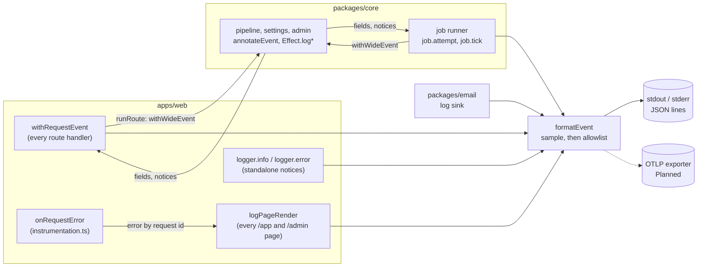

# Observability: wide events

Every unit of work writes **one** JSON line, a wide event, when it finishes: an API request, a server render of an
`/app` or `/admin` page, a job attempt and a queue tick. Code adds facts to the current event instead of writing lines
of its own. The schema, the redaction allowlist, tail sampling and the logger all live in
[`packages/core/src/telemetry`](../../../packages/core/src/telemetry), so core, the web app and a future worker write the
same events. The decision behind this (OTLP as the only transport, Axiom as the default destination) is in the
[observability plan](../../plans/2026-11-06-observability.md#decided-owner-2026-11-06).

## Where events come from

| Event                              | Unit          | Written by                                                                | Sampled when routine                      |
| ---------------------------------- | ------------- | ------------------------------------------------------------------------- | ----------------------------------------- |
| `receipt.upload`, `receipt.retry`… | `request`     | [`withRequestEvent`](../../../apps/web/lib/http.ts), one per API request  | polls, health, session reads, group reads |
| `page.render`                      | `page`        | [`logPageRender`](../../../apps/web/lib/page-event.ts), in `after()`      | every successful render                   |
| `job.attempt`                      | `job_attempt` | [`runner.ts`](../../../packages/core/src/jobs/runner.ts), claim to settle | never                                     |
| `job.tick`                         | `job_tick`    | `runner.ts`, one per drain                                                | idle ticks                                |
| `request.error`                    | `log`         | `onRequestError`; a failed render is also folded into its `page.render`   | never                                     |
| `email.*`, `health.not_ready`, …   | `log`         | standalone notices outside any unit                                       | never                                     |

`job.attempt` replaced `job.run`. It carries the queue wait (`queue.wait_ms`, by the database clock), the outcome,
the OCR model, calls, tokens and cost, and per-step `timings_ms` (`storage.get`, `ai.extract`, `db.complete`). The
request that triggered the run passes its `request_id` and `trigger` (`upload`, `retry`, `poll`, `drain`), so one id
finds a request and every job attempt it caused.

## The schema is the allowlist

[`schema.ts`](../../../packages/core/src/telemetry/schema.ts) lists every key and the kind of value it may hold.
[`sanitize`](../../../packages/core/src/telemetry/redact.ts) runs inside `formatEvent`, before any sink:

- Unknown keys are dropped at any depth; their paths (never their values) go in `dropped_fields`.
- `id` values must look like ids (no `@`, no spaces), `token` values like our own codes, `route` values lose any query
  string or hash. Maps and lists are filtered entry by entry and capped (32 keys, 20 items).
- Only plain objects are walked: an `Error`, a `Map` or a class instance in a group is dropped whole.
- Errors are described by [`errorFields`](../../../packages/core/src/telemetry/redact.ts): the tagged error's `type`
  and `kind`, the cause's class and a Postgres SQLSTATE. Never the message or stack, because provider and Drizzle
  messages embed receipt data and bound `params:`.

There is no field for an email, an IP, a user agent, a cookie, a token, a file name, a group name, receipt text, a
prompt or model output. Adding one means adding it to the schema, which is where review happens.

## Sampling

[`sampling.ts`](../../../packages/core/src/telemetry/sampling.ts) decides after the unit has finished. Errors (status
4xx or 5xx, an `error` field, level `error`), slow units (`duration_ms` at or above `LOG_SLOW_MS`, default 1000) and
anything that called a model are always kept. Only routine units are sampled, at `LOG_SAMPLE_RATE` (default 1, `0.1`
in production), and a kept sampled line carries `sample_rate` so counts can be weighted back up.

## Effect code

`withWideEvent(event)` makes `event` the fiber's current event (`CurrentWideEvent`, a `FiberRef`); child fibers inherit
it. `annotateEvent(fields)` merges into it and is a no-op outside one. `WideEventLoggerLive` routes `Effect.log*`
inside a unit into its `notices` (an error raises its level) and outside one into a standalone `unit: "log"` line
through the same allowlist.

## Testing

- [`telemetry.test.ts`](../../../packages/core/src/telemetry/telemetry.test.ts): the allowlist against adversarial
  input (nested objects, emails in messages, cause chains and error names, prototype tricks, caps), `errorFields`,
  sampling, formatting and the Effect logger.
- [`runner.test.ts`](../../../packages/core/src/jobs/runner.test.ts): `job.attempt` and `job.tick`.
- [`http.test.ts`](../../../apps/web/lib/http.test.ts) and the route tests: one request event per request.
- [`wide-events.int.test.ts`](../../../apps/web/lib/wide-events.int.test.ts) (CI `test:int`): one real upload writes
  exactly one request event and one `job.attempt`, with no customer data.

## Planned

OTLP export through `@effect/opentelemetry` and Next's `register()`, loaded only when `OTEL_EXPORTER_OTLP_ENDPOINT` is
set, with a flush in `after()`. See the [plan](../../plans/2026-11-06-observability.md#tracks-from-here).
