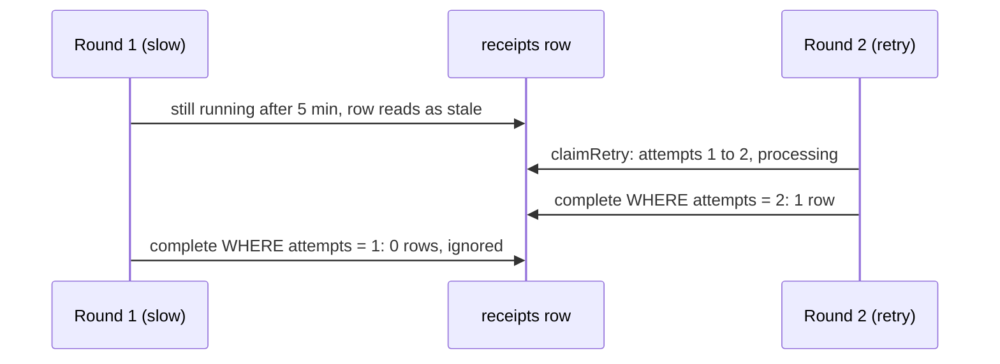

# Retry

A failed receipt can be read again from its stored file, without uploading it again. Each receipt gets at most three
rounds: the upload and two retries (`MAX_EXTRACTION_ATTEMPTS` in
[`repository.ts`](../../../packages/core/src/repository.ts)).

## When the button shows

The receipt page shows **Try again** when the receipt is `failed` (or stale, see below) and rounds are left
([`receipt-result.tsx`](../../../apps/web/components/receipt-result.tsx)). The server checks the same rules again; the
button is only a hint.

A receipt is **stale** when it is still `uploaded` or `processing` five minutes after its last update and has no live
job (`STALE_AFTER_MS`): no job at all, or one nothing has run for five minutes past its due time
([orphaned jobs](jobs.md#orphaned-jobs)). Stale is computed on read: lists, counts and the detail page show it as
`failed` with "Reading this receipt took too long", and a retry may claim it. While a job is queued or retrying, the
receipt reads as `processing`.

## Sequence

```mermaid
sequenceDiagram
  autonumber
  participant B as Browser
  participant R as POST /api/receipts/{id}/retry
  participant DB as Postgres
  participant A as after()

  B->>R: retry
  R->>R: Origin check, session, scope
  R->>DB: enforceUploadQuota (read-only), ocr.ready
  R->>DB: claimRetry, one transaction
  Note over DB: lock user, count usage, decide quota
  Note over DB: set status processing, attempts + 1
  Note over DB: only if in scope, failed or stale, attempts under 3
  Note over DB: INSERT ocr_rounds (round = new attempts)
  Note over DB: cancel any job left for an older round, enqueue this round's job
  R-->>B: 202 { status: processing }
  R->>A: drainJobs (waits for this job's backoff)
  A->>DB: complete, or retry, or settle failed when dead; only if attempts still matches
  B->>R: poll GET /api/receipts/{id}
```

`claimRetry` ([`repository.ts`](../../../packages/core/src/repository.ts)) returns one of:

| Result               | HTTP | Meaning                                                            |
| -------------------- | ---- | ------------------------------------------------------------------ |
| `claimed`            | 202  | The receipt is `processing` under the new round                    |
| `quota`              | 429  | A retry counts like an upload for the burst and daily windows      |
| `not-found`          | 404  | Not in the caller's workspace, or not a UUID                       |
| `not-retryable`      | 409  | Not failed and not stale (for example completed, or still running) |
| `attempts-exhausted` | 409  | Three rounds used; the message asks for a clearer photo            |

Any workspace member may retry any receipt in the workspace; the quota is charged to the member who retries.

## The attempt guard

The update in step 4 is atomic: two clicks, or two tabs, can't both claim the same round, because the second
`UPDATE` no longer matches `status = failed`.

Every later write by the extraction is guarded by the round it started with:

```sql
WHERE id = $id AND organization_id = $org
  AND status = 'processing' AND attempts = $round
```

So if an old run that was thought dead finishes after a retry claimed round 2, its `complete` or `fail` matches no
row and changes nothing. Its model calls are still written to `ocr_calls` under its own round, because they were made.



## Ledger effect

A user retry adds one `ocr_rounds` row; the job's automatic retries inside it add none. Whether it counts against the daily limit depends on its outcome: a receipt read
successfully counts once per day however many rounds it took, and a failed round counts only beyond the first five
failed rounds of the day. While its job is live (running, or waiting to retry), the round counts as in flight. See [core: quota ledger semantics](../core.md#design-principles-and-invariants).
