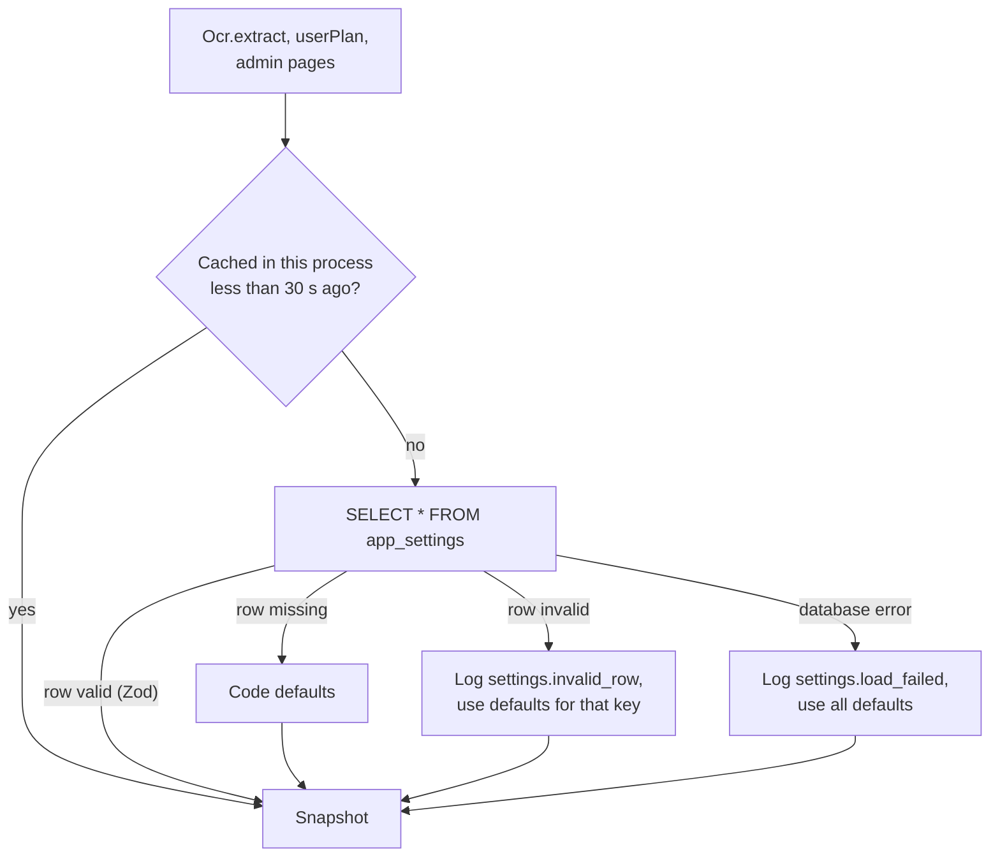
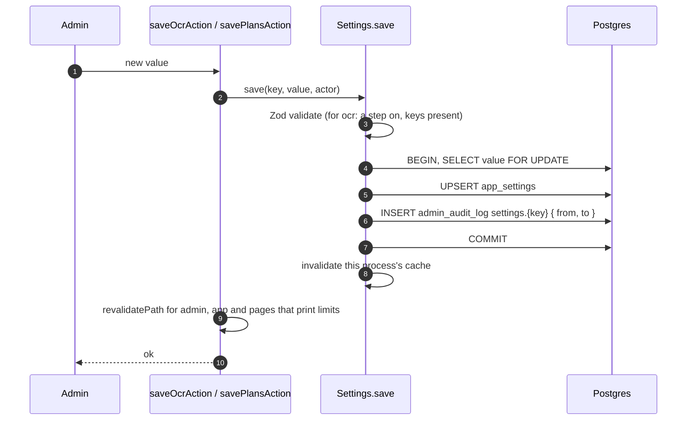

# Settings cache

Two settings can be changed at runtime from **Admin → Settings**, without a deploy:

| Key     | Holds                                                                   | Code default                                                                                               |
| ------- | ----------------------------------------------------------------------- | ---------------------------------------------------------------------------------------------------------- |
| `plans` | Per plan: workspaces a user may own, receipts per UTC day, per minute   | `DEFAULT_PLANS` in [`plans.ts`](../../../packages/core/src/plans.ts): Free 1 / 20 / 10, Pro 5 / 1,000 / 30 |
| `ocr`   | The model chain: up to 5 steps, each with a model, on/off and a timeout | One step: `GEMINI_MODEL` (or `fixture` when `OCR_PROVIDER=fixture`), 30 s                                  |

Both are JSON rows in `app_settings`, read and written by the `Settings` service in
[`settings.ts`](../../../packages/core/src/settings.ts).

## Reading

- The cache is `Effect.cachedInvalidateWithTTL(load, "30 seconds")`, one per server process (it lives in the
  `ManagedRuntime`). On Vercel each warm function instance has its own.
- A failed load is cached like a successful one, so during a database outage the defaults are served for up to 30 s
  before the next attempt.
- Defaults are never "unlimited". An unknown plan id gets the default plan's limits (`policyFor`).
- `GEMINI_MODEL` that is not in the model list falls back to the first listed Gemini model, with a
  `settings.unlisted_model` warning, so the settings page always has a model that can run.
- The web app's `getPlanTable()` ([`lib/plan-limits.ts`](../../../apps/web/lib/plan-limits.ts)) wraps the read in a
  3 s timeout and also falls back to the defaults.

## Saving

Validation rules:

- Plans: counts are whole numbers from 1 to a cap; the per-minute limit can't exceed the daily one.
- OCR chain: 1 to 5 steps, each model on the allowlist (`OCR_MODELS`) and listed once, timeouts 5 to 50 s, at least
  one step enabled, and no enabled step whose provider has no API key on the server.

## How long a change takes to apply

| Where                                                                                                   | When the new value is used                              |
| ------------------------------------------------------------------------------------------------------- | ------------------------------------------------------- |
| The process that saved it                                                                               | Immediately (its cache is invalidated)                  |
| Other processes or function instances                                                                   | Within 30 s, on their next read after the cache expires |
| Cached pages that print plan limits (`/terms`, `/sign-in`, `/sign-up`, password pages, invitation page) | After `revalidatePlanCopy()` regenerates them           |

A user's own plan (Free or Pro, in `user.plan`) is not cached either: `userPlan`
([`quota.ts`](../../../packages/core/src/quota.ts)) reads it from the database on every upload and retry, so an admin's
plan change applies on the next request.
