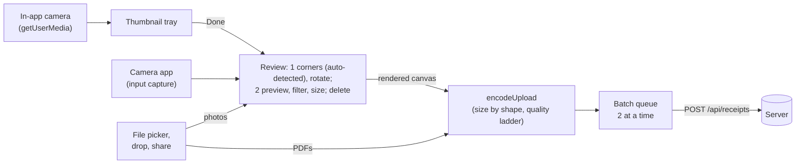

# Upload, extraction and result

What happens from the moment a user picks a receipt file to the moment its rows appear. This is the main flow of the
product; most other pages describe a part of it.

## Contents

- [Overview](#overview)
- [1. In the browser](#1-in-the-browser)
- [2. Instant mode](#2-instant-mode)
- [3. Queued mode](#3-queued-mode)
- [4. Inside extraction: the fallback chain](#4-inside-extraction-the-fallback-chain)
- [5. What the ledger records](#5-what-the-ledger-records)
- [6. Showing the result](#6-showing-the-result)
- [Failure cases](#failure-cases)

## Overview

The work is split into two stages in [`pipeline.ts`](../../../packages/core/src/pipeline.ts):

1. **Ingest** (`ingestUpload`), always inside the request: validate the bytes, store the file, then in one
   transaction under the quota lock insert the receipt, its first round and its `receipt.extract` job.
2. **Extract**, as that job ([Background jobs](jobs.md)): each attempt (`runExtraction`) loads the file by receipt
   id, runs the model chain and writes the result, or records its calls and leaves the job to retry. Only a dead job
   marks the receipt failed.

The two upload modes differ only in when the job first runs.

| Mode      | Used by                                     | First attempt runs                                           | Response                                                           |
| --------- | ------------------------------------------- | ------------------------------------------------------------ | ------------------------------------------------------------------ |
| `instant` | "Read" on a single file in the upload panel | In the request, before responding (priority 0)               | `200` `completed` or `failed`; `202` `processing` while it retries |
| `queued`  | "Read N receipts" on several files          | In Next.js `after()`, once the response is sent (priority 5) | `202` with `status: processing`                                    |

The route has `maxDuration = 300` so its `after()` drain can wait out the job's backoff. A worker app and a cron drain
are planned ([jobs plan](../../plans/2026-11-06-jobs-queue.md), Track B); they run the same job.

## 1. In the browser

[`components/upload-panel.tsx`](../../../apps/web/components/upload-panel.tsx), the capture modules in
[`components/capture`](../../../apps/web/components/capture) and [`lib/capture`](../../../apps/web/lib/capture), and
[`lib/upload-prep.ts`](../../../apps/web/lib/upload-prep.ts):



- Files are checked for an accepted type (JPEG, PNG, WebP, HEIC/HEIF, PDF). One batch (camera tray plus picked
  files) holds up to the plan's `batchMax` (10 by default, set in Admin → Settings); picking more keeps the first ones
  and says so. The server still applies the per-minute and daily limits to each upload.
- **Camera.** The back camera at the highest resolution it offers, full screen, with a torch toggle when the track
  supports one. A small copy of the frame is checked for the receipt outline four times a second and drawn over the
  viewfinder. The stream stops on close, when the page is hidden and when the panel unmounts. Without getUserMedia
  (plain HTTP, old browsers) or when access is blocked, "Take photos" falls back to the phone's camera app through
  `<input capture>`. The camera is touch-only: "Take photos" and `?capture=1` apply on `(pointer: coarse)` devices and viewports under `md`, never on fine-pointer desktops, even with a webcam.
- **Review.** Every photo opens here before upload, in two steps like a document scanner, shared by the whole batch
  (the photo dots move between photos in either step). `detect-quad.ts` finds the receipt on a 256 px greyscale copy
  (Otsu threshold, largest component, convex hull, four corners) and places the corners there; when it isn't
  confident, the crop is the whole image.
  - _Step 1, Adjust corners_: the whole photo with the crop outline. Corners drag with pointer events (a circular
    loupe at 2.8x, drawn from the canvas already on screen, shows the exact point above the finger) or move with arrow
    keys; Rotate turns in quarter turns; Reset to detected and Full image restore a crop. "Next" opens step 2.
  - _Step 2, Preview_: the crop warped straight (`geometry.ts` solves the homography and warps on a canvas) at up to
    1.5 MP, with the four filters (Original, Enhance, Greyscale, B&W; Enhance is the default when a receipt was found,
    and the last choice is remembered for the session) applied after the warp. The filter thumbnails are of the same
    flattened page. About 400 ms after the last change, the edit is rendered once at full size and the real upload
    is encoded from it: the chosen size first, then the other options, so the picker shows real bytes. The preview
    then shows that file, and tapping it opens it whole ("Whole receipt") or at "Actual pixels" (one image pixel per
    device pixel, so a 1,000 px image is 333 CSS px wide on a 3x phone), captioned from the file itself ("Uploads
    exactly this: 1000 × 2163 px · 241 KB JPEG"). While a new encode runs, the size line keeps the last values,
    dimmed. "Upload" sends the files already made and encodes any photo that wasn't previewed.
  - State (corners, rotation, filter) is kept per photo across steps; the photo is decoded once and kept while it is
    shown. Escape or the back arrow goes step 2, step 1, then asks to discard. The stage is a fixed box, so no action
    moves the controls around it (the e2e suite measures this).
- Photos over 16 MP are decoded straight to 16 MP (`createImageBitmap` resize, size read from the header first), and
  every canvas is released (`width = height = 0`) as soon as its pixels are used, to stay within iOS canvas memory.
- Each photo's edit is rendered to a canvas (straightened at up to 6 MP, so the downscale to the upload size averages
  pixels instead of aliasing thin print) and encoded from it directly, with no intermediate JPEG. If the browser can't
  decode a photo, the original goes through `prepareFile`. If it decodes but the edit can't be rendered or encoded, an
  edited photo is held back with an error on it (sending the original would drop the crop, rotation and filter); an
  unedited one goes as it is. A photo still over the hard cap is held back too. Photos and frames stay on the device
  until upload.
- Every image the browser can decode is oriented, sized and re-encoded as JPEG by `encodeUpload`. The size depends only
  on the photo's shape and the chosen option, never on how well it compresses: **Faster upload** fits 1 MP with the
  short edge kept at 800 px, **Standard** (the default) 2 MP with 1,000 px, **Sharpest** the most Claude reads natively.
  All three stay within 2,576 px on the long edge and 4,784 patches of 28 x 28 px, and nothing is upscaled. A receipt
  longer than 1:2.6 (`LONG_RECEIPT_RATIO`) can't keep Standard's width inside that long edge, so it goes at Sharpest
  with no choice offered. Encoding follows one config, `ENCODING` in
  [`lib/upload-encoding.ts`](../../../apps/web/lib/upload-encoding.ts): JPEG at 0.80, then 0.72, then 0.65 (the floor
  for thin print), keeping the first encode under the option's target (500 KB Faster, 700 KB Standard, 1 MB Sharpest).
  Past the ladder anything up to the 1.5 MB hard cap is sent. Over it, the photo is encoded once more at Faster's size
  at 0.72, and refused with an error if it is still over. A non-JPEG from the canvas (Safari returns PNG for types it
  can't write) counts as a failed encode. This removes camera metadata (including GPS) and keeps the body far under
  Vercel's 4.5 MB limit. A successful re-encode always replaces the original, so its metadata is gone. PDFs, images
  the browser can't decode (HEIC outside Safari) and images whose encode fails (for example a phone out of canvas
  memory) are sent unchanged, metadata included; stripping those on the server is a known follow-up.
- In the review sheet's Preview step the size line ("W × H px · N KB · Change", every number in a fixed-width slot)
  opens a choice for the batch, remembered for the session. The ids sent as `size_choice` are unchanged from the
  earlier options: `smaller` is Faster upload, `recommended` Standard, `larger` Sharpest (and every long receipt). The
  upload also carries its quality step, encode count, filter and whether it was rescued, and the server reads the
  file's pixel size from its header, so the `receipt.upload` wide event has bytes per pixel from real phones.
- A file still over 4 MB (`DEPLOYMENT_BODY_LIMIT_BYTES` in
  [`upload-limits.ts`](../../../packages/core/src/upload-limits.ts)) is refused before upload.
- **Upload.** One file uses instant mode and opens its receipt. Several upload two at a time in queued mode, each with
  its own progress, status and Retry. A `429` with a short `Retry-After` (the per-minute limit) pauses the queue and
  resumes on its own; a long one (the daily limit) stops it and keeps the rest waiting.

## 2. Instant mode

```mermaid
sequenceDiagram
  autonumber
  participant B as Browser
  participant R as POST /api/receipts
  participant Q as Quota (core)
  participant S as Bucket
  participant DB as Postgres
  participant O as Ocr chain

  B->>R: multipart file, mode=instant
  R->>R: Origin check, session, scope, capped body read
  R->>Q: enforceUploadQuota (read-only)
  R->>O: ocr.ready (any model with a key?)
  R->>R: sniff type from bytes, max 10 MB
  R->>S: put users/{userId}/receipts/{id}.{ext}
  R->>DB: lock user, count usage, insert receipt (processing) + ocr_rounds round 1 + jobs row
  R->>DB: claim that job (attempt 1, lease 90 s)
  R->>S: get file
  R->>O: extract (chain, 50 s deadline)
  O-->>R: extraction + attempts
  R->>DB: one transaction: ocr_calls rows + receipt completed + items; job succeeded
  R-->>B: 200 { receiptId, status: completed }
  B->>B: navigate to /app/receipts/{id}
```

Steps 3 and 4 refuse early, before anything is stored, when the user is over quota or no model can run. Step 7 is
the check that counts: it runs inside the transaction that records the round, under
`pg_advisory_xact_lock` on the user, so parallel uploads can't all pass. If step 7 refuses, the file stored in step 6
is deleted.

## 3. Queued mode

```mermaid
sequenceDiagram
  autonumber
  participant B as Browser
  participant R as POST /api/receipts
  participant A as after() in the same function
  participant DB as Postgres

  B->>R: multipart file, mode=queued
  R->>DB: ingest (same as instant steps 2 to 7)
  R-->>B: 202 { receiptId, status: processing }
  R->>A: schedule drainJobs (waits for this job's backoff)
  A->>DB: claim, extract, complete; or record calls and retry
  loop until it changes (backoff 2 to 15 s, paused while hidden, 6 min of visible polling)
    B->>R: GET /api/receipts/{id}, or GET /api/receipts/status for a list
    R-->>B: { status } or workspace counts
  end
```

Each attempt logs its own wide event (`job.attempt`, see [Observability](observability.md)) with the outcome, error
kind, queue wait, model, tokens, cost and step timings. A poll that
finds the job due but not running (its drain ran out of time, or its function was killed) drains it.

## 4. Inside extraction: the fallback chain

[`runChain`](../../../packages/core/src/ocr.ts) tries the admin's model chain in order. The chain is the saved one,
filtered to steps that are enabled and whose provider has an API key.


- Each step's default timeout is 30 s (`DEFAULT_STEP_TIMEOUT_MS`), settable from 5 to 50 s per step in Admin →
  Settings.
- Image problems stop the chain because a second model would usually fail the same way and cost a second call.
- One model call is [packages/ai](../ai.md)'s `extractReceipt`; it classifies the error into a kind and returns any
  token usage the provider reported, even on failure.

## 5. What the ledger records

| When                                  | Table        | Rows                                                                                     |
| ------------------------------------- | ------------ | ---------------------------------------------------------------------------------------- |
| The upload is accepted (ingest)       | `ocr_rounds` | One, `round = 1`, in the insert transaction                                              |
| An attempt succeeds                   | `ocr_calls`  | One per model call (failed fallbacks and the successful call), with the `complete` write |
| An attempt fails after calling models | `ocr_calls`  | One per model call, under that attempt's `job_attempt`                                   |
| An attempt fails before any model ran | `ocr_calls`  | One with `model = null`, `status = storage-error` or `not-configured`, cost 0            |
| A step is skipped before its request  | `ocr_calls`  | One with `model = null`, its provider and step, `status = unsupported-file`, cost 0      |

Each call row holds the step, model, provider, status, latency, input, cached, cache-write, output and reasoning
tokens, and the cost in micro-USD priced at write time (`null` when unknown). Calls are written even when the receipt
was deleted or superseded meanwhile: they were made and are billed. The unique index on
`(receipt_id, round, job_attempt, step)` stops an attempt being billed twice.

How these rows become "used today" is in [core: quota ledger semantics](../core.md#design-principles-and-invariants).

## 6. Showing the result

[`app/app/receipts/[id]/page.tsx`](../../../apps/web/app/app/receipts/[id]/page.tsx) loads the receipt through
`getReceiptForWorkspace`, which runs core's `getReceiptWithImage`: the scoped row with its items, plus a signed image URL valid for 10 minutes. A receipt with
overall confidence under 0.9 is flagged "needs review" (`NEEDS_REVIEW_BELOW`). Users correct fields through
`PATCH /api/receipts/:id`; members may edit only their own uploads, owners and admins any.

## Failure cases

| What went wrong                         | What the user sees                                      | Receipt state                                             |
| --------------------------------------- | ------------------------------------------------------- | --------------------------------------------------------- |
| `Origin` is not the app's own           | `403` "Cross-origin request rejected"                   | No receipt created                                        |
| No active workspace                     | `409` "No active workspace…"                            | No receipt created                                        |
| Over the daily or per-minute limit      | `429` with a message and `Retry-After`                  | No receipt created                                        |
| No model configured                     | `503` "not configured"                                  | No receipt created                                        |
| Not an accepted type, empty, over 10 MB | `400` / `413`                                           | No receipt created                                        |
| A retryable failure (timeout, 429, 5xx) | "Reading" while the job retries (up to 4 attempts)      | `processing`; `failed`, retryable, once the job is dead   |
| Not retryable (unreadable image)        | Instant: `200` with `status: failed` and a retry hint   | `failed`, retryable                                       |
| The function died mid-extraction        | The lease expires; the next drain or poll runs it again | `processing`; read as failed if nothing runs it for 5 min |
| Receipt deleted while being read        | Nothing to show                                         | Gone; the calls are still recorded                        |

Retrying is described in [Retry](retry.md).
