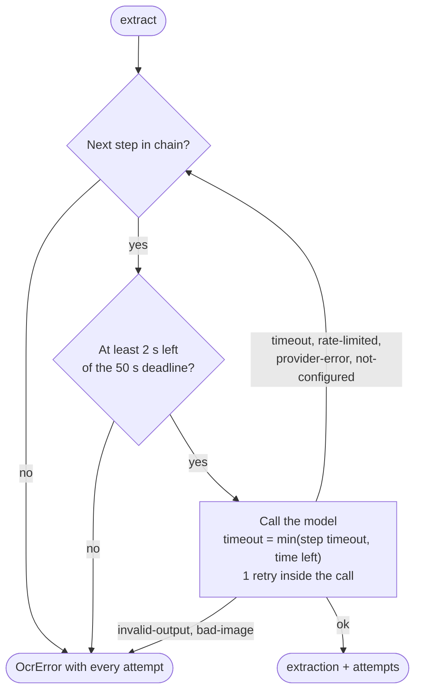

# Upload, extraction and result

What happens from the moment a user picks a receipt file to the moment its rows appear. This is the main flow of the
product; most other pages describe a part of it.

## Contents

- [Overview](#overview)
- [1. In the browser](#1-in-the-browser)
- [2. Instant mode](#2-instant-mode)
- [3. Queued mode](#3-queued-mode)
- [4. Inside extraction: the fallback chain](#4-inside-extraction-the-fallback-chain)
- [5. What the ledger records](#5-what-the-ledger-records)
- [6. Showing the result](#6-showing-the-result)
- [Failure cases](#failure-cases)

## Overview

The work is split into two stages in [`pipeline.ts`](../../../packages/core/src/pipeline.ts):

1. **Ingest** (`ingestUpload`), always inside the request: validate the bytes, store the file, then in one
   transaction under the quota lock insert the receipt, its first round and its `receipt.extract` job.
2. **Extract**, as that job ([Background jobs](jobs.md)): each attempt (`runExtraction`) loads the file by receipt
   id, runs the model chain and writes the result, or records its calls and leaves the job to retry. Only a dead job
   marks the receipt failed.

The two upload modes differ only in when the job first runs.

| Mode      | Used by                                     | First attempt runs                                           | Response                                                           |
| --------- | ------------------------------------------- | ------------------------------------------------------------ | ------------------------------------------------------------------ |
| `instant` | "Read" on a single file in the upload panel | In the request, before responding (priority 0)               | `200` `completed` or `failed`; `202` `processing` while it retries |
| `queued`  | "Read all" on several files                 | In Next.js `after()`, once the response is sent (priority 5) | `202` with `status: processing`                                    |

The route has `maxDuration = 300` so its `after()` drain can wait out the job's backoff. A worker app and a cron drain
are planned ([jobs plan](../../plans/2026-11-06-jobs-queue.md), Track B); they run the same job.

## 1. In the browser

[`components/upload-panel.tsx`](../../../apps/web/components/upload-panel.tsx) and
[`lib/upload-prep.ts`](../../../apps/web/lib/upload-prep.ts):

- Files are checked for an accepted type (JPEG, PNG, WebP, HEIC/HEIF, PDF). Up to 20 can be queued at once.
- Every image the browser can decode is oriented, scaled to a 2,000 px long edge and re-encoded as JPEG at quality
  0.85. This removes camera metadata (including GPS) and keeps the body under Vercel's 4.5 MB limit. PDFs and images
  the browser can't decode (HEIC outside Safari) are sent unchanged.
- A file still over 4 MB (`DEPLOYMENT_BODY_LIMIT_BYTES` in
  [`upload-limits.ts`](../../../packages/core/src/upload-limits.ts)) is refused before upload.
- "Read all" posts files one at a time and stops at the first error (usually the quota).

## 2. Instant mode

```mermaid
sequenceDiagram
  autonumber
  participant B as Browser
  participant R as POST /api/receipts
  participant Q as Quota (core)
  participant S as Bucket
  participant DB as Postgres
  participant O as Ocr chain

  B->>R: multipart file, mode=instant
  R->>R: Origin check, session, scope, capped body read
  R->>Q: enforceUploadQuota (read-only)
  R->>O: ocr.ready (any model with a key?)
  R->>R: sniff type from bytes, max 10 MB
  R->>S: put users/{userId}/receipts/{id}.{ext}
  R->>DB: lock user, count usage, insert receipt (processing) + ocr_rounds round 1 + jobs row
  R->>DB: claim that job (attempt 1, lease 90 s)
  R->>S: get file
  R->>O: extract (chain, 50 s deadline)
  O-->>R: extraction + attempts
  R->>DB: one transaction: ocr_calls rows + receipt completed + items; job succeeded
  R-->>B: 200 { receiptId, status: completed }
  B->>B: navigate to /app/receipts/{id}
```

Steps 3 and 4 refuse early, before anything is stored, when the user is over quota or no model can run. Step 7 is
the check that counts: it runs inside the transaction that records the round, under
`pg_advisory_xact_lock` on the user, so parallel uploads can't all pass. If step 7 refuses, the file stored in step 6
is deleted.

## 3. Queued mode

```mermaid
sequenceDiagram
  autonumber
  participant B as Browser
  participant R as POST /api/receipts
  participant A as after() in the same function
  participant DB as Postgres

  B->>R: multipart file, mode=queued
  R->>DB: ingest (same as instant steps 2 to 7)
  R-->>B: 202 { receiptId, status: processing }
  R->>A: schedule drainJobs (waits for this job's backoff)
  A->>DB: claim, extract, complete; or record calls and retry
  loop until it changes (backoff 2 to 15 s, paused while hidden, 3 min of visible polling)
    B->>R: GET /api/receipts/{id}, or GET /api/receipts/status for a list
    R-->>B: { status } or workspace counts
  end
```

Each attempt logs its own wide event (`job.run`) with the outcome, error kind, model, attempts and cost. A poll that
finds the job due but not running (its drain ran out of time, or its function was killed) drains it.

## 4. Inside extraction: the fallback chain

[`runChain`](../../../packages/core/src/ocr.ts) tries the admin's model chain in order. The chain is the saved one,
filtered to steps that are enabled and whose provider has an API key.



- Each step's default timeout is 30 s (`DEFAULT_STEP_TIMEOUT_MS`), settable from 5 to 50 s per step in Admin →
  Settings.
- Image problems stop the chain because a second model would usually fail the same way and cost a second call.
- One model call is [packages/ai](../ai.md)'s `extractReceipt`; it classifies the error into a kind and returns any
  token usage the provider reported, even on failure.

## 5. What the ledger records

| When                                  | Table        | Rows                                                                                     |
| ------------------------------------- | ------------ | ---------------------------------------------------------------------------------------- |
| The upload is accepted (ingest)       | `ocr_rounds` | One, `round = 1`, in the insert transaction                                              |
| An attempt succeeds                   | `ocr_calls`  | One per model call (failed fallbacks and the successful call), with the `complete` write |
| An attempt fails after calling models | `ocr_calls`  | One per model call, under that attempt's `job_attempt`                                   |
| An attempt fails before any model ran | `ocr_calls`  | One with `model = null`, `status = storage-error` or `not-configured`, cost 0            |

Each call row holds the step, model, provider, status, latency, input, cached, cache-write, output and reasoning
tokens, and the cost in micro-USD priced at write time (`null` when unknown). Calls are written even when the receipt
was deleted or superseded meanwhile: they were made and are billed. The unique index on
`(receipt_id, round, job_attempt, step)` stops an attempt being billed twice.

How these rows become "used today" is in [core: quota ledger semantics](../core.md#design-principles-and-invariants).

## 6. Showing the result

[`app/app/receipts/[id]/page.tsx`](../../../apps/web/app/app/receipts/[id]/page.tsx) loads the receipt through
`getReceiptForWorkspace`, which runs core's `getReceiptWithImage`: the scoped row with its items, plus a signed image URL valid for 10 minutes. A receipt with
overall confidence under 0.9 is flagged "needs review" (`NEEDS_REVIEW_BELOW`). Users correct fields through
`PATCH /api/receipts/:id`; members may edit only their own uploads, owners and admins any.

## Failure cases

| What went wrong                         | What the user sees                                      | Receipt state                                             |
| --------------------------------------- | ------------------------------------------------------- | --------------------------------------------------------- |
| `Origin` is not the app's own           | `403` "Cross-origin request rejected"                   | No receipt created                                        |
| No active workspace                     | `409` "No active workspace…"                            | No receipt created                                        |
| Over the daily or per-minute limit      | `429` with a message and `Retry-After`                  | No receipt created                                        |
| No model configured                     | `503` "not configured"                                  | No receipt created                                        |
| Not an accepted type, empty, over 10 MB | `400` / `413`                                           | No receipt created                                        |
| A retryable failure (timeout, 429, 5xx) | "Reading" while the job retries (up to 4 attempts)      | `processing`; `failed`, retryable, once the job is dead   |
| Not retryable (unreadable image)        | Instant: `200` with `status: failed` and a retry hint   | `failed`, retryable                                       |
| The function died mid-extraction        | The lease expires; the next drain or poll runs it again | `processing`; read as failed if nothing runs it for 5 min |
| Receipt deleted while being read        | Nothing to show                                         | Gone; the calls are still recorded                        |

Retrying is described in [Retry](retry.md).
