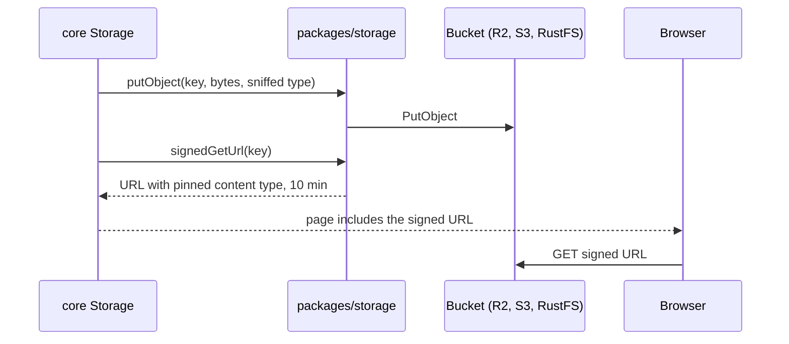

# packages/storage

Plain functions over the AWS S3 client, so the same code talks to Cloudflare R2 (production), AWS S3 or RustFS
(local and CI). Only configuration changes between them. Core wraps these functions in its `Storage` service
([`services.ts`](../../packages/core/src/services.ts)).

## Public API

All in [`src/index.ts`](../../packages/storage/src/index.ts):

| Export                                 | Does                                                                               |
| -------------------------------------- | ---------------------------------------------------------------------------------- |
| `S3StorageConfig`                      | `endpoint`, `region`, `bucket`, `accessKeyId`, `secretAccessKey`, `forcePathStyle` |
| `receiptObjectKey(userId, id, type)`   | `users/<userId>/receipts/<receiptId>.<ext>`                                        |
| `putObject`, `getObject`               | Store and read one object                                                          |
| `deleteObjects(config, keys)`          | Delete in batches of 1,000 (the S3 maximum); throws if any key fails               |
| `signedGetUrl(config, key, expiresIn)` | A read URL valid 5 to 10 minutes by default, stable within a 5-minute window       |
| `s3Client(config)`                     | The cached client for a config                                                     |

## Data flow

Configuration is read by core per call ([`config.ts`](../../packages/core/src/config.ts)): `S3_ENDPOINT` (unset
for AWS), `S3_REGION` (default `auto`, right for R2), `S3_BUCKET`, `S3_ACCESS_KEY_ID`, `S3_SECRET_ACCESS_KEY`,
`S3_FORCE_PATH_STYLE` (default `true`; needed for RustFS).

## Design principles and invariants

- **Keys never contain user input.** The key is built from the user id, the receipt id and the extension of the
  type sniffed from the file's bytes. The uploaded file name is stored in `receipts.file_name` only.
- **The bucket stays private.** Images reach the browser only through signed URLs.
- **Signed URLs are cacheable, privately.** The signature is dated at the start of a 5-minute window, so repeat renders get the
  same URL, and `ResponseCacheControl: private, max-age=<expiresIn - 300>, immutable` lets the browser reuse the image
  without outliving the signature.
- **Signed URLs pin the response type.** `ResponseContentType` comes from the key's extension, so a changed object's
  metadata can't make the bucket serve HTML. Images are served `inline`; PDFs and anything else as an `attachment`,
  so they never render on the bucket's origin.
- **One client per config.** Clients are cached in a 16-entry LRU keyed by a SHA-256 of the settings (never the
  secret itself), so keep-alive connections and TLS sessions are reused across requests. Only the Map keys are
  hashed: a cached client still holds its credentials in memory. Evicted clients are destroyed.
- **Missing config is local.** If `S3_*` is unset, only storage operations fail (`NotConfigured`); receipt pages
  still load without an image.

## How to test it

[`index.test.ts`](../../packages/storage/src/index.test.ts) covers keys and signed-URL parameters (`bun run test`).
Real reads and writes run in the core integration suite and the e2e job against RustFS.

## Common changes

- **Accept a new file type.** Add it to `ACCEPTED_MEDIA_TYPES` in
  [`upload-limits.ts`](../../packages/core/src/upload-limits.ts), its magic bytes to `sniffMediaType` in
  [`files.ts`](../../packages/core/src/files.ts), and its extension to `EXTENSIONS` here. Check the model accepts it.
- **Move to another S3-compatible store.** Change the `S3_*` variables; the code does not change. Create the bucket
  private, with a token that can read, write and delete objects.
