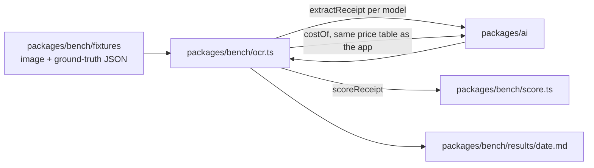
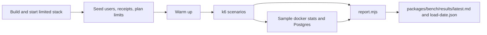
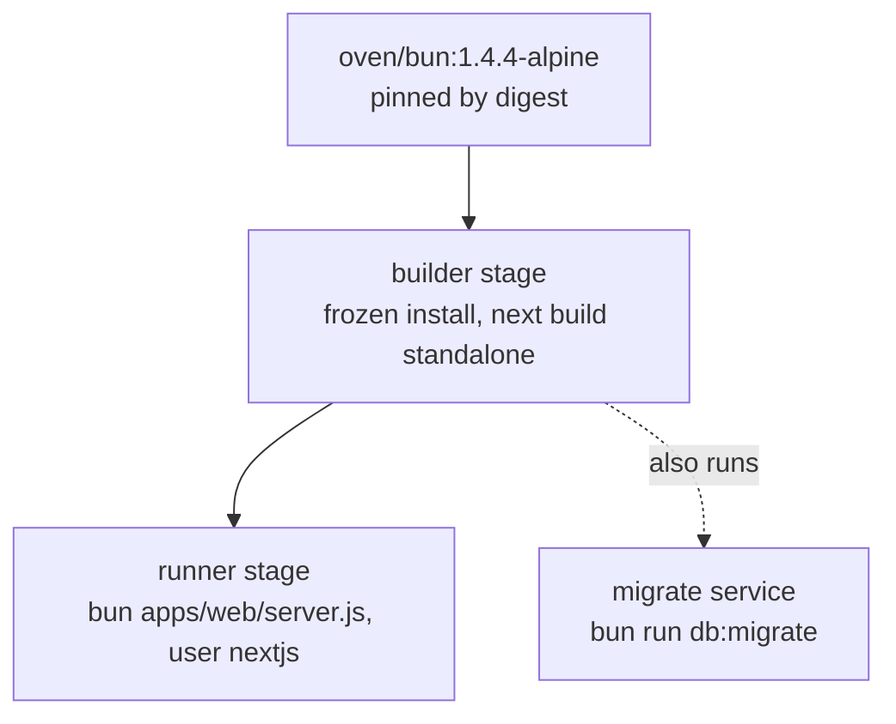

# Benchmarks, scripts, Docker and CI

Everything that is not the app but keeps it honest: the OCR benchmark, the upload load test, repository checks,
container images and GitHub workflows. Deployment as a flow is on [its own page](flows/deployment.md).

## Contents

- [Monorepo tooling](#monorepo-tooling)
- [OCR benchmark](#ocr-benchmark)
- [Load test](#load-test)
- [Scripts](#scripts)
- [Docker](#docker)
- [CI workflows](#ci-workflows)
- [Dependency rules](#dependency-rules)

## Monorepo tooling

| Tool       | Where                                                                                    | Notes                                                                                                                               |
| ---------- | ---------------------------------------------------------------------------------------- | ----------------------------------------------------------------------------------------------------------------------------------- |
| Bun        | [`package.json`](../../package.json) `packageManager`                                    | Installs, runs scripts and tests; runs the production Docker image                                                                  |
| Turborepo  | [`turbo.json`](../../turbo.json)                                                         | `build`, `dev`, `typecheck`, `test` across workspaces. Lists every env variable the build may read                                  |
| Vitest     | [`vitest.config.mts`](../../vitest.config.mts)                                           | Two projects, `unit` and `int`, over one alias table that points packages at their `src`; `server-only` is aliased to an empty stub |
| Playwright | [`apps/web/playwright.config.ts`](../../apps/web/playwright.config.ts)                   | Starts `next start` on 3004; one Chromium project; a random `x-forwarded-for` per worker                                            |
| ESLint     | [`eslint.config.mjs`](../../eslint.config.mjs)                                           | `eslint-config-next`                                                                                                                |
| bun fmt    | [`.prettierrc.json`](../../.prettierrc.json), [`.prettierignore`](../../.prettierignore) | Bun's built-in formatter, Prettier-compatible output; also formats Markdown                                                         |
| knip       | [`knip.json`](../../knip.json)                                                           | Unused files and dependencies                                                                                                       |

Packages have no build output: each `build` script is `tsc --noEmit`, and Next.js compiles their TypeScript source
directly (`transpilePackages`).

## OCR benchmark

[`packages/bench/ocr.ts`](../../packages/bench/ocr.ts), run with `bun run bench:ocr`. It calls real models, billed to each chosen
provider's key (`GOOGLE_GENERATIVE_AI_API_KEY`, `ANTHROPIC_API_KEY`, `GROQ_API_KEY`, `OPENAI_API_KEY`). `--dry-run` prints a cost estimate and calls
nothing.

- Fixtures are `<id>.png|jpg|pdf` plus `<id>.json`. The five today are synthetic, made by
  [`make-fixtures.mjs`](../../packages/bench/make-fixtures.mjs) (`bun run bench:fixtures`).
- [`score.ts`](../../packages/bench/score.ts) scores exact fields, amounts within 0.01, merchant by edit similarity, and line
  items by F1. It is unit-tested ([`score.test.ts`](../../packages/bench/score.test.ts)).
- Cost uses `costOf` from [`packages/ai/src/models.ts`](../../packages/ai/src/models.ts), so benchmark and app agree.
- Details and flags: [`packages/bench/README.md`](../../packages/bench/README.md).

**Planned:** a set of 20 to 30 real, PII-free receipts and more engines to compare
([parsers landscape](../plans/2026-11-06-parsers-landscape.md)). No benchmark results are committed yet.

## Load test

[`scripts/load.sh`](../../scripts/load.sh) runs the production image (`docker/Dockerfile.prod`) as a small server and
drives it with k6. [`docker-compose.load.yml`](../../docker-compose.load.yml) limits the app to 1 vCPU and 1 GB and
Postgres to 1 vCPU and 512 MB, turns on `pg_stat_statements`, and sets `OCR_PROVIDER=fixture` with
`FIXTURE_LATENCY_MS` so the model takes a realistic few seconds without costing anything. k6 comes from the official
`grafana/k6` image pinned by digest and runs on the compose network, so nothing is installed except Docker and Bun.

Scenarios are smoke, load, spike, soak and a capacity ladder; thresholds are k6 SLOs in
[`packages/bench/load/load.js`](../../packages/bench/load/load.js). The report joins k6 results with container CPU and memory, Postgres
connections, per-statement times and the app's wide events. Details: [`packages/bench/README.md`](../../packages/bench/README.md).

## Scripts

| Script                                                   | Does                                                                                                                                                                                         |
| -------------------------------------------------------- | -------------------------------------------------------------------------------------------------------------------------------------------------------------------------------------------- |
| [`scripts/test.sh`](../../scripts/test.sh)               | Unit tests, then compose Postgres and RustFS, a throwaway database, migrations, integration tests, build and Playwright e2e. `--unit` stops after unit tests; `--keep-db` keeps the database |
| [`scripts/check-deps.ts`](../../scripts/check-deps.ts)   | `bun run check:deps`: one version per package across the workspace, exact pins only, `bun.lock` in sync                                                                                      |
| [`scripts/screenshot.mjs`](../../scripts/screenshot.mjs) | Full-page screenshots of a running instance at desktop and phone widths, optionally signed in                                                                                                |

## Docker

| File                                                     | Used by                                                                                                   |
| -------------------------------------------------------- | --------------------------------------------------------------------------------------------------------- |
| [`docker/Dockerfile.prod`](../../docker/Dockerfile.prod) | `bun run docker:app` and any self-hosted deploy. `NEXT_OUTPUT=standalone` only here                       |
| [`docker/Dockerfile.dev`](../../docker/Dockerfile.dev)   | `bun run docker:dev`: `next dev` with the repo bind-mounted                                               |
| [`docker-compose.yml`](../../docker-compose.yml)         | Postgres 18 on 5433, RustFS on 9000, a bucket-creating one-shot, a migrate one-shot, and the app profiles |

Images are pinned by digest. Containers have no restart policy, so they stay stopped until `bun run docker:up`.

## CI workflows

| Workflow                                                   | Trigger                                                  | Jobs                                                                                                                                                                                                                                                                                                            |
| ---------------------------------------------------------- | -------------------------------------------------------- | --------------------------------------------------------------------------------------------------------------------------------------------------------------------------------------------------------------------------------------------------------------------------------------------------------------- |
| [`ci.yml`](../../.github/workflows/ci.yml)                 | Every PR, every push to `main`                           | `changes` (which files the PR touched), `static` (format, lint, deps, knip, audit), `checks` (typecheck, unit tests, build), `integration` (migrations and the integration suites, on Postgres 17 and 18), `e2e` (Postgres 17 and RustFS services, migrations, build, Playwright), `e2e-turnstile`, and `ci-ok` |
| [`preview.yml`](../../.github/workflows/preview.yml)       | PR opened, pushed, ready for review or labelled          | Vercel preview deploy and a PR comment with its URL, only when the PR needs one (see below)                                                                                                                                                                                                                     |
| [`production.yml`](../../.github/workflows/production.yml) | CI succeeded on a push to `main`, or by hand from `main` | Deploys the exact commit CI tested to Vercel production; the automatic run skips when migrations changed since the last successful production deploy run                                                                                                                                                        |
| [`db-migrate.yml`](../../.github/workflows/db-migrate.yml) | By hand from `main` only                                 | `bun run db:migrate` against `staging-db` or `production-db` (GitHub environments holding `DIRECT_URL`), one run per database at a time                                                                                                                                                                         |
| [`load.yml`](../../.github/workflows/load.yml)             | By hand only (workflow_dispatch)                         | Builds the image, runs `scripts/load.sh` with the chosen scenarios and limits, uploads the report. No secrets                                                                                                                                                                                                   |

### CI speed

- A new push to a PR cancels its running CI; runs on `main` are never cancelled, because production deploys the commit
  whose CI succeeded.
- `changes` lists the PR's files (merge commit against its base). Docs and Markdown only: just `static`. Also
  `packages/bench/` and unrelated workflows: `static` and `checks` but no e2e. Pushes to `main` run everything.
- Skipped jobs report success. `ci-ok` is the one job to require: it fails if any job failed or was cancelled.
- [`next-cache`](../../.github/actions/next-cache/action.yml) keeps `apps/web/.next/cache` (Turbopack's build cache) per
  job, keyed by lockfile and source hash. [`playwright`](../../.github/actions/playwright/action.yml) caches the
  Chromium download by Playwright version; system libraries are installed every time.
- `integration` is a matrix over Postgres 17 (Supabase's major) and 18 (self-hosted Docker); `ci-ok` fails if
  either leg fails. The e2e jobs run on 17 only.
- Running tests: `bun run test` is the `unit` project (everything except `*.int.test.ts`, no services). `bun run
test:int` is the `int` project: every `*.int.test.ts` found by glob (no file list to keep in sync), one file at a
  time, with `INTEGRATION=1`; it needs migrated Postgres and RustFS (`scripts/test.sh` sets them up). Browser tests are
  `bun run test:e2e`. `scripts/test.sh` runs all three, as CI does.
- Unit tests: one Vitest run takes about 13 s on a runner and is dominated by startup and one 8 s file
  (`pdf-pages.test.ts`), so pool settings are left at the defaults.
- E2E auth forms set `data-ready` once hydrated and the helpers wait for it. Typing before hydration is lost and an early
  submit reloads the page, which showed up as sign-up staying on `/sign-up`.

### Vercel previews

The free plan allows 100 deployments a day and 10 GB of function storage, and every deployment keeps its function
bundles, and production deploys count toward the same limit. Until launch a PR gets a preview only when it carries
the `preview` label (drafts and docs-only PRs included). With the repository variable `PREVIEW_MODE=auto`, every PR
that is not a draft and changes a file that ships also gets one. Never for Dependabot or fork PRs. A newer push cancels the deploy in flight, and
labels other than `preview` don't. Docs, Markdown, tests, `packages/bench/`, `scripts/` and CI config other than `preview.yml` don't
count as shipping.

All third-party actions are pinned to a commit SHA. [`.github/actions/setup-bun`](../../.github/actions/setup-bun/action.yml)
installs the pinned Bun and runs `bun install --frozen-lockfile` with a cache. The Vercel CLI has its own pinned
lockfile in [`.github/vercel-cli`](../../.github/vercel-cli).

## Dependency rules

- Exact versions only, one version per package, checked by `check:deps`.
- Releases must be at least 7 days old: `minimumReleaseAge = "7d"` in [`bunfig.toml`](../../bunfig.toml).
- Installs use `--frozen-lockfile` in CI and Docker.
- `bun audit --audit-level=high` fails CI on high or critical advisories.
