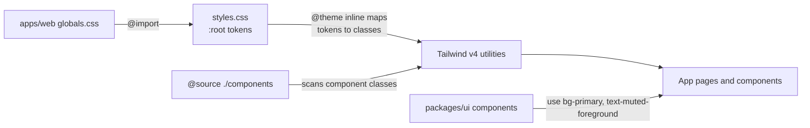

# packages/ui

Shared UI primitives in the shadcn style (registry style `base-nova`), built on [Base UI](https://base-ui.com) and
styled with Tailwind v4, plus the global theme: colour tokens, fonts and the dark-only variant. The web app imports
components from here rather than defining its own buttons, inputs or dialogs.

## Public API

Package exports ([`package.json`](../../packages/ui/package.json)):

| Import                              | What                                                                    |
| ----------------------------------- | ----------------------------------------------------------------------- |
| `@receipt-ocr/ui/styles.css`        | Theme tokens and Tailwind setup; imported by `apps/web/app/globals.css` |
| `@receipt-ocr/ui/lib/utils`         | `cn()`: `clsx` plus `tailwind-merge`                                    |
| `@receipt-ocr/ui/components/<name>` | One file per component                                                  |

Components in [`src/components`](../../packages/ui/src/components): accordion, alert, alert-dialog, badge, button,
card, confirm-dialog, dialog, dropdown-menu, field, input, label, select, separator, skeleton, switch, table,
textarea, toast, tooltip.

## How the theme reaches a page

- Colours are CSS variables on `:root` in [`styles.css`](../../packages/ui/src/styles.css) (emerald `--primary`,
  near-black `--background`), mapped to Tailwind colours with `@theme inline`.
- `@source "./components"` makes Tailwind scan this package; without it, classes used only inside shared components
  would not be generated in the app.
- The app is dark-only: `@custom-variant dark (&)` makes every `dark:` variant always apply.

## Design principles and invariants

- **Tokens, not literals.** App code uses token classes (`bg-primary`, `text-muted-foreground`, `bg-wash`), not hex
  values or raw Tailwind palette colours. [`tests/components/design-tokens.test.ts`](../../apps/web/tests/components/design-tokens.test.ts)
  fails the test run when a literal colour appears in app UI.
- **Touch targets.** Buttons grow to 44 px below the `md` breakpoint (WCAG 2.5.5), see
  [`button.tsx`](../../packages/ui/src/components/button.tsx).
- **Primitives here, composition in the app.** Product components (upload panel, receipt editor, admin tables) live
  in `apps/web/components` and are built from these primitives.
- **No prototype styles.** The Claude Design prototype is the visual target, but its inline styles and tweak panel
  are not copied ([AGENTS.md](../../AGENTS.md)).

## How to test it

`bun run typecheck` covers the package. Visual checks are manual or through
[`scripts/screenshot.mjs`](../../scripts/screenshot.mjs); the token rule runs in `bun run test`.

## Common changes

- **Add a shadcn component.** Run the shadcn CLI from `packages/ui` (its [`components.json`](../../packages/ui/components.json)
  points at this package), review the generated file, replace any literal colours with tokens, and import it in the
  app as `@receipt-ocr/ui/components/<name>`.
- **Add a token.** Define the variable on `:root` in `styles.css`, map it in `@theme inline`, then use the class.

**Planned:** more shared primitives (Spinner, Meter, Checkbox, Avatar, Empty, Pagination) and one form system on
`Field`, from the [shadcn/UI review](../reviews/2026-11-06-shadcn-ui.md).
