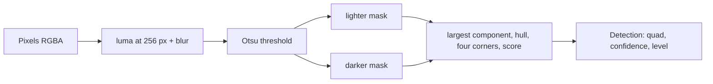

# packages/vision

Pure image code for capture: quad geometry, the perspective warp and the receipt-edge detector. It has no
dependencies and its `tsconfig.json` leaves out the DOM and Node libraries, so the same code runs in the browser, a
worker, Node and Bun. The web app keeps the camera, canvas and DOM work and the crop editor's edge handles
([`apps/web/lib/capture`](../../apps/web/lib/capture)) and imports the maths from here.

## Public API

All from `@receipt-ocr/vision` ([`src/index.ts`](../../packages/vision/src/index.ts)):

| Export                                  | Does                                                                                                 |
| --------------------------------------- | ---------------------------------------------------------------------------------------------------- |
| `Point`, `Quad`, `Pixels`, `Homography` | Types. A `Quad` is top-left, top-right, bottom-right, bottom-left; `Pixels` is RGBA like `ImageData` |
| `isConvex`, `quadArea`, `cornerAngles`  | Quad checks                                                                                          |
| `homography`, `applyHomography`         | The projective transform between two quads; null for a folded or flat one                            |
| `straightenedSize`, `warpQuad`          | Output size within a pixel budget, and the bilinear warp of a quad into a rectangle                  |
| `detectQuad(pixels)` → `Detection`      | The receipt outline, normalised to 0..1, with a confidence and a level: `apply`, `suggest` or `none` |
| `DETECT_EDGE`                           | Long edge (256 px) the detector works at, so callers can hand it an already reduced frame            |

## Key modules

| File                                                                       | Holds                                                                           |
| -------------------------------------------------------------------------- | ------------------------------------------------------------------------------- |
| [`geometry.ts`](../../packages/vision/src/geometry.ts)                     | Points, quads, homography, warp                                                 |
| [`detect/channels.ts`](../../packages/vision/src/detect/channels.ts)       | Area-averaged luma at 256 px, 3x3 blur, Otsu threshold                          |
| [`detect/outline.ts`](../../packages/vision/src/detect/outline.ts)         | Largest connected component, convex hull, the four hull corners of the quad     |
| [`detect/detect-quad.ts`](../../packages/vision/src/detect/detect-quad.ts) | Scoring a candidate (cover, angles, fill, share) and the `apply` evidence rules |

## Data flow

The camera sheet and the review sheet (`apps/web/lib/capture/render.ts`) draw the photo to a canvas, read its pixels
and call `detectQuad`; the crop is then warped with `warpQuad` before the filters run.

## Design principles and invariants

- No DOM, no Node, no dependencies. A new module that needs `document` or `Buffer` belongs in `apps/web`.
- Detection is deterministic: the same pixels give the same `Detection`.
- `apply` is only returned when the evidence says the quad holds the whole paper; anything less is `suggest` or
  `none`. The rules and their reasons sit next to the constants in `detect-quad.ts`.

## How to test it

Tests live in [`packages/vision/tests`](../../packages/vision/tests), mirroring `src`, and run in the `unit` Vitest
project (`bun run test`). The detector tests draw synthetic scenes and also place the bench receipts in
[`packages/bench/fixtures`](../../packages/bench/fixtures) on a table. Two `it.fails` tests record known misses
(bowed sides, a lighter band of table); see the [edge-detection plan](../plans/2026-11-12-edge-detection.md).
`bun run --filter @receipt-ocr/vision typecheck` checks `src` without the DOM and the tests with Node types.

## Common changes

- **A new export**: add it to `src/index.ts`. The package has one entry point, so no Vitest alias or `exports` line
  is needed.
- **A new detector stage**: a file under `src/detect/` with its test under `tests/detect/`.
