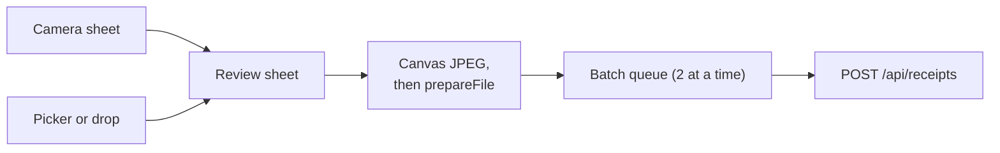
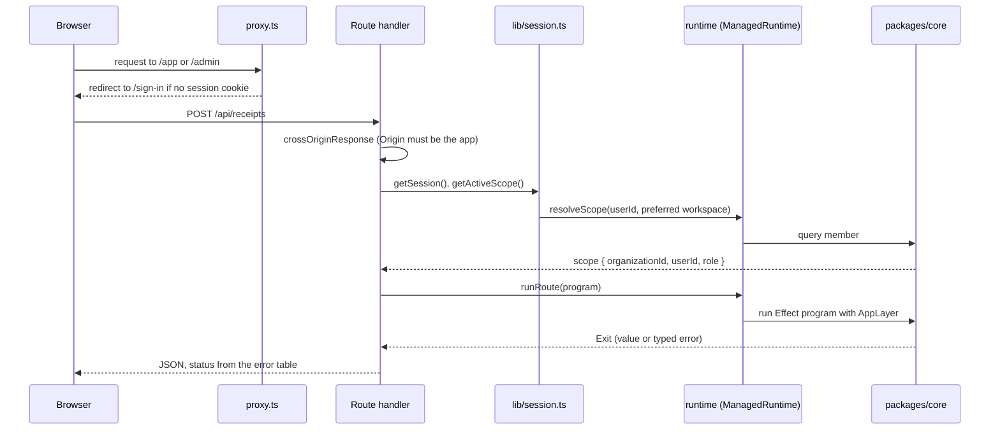

# apps/web

The Next.js App Router app: every page, every HTTP endpoint, the Better Auth configuration and the admin panel. It is
the only process that runs. Receipt logic is not here; it lives in [packages/core](core.md), and this app adapts it to
HTTP.

## Contents

- [Layout of the app](#layout-of-the-app)
- [Public API](#public-api)
- [How a request reaches core](#how-a-request-reaches-core)
- [Key modules](#key-modules)
- [Design principles and invariants](#design-principles-and-invariants)
- [How to test it](#how-to-test-it)
- [Common changes](#common-changes)

## Layout of the app

| Path                                                                                                                                                                                               | What is there                                                                                                                                                                                                        |
| -------------------------------------------------------------------------------------------------------------------------------------------------------------------------------------------------- | -------------------------------------------------------------------------------------------------------------------------------------------------------------------------------------------------------------------- |
| [`app/page.tsx`](../../apps/web/app/page.tsx)                                                                                                                                                      | Landing page                                                                                                                                                                                                         |
| `app/sign-in`, `sign-up`, `forgot-password`, `reset-password`                                                                                                                                      | Auth pages; forms in [`components/auth`](../../apps/web/components/auth)                                                                                                                                             |
| [`app/accept-invitation/[id]`](../../apps/web/app/accept-invitation/[id]/page.tsx)                                                                                                                 | Invitation landing page                                                                                                                                                                                              |
| [`app/app`](../../apps/web/app/app)                                                                                                                                                                | Signed-in app: Home with upload panel (`/app`), History, receipt detail, Settings, Members                                                                                                                           |
| [`app/admin`](../../apps/web/app/admin)                                                                                                                                                            | Platform admin panel: overview, users, workspaces, audit log, settings                                                                                                                                               |
| [`app/api`](../../apps/web/app/api)                                                                                                                                                                | Route handlers (below)                                                                                                                                                                                               |
| `app/(lab)`, `components/marketing`                                                                                                                                                                | Landing-page design experiments, `noindex`, shown only in development or when the build sets `LAB_PAGES=1` (read at build time, the pages are prerendered). Pending removal (see [STATUS](../STATUS.md))             |
| [`lib`](../../apps/web/lib)                                                                                                                                                                        | Server helpers: auth, session, HTTP adapter, env, logging                                                                                                                                                            |
| [`proxy.ts`](../../apps/web/proxy.ts)                                                                                                                                                              | Next.js proxy (formerly middleware): optimistic cookie check for `/app` and `/admin`, and the `signed_in_hint` cookie                                                                                                |
| `loading.tsx` in [`app/app`](../../apps/web/app/app/loading.tsx), [`app/app/receipts/[id]`](../../apps/web/app/app/receipts/[id]/loading.tsx), [`app/admin`](../../apps/web/app/admin/loading.tsx) | Skeletons streamed while a page's data loads. Data helpers (`getSession`, `getActiveScope`, `getCurrentPlan`, `getUsageSummary`) are wrapped in React `cache()`, so the layout and page share one lookup per request |
| [`app/global-error.tsx`](../../apps/web/app/global-error.tsx)                                                                                                                                      | Last-resort error page for failures in the root layout; brings its own `<html>` and logs `app.global_error`                                                                                                          |
| [`drizzle`](../../apps/web/drizzle)                                                                                                                                                                | SQL migrations, generated from [packages/db](db.md)                                                                                                                                                                  |
| [`e2e`](../../apps/web/e2e)                                                                                                                                                                        | Playwright suite                                                                                                                                                                                                     |

The upload panel lives on Home (`/app`) and on `/app/upload`, which the home-screen shortcut (`?capture=1` opens the
camera) and the share target (`?shared=1`) land on. Capture, review and upload in the browser are described in
[Upload, extraction and result](flows/upload-and-extraction.md#1-in-the-browser):

## Public API

### Route handlers

| Method and path                | File                                                                                      | Does                                                                                         |
| ------------------------------ | ----------------------------------------------------------------------------------------- | -------------------------------------------------------------------------------------------- |
| `GET, POST /api/auth/*`        | [`api/auth/[...all]/route.ts`](../../apps/web/app/api/auth/[...all]/route.ts)             | Better Auth. `503` when auth is not configured.                                              |
| `POST /api/receipts`           | [`api/receipts/route.ts`](../../apps/web/app/api/receipts/route.ts)                       | Upload one file. `mode=instant` reads it in the request; `mode=queued` returns `202`.        |
| `GET /api/receipts/status`     | [`api/receipts/status/route.ts`](../../apps/web/app/api/receipts/status/route.ts)         | Workspace receipt counts, so list pollers refresh only when something changed                |
| `GET /api/receipts/:id`        | [`api/receipts/[id]/route.ts`](../../apps/web/app/api/receipts/[id]/route.ts)             | Status for the polling client; drains the receipt's job if it is due and not running         |
| `PATCH /api/receipts/:id`      | same file                                                                                 | User corrections to merchant, date, category, currency and amounts                           |
| `DELETE /api/receipts/:id`     | same file                                                                                 | Delete the row, then the stored file                                                         |
| `POST /api/receipts/:id/retry` | [`api/receipts/[id]/retry/route.ts`](../../apps/web/app/api/receipts/[id]/retry/route.ts) | Claim a failed receipt for another round and enqueue its job; `202`, then drain in `after()` |
| `GET /api/receipts/export`     | [`api/receipts/export/route.ts`](../../apps/web/app/api/receipts/export/route.ts)         | CSV with the History filters, up to 5,000 rows                                               |
| `POST /api/contact`            | [`api/contact/route.ts`](../../apps/web/app/api/contact/route.ts)                         | Support form: origin check, honeypot, per-IP rate limit, mail to `SUPPORT_EMAIL`             |

Status codes come from one table in [`lib/http.ts`](../../apps/web/lib/http.ts):

| Core error      | HTTP | Message shown                          |
| --------------- | ---- | -------------------------------------- |
| `InvalidInput`  | 400  | The error's own message                |
| `NotFound`      | 404  | The error's own message                |
| `Conflict`      | 409  | The error's own message                |
| `QuotaExceeded` | 429  | The error's own message, `Retry-After` |
| `NotConfigured` | 503  | "This feature is not configured…"      |
| `DbError`       | 500  | Generic                                |
| `StorageError`  | 502  | Generic                                |
| `OcrError`      | 502  | Generic                                |

### Server actions

- [`app/admin/actions.ts`](../../apps/web/app/admin/actions.ts): every admin mutation. See
  [Admin actions](flows/admin-actions.md).
- [`lib/impersonation-actions.ts`](../../apps/web/lib/impersonation-actions.ts): stop impersonating.

Customer-side workspace changes (create, switch, invite, change a member's role, remove a member, cancel an invite)
call Better Auth's organization endpoints from the browser through
[`lib/auth-client.ts`](../../apps/web/lib/auth-client.ts); Better Auth checks the caller's workspace role.

## How a request reaches core

- [`proxy.ts`](../../apps/web/proxy.ts) only checks that a session cookie exists; it does not touch the database.
  API routes are not matched by it and check the session themselves. On a guarded path with a session cookie it also
  sets `signed_in_hint=1`, a non-HttpOnly cookie that lets the static landing page show "Open the app" without a
  session fetch; it deletes the hint when it redirects to sign-in, and `signOutAndClearHint` in
  [`lib/auth-client.ts`](../../apps/web/lib/auth-client.ts) clears it on sign-out. The hint only picks a button.
- [`lib/session.ts`](../../apps/web/lib/session.ts) always reads the session row (the cookie cache is off in
  [`lib/auth.ts`](../../apps/web/lib/auth.ts), and reads also pass `disableCookieCache: true`), so a ban or a revoked
  session applies on the next request. `getSession` and `getActiveScope` are wrapped in React `cache`, so a
  request does each lookup once.
- [`lib/runtime.ts`](../../apps/web/lib/runtime.ts) builds one `ManagedRuntime` from core's `AppLayer` per server
  process. The database pool and the settings cache live in it.
- [`runRoute`](../../apps/web/lib/http.ts) runs the program and maps failures. Work after the response runs the
  [job queue](flows/jobs.md) through [`lib/jobs.ts`](../../apps/web/lib/jobs.ts) (`runJobNow`, `drainJobs`), which
  logs one `job.run` event per attempt.

Pages follow the same path without the HTTP mapping: server components call helpers in
[`lib/receipts.ts`](../../apps/web/lib/receipts.ts), which call `requireActiveScope()` and then `runtime.runPromise`.

## Key modules

| Module                                                                                | Purpose                                                                                                                                                                                                                                                                                                                     |
| ------------------------------------------------------------------------------------- | --------------------------------------------------------------------------------------------------------------------------------------------------------------------------------------------------------------------------------------------------------------------------------------------------------------------------- |
| [`lib/auth.ts`](../../apps/web/lib/auth.ts)                                           | Better Auth config: email/password, OAuth, organization and admin plugins, rate limits, hooks that create the personal workspace                                                                                                                                                                                            |
| [`lib/auth-guards.ts`](../../apps/web/lib/auth-guards.ts)                             | Organization hooks: workspace-name rules, 10 invitations per inviter per hour, and `assertWorkspaceRole` (a role must be exactly `owner`, `admin` or `member`; GHSA-c85h) on invite, accept, add member and role change                                                                                                     |
| [`lib/session.ts`](../../apps/web/lib/session.ts)                                     | `getSession`, `requireSession`, `requireAdmin`, `getActiveScope`, `requireActiveScope`                                                                                                                                                                                                                                      |
| [`lib/http.ts`](../../apps/web/lib/http.ts)                                           | `runRoute`, `runBackground`, error-to-status table, origin check, client IP, capped multipart reader                                                                                                                                                                                                                        |
| [`lib/env.ts`](../../apps/web/lib/env.ts)                                             | Auth, email and proxy env parsing. Throws at boot on bad production config, loaded by [`instrumentation-node.ts`](../../apps/web/instrumentation-node.ts)                                                                                                                                                                   |
| [`instrumentation.ts`](../../apps/web/instrumentation.ts)                             | `register()` loads the env check on the Node runtime; `onRequestError` logs render, route and action failures as `request.error` (message and digest only)                                                                                                                                                                  |
| [`lib/quota.ts`](../../apps/web/lib/quota.ts)                                         | `enforceUploadQuota` (early, read-only check) and the usage meter summary                                                                                                                                                                                                                                                   |
| [`lib/plan-limits.ts`](../../apps/web/lib/plan-limits.ts)                             | Plan table from Settings (3 s timeout, defaults on error), current user's plan, revalidating pages that print limits                                                                                                                                                                                                        |
| [`lib/receipts.ts`](../../apps/web/lib/receipts.ts)                                   | History list, filters from URL params, counts, export rows, receipt with signed image URL                                                                                                                                                                                                                                   |
| [`lib/upload-prep.ts`](../../apps/web/lib/upload-prep.ts)                             | Browser side: orient, size to a ~3 MP budget (short edge kept at 1,000 px or more) and re-encode images as JPEG near 500 KB before upload                                                                                                                                                                                   |
| [`lib/log.ts`](../../apps/web/lib/log.ts)                                             | One JSON wide event per request on stdout                                                                                                                                                                                                                                                                                   |
| [`lib/csv.ts`](../../apps/web/lib/csv.ts)                                             | CSV export with formula-injection escaping                                                                                                                                                                                                                                                                                  |
| [`components/upload-panel.tsx`](../../apps/web/components/upload-panel.tsx)           | Picks files or opens the camera, sends photos to review, uploads the batch two at a time with progress and retry, up to the plan's `batchMax`                                                                                                                                                                               |
| [`components/capture`](../../apps/web/components/capture)                             | Camera sheet and review sheet (corner crop, rotate, filters), loaded with `next/dynamic` on first use                                                                                                                                                                                                                       |
| [`lib/capture`](../../apps/web/lib/capture)                                           | Pure maths for capture: homography and warp, edit state, edge detection, filters, the batch queue; plus the camera, canvas and XHR upload helpers                                                                                                                                                                           |
| [`components/processing-poller.tsx`](../../apps/web/components/processing-poller.tsx) | Polls one receipt's status, or the workspace counts (`/api/receipts/status`) for a list, on the schedule in [`lib/backoff-poll.ts`](../../apps/web/lib/backoff-poll.ts): backs off from 2 s to 15 s, pauses while the tab is hidden, gives up after 6 minutes of visible polling (a receipt job's retries can take about 4) |
| [`lib/signed-in-hint.ts`](../../apps/web/lib/signed-in-hint.ts)                       | The `signed_in_hint` cookie name and browser helpers to read and clear it                                                                                                                                                                                                                                                   |

## Design principles and invariants

- **Thin adapters.** A route handler checks origin, session and input shape, then runs one core program. If a
  handler grows a loop or a transaction, that code belongs in core.
- **Mutations require the app's own `Origin`.** `crossOriginResponse` refuses a POST, PATCH or DELETE whose `Origin`
  is not `BETTER_AUTH_URL`, including one with no `Origin`.
- **The scope comes from `member`, not the session.** `session.activeOrganizationId` is only a preference, because
  Better Auth leaves it set on a removed member's other sessions.
- **The client is never trusted for roles.** Admin pages call `requireAdmin()` (a non-admin gets a 404); every admin
  action calls it again. Hiding a button in the UI ([`receipt-permissions.ts`](../../apps/web/lib/receipt-permissions.ts)) is
  convenience only; core enforces edit and delete rights.
- **Safe messages only.** Only `InvalidInput`, `NotFound`, `Conflict` and `QuotaExceeded` messages reach the browser.
  Causes go to the log, with Drizzle's bound `params:` redacted (`causeDetail`, using `redactDbMessage` in
  [`lib/log.ts`](../../apps/web/lib/log.ts)).
- **One wide event per request.** Upload and retry build a `WideEvent` and log it once with timings, model, attempts,
  cost and outcome. Requests made while impersonating carry `impersonated_by`.
- **Bodies are capped while streaming.** `readFormData` refuses a declared or streamed body over 10 MB plus 64 KB.
- **Degrades without config.** With no `DATABASE_URL` or auth secret, `authEnabled` is false, auth endpoints return
  `503` and the auth pages show a "not configured" card. In production off Vercel, the app refuses to start without
  `TRUSTED_IP_HEADERS`, because rate limits would otherwise share one bucket.

Security headers (HSTS, `X-Frame-Options: DENY`, a report-only CSP) are set in
[`next.config.ts`](../../apps/web/next.config.ts).

## How to test it

| What                                      | Command                                                                     |
| ----------------------------------------- | --------------------------------------------------------------------------- |
| Unit tests (all `*.test.ts`, Node, no DB) | `bun run test`                                                              |
| Better Auth against a real database       | `bun run --filter @receipt-ocr/web test:int` (needs `DATABASE_URL`)         |
| Playwright e2e against a built app        | `scripts/test.sh` (starts Postgres and RustFS, fresh database, fixture OCR) |
| Type check                                | `bun run typecheck`                                                         |

The e2e specs ([`e2e/`](../../apps/web/e2e)) cover auth, upload, admin, smoke pages and security checks.
`capture.spec.ts` runs in its own `mobile-camera` project (390x844 Chromium with a fake camera). They run with
`OCR_PROVIDER=fixture`, so no model is called.

## Common changes

### Add an API route

1. Put the workflow in core as an Effect program returning typed errors from
   [`errors.ts`](../../packages/core/src/errors.ts).
2. In the handler: `crossOriginResponse` for mutations, `getActiveScope()` (or `getSession()`), validate the input,
   then `return runRoute(program, onSuccess)`.
3. Add a unit test for any pure parsing, and an e2e test if it changes what a user sees.

### Add an admin action

See [Admin actions](flows/admin-actions.md#add-an-admin-action).

### Add an environment variable

1. Read it where it is used: Effect `Config` in core, or [`lib/env.ts`](../../apps/web/lib/env.ts) for auth and email.
2. Add it to [`apps/web/.env.example`](../../apps/web/.env.example), and to the root
   [`.env.example`](../../.env.example) and [`docker-compose.yml`](../../docker-compose.yml) if the container needs it.
3. Add it to `tasks.build.env` in [`turbo.json`](../../turbo.json), so Turborepo passes it to the build and includes
   it in the cache key.
4. Add a row to the variables table in [deployment.md](../deployment.md#4-environment-variables).
