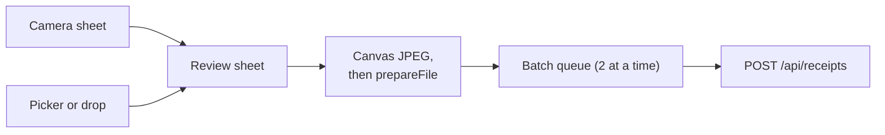
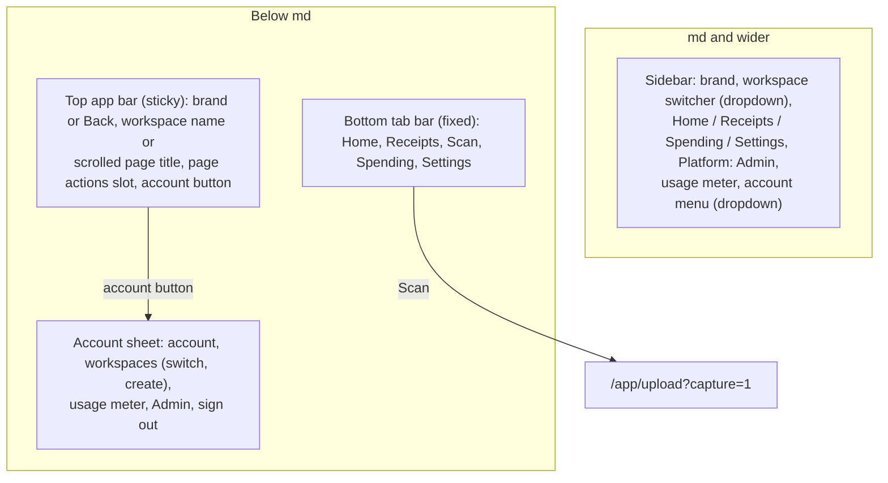
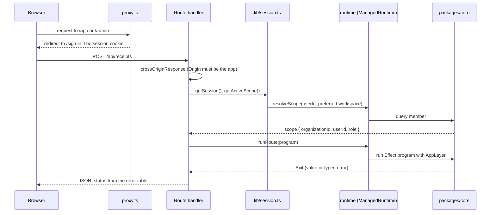
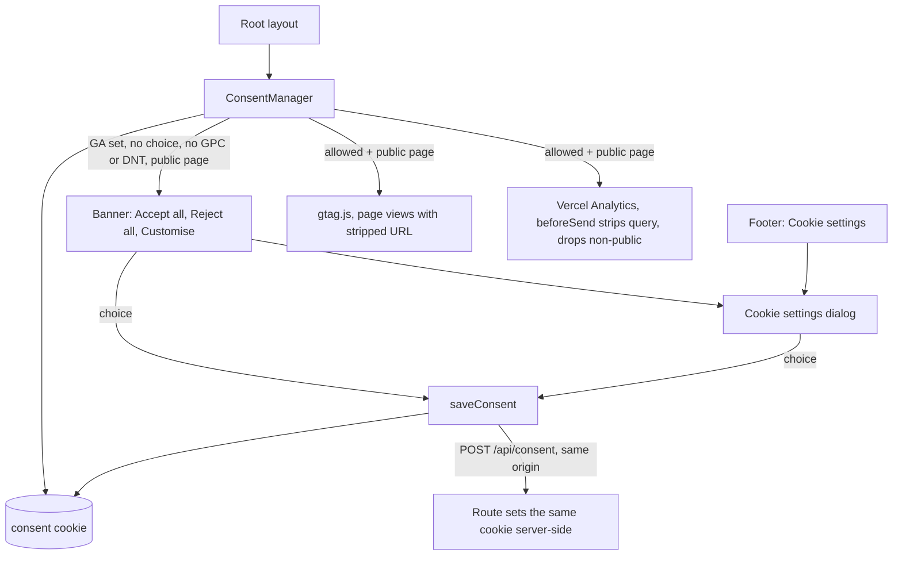
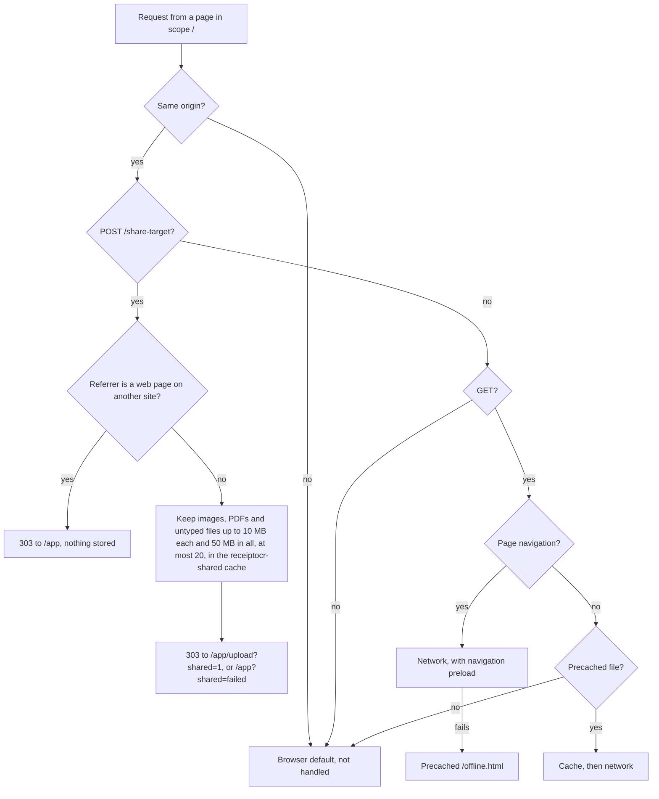

# apps/web

The Next.js App Router app: every page, every HTTP endpoint, the Better Auth configuration and the admin panel. It is
the only process that runs. Receipt logic is not here; it lives in [packages/core](core.md), and this app adapts it to
HTTP.

## Contents

- [Layout of the app](#layout-of-the-app)
- [Navigation](#navigation)
- [Public API](#public-api)
- [How a request reaches core](#how-a-request-reaches-core)
- [Key modules](#key-modules)
- [Installable app (PWA)](#installable-app-pwa)
- [Consent and analytics](#consent-and-analytics)
- [Search indexing and hosts](#search-indexing-and-hosts)
- [Design principles and invariants](#design-principles-and-invariants)
- [How to test it](#how-to-test-it)
- [Common changes](#common-changes)

## Layout of the app

| Path                                                                                                                                                                                               | What is there                                                                                                                                                                                                                                                     |
| -------------------------------------------------------------------------------------------------------------------------------------------------------------------------------------------------- | ----------------------------------------------------------------------------------------------------------------------------------------------------------------------------------------------------------------------------------------------------------------- |
| [`app/page.tsx`](../../apps/web/app/page.tsx)                                                                                                                                                      | Landing page                                                                                                                                                                                                                                                      |
| `app/sign-in`, `sign-up`, `forgot-password`, `reset-password`                                                                                                                                      | Auth pages; forms in [`components/auth`](../../apps/web/components/auth)                                                                                                                                                                                          |
| [`app/accept-invitation/[id]`](../../apps/web/app/accept-invitation/[id]/page.tsx)                                                                                                                 | Invitation landing page                                                                                                                                                                                                                                           |
| [`app/app`](../../apps/web/app/app)                                                                                                                                                                | Signed-in app: Home with upload panel (`/app`), Receipts (`/app/receipts`), Spending dashboard (`/app/spending`), receipt detail, Groups (`/app/receipts/groups`), Settings (plan, workspace, read-only Receipt reading from `receiptReaders`), Members           |
| [`app/admin`](../../apps/web/app/admin)                                                                                                                                                            | Platform admin panel: overview, users, workspaces, operations, jobs, audit log, settings                                                                                                                                                                          |
| [`app/pricing`](../../apps/web/app/pricing/page.tsx), [`app/refunds`](../../apps/web/app/refunds/page.tsx)                                                                                         | Public pricing (Free and Pro, monthly or yearly, FAQ) and refund policy. Terms and privacy name Paddle as reseller and merchant of record                                                                                                                         |
| [`app/pay`](../../apps/web/app/pay/page.tsx)                                                                                                                                                       | Paddle's default payment link, public and noindex: with a well-formed `?_ptxn=txn_…` it loads Paddle.js and opens the overlay for that transaction (checkout links, update-payment-method links in Paddle's emails); otherwise a short page linking to `/pricing` |
| [`app/app/settings/billing`](../../apps/web/app/app/settings/billing)                                                                                                                              | Plan and usage, subscription status, owner-only checkout (Paddle.js overlay) and portal links; members see it read-only                                                                                                                                           |
| [`app/api`](../../apps/web/app/api)                                                                                                                                                                | Route handlers (below)                                                                                                                                                                                                                                            |
| [`lib`](../../apps/web/lib)                                                                                                                                                                        | Server helpers: auth, session, HTTP adapter, env, logging                                                                                                                                                                                                         |
| [`proxy.ts`](../../apps/web/proxy.ts)                                                                                                                                                              | Next.js proxy (formerly middleware): optimistic cookie check for `/app` and `/admin`, and the `signed_in_hint` cookie                                                                                                                                             |
| `loading.tsx` in [`app/app`](../../apps/web/app/app/loading.tsx), [`app/app/receipts/[id]`](../../apps/web/app/app/receipts/[id]/loading.tsx), [`app/admin`](../../apps/web/app/admin/loading.tsx) | Skeletons streamed while a page's data loads. Data helpers (`getSession`, `getActiveScope`, `getCurrentPlan`, `getUsageSummary`) are wrapped in React `cache()`, so the layout and page share one lookup per request                                              |
| [`app/global-error.tsx`](../../apps/web/app/global-error.tsx)                                                                                                                                      | Last-resort error page for failures in the root layout; brings its own `<html>` and logs `app.global_error`                                                                                                                                                       |
| [`drizzle`](../../apps/web/drizzle)                                                                                                                                                                | SQL migrations, generated from [packages/db](db.md)                                                                                                                                                                                                               |
| [`e2e`](../../apps/web/e2e)                                                                                                                                                                        | Playwright suite                                                                                                                                                                                                                                                  |

The upload panel lives on Home (`/app`) and on `/app/upload`, which the Scan tab and the home-screen shortcut (`?capture=1`
opens the camera on each visit, then is dropped from the URL with `history.replaceState`) and the share target (`?shared=1`) land on. Capture, review and upload in the browser are described in
[Upload, extraction and result](flows/upload-and-extraction.md#1-in-the-browser):

## Navigation

The signed-in shell ([`app/app/layout.tsx`](../../apps/web/app/app/layout.tsx)) has two arrangements, switched at the
`md` breakpoint (768 px) with CSS only, so the server renders both and nothing depends on JavaScript to pick one.

| Piece                                        | Where                                                                                  | Notes                                                                                                                                                                                                                                                                                                   |
| -------------------------------------------- | -------------------------------------------------------------------------------------- | ------------------------------------------------------------------------------------------------------------------------------------------------------------------------------------------------------------------------------------------------------------------------------------------------------- |
| `AppSidebarNav`, `SidebarNav`                | [`components/app-nav.tsx`](../../apps/web/components/app-nav.tsx)                      | `aria-current="page"` on the active link. Receipt pages and Groups (everything under `/app/receipts`) count as Receipts; Groups is reached from the Receipts group filter and from Settings. "Add receipts" (desktop only) links to `/app/upload` above the nav. Admin sits in its own "Platform" group |
| `AppTabBar`, `BottomTabBar`                  | same                                                                                   | 4rem tall (`--tabbar-h`) plus `env(safe-area-inset-bottom)`; `--app-bottom-inset` is the total, set in [`styles.css`](../../packages/ui/src/styles.css) only while a tab bar is on the page. `<main>` and toasts clear it with that variable                                                            |
| `MobileTopBar`                               | same                                                                                   | Back on detail pages (`backFor(pathname)`): returns with `router.back()` when the previous page was the parent list, so filters and scroll survive, else links to it. Shows the page `<h1>` text once it scrolls under the bar                                                                          |
| `AppBarActions`                              | same                                                                                   | Portals a page's own phone actions into the app bar (the receipt page's "Receipt actions" sheet)                                                                                                                                                                                                        |
| `UserMenu` (desktop), `AccountSheet` (phone) | [`components/user-menu.tsx`](../../apps/web/components/user-menu.tsx)                  | The sheet holds `WorkspaceList` from [`workspace-switcher.tsx`](../../apps/web/components/workspace-switcher.tsx); `CreateWorkspaceDialog` is outside the sheet so closing it doesn't unmount the form                                                                                                  |
| `Drawer`                                     | [`packages/ui/src/components/drawer.tsx`](../../packages/ui/src/components/drawer.tsx) | Bottom sheet on Base UI's Drawer: swipe down, Escape or a tap outside closes it. `DrawerAction` is a 48 px row                                                                                                                                                                                          |

The admin shell ([`app/admin/layout.tsx`](../../apps/web/app/admin/layout.tsx)) uses the same pieces with its own five
tabs and no Scan action, and keeps "App" in the top bar.

Phone details: `touch-action: manipulation` on `<html>` (no double-tap delay), and in standalone (installed) mode
`overscroll-behavior-y: none`, so there is no rubber band or pull-to-refresh.

## Public API

### Route handlers

| Method and path                    | File                                                                                            | Does                                                                                                                                                                                                                                                                                                                                                                                                                                                       |
| ---------------------------------- | ----------------------------------------------------------------------------------------------- | ---------------------------------------------------------------------------------------------------------------------------------------------------------------------------------------------------------------------------------------------------------------------------------------------------------------------------------------------------------------------------------------------------------------------------------------------------------- |
| `GET, POST /api/auth/*`            | [`api/auth/[...all]/route.ts`](../../apps/web/app/api/auth/[...all]/route.ts)                   | Better Auth. `503` when auth is not configured.                                                                                                                                                                                                                                                                                                                                                                                                            |
| `POST /api/receipts`               | [`api/receipts/route.ts`](../../apps/web/app/api/receipts/route.ts)                             | Upload one file. `mode=instant` reads it in the request; `mode=queued` returns `202`.                                                                                                                                                                                                                                                                                                                                                                      |
| `GET /api/receipts/status`         | [`api/receipts/status/route.ts`](../../apps/web/app/api/receipts/status/route.ts)               | Workspace receipt counts, so list pollers refresh only when something changed                                                                                                                                                                                                                                                                                                                                                                              |
| `GET /api/receipts/:id`            | [`api/receipts/[id]/route.ts`](../../apps/web/app/api/receipts/[id]/route.ts)                   | Status for the polling client; drains the receipt's job if it is due and not running                                                                                                                                                                                                                                                                                                                                                                       |
| `PATCH /api/receipts/:id`          | same file                                                                                       | User corrections to merchant, date, category, currency and amounts                                                                                                                                                                                                                                                                                                                                                                                         |
| `DELETE /api/receipts/:id`         | same file                                                                                       | Delete one receipt (`deleteReceipt`, which is `deleteReceipts` with one id); its file goes with a `storage.delete` job, started in `after()`                                                                                                                                                                                                                                                                                                               |
| `POST /api/receipts/delete`        | [`api/receipts/delete/route.ts`](../../apps/web/app/api/receipts/delete/route.ts)               | Bulk delete: `{ organizationId, ids }` or `{ organizationId, filter, expected }` (History's query string and the count the user confirmed). `409` when `organizationId` isn't the active workspace or the list changed (rolled back), `400` for an unknown filter key or value, `403` while impersonating. Up to 1,000; a member's deletes skip others' uploads. Answers `{ deleted, skipped, notFound }` and starts the `storage.delete` job in `after()` |
| `GET /api/receipts/ids`            | [`api/receipts/ids/route.ts`](../../apps/web/app/api/receipts/ids/route.ts)                     | Ids matching History's filters (up to 1,000), for "Add to group" on "all that match". `?org=` must be the active workspace (`409`); any other non-filter param is `400`                                                                                                                                                                                                                                                                                    |
| `POST /api/receipts/:id/retry`     | [`api/receipts/[id]/retry/route.ts`](../../apps/web/app/api/receipts/[id]/retry/route.ts)       | Claim a failed receipt for another round and enqueue its job; `202`, then drain in `after()`                                                                                                                                                                                                                                                                                                                                                               |
| `GET /api/receipts/export`         | [`api/receipts/export/route.ts`](../../apps/web/app/api/receipts/export/route.ts)               | CSV with the History filters and sort, up to 5,000 rows                                                                                                                                                                                                                                                                                                                                                                                                    |
| `POST /api/receipts/export`        | same file                                                                                       | CSV of a selection, `{ organizationId, ids, sort? }` (`409` for another workspace). The GET takes `?org=` from a selection the same way                                                                                                                                                                                                                                                                                                                    |
| `GET, POST /api/jobs/drain`        | [`api/jobs/drain/route.ts`](../../apps/web/app/api/jobs/drain/route.ts)                         | Runs the job queue once (`drainOnce`). `Authorization: Bearer $CRON_SECRET`: `401` when wrong or unset. Called by Supabase `pg_cron` and Vercel Cron                                                                                                                                                                                                                                                                                                       |
| `POST /api/billing/paddle/webhook` | [`api/billing/paddle/webhook/route.ts`](../../apps/web/app/api/billing/paddle/webhook/route.ts) | Paddle's webhook destination. Verifies `Paddle-Signature`, stores the event and enqueues `billing.apply_event`, answers `200`. `401` bad signature, `400` unreadable body, `413` over 256 KB, `503` while billing is off. See [Billing](flows/billing.md)                                                                                                                                                                                                  |
| `POST /api/contact`                | [`api/contact/route.ts`](../../apps/web/app/api/contact/route.ts)                               | Support form: origin check, honeypot, per-IP rate limit, Turnstile, mail to `SUPPORT_EMAIL`, capped auto-reply job                                                                                                                                                                                                                                                                                                                                         |
| `POST /share-target`               | [`share-target/route.ts`](../../apps/web/app/share-target/route.ts)                             | Share target fallback when no service worker took the share: `303` to the upload page, body unread                                                                                                                                                                                                                                                                                                                                                         |
| `POST /share-target`               | [`share-target/route.ts`](../../apps/web/app/share-target/route.ts)                             | Share target fallback when no service worker took the share: `303` to the upload page, body unread                                                                                                                                                                                                                                                                                                                                                         |

Status codes come from one table in [`lib/http.ts`](../../apps/web/lib/http.ts):

| Core error      | HTTP | Message shown                          |
| --------------- | ---- | -------------------------------------- |
| `InvalidInput`  | 400  | The error's own message                |
| `NotFound`      | 404  | The error's own message                |
| `Forbidden`     | 403  | The error's own message                |
| `Conflict`      | 409  | The error's own message                |
| `QuotaExceeded` | 429  | The error's own message, `Retry-After` |
| `NotConfigured` | 503  | "This feature is not configured…"      |
| `DbError`       | 500  | Generic                                |
| `StorageError`  | 502  | Generic                                |
| `OcrError`      | 502  | Generic                                |

### Server actions

- [`app/admin/actions.ts`](../../apps/web/app/admin/actions.ts): every admin mutation. See
  [Admin actions](flows/admin-actions.md).
- [`lib/impersonation-actions.ts`](../../apps/web/lib/impersonation-actions.ts): stop impersonating.
- [`app/app/settings/billing/actions.ts`](../../apps/web/app/app/settings/billing/actions.ts): `openBillingPortalAction`, a fresh Paddle portal link for the active workspace. Owners only, refused while impersonating.

Customer-side workspace changes (create, switch, invite, change a member's role, remove a member, cancel an invite)
call Better Auth's organization endpoints from the browser through
[`lib/auth-client.ts`](../../apps/web/lib/auth-client.ts); Better Auth checks the caller's workspace role.

## How a request reaches core

- [`proxy.ts`](../../apps/web/proxy.ts) only checks that a session cookie exists; it does not touch the database.
  API routes are not matched by it and check the session themselves. On a guarded path with a session cookie it also
  sets `signed_in_hint=1`, a non-HttpOnly cookie that lets the static landing page show "Open the app" without a
  session fetch; it deletes the hint when it redirects to sign-in, and `signOutAndClearHint` in
  [`lib/auth-client.ts`](../../apps/web/lib/auth-client.ts) clears it on sign-out. The hint only picks a button.
- [`lib/session.ts`](../../apps/web/lib/session.ts) always reads the session row (the cookie cache is off in
  [`lib/auth.ts`](../../apps/web/lib/auth.ts), and reads also pass `disableCookieCache: true`), so a ban or a revoked
  session applies on the next request. `getSession` and `getActiveScope` are wrapped in React `cache`, so a
  request does each lookup once.
- [`lib/runtime.ts`](../../apps/web/lib/runtime.ts) builds one `ManagedRuntime` from core's `AppLayer` per server
  process. The database pool and the settings cache live in it.
- [`runRoute`](../../apps/web/lib/http.ts) runs the program and maps failures. Work after the response runs the
  [job queue](flows/jobs.md) through [`lib/jobs.ts`](../../apps/web/lib/jobs.ts) (`runJobNow`, `drainJobs`), which
  logs one `job.attempt` event per attempt and a `job.tick` per drain.

Pages follow the same path without the HTTP mapping: server components call helpers in
[`lib/receipts.ts`](../../apps/web/lib/receipts.ts), which call `requireActiveScope()` and then `runtime.runPromise`.

## Key modules

| Module                                                                                | Purpose                                                                                                                                                                                                                                                                                                                                                                        |
| ------------------------------------------------------------------------------------- | ------------------------------------------------------------------------------------------------------------------------------------------------------------------------------------------------------------------------------------------------------------------------------------------------------------------------------------------------------------------------------ |
| [`lib/auth.ts`](../../apps/web/lib/auth.ts)                                           | Better Auth config: email/password, OAuth, organization and admin plugins, rate limits, hooks that create the personal workspace                                                                                                                                                                                                                                               |
| [`lib/auth-guards.ts`](../../apps/web/lib/auth-guards.ts)                             | Organization hooks: workspace-name rules, the ownership cap with its message (`assertCanCreateWorkspace`), refusing to delete a workspace with a live subscription (`assertNoLiveSubscription`), 10 invitations per inviter per hour, and `assertWorkspaceRole` (a role must be exactly `owner`, `admin` or `member`; GHSA-c85h) on invite, accept, add member and role change |
| [`lib/session.ts`](../../apps/web/lib/session.ts)                                     | `getSession`, `requireSession`, `requireAdmin`, `getActiveScope`, `requireActiveScope`                                                                                                                                                                                                                                                                                         |
| [`lib/http.ts`](../../apps/web/lib/http.ts)                                           | `runRoute`, `runBackground`, error-to-status table, origin check, client IP, capped multipart reader                                                                                                                                                                                                                                                                           |
| [`lib/env.ts`](../../apps/web/lib/env.ts)                                             | Auth, email and proxy env parsing. Throws at boot on bad production config, loaded by [`instrumentation-node.ts`](../../apps/web/instrumentation-node.ts)                                                                                                                                                                                                                      |
| [`instrumentation.ts`](../../apps/web/instrumentation.ts)                             | `register()` loads the env check on the Node runtime; `onRequestError` logs render, route and action failures as `request.error` (message and digest only)                                                                                                                                                                                                                     |
| [`lib/quota.ts`](../../apps/web/lib/quota.ts)                                         | `enforceUploadQuota` (early, read-only check) and the usage meter summary                                                                                                                                                                                                                                                                                                      |
| [`lib/billing.ts`](../../apps/web/lib/billing.ts)                                     | Public checkout settings (env only), the workspace's subscription for the billing page, `canManageBilling` (owner only)                                                                                                                                                                                                                                                        |
| [`components/billing`](../../apps/web/components/billing)                             | Checkout button (opens the overlay for a server-made transaction), `/pay`'s payment-link checkout, `paddle-js.ts` (one `Paddle.Initialize` per page, shared by both), portal buttons, interval toggle, plan cards for `/pricing`                                                                                                                                               |
| [`lib/plan-limits.ts`](../../apps/web/lib/plan-limits.ts)                             | Plan table from Settings (3 s timeout, defaults on error), current user's plan, revalidating pages that print limits                                                                                                                                                                                                                                                           |
| [`lib/receipts.ts`](../../apps/web/lib/receipts.ts)                                   | Receipts list, filters from URL params, counts, export rows, receipt with signed image URL                                                                                                                                                                                                                                                                                     |
| [`lib/upload-prep.ts`](../../apps/web/lib/upload-prep.ts)                             | Browser side: the upload sizes (Compact, Small, Standard, Sharpest; set by the photo's shape, within what Claude reads natively) and the JPEG encode, with the quality ladder in `lib/upload-encoding.ts`                                                                                                                                                                      |
| [`lib/log.ts`](../../apps/web/lib/log.ts)                                             | One JSON wide event per request on stdout                                                                                                                                                                                                                                                                                                                                      |
| [`lib/json-body.ts`](../../apps/web/lib/json-body.ts)                                 | Size-capped JSON body read and Zod validation for the group routes; `400` or `413` on bad input                                                                                                                                                                                                                                                                                |
| [`components/groups`](../../apps/web/components/groups)                               | Group chips, the searchable picker (popover from md, bottom sheet below), Receipts filter chips, the `/app/receipts/groups` manager                                                                                                                                                                                                                                            |
| [`lib/csv.ts`](../../apps/web/lib/csv.ts)                                             | CSV export with formula-injection escaping                                                                                                                                                                                                                                                                                                                                     |
| [`components/upload-panel.tsx`](../../apps/web/components/upload-panel.tsx)           | Picks files or opens the camera, sends photos to review, uploads the batch two at a time with progress and retry, up to the plan's `batchMax`                                                                                                                                                                                                                                  |
| [`components/capture`](../../apps/web/components/capture)                             | Camera sheet and review sheet (corner crop, rotate, filters), loaded with `next/dynamic` on first use                                                                                                                                                                                                                                                                          |
| [`lib/capture`](../../apps/web/lib/capture)                                           | Pure maths for capture: homography and warp, edit state, edge detection, filters, the batch queue; plus the camera, canvas and XHR upload helpers                                                                                                                                                                                                                              |
| [`components/processing-poller.tsx`](../../apps/web/components/processing-poller.tsx) | Polls one receipt's status, or the workspace counts (`/api/receipts/status`) for a list, on the schedule in [`lib/backoff-poll.ts`](../../apps/web/lib/backoff-poll.ts): backs off from 2 s to 15 s, pauses while the tab is hidden, gives up after 6 minutes of visible polling (a receipt job's retries can take about 4)                                                    |
| [`lib/consent`](../../apps/web/lib/consent)                                           | Cookie consent and analytics rules, cookie registry; see [Consent and analytics](#consent-and-analytics)                                                                                                                                                                                                                                                                       |
| [`lib/signed-in-hint.ts`](../../apps/web/lib/signed-in-hint.ts)                       | The `signed_in_hint` cookie name and browser helpers to read and clear it                                                                                                                                                                                                                                                                                                      |
| [`components/dashboard/`](../../apps/web/components/dashboard)                        | Home `Spending` section: streamed in Suspense and loaded once per request. Range, compare and currency live in the URL. Recharts (shadcn `ChartContainer`) sits in a lazy chunk that loads when a chart nears the viewport; each chart has a text summary and a table view                                                                                                     |

## Consent and analytics

Analytics runs on an allowlist of public pages only (`isAnalyticsPath` in
[`lib/consent/config.ts`](../../apps/web/lib/consent/config.ts): `/`, `/sign-in`, `/sign-up`, `/privacy`, `/terms`,
`/cookies`). `/app` and `/admin` URLs and titles carry receipt and workspace ids, so nothing runs there.

| Tool                 | When it runs                                           | Consent                                          |
| -------------------- | ------------------------------------------------------ | ------------------------------------------------ |
| Vercel Web Analytics | Vercel builds (`VERCEL=1`), allowlisted pages          | Opt-out; with GA configured, only after a choice |
| Google Analytics 4   | `NEXT_PUBLIC_GA_MEASUREMENT_ID` set, allowlisted pages | Opt-in; Consent Mode v2, basic mode              |
| Browser signals      | GPC and DNT turn both GA and page counts off           | Can't be overridden in the dialog                |

- **Referrer.** Allowlisted pages send `Referrer-Policy: origin` (`next.config.ts`), so the same-origin `/view` fetch and Google never see a path or query. gtag's `page_location` and `page_referrer` are set in `config` and `set` so its automatic hits are stripped too. Withdrawing deletes `_ga*` in `saveConsent` even when gtag never loaded.
- **Choice.** The `consent` cookie holds version, timestamp and one flag per category (6 months, `SameSite=Lax`,
  `Secure` on HTTPS). A different `CONSENT_VERSION` or an older timestamp means no choice, so the banner asks again.
  [`lib/consent/state.ts`](../../apps/web/lib/consent/state.ts) holds the pure rules;
  [`lib/consent/store.ts`](../../apps/web/lib/consent/store.ts) is the browser store. `POST /api/consent` re-sets the
  cookie from the server because Safari caps script-written cookies at 7 days.
- **GA.** [`lib/consent/gtag.ts`](../../apps/web/lib/consent/gtag.ts) queues `consent default` (all four signals
  denied) before `config`, then grants only `analytics_storage`. `send_page_view` is off and page views carry
  `origin + pathname`. gtag.js can't be unloaded, so `ga-disable-<id>` is set during render whenever the page leaves
  the allowlist or consent is withdrawn. Withdrawing also deletes the `_ga*` cookies.
- **Cookie list.** [`lib/consent/cookies.ts`](../../apps/web/lib/consent/cookies.ts) lists every cookie and storage
  key; `/cookies` renders it, and `cookies.test.ts` scans the code for cookie, `localStorage`, Cache Storage and
  IndexedDB names that have no entry.
- **CSP.** `buildContentSecurityPolicy` adds Google's origins only when GA is on. Vercel's script is same-origin. Paddle's origins (`cdn.paddle.com` script, `buy.paddle.com` and `sandbox-buy.paddle.com` frames, `*.paddle.com` connect) are added only when `NEXT_PUBLIC_PADDLE_CLIENT_TOKEN` is set at build time, so changing it needs a redeploy.

## Search indexing and hosts

Only one host may be indexed: `PRODUCTION_HOST` in [`lib/seo-hosts.ts`](../../apps/web/lib/seo-hosts.ts)
(`receipt-ocr.bhimraj.com.np`). The file has no dependencies because `next.config.ts` imports it. Every check reads the
`Host` header only, never `X-Forwarded-Host`, so the config rules and the route handlers agree and a client can't
spoof one.

| Piece                                                                                                       | What it does                                                                                                                                                             |
| ----------------------------------------------------------------------------------------------------------- | ------------------------------------------------------------------------------------------------------------------------------------------------------------------------ |
| [`app/robots.ts`](../../apps/web/app/robots.ts)                                                             | Decided per request: on the production host `Allow: /` with the private paths disallowed and the sitemap URL; on any other host `Disallow: /`                            |
| `X-Robots-Tag: noindex, nofollow` in [`next.config.ts`](../../apps/web/next.config.ts)                      | Added to every response whose host is not the production host (previews, localhost, the deployment's `*.vercel.app` URL), including images, JSON and PDFs                |
| [`app/sitemap.ts`](../../apps/web/app/sitemap.ts)                                                           | The indexable public pages (home, pricing, legal pages, content pages) with real last-modified dates; `e2e/seo.spec.ts` checks each is served, canonical and not noindex |
| [`app/llms.txt`](../../apps/web/app/llms.txt), `llms-full.txt`, [`lib/llms.ts`](../../apps/web/lib/llms.ts) | A plain-text summary of the product for AI assistants, and the long form                                                                                                 |
| `www` redirect in `next.config.ts`                                                                          | `www.receipt-ocr.bhimraj.com.np` answers `308` to the apex host, same path                                                                                               |

Titles, descriptions and structured data (JSON-LD) for the public pages come from
[`lib/seo.ts`](../../apps/web/lib/seo.ts): `homeTitle`/`homeDescription` are the home page's and the site-wide
defaults, `pageMetadata` builds each page's canonical and social tags, and `homeJsonLd` emits one graph of `Person`,
`Organization`, `WebSite` and `WebApplication` (free `Offer`, `featureList`; no ratings, since none exist). The landing
page adds `FAQPage` from `lib/home-faqs.ts`; Google no longer shows FAQ rich results, so it only describes the page.

### Content pages

Search landing pages (use cases now; guides and comparisons next) are typed TypeScript data rendered by one layout:
no MDX and no new dependency.

| Piece                                                                                               | What it does                                                                                                                                                                                                                 |
| --------------------------------------------------------------------------------------------------- | ---------------------------------------------------------------------------------------------------------------------------------------------------------------------------------------------------------------------------- |
| [`lib/content/types.ts`](../../apps/web/lib/content/types.ts)                                       | `ContentCollectionId` (literal union), `ContentCollection` (a hub such as `/use-cases`) and `ContentPage` (title, description, h1, icon, hero art, fact tile, sections, sample receipt, FAQs, related paths, CTA, `updated`) |
| [`lib/content/use-cases.ts`](../../apps/web/lib/content/use-cases.ts)                               | The use-case collection and its four pages                                                                                                                                                                                   |
| [`lib/content/index.ts`](../../apps/web/lib/content/index.ts)                                       | The registry (`contentCollections`, `contentPages`), `contentPageAt(path)`, and everything built from it: metadata through `pageMetadata`, JSON-LD, sitemap entries, llms.txt sections, footer columns                       |
| [`components/content/content-page.tsx`](../../apps/web/components/content/content-page.tsx)         | `ContentPageView` and `ContentHubView`: the landing page's header, footer and styling, breadcrumbs, native `
` FAQ, related cards and a sign-up CTA                                                                  |
| [`components/content/content-sections.tsx`](../../apps/web/components/content/content-sections.tsx) | Section layouts and the fact tiles under the hero                                                                                                                                                                            |
| [`components/content/content-art.tsx`](../../apps/web/components/content/content-art.tsx)           | Inline SVG hero art (`pipeline`, `trip`, `client`, `tax-year`, `team`), tile diagrams and field-map connectors; decorative, `aria-hidden`, theme tokens only                                                                 |
| [`components/content/content-example.tsx`](../../apps/web/components/content/content-example.tsx)   | A sample receipt laid out like the receipt page (its checks, Details, Line items), with Copy JSON or the Receipts CSV from the real `receiptsToCsv`                                                                          |

A section's `paragraphs` render at reading width; its `layout` then adds `steps` (numbered icon cards), `tiles` (icon
cards with an optional chip and three-node diagram), `does-doesnt` (two lists) or `fieldmap` (printed receipt lines
joined to CSV columns). The sample receipt comes after the first section, or after `exampleAfter` sections.

Each page emits `BreadcrumbList`, `WebPage` (`isPartOf` the home page's `WebSite`, `about` its `WebApplication`, by
`@id`), `FAQPage` built from the same `faqs` array the page renders, and short `WebSite` and `WebApplication` nodes with
those `@id`s so every reference resolves inside the page's graph. A hub emits `CollectionPage` with an `ItemList` of its
pages. Titles go through `fullTitle` in `lib/seo.ts`, the same helper `pageMetadata` uses.

To add a collection, such as guides at `/guides/<slug>`:

1. Add the id to `ContentCollectionId`, write `lib/content/guides.ts` with a `ContentCollection` and its
   `ContentPage[]`, and add both to the registry in `lib/content/index.ts`. The sitemap, llms.txt and a footer column
   pick them up; bump the footer grid's column count in `components/site-footer.tsx`.
2. Add `app/guides/page.tsx` (`ContentHubView`, `collectionMetadata`) and `app/guides/[slug]/page.tsx`
   (`generateStaticParams` from `pagesIn("guides")`, `dynamicParams = false`, `contentPageAt`, `contentMetadata`,
   `ContentPageView`). Copy the use-case routes.
3. Add the paths to `CONTENT` in `e2e/seo.spec.ts` and to the sitemap list in `lib/seo-routes.test.ts`.

Rules, checked by [`lib/content/content.test.ts`](../../apps/web/lib/content/content.test.ts):

- Full title at most 60 characters, description 120 to 155, both unique across the site; one unique h1.
- `updated` is the page's own `YYYY-MM-DD` date (no time), used for the sitemap's `lastModified` and the
  `WebPage`'s `dateModified`. It is never the build time or a shared constant; bump it only when that page's visible
  content changes. The test rejects invalid dates and dates in the future.
- 500 to 900 words of visible copy (prose, steps, tiles, lists and FAQs), 3 to 5 FAQs, step bodies of at most 25
  words, 3 to 5 items in each does / doesn't list, related links that resolve, and low word overlap between pages, so a
  page can't be a keyword-swapped copy of another.
- Only what the product does: no Excel or .xlsx, no API, no integrations. "Needs review" means overall confidence
  below 90% (`NEEDS_REVIEW_BELOW`); line and totals checks are on the receipt page. Sample receipts must add up the way
  the receipt page checks them.

## Queue drain route

`GET, POST /api/jobs/drain` ([route](../../apps/web/app/api/jobs/drain/route.ts)) is a thin adapter over `drainOnce` in
core. It answers only to `Authorization: Bearer $CRON_SECRET` (`401` when wrong or unset) and stays inside a 60 s budget
to match `pg_net`. Callers: Supabase `pg_cron` every 5 minutes, and the daily Vercel cron in `vercel.json` as a recovery
net. See [Background jobs](flows/jobs.md).

## Installable app (PWA)

The app installs to a home screen or desktop and opens `/app` in its own window.

| Piece                                                                                                                                                          | What it does                                                                                                                                                                                                                                     |
| -------------------------------------------------------------------------------------------------------------------------------------------------------------- | ------------------------------------------------------------------------------------------------------------------------------------------------------------------------------------------------------------------------------------------------ |
| [`app/manifest.ts`](../../apps/web/app/manifest.ts)                                                                                                            | Name, `id` and `start_url` `/app`, standalone display, colours from the theme tokens, PNG and maskable icons, an "Add receipt" shortcut (`/app/upload?capture=1`; the camera track's upload page reads `capture=1`) and the Android share target |
| [`public/sw.js`](../../apps/web/public/sw.js)                                                                                                                  | Hand-written service worker: offline fallback and share target handoff. Served with `Cache-Control: no-cache` from [`next.config.ts`](../../apps/web/next.config.ts)                                                                             |
| [`public/offline.html`](../../apps/web/public/offline.html), [`offline.js`](../../apps/web/public/offline.js)                                                  | Page shown when a page load fails offline; reloads itself when the connection returns. The script is a file, not inline, so it still runs under a nonce-based CSP                                                                                |
| [`public/sw-killswitch.js`](../../apps/web/public/sw-killswitch.js)                                                                                            | Not used normally. Published as `sw.js` it removes the worker and its caches everywhere; see [Disable the service worker](../runbook.md#disable-the-service-worker)                                                                              |
| [`components/pwa.tsx`](../../apps/web/components/pwa.tsx)                                                                                                      | Registers the worker (production builds, `/app` routes only) and loads the install-prompt listener; renders nothing                                                                                                                              |
| [`lib/use-install-offer.ts`](../../apps/web/lib/use-install-offer.ts), [`lib/pwa.ts`](../../apps/web/lib/pwa.ts)                                               | `useInstallOffer()`: holds `beforeinstallprompt` (taken on every path), the install path (Chrome's prompt or the iOS guide) and the `receiptocr.install` snooze state                                                                            |
| [`components/install-offer.tsx`](../../apps/web/components/install-offer.tsx), [`landing-install.tsx`](../../apps/web/components/landing-install.tsx)          | Surfaces: the card under a read receipt, "Install app" in both account menus and Settings, "Get the app" in the site footer and mobile menu, and the home page's timed sheet. Card, sheet and iOS guide load only when shown                     |
| [`lib/share-target.ts`](../../apps/web/lib/share-target.ts)                                                                                                    | `takeSharedFiles()` reads the shared files from Cache Storage and deletes them; `clearSharedFiles()` runs on sign-out                                                                                                                            |
| [`lib/use-shared-files.ts`](../../apps/web/lib/use-shared-files.ts), [`components/shared-files-notice.tsx`](../../apps/web/components/shared-files-notice.tsx) | In the upload panel: lists shared files with Keep and Discard, and explains `?shared=failed` and `?shared=unavailable`                                                                                                                           |
| [`scripts/brand-assets.ts`](../../scripts/brand-assets.ts)                                                                                                     | Renders every icon, favicon, social and Google PNG from the SVG masters in [`apps/web/brand`](../../apps/web/brand/README.md) with sharp                                                                                                         |

How the worker routes a request:

- **Nothing user-specific is cached.** Receipts are financial data, so the worker never stores API responses,
  signed-in HTML, RSC payloads or receipt images; those requests go straight to the network. The static cache holds
  only `offline.html`, `offline.js`, `icon.svg` and one icon, fetched past the HTTP cache. `VERSION` in `sw.js`
  names the cache; `activate` deletes older ones.
- **A share is never uploaded unseen.** Any site can POST a form to `/share-target`, so shared files never join the
  queue on their own. The worker drops a share whose referrer is another website (an Android app sends none or an android-app:// one, which passes; a page can hide its referrer, so this
  is only a first check). The upload panel then lists the files, says they were shared on this device, possibly
  before sign-in, and waits for **Keep** or **Discard**. Kept files go through the file input like picked files and
  still need the usual Read click.
- **Shared files are short-lived.** The worker keeps them in Cache Storage and redirects to the upload page; a
  signed-out visitor goes through sign-in first. They expire after 10 minutes. The panel deletes the cache when it
  takes them (stale entries included), the worker prunes expired entries on activate, a new share replaces an
  earlier one, and sign-out deletes the cache. A file with no type (multipart sends it as `application/octet-stream`)
  is stored with an empty type, so the panel goes by its extension; a file with no name becomes `shared-receipt`
  with an extension from its type.
- **Without a worker** (first launch before it installed, or a browser without one) the share reaches the
  [route handler](../../apps/web/app/share-target/route.ts), which redirects to `/app/upload?shared=unavailable`
  without reading the body; the panel explains it. On Vercel a share larger than 4.5 MB is refused with a 413 in
  that case.
- **Only the app registers it.** The landing and auth pages never register the worker. Once installed it
  controls every same-origin page (scope `/`), which only matters for offline page loads and the share target.
- **iOS** has no install prompt or share target; the hint covers installing. The status bar style is `black`, so
  pages start below it and need no top safe-area inset; the root `body` pads for side insets
  (`viewport-fit=cover`). The install card sits in the result page's flow, so it never covers the tab bar.
- **Install offers wait for value.** In the app, a card under the first read receipt (snoozed 30 days, then for
  good) and permanent menu rows; on the home page, a timed sheet for Android phones that never stacks with the
  cookie banner or support panel (one bottom slot, `lib/bottom-slot.ts`). See the
  [UX decisions plan](../plans/2026-11-07-ux-decisions.md#as-built-2026-11-08).
- **Home-screen launches** open `/app?source=pwa`: proxy.ts sends a signed-out first launch (no `has_account`
  cookie) to sign-up, and `page.render` records `launch_source: pwa`.

The CSP allows `worker-src 'self'` and `manifest-src 'self'` ([`lib/csp.ts`](../../apps/web/lib/csp.ts)).
[`e2e/pwa.spec.ts`](../../apps/web/e2e/pwa.spec.ts) checks installability (Chromium's own check), the icons, the
worker's headers, registration, the offline page, that nothing but the precached files is ever cached, the share flow
signed in and signed out (Keep, Discard, no upload without the visitor's clicks), a share posted by another site, and
that sign-out clears a waiting share.

## Design principles and invariants

- **Thin adapters.** A route handler checks origin, session and input shape, then runs one core program. If a
  handler grows a loop or a transaction, that code belongs in core.
- **Mutations require the app's own `Origin`.** `crossOriginResponse` refuses a POST, PATCH or DELETE whose `Origin`
  is not `BETTER_AUTH_URL`, including one with no `Origin`.
- **The scope comes from `member`, not the session.** `session.activeOrganizationId` is only a preference, because
  Better Auth leaves it set on a removed member's other sessions.
- **The client is never trusted for roles.** Admin pages call `requireAdmin()` (a non-admin gets a 404); every admin
  action calls it again. Hiding a button in the UI ([`receipt-permissions.ts`](../../apps/web/lib/receipt-permissions.ts)) is
  convenience only; core enforces edit and delete rights.
- **Safe messages only.** Only `InvalidInput`, `NotFound`, `Conflict` and `QuotaExceeded` messages reach the browser.
  The log gets the error's tag, kind, class and SQLSTATE (`errorFields`), never its message.
- **One wide event per request.** Every route handler is wrapped in `withRequestEvent`
  ([`lib/http.ts`](../../apps/web/lib/http.ts)) and every `/app` and `/admin` page calls `logPageRender`; each writes
  one event through the schema allowlist. Requests made while impersonating carry `impersonated_by`. See
  [Observability](flows/observability.md).
- **Bodies are capped while streaming.** `readFormData` refuses a declared or streamed body over 10 MB plus 64 KB.
- **Degrades without config.** With no `DATABASE_URL` or auth secret, `authEnabled` is false, auth endpoints return
  `503` and the auth pages show a "not configured" card. In production off Vercel, the app refuses to start without
  `TRUSTED_IP_HEADERS`, because rate limits would otherwise share one bucket.

Security headers (HSTS, `X-Frame-Options: DENY`, a report-only CSP) are set in
[`next.config.ts`](../../apps/web/next.config.ts).

## How to test it

| What                                      | Command                                                                     |
| ----------------------------------------- | --------------------------------------------------------------------------- |
| Unit tests (all `*.test.ts`, Node, no DB) | `bun run test`                                                              |
| Better Auth against a real database       | `bun run --filter @receipt-ocr/web test:int` (needs `DATABASE_URL`)         |
| Playwright e2e against a built app        | `scripts/test.sh` (starts Postgres and RustFS, fresh database, fixture OCR) |
| Consent flow with GA configured           | `scripts/test.sh --analytics` (rebuilds with a test id; Google is stubbed)  |
| Type check                                | `bun run typecheck`                                                         |

The e2e specs ([`e2e/`](../../apps/web/e2e)) cover auth, upload, admin, smoke pages and security checks.
`capture.spec.ts` runs in its own `mobile-camera` project (390x844 Chromium with a fake camera). They run with
`OCR_PROVIDER=fixture`, so no model is called.

## Common changes

### Add an API route

1. Put the workflow in core as an Effect program returning typed errors from
   [`errors.ts`](../../packages/core/src/errors.ts).
2. In the handler: `crossOriginResponse` for mutations, `getActiveScope()` (or `getSession()`), validate the input,
   then `return runRoute(program, onSuccess)`.
3. Add a unit test for any pure parsing, and an e2e test if it changes what a user sees.

### Add an admin action

See [Admin actions](flows/admin-actions.md#add-an-admin-action).

### Change the service worker

Edit [`public/sw.js`](../../apps/web/public/sw.js) and bump `VERSION`, so browsers drop the old static cache. If a
share target name changes, change [`lib/share-target.ts`](../../apps/web/lib/share-target.ts) too;
`share-target.test.ts` fails until both match. After changing a master in `apps/web/brand`, run `bun run brand:assets` and
commit the outputs.

### Add an environment variable

1. Read it where it is used: Effect `Config` in core, or [`lib/env.ts`](../../apps/web/lib/env.ts) for auth and email.
2. Add it to [`apps/web/.env.example`](../../apps/web/.env.example), and to the root
   [`.env.example`](../../.env.example) and [`docker-compose.yml`](../../docker-compose.yml) if the container needs it.
3. Add it to `tasks.build.env` in [`turbo.json`](../../turbo.json), so Turborepo passes it to the build and includes
   it in the cache key.
4. Add a row to the variables table in [deployment.md](../deployment.md#4-environment-variables).
