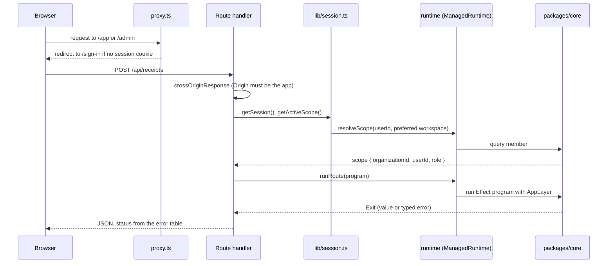
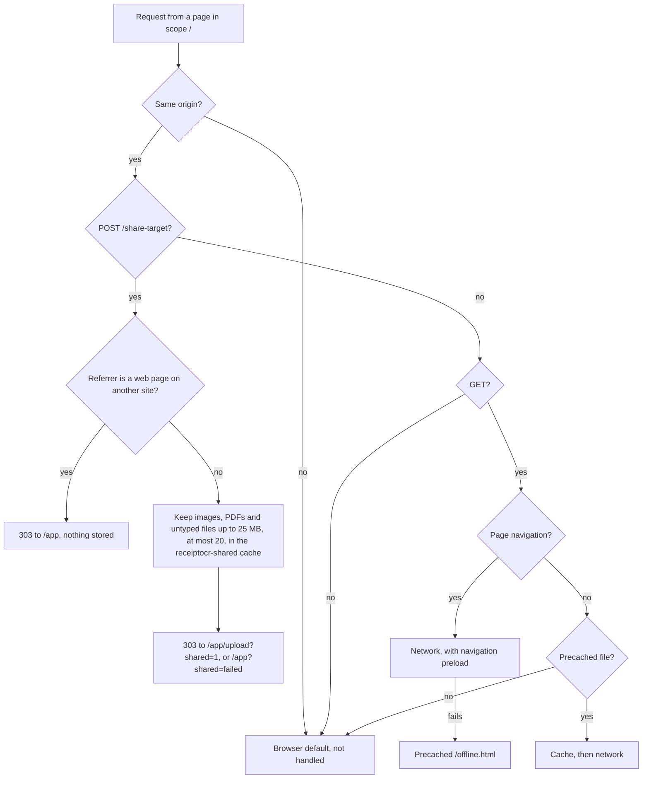

# apps/web

The Next.js App Router app: every page, every HTTP endpoint, the Better Auth configuration and the admin panel. It is
the only process that runs. Receipt logic is not here; it lives in [packages/core](core.md), and this app adapts it to
HTTP.

## Contents

- [Layout of the app](#layout-of-the-app)
- [Public API](#public-api)
- [How a request reaches core](#how-a-request-reaches-core)
- [Key modules](#key-modules)
- [Installable app (PWA)](#installable-app-pwa)
- [Design principles and invariants](#design-principles-and-invariants)
- [How to test it](#how-to-test-it)
- [Common changes](#common-changes)

## Layout of the app

| Path                                                                                                                                                                                               | What is there                                                                                                                                                                                                        |
| -------------------------------------------------------------------------------------------------------------------------------------------------------------------------------------------------- | -------------------------------------------------------------------------------------------------------------------------------------------------------------------------------------------------------------------- |
| [`app/page.tsx`](../../apps/web/app/page.tsx)                                                                                                                                                      | Landing page                                                                                                                                                                                                         |
| `app/sign-in`, `sign-up`, `forgot-password`, `reset-password`                                                                                                                                      | Auth pages; forms in [`components/auth`](../../apps/web/components/auth)                                                                                                                                             |
| [`app/accept-invitation/[id]`](../../apps/web/app/accept-invitation/[id]/page.tsx)                                                                                                                 | Invitation landing page                                                                                                                                                                                              |
| [`app/app`](../../apps/web/app/app)                                                                                                                                                                | Signed-in app: Home with upload panel (`/app`), History, receipt detail, Settings, Members                                                                                                                           |
| [`app/admin`](../../apps/web/app/admin)                                                                                                                                                            | Platform admin panel: overview, users, workspaces, audit log, settings                                                                                                                                               |
| [`app/api`](../../apps/web/app/api)                                                                                                                                                                | Route handlers (below)                                                                                                                                                                                               |
| `app/(lab)`, `components/marketing`                                                                                                                                                                | Landing-page design experiments, `noindex`, shown only in development or when the build sets `LAB_PAGES=1` (read at build time, the pages are prerendered). Pending removal (see [STATUS](../STATUS.md))             |
| [`lib`](../../apps/web/lib)                                                                                                                                                                        | Server helpers: auth, session, HTTP adapter, env, logging                                                                                                                                                            |
| [`proxy.ts`](../../apps/web/proxy.ts)                                                                                                                                                              | Next.js proxy (formerly middleware): optimistic cookie check for `/app` and `/admin`, and the `signed_in_hint` cookie                                                                                                |
| `loading.tsx` in [`app/app`](../../apps/web/app/app/loading.tsx), [`app/app/receipts/[id]`](../../apps/web/app/app/receipts/[id]/loading.tsx), [`app/admin`](../../apps/web/app/admin/loading.tsx) | Skeletons streamed while a page's data loads. Data helpers (`getSession`, `getActiveScope`, `getCurrentPlan`, `getUsageSummary`) are wrapped in React `cache()`, so the layout and page share one lookup per request |
| [`app/global-error.tsx`](../../apps/web/app/global-error.tsx)                                                                                                                                      | Last-resort error page for failures in the root layout; brings its own `<html>` and logs `app.global_error`                                                                                                          |
| [`drizzle`](../../apps/web/drizzle)                                                                                                                                                                | SQL migrations, generated from [packages/db](db.md)                                                                                                                                                                  |
| [`e2e`](../../apps/web/e2e)                                                                                                                                                                        | Playwright suite                                                                                                                                                                                                     |

`/app/upload` only redirects to `/app`; the upload panel lives on Home.

## Public API

### Route handlers

| Method and path                | File                                                                                      | Does                                                                                               |
| ------------------------------ | ----------------------------------------------------------------------------------------- | -------------------------------------------------------------------------------------------------- |
| `GET, POST /api/auth/*`        | [`api/auth/[...all]/route.ts`](../../apps/web/app/api/auth/[...all]/route.ts)             | Better Auth. `503` when auth is not configured.                                                    |
| `POST /api/receipts`           | [`api/receipts/route.ts`](../../apps/web/app/api/receipts/route.ts)                       | Upload one file. `mode=instant` reads it in the request; `mode=queued` returns `202`.              |
| `GET /api/receipts/status`     | [`api/receipts/status/route.ts`](../../apps/web/app/api/receipts/status/route.ts)         | Workspace receipt counts, so list pollers refresh only when something changed                      |
| `GET /api/receipts/:id`        | [`api/receipts/[id]/route.ts`](../../apps/web/app/api/receipts/[id]/route.ts)             | Status for the polling client; drains the receipt's job if it is due and not running               |
| `PATCH /api/receipts/:id`      | same file                                                                                 | User corrections to merchant, date, category, currency and amounts                                 |
| `DELETE /api/receipts/:id`     | same file                                                                                 | Delete the row, then the stored file                                                               |
| `POST /api/receipts/:id/retry` | [`api/receipts/[id]/retry/route.ts`](../../apps/web/app/api/receipts/[id]/retry/route.ts) | Claim a failed receipt for another round and enqueue its job; `202`, then drain in `after()`       |
| `GET /api/receipts/export`     | [`api/receipts/export/route.ts`](../../apps/web/app/api/receipts/export/route.ts)         | CSV with the History filters, up to 5,000 rows                                                     |
| `POST /api/contact`            | [`api/contact/route.ts`](../../apps/web/app/api/contact/route.ts)                         | Support form: origin check, honeypot, per-IP rate limit, mail to `SUPPORT_EMAIL`                   |
| `POST /share-target`           | [`share-target/route.ts`](../../apps/web/app/share-target/route.ts)                       | Share target fallback when no service worker took the share: `303` to the upload page, body unread |

Status codes come from one table in [`lib/http.ts`](../../apps/web/lib/http.ts):

| Core error      | HTTP | Message shown                          |
| --------------- | ---- | -------------------------------------- |
| `InvalidInput`  | 400  | The error's own message                |
| `NotFound`      | 404  | The error's own message                |
| `Conflict`      | 409  | The error's own message                |
| `QuotaExceeded` | 429  | The error's own message, `Retry-After` |
| `NotConfigured` | 503  | "This feature is not configured…"      |
| `DbError`       | 500  | Generic                                |
| `StorageError`  | 502  | Generic                                |
| `OcrError`      | 502  | Generic                                |

### Server actions

- [`app/admin/actions.ts`](../../apps/web/app/admin/actions.ts): every admin mutation. See
  [Admin actions](flows/admin-actions.md).
- [`lib/impersonation-actions.ts`](../../apps/web/lib/impersonation-actions.ts): stop impersonating.

Customer-side workspace changes (create, switch, invite, change a member's role, remove a member, cancel an invite)
call Better Auth's organization endpoints from the browser through
[`lib/auth-client.ts`](../../apps/web/lib/auth-client.ts); Better Auth checks the caller's workspace role.

## How a request reaches core

- [`proxy.ts`](../../apps/web/proxy.ts) only checks that a session cookie exists; it does not touch the database.
  API routes are not matched by it and check the session themselves. On a guarded path with a session cookie it also
  sets `signed_in_hint=1`, a non-HttpOnly cookie that lets the static landing page show "Open the app" without a
  session fetch; it deletes the hint when it redirects to sign-in, and `signOutAndClearHint` in
  [`lib/auth-client.ts`](../../apps/web/lib/auth-client.ts) clears it on sign-out. The hint only picks a button.
- [`lib/session.ts`](../../apps/web/lib/session.ts) always reads the session row (the cookie cache is off in
  [`lib/auth.ts`](../../apps/web/lib/auth.ts), and reads also pass `disableCookieCache: true`), so a ban or a revoked
  session applies on the next request. `getSession` and `getActiveScope` are wrapped in React `cache`, so a
  request does each lookup once.
- [`lib/runtime.ts`](../../apps/web/lib/runtime.ts) builds one `ManagedRuntime` from core's `AppLayer` per server
  process. The database pool and the settings cache live in it.
- [`runRoute`](../../apps/web/lib/http.ts) runs the program and maps failures. Work after the response runs the
  [job queue](flows/jobs.md) through [`lib/jobs.ts`](../../apps/web/lib/jobs.ts) (`runJobNow`, `drainJobs`), which
  logs one `job.run` event per attempt.

Pages follow the same path without the HTTP mapping: server components call helpers in
[`lib/receipts.ts`](../../apps/web/lib/receipts.ts), which call `requireActiveScope()` and then `runtime.runPromise`.

## Key modules

| Module                                                                                | Purpose                                                                                                                                                                                                                                                                                                                     |
| ------------------------------------------------------------------------------------- | --------------------------------------------------------------------------------------------------------------------------------------------------------------------------------------------------------------------------------------------------------------------------------------------------------------------------- |
| [`lib/auth.ts`](../../apps/web/lib/auth.ts)                                           | Better Auth config: email/password, OAuth, organization and admin plugins, rate limits, hooks that create the personal workspace                                                                                                                                                                                            |
| [`lib/auth-guards.ts`](../../apps/web/lib/auth-guards.ts)                             | Organization hooks: workspace-name rules, 10 invitations per inviter per hour, and `assertWorkspaceRole` (a role must be exactly `owner`, `admin` or `member`; GHSA-c85h) on invite, accept, add member and role change                                                                                                     |
| [`lib/session.ts`](../../apps/web/lib/session.ts)                                     | `getSession`, `requireSession`, `requireAdmin`, `getActiveScope`, `requireActiveScope`                                                                                                                                                                                                                                      |
| [`lib/http.ts`](../../apps/web/lib/http.ts)                                           | `runRoute`, `runBackground`, error-to-status table, origin check, client IP, capped multipart reader                                                                                                                                                                                                                        |
| [`lib/env.ts`](../../apps/web/lib/env.ts)                                             | Auth, email and proxy env parsing. Throws at boot on bad production config, loaded by [`instrumentation-node.ts`](../../apps/web/instrumentation-node.ts)                                                                                                                                                                   |
| [`instrumentation.ts`](../../apps/web/instrumentation.ts)                             | `register()` loads the env check on the Node runtime; `onRequestError` logs render, route and action failures as `request.error` (message and digest only)                                                                                                                                                                  |
| [`lib/quota.ts`](../../apps/web/lib/quota.ts)                                         | `enforceUploadQuota` (early, read-only check) and the usage meter summary                                                                                                                                                                                                                                                   |
| [`lib/plan-limits.ts`](../../apps/web/lib/plan-limits.ts)                             | Plan table from Settings (3 s timeout, defaults on error), current user's plan, revalidating pages that print limits                                                                                                                                                                                                        |
| [`lib/receipts.ts`](../../apps/web/lib/receipts.ts)                                   | History list, filters from URL params, counts, export rows, receipt with signed image URL                                                                                                                                                                                                                                   |
| [`lib/upload-prep.ts`](../../apps/web/lib/upload-prep.ts)                             | Browser side: orient, size to a ~3 MP budget (short edge kept at 1,000 px or more) and re-encode images as JPEG near 500 KB before upload                                                                                                                                                                                   |
| [`lib/log.ts`](../../apps/web/lib/log.ts)                                             | One JSON wide event per request on stdout                                                                                                                                                                                                                                                                                   |
| [`lib/csv.ts`](../../apps/web/lib/csv.ts)                                             | CSV export with formula-injection escaping                                                                                                                                                                                                                                                                                  |
| [`components/upload-panel.tsx`](../../apps/web/components/upload-panel.tsx)           | Picks files, prepares them, posts one at a time                                                                                                                                                                                                                                                                             |
| [`components/processing-poller.tsx`](../../apps/web/components/processing-poller.tsx) | Polls one receipt's status, or the workspace counts (`/api/receipts/status`) for a list, on the schedule in [`lib/backoff-poll.ts`](../../apps/web/lib/backoff-poll.ts): backs off from 2 s to 15 s, pauses while the tab is hidden, gives up after 6 minutes of visible polling (a receipt job's retries can take about 4) |
| [`lib/signed-in-hint.ts`](../../apps/web/lib/signed-in-hint.ts)                       | The `signed_in_hint` cookie name and browser helpers to read and clear it                                                                                                                                                                                                                                                   |

## Installable app (PWA)

The app installs to a home screen or desktop and opens `/app` in its own window.

| Piece                                                                                                                                                          | What it does                                                                                                                                                                                                                                     |
| -------------------------------------------------------------------------------------------------------------------------------------------------------------- | ------------------------------------------------------------------------------------------------------------------------------------------------------------------------------------------------------------------------------------------------ |
| [`app/manifest.ts`](../../apps/web/app/manifest.ts)                                                                                                            | Name, `id` and `start_url` `/app`, standalone display, colours from the theme tokens, PNG and maskable icons, an "Add receipt" shortcut (`/app/upload?capture=1`; the camera track's upload page reads `capture=1`) and the Android share target |
| [`public/sw.js`](../../apps/web/public/sw.js)                                                                                                                  | Hand-written service worker: offline fallback and share target handoff. Served with `Cache-Control: no-cache` from [`next.config.ts`](../../apps/web/next.config.ts)                                                                             |
| [`public/offline.html`](../../apps/web/public/offline.html), [`offline.js`](../../apps/web/public/offline.js)                                                  | Page shown when a page load fails offline; reloads itself when the connection returns. The script is a file, not inline, so it still runs under a nonce-based CSP                                                                                |
| [`public/sw-killswitch.js`](../../apps/web/public/sw-killswitch.js)                                                                                            | Not used normally. Published as `sw.js` it removes the worker and its caches everywhere; see [Disable the service worker](../runbook.md#disable-the-service-worker)                                                                              |
| [`components/pwa.tsx`](../../apps/web/components/pwa.tsx)                                                                                                      | Registers the worker (production builds, `/app` routes only) and shows the install card: `beforeinstallprompt` on Android and desktop, a one-time Share then Add to Home Screen hint on iOS Safari                                               |
| [`lib/share-target.ts`](../../apps/web/lib/share-target.ts)                                                                                                    | `takeSharedFiles()` reads the shared files from Cache Storage and deletes them; `clearSharedFiles()` runs on sign-out                                                                                                                            |
| [`lib/use-shared-files.ts`](../../apps/web/lib/use-shared-files.ts), [`components/shared-files-notice.tsx`](../../apps/web/components/shared-files-notice.tsx) | In the upload panel: lists shared files with Keep and Discard, and explains `?shared=failed` and `?shared=unavailable`                                                                                                                           |
| [`scripts/pwa-icons.ts`](../../scripts/pwa-icons.ts)                                                                                                           | Renders the PNG icons and `app/apple-icon.png` from `app/icon.svg` with Playwright's Chromium                                                                                                                                                    |

How the worker routes a request:

- **Nothing user-specific is cached.** Receipts are financial data, so the worker never stores API responses,
  signed-in HTML, RSC payloads or receipt images; those requests go straight to the network. The static cache holds
  only `offline.html`, `offline.js`, `icon.svg` and one icon, fetched past the HTTP cache. `VERSION` in `sw.js`
  names the cache; `activate` deletes older ones.
- **A share is never uploaded unseen.** Any site can POST a form to `/share-target`, so shared files never join the
  queue on their own. The worker drops a share whose referrer is another website (an Android app sends none or an android-app:// one, which passes; a page can hide its referrer, so this
  is only a first check). The upload panel then lists the files, says they were shared on this device, possibly
  before sign-in, and waits for **Keep** or **Discard**. Kept files go through the file input like picked files and
  still need the usual Read click.
- **Shared files are short-lived.** The worker keeps them in Cache Storage and redirects to the upload page; a
  signed-out visitor goes through sign-in first. They expire after 10 minutes. The panel deletes the cache when it
  takes them (stale entries included), the worker prunes expired entries on activate, a new share replaces an
  earlier one, and sign-out deletes the cache. A file with no type (multipart sends it as `application/octet-stream`)
  is stored with an empty type, so the panel goes by its extension; a file with no name becomes `shared-receipt`
  with an extension from its type.
- **Without a worker** (first launch before it installed, or a browser without one) the share reaches the
  [route handler](../../apps/web/app/share-target/route.ts), which redirects to `/app/upload?shared=unavailable`
  without reading the body; the panel explains it. On Vercel a share larger than 4.5 MB is refused with a 413 in
  that case.
- **Only the app registers it.** The landing, auth and lab pages never register the worker. Once installed it
  controls every same-origin page (scope `/`), which only matters for offline page loads and the share target.
- **iOS** has no install prompt or share target; the hint covers installing. The status bar style is `black`, so
  pages start below it and need no top safe-area inset; the root `body` pads for side insets
  (`viewport-fit=cover`). The install card sits above the mobile tab bar using the shell's `--app-bottom-inset`.

The CSP allows `worker-src 'self'` and `manifest-src 'self'` ([`lib/csp.ts`](../../apps/web/lib/csp.ts)).
[`e2e/pwa.spec.ts`](../../apps/web/e2e/pwa.spec.ts) checks installability (Chromium's own check), the icons, the
worker's headers, registration, the offline page, that nothing but the precached files is ever cached, the share flow
signed in and signed out (Keep, Discard, no upload without the visitor's clicks), a share posted by another site, and
that sign-out clears a waiting share.

## Design principles and invariants

- **Thin adapters.** A route handler checks origin, session and input shape, then runs one core program. If a
  handler grows a loop or a transaction, that code belongs in core.
- **Mutations require the app's own `Origin`.** `crossOriginResponse` refuses a POST, PATCH or DELETE whose `Origin`
  is not `BETTER_AUTH_URL`, including one with no `Origin`.
- **The scope comes from `member`, not the session.** `session.activeOrganizationId` is only a preference, because
  Better Auth leaves it set on a removed member's other sessions.
- **The client is never trusted for roles.** Admin pages call `requireAdmin()` (a non-admin gets a 404); every admin
  action calls it again. Hiding a button in the UI ([`receipt-permissions.ts`](../../apps/web/lib/receipt-permissions.ts)) is
  convenience only; core enforces edit and delete rights.
- **Safe messages only.** Only `InvalidInput`, `NotFound`, `Conflict` and `QuotaExceeded` messages reach the browser.
  Causes go to the log, with Drizzle's bound `params:` redacted (`causeDetail`, using `redactDbMessage` in
  [`lib/log.ts`](../../apps/web/lib/log.ts)).
- **One wide event per request.** Upload and retry build a `WideEvent` and log it once with timings, model, attempts,
  cost and outcome. Requests made while impersonating carry `impersonated_by`.
- **Bodies are capped while streaming.** `readFormData` refuses a declared or streamed body over 10 MB plus 64 KB.
- **Degrades without config.** With no `DATABASE_URL` or auth secret, `authEnabled` is false, auth endpoints return
  `503` and the auth pages show a "not configured" card. In production off Vercel, the app refuses to start without
  `TRUSTED_IP_HEADERS`, because rate limits would otherwise share one bucket.

Security headers (HSTS, `X-Frame-Options: DENY`, a report-only CSP) are set in
[`next.config.ts`](../../apps/web/next.config.ts).

## How to test it

| What                                      | Command                                                                     |
| ----------------------------------------- | --------------------------------------------------------------------------- |
| Unit tests (all `*.test.ts`, Node, no DB) | `bun run test`                                                              |
| Better Auth against a real database       | `bun run --filter @receipt-ocr/web test:int` (needs `DATABASE_URL`)         |
| Playwright e2e against a built app        | `scripts/test.sh` (starts Postgres and RustFS, fresh database, fixture OCR) |
| Type check                                | `bun run typecheck`                                                         |

The e2e specs ([`e2e/`](../../apps/web/e2e)) cover auth, upload, admin, smoke pages and security checks. They run with
`OCR_PROVIDER=fixture`, so no model is called.

## Common changes

### Add an API route

1. Put the workflow in core as an Effect program returning typed errors from
   [`errors.ts`](../../packages/core/src/errors.ts).
2. In the handler: `crossOriginResponse` for mutations, `getActiveScope()` (or `getSession()`), validate the input,
   then `return runRoute(program, onSuccess)`.
3. Add a unit test for any pure parsing, and an e2e test if it changes what a user sees.

### Add an admin action

See [Admin actions](flows/admin-actions.md#add-an-admin-action).

### Change the service worker

Edit [`public/sw.js`](../../apps/web/public/sw.js) and bump `VERSION`, so browsers drop the old static cache. If a
share target name changes, change [`lib/share-target.ts`](../../apps/web/lib/share-target.ts) too;
`share-target.test.ts` fails until both match. After changing `app/icon.svg`, run `bun scripts/pwa-icons.ts` and
commit the PNGs.

### Add an environment variable

1. Read it where it is used: Effect `Config` in core, or [`lib/env.ts`](../../apps/web/lib/env.ts) for auth and email.
2. Add it to [`apps/web/.env.example`](../../apps/web/.env.example), and to the root
   [`.env.example`](../../.env.example) and [`docker-compose.yml`](../../docker-compose.yml) if the container needs it.
3. Add it to `tasks.build.env` in [`turbo.json`](../../turbo.json), so Turborepo passes it to the build and includes
   it in the cache key.
4. Add a row to the variables table in [deployment.md](../deployment.md#4-environment-variables).
