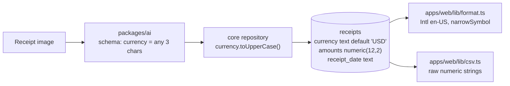
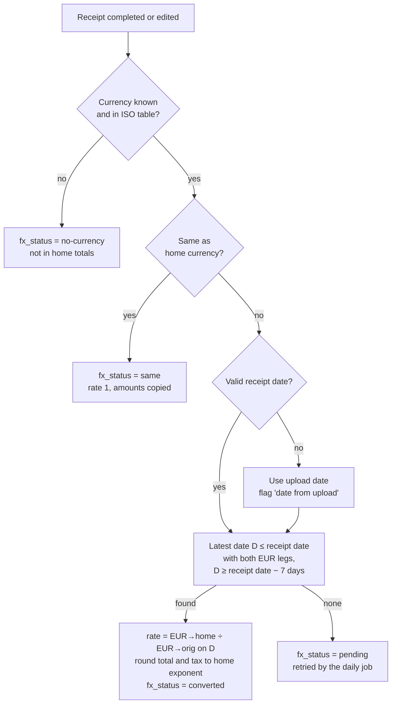
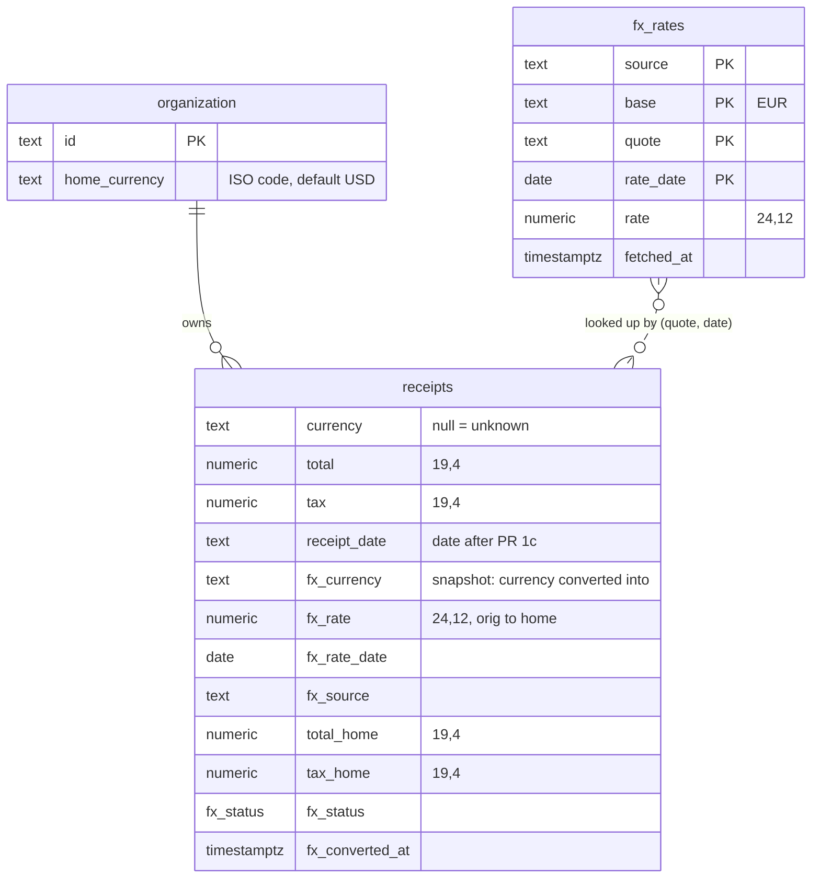
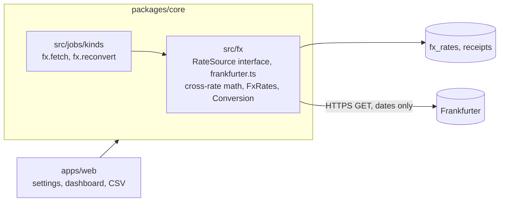
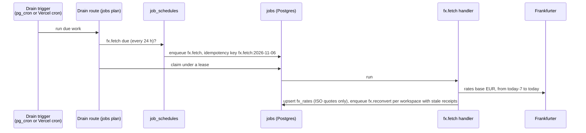
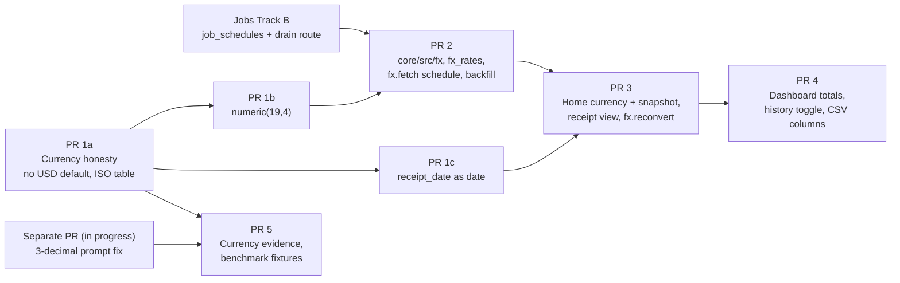

# Currencies and conversion to a home currency: plan (2026-11-06)

Status: proposal, revised after review on 2026-11-06. Nothing implemented yet. Code facts below were read from
`main` at `43b4944`. Vendor facts were read
from each vendor's own pages, and the Frankfurter API was queried directly, on 2026-11-06. Prices and limits change,
so check them again before signing up for anything.

## TL;DR

- **Storage.** Change every amount column from `numeric(12,2)` to `numeric(19,4)` and keep the ISO code next to it.
  Do not move to bigint minor units: a receipt whose currency is unknown, or one whose currency a user edits, has no
  fixed exponent to scale by. Drop the `USD` default on `receipts.currency`; unknown is `null`, not `USD`.
- **Currency codes.** Ship our own ISO 4217 table (code, exponent, name, symbols) in `packages/ai`, built from the
  SIX list without test, metal and fund codes. Today the AI schema accepts any 3 characters, and `Intl.NumberFormat`
  formats any well-formed code, so `QQQ` passes both.
- **Already in hand, shipping separately.** The extraction prompt tells the model that three digits after a separator
  are "almost always thousands". For KWD, BHD and OMR they are fils or baisa: `1.250 KD` is one and a quarter
  dinars. Another engineer is fixing that prompt in its own PR; this plan does not include it.
- **Home currency.** One per workspace, set by owners and admins in Settings, defaulted on sign-up from the visitor's
  country. Members see it read-only. No per-user override in v1.
- **Rates.** v1 uses **Frankfurter** only (MIT, free, commercial use allowed, no key, central-bank data from 108
  sources, history to 1948; covers NPR through Nepal Rastra Bank and every Gulf currency). We store ISO codes only.
  The exit, if the public instance goes away, is self-hosting Frankfurter. ECB files and peg fallbacks are deferred;
  a paid API (Open Exchange Rates at $12 a month is the cheapest that allows commercial use) only if needed.
- **Rule.** Convert at the rate for the receipt date, falling back to the latest earlier date within 7 days. Cross
  rates go through EUR. Round once, to the home currency's exponent, at the end.
- **Store the conversion on the receipt** (rate, rate date, source, converted total and tax) and keep every daily rate
  in `fx_rates`. Dashboards and the CSV then read stored values, and an export done today matches one done next year.
- **Seven PRs**, each shippable alone. The first two (currency honesty, then wider amounts) need no FX source at
  all. Code lives in `packages/core/src/fx`; the daily fetch is a scheduled job on the jobs queue.

## Contents

1. [Current state and gaps](#1-current-state-and-gaps)
2. [Home currency](#2-home-currency)
3. [Rate sources](#3-rate-sources)
4. [Conversion rule](#4-conversion-rule)
5. [Data model, fetch job and caching](#5-data-model-fetch-job-and-caching)
6. [UX](#6-ux)
7. [Accuracy: detecting the currency](#7-accuracy-detecting-the-currency)
8. [Rollout and owner decisions](#8-rollout-and-owner-decisions)
9. [Sources](#9-sources)

## Words used here

| Term           | Meaning                                                                                                     |
| -------------- | ----------------------------------------------------------------------------------------------------------- |
| ISO 4217       | The standard list of currency codes (`USD`, `NPR`, `KWD`) and how many decimals each uses.                  |
| Exponent       | The number of decimals ISO 4217 gives a currency: 2 for USD, 0 for JPY, 3 for KWD. Also called minor units. |
| Home currency  | The one currency a workspace wants its totals in.                                                           |
| Reference rate | A mid-market rate published once a day by a central bank, for information. Not the rate a card was charged. |
| Cross rate     | A rate between two currencies worked out through a third one (here EUR): `NPR→USD = (EUR→USD) / (EUR→NPR)`. |
| Snapshot       | The rate, rate date and converted amount saved on the receipt when it was converted.                        |

## 1. Current state and gaps

### 1.1 What the code does today



| Area             | Today                                                                                                                                                                                                                           | File                                                            |
| ---------------- | ------------------------------------------------------------------------------------------------------------------------------------------------------------------------------------------------------------------------------- | --------------------------------------------------------------- |
| Amount columns   | `subtotal`, `tax`, `tip`, `total`, `receipt_items.unit_price`, `receipt_items.total_price`: all `numeric(12,2)`                                                                                                                 | `packages/db/src/index.ts`                                      |
| Currency column  | `text`, default `'USD'`. The upload row is inserted before extraction, so every uploaded, processing and failed receipt already says USD                                                                                        | `packages/db/src/index.ts`                                      |
| Summary mapping  | `currency: row.currency ?? "USD"`: a null is turned back into USD on the way out                                                                                                                                                | `packages/core/src/repository.ts` (`toSummary`)                 |
| AI schema        | `currency: z.string().length(3).describe("ISO 4217 currency code, e.g. USD")`. Required, not nullable, not checked against a list. The repository upper-cases it                                                                | `packages/ai/src/schema.ts`                                     |
| Prompt           | "currency must be an ISO 4217 code such as USD or EUR", and "A trailing group of exactly three digits after a separator is almost always thousands, not cents" (added for an IDR misread)                                       | `packages/ai/src/extract.ts`                                    |
| Manual edit      | `PATCH /api/receipts/[id]` accepts any `^[A-Za-z]{3}$` and upper-cases it; the editor is a free text box                                                                                                                        | `apps/web/app/api/receipts/[id]/route.ts`, `receipt-editor.tsx` |
| Display          | `Intl.NumberFormat("en-US", { style: "currency", currency, currencyDisplay: "narrowSymbol" })`. An unknown code such as `QQQ` is formatted by `Intl` itself as `"QQQ 1.00"`; the `catch` fallback only runs for malformed codes | `apps/web/lib/format.ts`                                        |
| CSV export       | Writes the Postgres numeric string as is (`"12.50"`), one `currency` column, no conversion columns                                                                                                                              | `apps/web/lib/csv.ts`                                           |
| Receipt date     | `text`. The AI schema allows any string up to 32 characters; only the PATCH route checks `YYYY-MM-DD`. History filters compare it as text                                                                                       | `schema.ts`, `repository.ts` (`filterWhere`)                    |
| Money aggregates | None. The dashboard shows counts only; per-currency totals are roadmap item 8                                                                                                                                                   | `apps/web/app/app/page.tsx`                                     |
| Benchmark        | Five synthetic fixtures (`usd-tip`, `eur-comma`, `idr-dot`, `npr-lakh`, `long-groceries`). `currency` is an exact-match field; amounts match within ±0.01                                                                       | `bench/score.ts`, `bench/fixtures/`                             |

### 1.2 Gaps

1. **Three-decimal currencies lose a digit.** KWD, BHD, OMR, JOD, TND, LYD and IQD have exponent 3. `numeric(12,2)`
   rounds `1.255` KWD to `1.26`. Worse, the prompt's thousands rule pushes the model to read `1.250` as `1250`
   (that prompt fix ships separately, see the TL;DR).
2. **Zero-decimal currencies don't need the scale, and some need the width.** JPY, KRW, VND, CLP, ISK and UGX have
   exponent 0. `numeric(12,2)` tops out at 9,999,999,999.99, which is about USD 552,000 in IDR (18,108 per USD on 2026-11-06)
   and about USD 390,000 in VND. That is enough
   for most receipts, but an invoice for a car or a year's rent in IDR, VND or IRR can exceed it, and the insert then
   fails rather than rounds. A note on IDR and NPR: ISO 4217 gives both exponent 2, though receipts print no
   decimals. CLDR, which `Intl` uses, displays IDR and HUF with 0 decimals and NPR with 2 (checked on Node 24). The
   table we ship must say which one we follow (section 1.4).
3. **USD as the default hides failures.** A receipt where no currency was read looks identical to a real USD receipt.
   Once totals are summed, those receipts are counted as dollars. With conversion, they would be converted from USD.
4. **No validation.** The model can return `XXX`, `RS.` or `$$$`; `.length(3)` accepts all three. `Intl` formats
   any three letters (`QQQ 1.00` comes from `Intl`, not from our fallback), so `format.ts`'s `catch` only fires for
   malformed codes, never for unknown ones.
5. **The model must always answer.** `currency` is required, so when the receipt shows only `$` the model has to guess
   and has no way to say "unsure".
6. **The receipt date is not a date.** Conversion needs a real calendar date. Today a model can store `14/09/26` and
   the date filters silently skip it.
7. **The CSV is not reconcilable across currencies.** Amounts carry no exponent formatting, and there is no rate,
   rate date or converted amount, so an accountant must look rates up by hand.

### 1.3 Storage: minor units or numeric(19,4)

| Question                               | `bigint` minor units + code                                            | `numeric(19,4)` + code                                   |
| -------------------------------------- | ---------------------------------------------------------------------- | -------------------------------------------------------- |
| Exact arithmetic                       | Yes (integers)                                                         | Yes (Postgres numeric is decimal, not float)             |
| Unknown currency (null)                | **Cannot store**: the exponent, and so the scale, is unknown           | Stores the amount as read                                |
| User changes the currency (JPY to USD) | Every amount must be rescaled, or its meaning silently changes by 100x | Nothing to rescale                                       |
| More precision than the currency       | Fuel at USD 3.459 a litre, unit prices in KWD with 4 digits: lost      | Kept up to 4 decimals (the largest ISO exponent is 4)    |
| ISO or CLDR disagreement (IDR, HUF)    | Picking one bakes it into the stored integers                          | Only affects display and rounding                        |
| Largest value                          | 9.2 × 10^18 minor units                                                | 10^15 major units (999 trillion), enough for any receipt |
| Read from Drizzle                      | `bigint` mode or strings; every reader must divide by 10^exponent      | Strings, as today                                        |
| Size                                   | 8 bytes                                                                | About 8 to 12 bytes; irrelevant at our volume            |

**Recommendation: `numeric(19,4)` for all six amount columns, with the ISO code beside them.** The deciding reasons
are null currency and currency edits: both are common in an OCR product, and minor units make both lossy. Exponent
still matters, but only at the edges: display, rounding a converted amount, export formatting and the benchmark's
tolerance. Keep sums in SQL (`sum(numeric)`), never in JavaScript `Number`.

### 1.4 The currency table

Add `packages/ai/src/currencies.ts`, a dependency-free entry point like `categories` and `models`:

- Generated once from the ISO 4217 list published by SIX (the maintenance agency), committed as data. That list
  has 178 codes. Validation accepts only currencies people pay with, so the table **excludes** `XXX` (no currency),
  `XTS` (testing), the metals (`XAU`, `XAG`, `XPT`, `XPD`), the bond-market units (`XBA` to `XBD`) and the fund
  codes (`BOV`, `CHE`, `CHW`, `CLF`, `COU`, `MXV`, `USN`, `UYI`, `UYW`, `XSU`, `XUA`). `XDR` is also out.
- Each row: `code`, `exponent`, `name`, `symbols` (for detection hints, for example `$` for USD, CAD, AUD and
  others), `countries` (ISO 3166 alpha-2). A unit test checks every code is three upper-case letters, every exponent
  is 0 to 4, and none of the excluded codes is present.
- Update it when ISO publishes an
  amendment (for example ZWG was added in 2024 and VED in 2021; `Intl.supportedValuesOf("currency")` on Node 24
  includes the withdrawn ZWL but not VED, so `Intl` is not a reliable list).
- Exponent follows ISO 4217 for storage and rounding. Display may use CLDR's digits (what `Intl` does), so an IDR
  amount shows as `IDR 31,000`. Rounding a converted IDR amount to 2 decimals and showing 0 is harmless.
- Exports and the dashboard depend on it, so it lives in `packages/ai` beside the schema that validates against it.

### 1.5 Migrations and backfill

Two migrations in two PRs, so the behaviour change and the table rewrite can be reviewed, deployed and rolled back
apart. Each takes the next free number after `0008` (the passkeys plan also takes numbers). Run both over
`DIRECT_URL`, which is the Supabase **session pooler** on port 5432 ([deployment.md](../deployment.md), section 1);
schema changes fail on the transaction pooler.

**Order: migrate, then deploy.** Both migrations are compatible with the code already running: old code never relies
on the default, and it writes 2-decimal strings into wider columns without complaint. Between the migration and the
deploy, old code shows `"12.5000"` in the CSV, which is cosmetic and lasts minutes. Both are **one-way**: rolling
back means restoring from backup, not a down migration.

#### PR 1a: currency honesty (no rewrite)

```sql
-- Unknown is null, not USD.
alter table receipts alter column currency drop default;

-- Rows that never finished extraction got USD from the default, not from a receipt.
update receipts set currency = null
where status <> 'completed' and currency = 'USD';

-- Completed rows: trust the column. It holds the model's answer or a user's edit
-- (raw_json keeps the model's answer, so an edit shows as a difference, which is fine).
-- Codes not in the ISO table become null and land in "needs review".
update receipts set currency = null
where currency is not null and currency not in (/* generated list from currencies.ts */);
```

Code in the same PR. Remove every place that turns a missing currency into USD:

- `toSummary` in `packages/core/src/repository.ts` (`row.currency ?? "USD"`);
- `apps/web/components/receipt-editor.tsx:43` (`receipt.currency ?? "USD"`);
- `apps/web/components/receipt-result.tsx:148` (`receipt.currency ?? "USD"`);
- `apps/web/app/admin/users/[id]/page.tsx:219` (`r.currency ?? "USD"`);
- the `currency = "USD"` default parameters of `money()` and `formatMoney()` in `apps/web/lib/format.ts`. A null
  currency then formats as a plain number with no symbol.

Also: make `ReceiptSummary.currency` `string | null`, make the AI schema's `currency` nullable and validated against
the table, validate the PATCH route against the table instead of `^[A-Za-z]{3}$`, and replace the editor's free text
box with a select.

#### PR 1b: `numeric(19,4)` (rewrites two tables)

Changing a numeric's scale rewrites the table under an `ACCESS EXCLUSIVE` lock: no reads or writes until it finishes.
Today the tables are small, so an `ALTER TYPE` is the simple, right choice. Three rules keep it safe:

1. **Measure first**, on production, and paste the result in the PR:

   ```sql
   select relname, n_live_tup, pg_size_pretty(pg_total_relation_size(relid))
   from pg_stat_user_tables where relname in ('receipts', 'receipt_items');
   ```

2. **One `ALTER TABLE` per table, hand-edited.** `drizzle-kit generate` writes one `ALTER TABLE ... ALTER COLUMN`
   statement per column, and each one rewrites the table again, so `receipts` would be rewritten four times. Edit the
   generated SQL into the two statements below; the snapshot JSON stays as generated.
3. **Fail fast.** Drizzle's migrator applies all pending migrations **in one transaction**, so use `set local`, and
   ship this migration on its own (not batched with others) so the lock covers only this work.

```sql
set local lock_timeout = '5s';        -- give up rather than queue behind live traffic (and block everyone behind us)
set local statement_timeout = '60s';  -- give up rather than hold the lock for longer than planned

alter table receipts
  alter column subtotal type numeric(19,4),
  alter column tax      type numeric(19,4),
  alter column tip      type numeric(19,4),
  alter column total    type numeric(19,4);
alter table receipt_items
  alter column unit_price  type numeric(19,4),
  alter column total_price type numeric(19,4);
```

**Threshold for a different approach.** If either table has more than **1 million rows or 1 GB**, or a rehearsal on
a restored copy takes longer than **10 seconds**, don't `ALTER TYPE`. Use expand and contract instead: add
`*_v2 numeric(19,4)` columns, write both from the app, backfill in batches of 10,000, switch reads, then drop the
old columns and rename in a short transaction. At today's size this is unnecessary work.

Code in the same PR: format amount strings by exponent at the boundary (a helper such as `amountString(value,
currency)`), because Postgres now returns `"12.5000"`.

Risks and mitigations:

| Risk                                                                                | Mitigation                                                                                                            |
| ----------------------------------------------------------------------------------- | --------------------------------------------------------------------------------------------------------------------- |
| The rewrite blocks reads and writes on `receipts` and `receipt_items` while it runs | Measure first; one `ALTER` per table; `lock_timeout` and `statement_timeout`; expand and contract above the threshold |
| A long migration batch holds the lock longer                                        | Ship 1b alone; Drizzle runs pending migrations in one transaction                                                     |
| Every reader now gets 4 decimals (`"12.5000"`): UI, API JSON, CSV, tests            | One formatting helper at the boundary; snapshot tests for UI, CSV and the PATCH round trip                            |
| Existing completed rows really were guesses (`$` read as USD)                       | Cannot be fixed by SQL. Section 7 adds evidence going forward; old rows keep their value                              |
| Narrowing back to `(12,2)` would round any 3-decimal values entered since           | One-way. Take a backup before (`pg_dump -t receipts -t receipt_items`, or Supabase PITR) and restore if it must undo  |

The receipt date should become a real `date` too. It is a separate, smaller migration (PR 1c in section 8): add
`receipt_date_d date`, fill it with a safe parse (`YYYY-MM-DD` that is a real calendar day, not more than one day in
the future), leave the rest null and flagged, then swap the columns. Core also validates the date on completion.

## 2. Home currency

| Option            | Good                                                                                         | Bad                                                                                                  |
| ----------------- | -------------------------------------------------------------------------------------------- | ---------------------------------------------------------------------------------------------------- |
| Per user          | Each member sees their own currency                                                          | Two members of one workspace see different totals; exports differ by who clicked; snapshots multiply |
| **Per workspace** | One set of books: dashboard, history and export agree for everyone; one snapshot per receipt | A member travelling from another country sees the workspace currency                                 |
| Both              | Flexible                                                                                     | Two code paths, two sets of tests, confusing exports; no user has asked for it                       |

**Recommendation: per workspace.** Receipts already belong to a workspace, every member reads them, and the
customers we target (freelancers handing books to an accountant, small teams) keep one set of books. A personal
workspace gives a solo user a personal home currency anyway. A per-user display currency can come later as a
view-only setting if users ask; it would compute on the fly and never touch the snapshot.

Where it lives and who sets it:

- A `home_currency text not null default 'USD'` column on `organization` (declared in `auth-schema.ts` as a Better
  Auth additional field with `input: false`, so Better Auth's client endpoints cannot set it). Core writes it through
  a `WorkspaceSettings.setHomeCurrency(scope, code)` service that requires owner or admin and validates the code
  against the ISO table. A separate `workspace_settings` table is the alternative if we prefer to keep Better Auth's
  tables untouched; it costs a join on every dashboard read.
- **Settings → Workspace**: a searchable select of ISO codes, common ones first. Changing it shows "Totals will be
  recalculated in NPR. This takes a minute for large workspaces." and enqueues a re-conversion job (section 5.4).
- **Default on sign-up**: when the personal workspace is created, map the visitor's country to its currency (the
  `x-vercel-ip-country` header on Vercel, or the region of `Accept-Language` such as `ne-NP` on Docker), and fall back
  to USD. Use the country once; don't store it. The first dashboard visit shows a one-line "Totals are in NPR.
  Change" note until the owner confirms or changes it.
- **Members** see the currency everywhere totals appear ("All, in NPR") and read-only in Settings, with "Only owners
  and admins can change this".
- **Invitations and new workspaces** created later copy the creator's personal workspace currency.

## 3. Rate sources

All facts below were read on 2026-11-06 from each provider's pages (links in [Sources](#9-sources)).

| Source                            | Commercial use                                                                                                                  | Cost                                                                                | Updates                              | Coverage                                                                                                                                                                                                                                                            | History                                                       | Reliability and terms                                                                                                                                  |
| --------------------------------- | ------------------------------------------------------------------------------------------------------------------------------- | ----------------------------------------------------------------------------------- | ------------------------------------ | ------------------------------------------------------------------------------------------------------------------------------------------------------------------------------------------------------------------------------------------------------------------- | ------------------------------------------------------------- | ------------------------------------------------------------------------------------------------------------------------------------------------------ |
| **ECB euro reference rates**      | Free use allowed; cite the ECB; if sold, tell buyers the data is free on the ECB site                                           | Free, no key                                                                        | Working days, about 16:00 CET        | 29 quotes + EUR. Has USD, JPY, KRW, IDR, INR, AUD, CAD. **No NPR, AED, SAR, KWD, BHD, OMR, QAR**. RUB suspended                                                                                                                                                     | From 1999-01-04 (CSV and XML)                                 | Official, very stable static files. "For information purposes only"; not for transactions. No weekend or TARGET-holiday rates                          |
| **Frankfurter** (frankfurter.dev) | Page says blended rates are free to use, including commercially. Code MIT. Single-provider queries follow that provider's terms | Free, no key; self-hostable with Docker                                             | Daily                                | Homepage says 239; `/v2/currencies` returns 181, of which 21 are not ISO 4217 (crypto such as BTC, plus CNH, GGP, IMP, JEP). From 108 central banks and official sources. NPR (Nepal Rastra Bank and 7 others), KWD, BHD, OMR, AED, SAR, QAR, IDR all returned live | To 1948                                                       | Open source, one maintainer, no SLA; no quotas but abuse rate limits; responses CDN-cached (`max-age` about 16 h). Storing rates locally is encouraged |
| Open Exchange Rates               | Free plan terms unclear (site terms bar commercial use by private users); paid plans are for business use                       | Free 1,000 req/mo (USD base only); Developer $12/mo, 10,000                         | Hourly (free and $12); faster higher | 200+ currencies                                                                                                                                                                                                                                                     | Historical on all plans; time series from $47/mo              | Established commercial vendor; SLA only on VIP                                                                                                         |
| exchangerate.host (APILayer)      | Terms on an external page; not stated on the product page                                                                       | Free 100 req/mo with key; paid from $14.99/mo                                       | End of day (available 00:05 GMT)     | About 168 currencies                                                                                                                                                                                                                                                | 19 years                                                      | Formerly a free open API, now an APILayer product with overage fees                                                                                    |
| CurrencyAPI                       | **Free plan is private use only**; commercial from Small                                                                        | Free 300 req/mo; Small $12.99/mo, 15,000                                            | Daily (free), hourly (Small)         | 171 fiat                                                                                                                                                                                                                                                            | To 1999 on all plans                                          | Commercial vendor                                                                                                                                      |
| Fixer (APILayer)                  | **Free plan non-commercial**; commercial from Basic                                                                             | Free 100 calls/mo; Basic $14.99/mo, 10,000                                          | Hourly (free, Basic)                 | 170                                                                                                                                                                                                                                                                 | 19 years                                                      | Free plan lacks base-currency switching                                                                                                                |
| Wise                              | No data-licence terms found; the API is a payments API                                                                          | Needs a Wise account token (personal token for business accounts, or partner OAuth) | Live                                 | Wise's routes                                                                                                                                                                                                                                                       | `from`/`to`/`group` parameters exist; not testable in sandbox | Built for quoting transfers, not for redistributing reference rates. **Not a fit**                                                                     |

What the comparison says:

- **Only two options are free for a paid product without a contract question: the ECB and Frankfurter.** The cheap
  paid tiers (CurrencyAPI Small, OXR Developer) cost $12 to $13 a month and would also work; their free tiers are
  either non-commercial or unclear.
- **The ECB set misses the currencies our users have.** Nepal, the Gulf and much of South Asia and Africa are not in
  it. The `npr-lakh` fixture is already in our benchmark.
- **Frankfurter blends** several central banks' reference rates into one mid rate per day. The blend is
  Frankfurter's own calculation, not an official figure. Asking for one provider (`?providers=NRB`) returns that
  bank's official rate instead. For example, on Sunday 2026-11-01 the blended USD→NPR was 152.01 from eight banks;
  Nepal Rastra Bank's own was 151.93.
- **A blended rate's date is the day of the blend**, not the day each input was published. The 2026-11-01 blend
  above used NRB's and the Central Bank of Kuwait's Sunday rates, Bank Negara Malaysia's from Friday 2026-10-30 and
  Narodowy Bank Polski's from Wednesday 2026-10-28. When a late provider publishes, the blend for a recent day can
  shift slightly. Our daily fetch re-reads the last 7 days and upserts, so `fx_rates` follows those revisions;
  snapshots already written do not (section 4.4).
- **Weekends differ by source.** Frankfurter's blend has rates dated on weekends, while the ECB-only query for that
  Sunday returned Friday 2026-10-30. Our lookup rule (section 4) works with either.

**Recommendation.**

- **v1: Frankfurter blended rates only, base EUR, once a day.** Store `source = 'frankfurter'`, and store **ISO codes
  only**: drop any quote that is not in our currency table (crypto, CNH, GGP, IMP, JEP). It is free for commercial
  use, covers every currency we have seen on receipts, and goes back far enough for any backfill.
- **The exit is self-hosting Frankfurter.** Its MIT code and Docker image run on the same free central-bank data. If
  the public instance goes away or degrades, point the base URL at our own instance; nothing else changes.
- **Deferred: other fallbacks.** Not in v1, recorded here so the work isn't repeated:
  - The ECB's own files (`eurofxref-daily.xml`, `eurofxref-hist.zip`) for its 30 currencies.
  - Documented pegs on top of ECB legs for currencies outside the ECB set. NPR is pegged to INR at 1.6 (Nepal
    Rastra Bank's feed on 2026-11-05 lists INR per 100 at 160.00 buy, 160.15 sell); AED 3.6725, SAR 3.75, BHD 0.376,
    OMR 0.3845 and QAR 3.64 per USD (Frankfurter returned exactly these on 2026-11-06). KWD is a basket, not a peg,
    and has no free fallback.
  - A paid source: Open Exchange Rates Developer ($12/mo) if Frankfurter misses more than a few days in a quarter.
  - Each would be one more `RateSource` implementation (section 5.2).
- Until then, an outage of a few days is absorbed by the 7-day lookback: receipts convert at the latest rate within
  the window or wait as `pending`.
- Attribution: the dashboard note names the source ("Rates: Frankfurter, from central-bank reference rates").

## 4. Conversion rule

### 4.1 Which day's rate

Use the rate for the **receipt date**, not today's. A EUR 40 dinner in March is worth what it was worth in March;
that's the figure an accountant books, and it does not move every time the dashboard loads.



- **Fallback to an earlier day.** Weekends, bank holidays and the hours before a day's rates are published all mean
  "no rate yet for that date". Take the latest date on or before the receipt date for which both legs exist, at most
  7 days back. Both legs come from the same date and source, so the stored snapshot names one date.
- **A receipt dated today** is usually converted before today's rates exist, so it gets yesterday's. The snapshot
  records `fx_rate_date < receipt_date`, and the daily job re-converts such receipts once the closer date arrives
  (only for receipts dated in the last 7 days).
- **Future dates** (a misread year, `2062`) have no rate: `pending`, and the receipt is flagged for review.
- **No date on the receipt**: use the upload date and say so on the receipt.

### 4.2 Triangulation

Store one leg per currency: `EUR→X` for every X. Any pair is a ratio of two legs:
`rate(orig→home) = rate(EUR→home) / rate(EUR→orig)`, with `rate(EUR→EUR) = 1`. EUR is the natural pivot because both
sources quote against it, and it means storing about 240 rows a day instead of 240². USD as the pivot works the same
way; switching is a data change, not a design change.

### 4.3 Rounding

- Compute in Postgres `numeric`, which is exact decimal, inside the update that writes the snapshot:
  `round(total * rate, home_exponent)`. Never in JavaScript `Number`: IDR and VND amounts times a 10-digit rate run
  past the 15 to 16 significant digits a double can hold.
- Store the cross rate at full precision, `numeric(24,12)`, as `fx_rate`. Round only the converted amounts, and
  compute them **from the stored `fx_rate`**: `total_home = round(total * fx_rate, home_exponent)`, not from the two
  legs. Anyone can then reproduce `total_home` from the CSV's own columns. Postgres `round()` rounds half away from
  zero, which is what accountants expect.
- Convert `total` and `tax` (tax is what VAT and GST reclaims need). Line items and subtotal stay in the original
  currency; converting each line and summing would not equal the converted total.

### 4.4 Store the snapshot, or compute at query time

| Approach                                                | Dashboard sums                                           | CSV                                      | When a rate is revised or the home currency changes         | Complexity                                    |
| ------------------------------------------------------- | -------------------------------------------------------- | ---------------------------------------- | ----------------------------------------------------------- | --------------------------------------------- |
| Compute at query time from `fx_rates`                   | A lateral join per receipt with a "latest date ≤" lookup | Same join                                | Numbers change silently, including in exports already filed | One table, but every query carries the lookup |
| **Store a snapshot on the receipt** (+ keep `fx_rates`) | `sum(total_home)` with the existing workspace index      | Reads stored columns; reproducible later | Explicit re-conversion, recorded                            | A few columns and a re-conversion job         |

**Recommendation: store the snapshot.** An export sent to an accountant in April must produce the same numbers in
October. Sums stay a plain `sum()` on indexed rows. `fx_rates` stays the source of truth, so any snapshot can be
recomputed on purpose: when the receipt's currency, date, total or tax is edited, when the workspace changes its
home currency, or for a stale receipt (defined in section 5.4). A revised rate for a date already used does not
rewrite existing snapshots.

## 5. Data model, fetch job and caching

### 5.1 Tables



```sql
create table fx_rates (
  source     text        not null,           -- 'frankfurter' in v1; later perhaps 'ecb', 'manual'
  base       text        not null default 'EUR' check (base = 'EUR'),
  quote      text        not null,           -- ISO 4217 only; non-ISO quotes are dropped on fetch
  rate_date  date        not null,           -- the source's date (for a blend, the day of the blend)
  rate       numeric(24,12) not null check (rate > 0),
  fetched_at timestamptz not null default now(),
  primary key (source, base, quote, rate_date)
);

create type fx_status as enum ('same', 'converted', 'pending', 'no-currency', 'unsupported');

alter table receipts
  add column fx_currency     text,           -- the home currency this snapshot is in
  add column fx_rate         numeric(24,12),
  add column fx_rate_date    date,
  add column fx_source       text,
  add column total_home      numeric(19,4),
  add column tax_home        numeric(19,4),
  add column fx_status       fx_status,
  add column fx_converted_at timestamptz;

-- The re-conversion job finds what still needs work (see "stale" in section 5.4).
create index receipts_fx_todo_idx on receipts (organization_id)
  where status = 'completed' and (fx_status is null or fx_status = 'pending');
```

- The primary key serves the lookup "latest `rate_date` ≤ D for this source and quote" as a backward index scan.
- Size: about 240 quotes a day is 88,000 rows a year; a backfill from 2015 is about one million narrow rows (well
  under 100 MB). Fine on Supabase's smallest tier.
- `rate` precision: `numeric(24,12)` holds 12 integer digits (EUR→IRR and EUR→LBP are in the hundreds of thousands)
  and 12 decimals (EUR→KWD is about 0.34).
- The dashboard sum uses the existing `receipts_org_created_at_idx`; a date-range view on `receipt_date` gets an
  index once that column is a real `date` (PR 1c).

### 5.2 Code layout



- **`packages/core/src/fx`**, not a new package. It holds a `RateSource` interface (`fetchDaily(from, to) →
{quote, date, rate}[]`) with one implementation, Frankfurter; the pure cross-rate function; `FxRates` (upsert,
  lookup with the 7-day rule); and `Conversion` (writes the snapshot in SQL). The interface is the boundary that a
  self-hosted Frankfurter or a later source plugs into. It sends dates and nothing else, so no user data leaves the
  app. It can move into its own package later if a second consumer appears.
- Conversion is called from the completion step and from `ReceiptRepo.update`. A missing rate never fails either;
  it only sets `pending`.
- Per AGENTS.md, the implementing PRs add `docs/architecture/fx.md` and update the data model, the system diagram
  (one new external service) and the flows.

### 5.3 Daily fetch

`fx.fetch` is a **scheduled job** on the Postgres queue (#37). It needs the scheduler from the
[jobs plan](2026-11-06-jobs-queue.md): the `job_schedules` table and the drain route with its triggers (Supabase
`pg_cron` every minute, and a daily Vercel cron as a backstop). That is jobs Track B, not on `main` yet, so the FX
fetch PR lands after it. There is no FX-specific cron route.



- **Schedule**: a `job_schedules` row, `every_seconds = 86400`, first run at 00:30 UTC. Each run fetches the last 7
  days and upserts, so a late or missed day, or a revised blend, fills itself in. The idempotency key per UTC day
  means two triggers in the same day enqueue one job.
- **On Vercel Hobby**, cron jobs run at most once a day each (100 per project, timing ±59 minutes), which is why the
  minute-level trigger is `pg_cron` and Vercel cron is the backstop. A daily FX job is fine with either.
- **Job policy**: 5 attempts, backoff as the queue defines, network errors and 5xx retryable, a malformed response
  dead. A run that stores nothing logs a wide event with `fx.fetch.empty`; an alert on two misses in a row belongs to
  the observability plan.
- **Backfill once**: a script (`bun run fx:backfill --from 2015-01-01`) calls Frankfurter's time-series endpoint one
  year per request and upserts ISO quotes. Its depth is an owner decision; the minimum is the earliest receipt date
  in production minus 7 days.

### 5.4 Re-conversion

A completed receipt is **stale** when any of these holds:

- `fx_status is null`: never converted (receipts from before PR 3, or completed while conversion was off);
- `fx_status = 'pending'`: no rate within the window yet;
- `fx_currency is distinct from organization.home_currency`: the home currency changed (`is distinct from` also
  catches a null `fx_currency`);
- `fx_rate_date < receipt_date` and the receipt is dated in the last 7 days: provisional, a closer rate may exist.

`no-currency` and `unsupported` receipts are not stale; they wait for a user to set the currency, and that edit
converts them directly. Stale receipts are left out of the home-currency total and counted in "not included".

`fx.reconvert` takes `{organizationId}` with the idempotency key **`fx.reconvert:<organizationId>`**, so there is at
most one live re-conversion per workspace and enqueuing again while one runs is a no-op. It converts that
workspace's stale receipts in pages of 500, one short transaction per page. When a page comes back empty it checks
once more and stops; if receipts went stale while it ran (a second home-currency change), the next enqueue picks them
up. The dashboard shows "Recalculating totals in NPR" while the workspace has stale receipts.

### 5.5 Caching

- `fx_rates` is the cache. Nothing reads a rate from the network at request time.
- An in-process map of `(quote, date) → rate` for the life of one conversion batch saves repeat lookups; no Redis.
- Frankfurter's CDN already caches its responses for hours; we call it once a day.

## 6. UX

### 6.1 Dashboard

A summary strip above the recent receipts (the per-currency totals the reviews asked for), for the chosen period:

```
All, in NPR            NPR 245,320.50
                       42 receipts, converted at each receipt's date rate (Frankfurter). 3 not included.

By currency            NPR 180,000.00 · USD 312.40 · EUR 95.00 · INR 2,150.00
```

- The headline sums `total_home` for `same` and `converted` receipts in the current home currency. It never adds
  original amounts across currencies.
- "converted at each receipt's date rate" links to a short help note: reference mid-market rates, not what the card
  was charged.
- "3 not included" links to History filtered to those receipts (unknown currency, pending rate, or unsupported).
- "By currency" shows original amounts, one per currency, no conversion. Single-currency workspaces see only the
  headline.

### 6.2 One receipt

- Original amounts stay the main figures. Under the total, when converted:
  `≈ NPR 7,222.45 · 1 EUR = 169.94 NPR on 30 Oct 2026 (Frankfurter)`.
- When the rate date differs from the receipt date: "Rate from 30 Oct, the latest before 1 Nov".
- `pending`: "Conversion waits for the 6 Nov rate". `no-currency`: a "Set currency" prompt, and the receipt counts as
  needs review.
- **Editing the currency**: a searchable select over the ISO table instead of the free text box, with the
  workspace's recent currencies first. Saving a new currency, date, total or tax re-converts in the same request (a
  DB lookup, no network). The API keeps accepting a code, now validated against the table.
- Later, if owners want it: a manual rate override per receipt ("my card charged 1 EUR = 171.20 NPR"), stored as
  `fx_source = 'manual'`, shown as such.

### 6.3 History

The total column stays in the original currency with the code in its own small mono column (the design review's
B10). A "Show in NPR" toggle swaps in `total_home`, with a muted dash for receipts that were not converted.

### 6.4 CSV export

New columns go at the **end**, so imports already built on today's columns keep working:

| Column                            | Example            | Notes                                                                                    |
| --------------------------------- | ------------------ | ---------------------------------------------------------------------------------------- |
| `currency`                        | `EUR`              | Existing; empty when unknown                                                             |
| `subtotal`, `tax`, `tip`, `total` | `42.50`            | Existing; now formatted to the currency's exponent (`1235` JPY, `1.250` KWD)             |
| `home_currency`                   | `NPR`              | New; from `fx_currency`, the currency the snapshot is in                                 |
| `fx_rate_to_home`                 | `169.940000000000` | New; 1 unit of `currency` in `home_currency`, at the full stored precision (12 decimals) |
| `fx_rate_date`                    | `2026-10-30`       | New                                                                                      |
| `fx_source`                       | `frankfurter`      | New                                                                                      |
| `total_home`                      | `7222.45`          | New; `round(total × fx_rate_to_home)` to the home exponent, so it reconciles             |
| `tax_home`                        | `1155.59`          | New; same rule, from a tax of `6.80` EUR                                                 |
| `fx_status`                       | `converted`        | New; makes the rows that were left out visible                                           |

The single-receipt items CSV adds `currency` and keeps line items in the original currency. Because the rate is
exported at full precision and `total_home` is computed from that same rate, a spreadsheet formula on the exported
columns reproduces every converted amount exactly.

## 7. Accuracy: detecting the currency

### 7.1 Why it is hard

| Symbol on the receipt | Could be                                                       | What usually decides it                                                   |
| --------------------- | -------------------------------------------------------------- | ------------------------------------------------------------------------- |
| `$`                   | USD, CAD, AUD, NZD, SGD, HKD, MXN, ARS, CLP, COP, TWD and more | Address, phone prefix, tax line (GST/HST in Canada, ABN in Australia)     |
| `¥`                   | JPY or CNY                                                     | Script and address; `元` or `RMB` means CNY                               |
| `Rs`, `Rs.`           | INR, NPR, PKR, LKR                                             | Address, VAT/PAN number format (Nepal PAN 9 digits; India GSTIN 15 chars) |
| `kr`                  | SEK, NOK, DKK, ISK                                             | Address, language, VAT format                                             |
| `£`                   | GBP, also EGP, LBP locally                                     | Address                                                                   |
| `R`                   | ZAR (and `R$` BRL)                                             | Address                                                                   |
| `KD`, `BD`, `RO`      | KWD, BHD, OMR, all with 3 decimals                             | Usually unambiguous; the decimal handling is the risk                     |

### 7.2 Changes to extraction

- Schema (`packages/ai/src/schema.ts`):
  - `currency` becomes nullable and must be in the ISO table (a Zod refinement on the generated list).
  - New `currencyEvidence`: `"code-printed" | "unique-symbol" | "symbol-and-location" | "location-only" | "guess"`.
  - New `country`: ISO 3166 alpha-2 or null, from the address, phone prefix or tax number.
- Prompt (`packages/ai/src/extract.ts`):
  - Return `null` when the receipt doesn't show which currency it is, rather than guessing.
  - The three-decimal fix to the thousands rule (KWD, BHD, OMR, JOD, TND, LYD, IQD) is shipping separately, by
    another engineer, ahead of this plan. PR 5 builds on it and does not redo it.
  - Use the address, phone and tax numbers to decide an ambiguous symbol.
- Core, after the call (deterministic, testable):
  - If the evidence is `guess`, or a `$`, `¥`, `kr` or `Rs` symbol came with no country, flag the receipt for review
    (`needs review` today is driven by confidence; add a currency reason beside it).
  - If `country` is known and its currency differs from `currency`, flag it. (A US tourist's receipt in Toronto is
    still CAD, so this is a flag, not a correction.)
  - Optional tie-break, owner decision 8: when the only evidence is `$` and the workspace's home currency is a dollar
    currency, use it and mark the evidence `guess`. Off by default; it biases results toward the user's own country.
- The model's `country` is kept in `raw_json` only. No new column until something needs it.

### 7.3 The benchmark

Today: five synthetic fixtures, exact match on `currency`, amounts within ±0.01.

- **Add fixtures** (synthetic, generated like the existing ones so there is no licence question, plus owner-supplied
  real receipts with personal data removed): CAD with `$` and a GST/HST line; AUD with `$` and an ABN; SGD; MXN with
  `$` and a Mexican RFC; JPY `¥` vs CNY `¥` with `元`; NPR `Rs.` with a Nepal PAN; INR `₹` and `Rs` with a GSTIN; PKR;
  KWD with `1.250` style amounts; BHD; a JPY receipt with no decimals; a receipt with `$` and no location (correct
  answer: `null`).
- **Score**:
  - Currency accuracy, reported separately for unambiguous and ambiguous fixtures.
  - Abstention: on fixtures whose truth is `null`, `null` counts as correct and any code as wrong.
  - A confusion list (truth to predicted) printed per run, so `CAD → USD` errors are visible.
  - Amount tolerance by exponent: half a minor unit (±0.0005 for KWD, ±0.5 for JPY) instead of ±0.01.
- **Gate**: the prompt and schema change (PR 5) must not lower amount accuracy on the existing fixtures, and must
  get every KWD and BHD fixture's amounts right.

## 8. Rollout and owner decisions

### 8.1 PRs



| PR  | Scope                                                                                                                                                                                                                                                                                           | Tests                                                                                                                                                                                                                                                                                                            |
| --- | ----------------------------------------------------------------------------------------------------------------------------------------------------------------------------------------------------------------------------------------------------------------------------------------------- | ---------------------------------------------------------------------------------------------------------------------------------------------------------------------------------------------------------------------------------------------------------------------------------------------------------------- |
| 1a  | Migration 1a (section 1.5): drop the default, null backfill; `currencies.ts` without test, metal and fund codes; nullable, validated `currency` in the AI schema and the PATCH route; remove every `?? "USD"` and the `format.ts` defaults; currency select in the editor; "Set currency" state | Unit: table shape and exclusions (`XXX`, `XAU`, `CLF` absent); `formatMoney` with a null currency; PATCH rejects `QQQ` and `XTS`. Integration: migration on a seeded DB (USD on a failed row becomes null; a completed USD stays). e2e: set a currency on a receipt that has none                                |
| 1b  | Migration 1b: hand-edited, one `ALTER` per table, `lock_timeout` and `statement_timeout`, row count and size in the PR; `amountString` by exponent in `format.ts` and `csv.ts`                                                                                                                  | Unit: `amountString` for JPY, USD, KWD, null; CSV snapshot. Integration: `1.255` KWD round-trips; the migration SQL has exactly two `ALTER TABLE` statements                                                                                                                                                     |
| 1c  | `receipt_date` to `date` with a safe backfill; date validation on completion                                                                                                                                                                                                                    | Integration: `2026-02-30` and `14/09/26` become null and flagged; filters still work                                                                                                                                                                                                                             |
| 2   | `packages/core/src/fx` (`RateSource`, Frankfurter, cross-rate math, `FxRates`); `fx_rates`; `fx.fetch` kind and its `job_schedules` row; `fx:backfill` script; architecture page. Needs jobs Track B                                                                                            | Unit: parser against recorded responses (committed fixtures, no network in CI) drops non-ISO quotes; the 7-day lookup. Integration: upsert is idempotent; two triggers on one day enqueue one job                                                                                                                |
| 3   | `organization.home_currency`; settings UI; sign-up default from country; snapshot columns (`fx_currency`, `fx_rate`, ...) and `fx_status`; conversion on completion and edit; `fx.reconvert` with one key per workspace; the receipt view lines                                                 | Integration: same-currency, converted, pending then filled, weekend uses the latest earlier rate, each stale rule in 5.4, home change re-converts every receipt, a second enqueue is a no-op, a member cannot change it. Rounding: IDR to USD, USD to KWD, JPY to EUR, and `total_home = round(total × fx_rate)` |
| 4   | Dashboard strip; history "Show in NPR"; CSV columns at the end with the rate at full precision; help note copy                                                                                                                                                                                  | Unit: CSV header order unchanged for existing columns; recomputing `total_home` from exported columns matches. Integration: totals exclude stale and `no-currency` receipts and count them. e2e: a mixed-currency workspace shows one headline and the breakdown at 390 px                                       |
| 5   | `currencyEvidence` and `country`; core flags; benchmark fixtures and scoring                                                                                                                                                                                                                    | `bench/score.test.ts` for abstention and exponent tolerance; a benchmark run attached to the PR, before and after                                                                                                                                                                                                |

PRs 1a, 1b and 5 are worth doing even if FX never ships: they make the stored currency honest.

### 8.2 Decisions for the owner

1. **Home currency per workspace** (recommended) or per user.
2. **`numeric(19,4)`** (recommended) or bigint minor units.
3. **Rate source**: Frankfurter blended (recommended), or official single-bank rates only (ECB for its 30 currencies,
   the national bank for each of the rest, with gaps). Some accountants prefer named official rates; this can be a
   later per-workspace option because `fx_rates` stores the source.
4. **Fallbacks**: none in v1, with self-hosted Frankfurter as the exit (recommended); or add the deferred ECB and peg
   fallbacks, or Open Exchange Rates Developer at $12 a month, from day one.
5. **Backfill depth**: from 2015 (recommended; small and covers any old receipts a user imports), or from the earliest
   receipt in production.
6. **Which amounts are converted**: total and tax (recommended), or every amount.
7. **Sign-up default**: country from the IP header (recommended, used once and not stored), browser locale, or
   always USD.
8. **Workspace currency as a tie-break** for a bare `$`: off (recommended) or on.
9. **Manual rate override per receipt**: later, if accountants ask (recommended), or in PR 3.
10. **Wording**: the dashboard note and help text must say these are reference mid-market rates, not the rate a card
    or bank charged. Approve the copy in PR 4.

## 9. Sources

All read on 2026-11-06.

- ECB, [Euro foreign exchange reference rates](https://www.ecb.europa.eu/stats/policy_and_exchange_rates/euro_reference_exchange_rates/html/index.en.html):
  29 currencies, published around 16:00 CET on working days, "for information purposes only"; latest shown 2026-11-05.
- ECB, [Disclaimer and copyright](https://www.ecb.europa.eu/services/disclaimer/html/index.en.html): free use, cite
  the ECB, tell buyers the data is free when it is included in something sold.
- ECB, [eurofxref-daily.xml](https://www.ecb.europa.eu/stats/eurofxref/eurofxref-daily.xml) and
  [eurofxref-hist.zip](https://www.ecb.europa.eu/stats/eurofxref/eurofxref-hist.zip); history from 1999-01-04 per
  Frankfurter's provider list.
- Frankfurter, [home page](https://frankfurter.dev/) and [docs](https://frankfurter.dev/docs/): 239 currencies, 108
  sources, history to 1948, free including commercial use, no quotas but rate limited, caching encouraged.
- Frankfurter API, queried directly: `/v2/currencies` (181 entries, 21 without an ISO numeric code: ADA, BCH, BTC,
  CMD, CNH, DOT, ETC, ETH, FIL, GGP, IMP, JEP, LTC, POL, SOL, SUI, UNI, XLM, XRP, XTZ, ZEC),
  `/v2/rate/eur/npr?date=2026-10-30` (169.94), `/v2/rate/usd/{npr,kwd,bhd,omr,aed,sar,qar,idr,jpy}`,
  `/v2/rate/usd/npr?date=2026-11-01&expand=providers`, `/v2/rate/eur/usd?date=2026-11-01&providers=ECB` (returned
  2026-10-30), `/v2/providers` (NPR from BDI, BIS, BNM, BOM, CBKKW, CBM, CBSL, HMRC, IMF, INFOREURO, JPC, NBP, NRB, UST).
- [lineofflight/frankfurter](https://github.com/lineofflight/frankfurter): MIT licence, about 2,070 stars, last push
  2026-11-06.
- Nepal Rastra Bank, [forex API](https://www.nrb.org.np/api/forex/v1/rates?page=1&per_page=1&from=2026-11-05&to=2026-11-05):
  buy and sell rates per unit, INR quoted per 100 at 160.00 and 160.15.
- Open Exchange Rates, [plans](https://openexchangerates.org/signup), [terms](https://openexchangerates.org/terms),
  [services agreement](https://openexchangerates.org/services-agreement).
- [exchangerate.host](https://exchangerate.host/) (APILayer).
- CurrencyAPI, [pricing](https://currencyapi.com/pricing/).
- Fixer, [product and plans](https://fixer.io/product).
- Wise, [Rate API](https://docs.wise.com/api-reference/rate) and
  [authentication](https://docs.wise.com/guides/developer/auth-and-security).
- Vercel, [cron jobs usage and pricing](https://vercel.com/docs/cron-jobs/usage-and-pricing): on Hobby, 100 cron jobs
  per project, each at most once a day, with ±59 minutes precision. The [jobs plan](2026-11-06-jobs-queue.md),
  section 1, has the triggers.
- ISO 4217 code list, maintained by [SIX](https://www.six-group.com/en/products-services/financial-information/data-standards.html):
  178 codes including `XXX`, `XTS`, metals, bond-market units and fund codes.
- Currency exponents and `Intl` behaviour: checked with Node 24.18 (`Intl.NumberFormat(...).resolvedOptions()` and
  `Intl.supportedValuesOf("currency")`).
