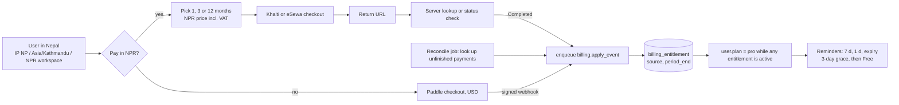

# Payments in Nepal: letting Nepali users pay in NPR (2026-11-07)

_Research · status: proposed, nothing built, nothing signed up for · companion to [payments](2026-11-07-payments.md)_

Paddle (or another merchant of record) covers card buyers abroad. It doesn't cover most of Nepal: an individual's
NRB dollar-card allowance is about **$500 a year** for all foreign online spending (bank pages, 2026), and most
people pay with wallets, mobile banking and QR. This page compares the local rails, says what the owner must
register, and shows how NPR purchases share the plan logic with Paddle. Items not confirmed in a primary source are
marked **unverified**. Tax points are a brief: **verify with a Nepali chartered accountant.**

## Recommendation

**Start with Khalti ePayment (KPG v2), then add eSewa ePay v2, and sell Pro as prepaid periods (1, 3 or 12 months)
in NPR.** Khalti has the best API for us: JSON over HTTPS, a self-serve sandbox today (`dev.khalti.com`, test
merchant at `test-admin.khalti.com`), and server-side lookup to confirm each payment. It also takes more than its
own wallet through the same checkout (e-banking, mobile banking, connectIPS; **verify the list on the merchant
agreement**). eSewa adds the largest wallet user base, with HMAC-SHA256 signed requests and responses. Neither
offers card-style auto-debit, so "subscription" in NPR means **reminders plus one-tap renew** for now. Watch two
things that may change that: **Fonepay Autopay** (announced around 2026-10-10, no merchant docs, limits or fees yet)
and **NCHL direct debit / e-mandate** (live for insurers and banks since 2023, no self-serve merchant product found).

**What it needs: a registered business.** Khalti and eSewa won't pay out collections to an individual with a
personal PAN. Khalti says you can integrate and test without documents, but can't withdraw without company or firm
registration, a PAN/VAT certificate and a tax clearance. eSewa's 2026 list has a lighter "small sole proprietor"
tier (under NPR 1 lakh a year), but it still asks for proof that the business exists. The cheapest route is a
**sole proprietorship ("private firm", Banijya registration) with a firm PAN and a current account in the firm's
name**, about **NPR 1–3k in government fees and 1–2 weeks** (secondary sources). Then list on the Department of
Commerce e-commerce portal, as the **E-Commerce Act 2081** (in force March 2025) requires. A Pvt. Ltd. isn't needed
for this.

## Comparison (checked 2026-11-07)

| Rail                                   | What the payer uses                                                                       | Recurring                                                                                                         | API and verification                                                                                                                                                                                                  | Sandbox                                                                                    | Onboarding (minimum)                                                                                                                                                                 | Fees and settlement                                                                                                                                                                                       | Refunds                                                                  | Fit                                 |
| -------------------------------------- | ----------------------------------------------------------------------------------------- | ----------------------------------------------------------------------------------------------------------------- | --------------------------------------------------------------------------------------------------------------------------------------------------------------------------------------------------------------------- | ------------------------------------------------------------------------------------------ | ------------------------------------------------------------------------------------------------------------------------------------------------------------------------------------ | --------------------------------------------------------------------------------------------------------------------------------------------------------------------------------------------------------- | ------------------------------------------------------------------------ | ----------------------------------- |
| **Khalti ePayment v2 (KPG-2)**         | Khalti wallet, plus e-banking, mobile banking and connectIPS via the gateway (**verify**) | **None**. Terms forbid storing wallet credentials                                                                 | `POST /epayment/initiate/` returns `pidx` + `payment_url` (expires in 30–60 min); redirect back with query params; **confirm with `POST /epayment/lookup/`** (secret key). No callback signature: lookup is the check | **Yes, self-serve**: `dev.khalti.com/api/v2`, test IDs 9800000000–5, MPIN 1111, OTP 987654 | Company or firm registration, PAN/VAT certificate, tax clearance, proprietor ID (merchant terms; 2026 FAQ: test without docs, no withdrawal)                                         | Negotiated % per transaction (third-party: 1.5–3.5%, **unverified**), a one-time API fee, annual fee from year 2. Funds go to the merchant account; withdraw to bank any time (T+1 claims **unverified**) | Statuses include Refunded / Partially Refunded; refund API exists (docs) | **First**                           |
| **eSewa ePay v2**                      | eSewa wallet (largest base), linked banks                                                 | **None** found                                                                                                    | Form POST with **HMAC-SHA256 (base64) signature** over `total_amount,transaction_uuid,product_code`; success redirect returns base64 JSON with its own signature; **status-check API** if no response in 5 min        | Yes: RC hosts (`rc-epay.esewa.com.np`), test merchant `EPAYTEST` (**verify hosts**)        | 2026-08-11 list: sole proprietor ≥ NPR 1 lakh/yr needs firm registration, PAN/VAT, tax clearance, citizenship; under 1 lakh needs proof of the business (ward office) + personal PAN | Not published (third-party 0.5–2%, **unverified**). Settles to the bank account (eSewa docs) or the wallet (blogs)                                                                                        | Merchant portal (**unverified**)                                         | **Second**                          |
| **Fonepay** (dynamic QR, merchant API) | Any bank app on the Fonepay network (about 95% of QR payments), eSewa, Khalti             | **Autopay announced** (Oct 2026), no merchant docs, limits or fees                                                | Bank-issued merchant API (username, password, terminal ID); per-transaction dynamic QR; verify via API. No public docs                                                                                                | Bank-provided (community packages show a dev gateway)                                      | **Through your bank**; registered business. One bank lets unregistered individuals collect up to Rs 5,000 a day on a static QR                                                       | Bank-set; not published                                                                                                                                                                                   | Bank process                                                             | Later, for QR and Autopay           |
| **connectIPS e-payment (NCHL)**        | Any bank account in connectIPS                                                            | NEPALPAY Request (pull, authorised **each time**); e-mandate exists for insurers/banks, no merchant product found | Form POST; `TOKEN` = **SHA256withRSA signature with your `.pfx` key**; redirect returns only `TXNID`; call the validation API; amounts in paisa                                                                       | Test environment via NCHL support (localhost allowed)                                      | **Through your bank** (bank does KYC, NCHL enrols you); registered business                                                                                                          | Not published                                                                                                                                                                                             | Bank process                                                             | Later; heavier (RSA keys, bank-led) |
| **NEPALPAY QR / Instant (NCHL)**       | Khalti, IME Pay, connectIPS, many bank apps                                               | No                                                                                                                | QR scheme; merchant APIs via bank                                                                                                                                                                                     | Via bank                                                                                   | Via bank                                                                                                                                                                             | Not published                                                                                                                                                                                             | Bank process                                                             | Covered by Khalti; no direct work   |
| **IME Pay**                            | IME Pay wallet                                                                            | No                                                                                                                | Native SDK docs last updated 2021; Flutter SDK; credentials from IME Pay                                                                                                                                              | Staging on request                                                                         | Registered business (**unverified**)                                                                                                                                                 | Not published                                                                                                                                                                                             | Not documented                                                           | Skip                                |

**Who can pay which QR:** Fonepay QR can be paid from most bank apps and from eSewa and Khalti. NEPALPAY QR can be
paid from Khalti, IME Pay, connectIPS and NCHL member banks. eSewa supports Fonepay but reportedly not NEPALPAY or
Smart QR (undated guide, **verify**). NRB ordered full interoperability in 2022 (Kathmandu Post, 2022-02-09), but it
isn't complete. Khalti plus eSewa reaches nearly every Nepali payer without us running a QR flow.

**Node/Next.js:** none of these publish an official Node SDK. Khalti is three `fetch` calls. eSewa is HMAC with
`node:crypto`. connectIPS needs RSA signing with a `.pfx`, which `node:crypto` also handles. We'd write small
adapters with no new dependencies, rather than pull community packages under our 7-day cooldown rules.

## Tax and rules for NPR sales (verify with an accountant)

- **This is domestic income, not export.** The 5% final rate for IT service exports (see the payments doc) does
  **not** apply to NPR sales to Nepali users. A sole proprietor's profit goes on the normal individual slabs; a
  company pays corporate tax. Keep the two income streams apart in the books.
- **VAT:** 13%. Registration is mandatory once **service turnover exceeds NPR 30 lakh a year** (Finance Act
  2081, carried into 2082/83; secondary sources). Voluntary registration is possible. Once VAT-registered, NPR
  prices must include VAT and each sale needs a VAT invoice. Exports stay zero-rated.
- **Bills:** a PAN or VAT registered seller issues a bill (tax invoice, or an abbreviated invoice for small amounts)
  for each sale. **Electronic invoices need IRD's prior approval or IRD-listed billing software.** Real-time CBMS
  reporting is mandatory only above about **NPR 20 crore** turnover (IRD notice, Baishakh 2083, via secondary
  sources). So our app emailing a PDF "receipt" may not count as a valid tax bill. Options to check: an IRD-approved
  billing service with an API, or getting our generator approved. **Accountant first.**
- **E-Commerce Act 2081:** list the business on the Department of Commerce portal (`online.doc.gov.np`) and show
  the business name, address, registration and **PAN**, the e-commerce type, contact, customer service, a complaint
  contact and the listing number on the site. There are penalties for operating unlisted.
- **NPR pricing:** residents settle domestic payments in NPR (Foreign Exchange Regulation Act; local gateways only
  take NPR). Show Nepali users an **NPR price that we set**, not a live conversion of the USD price.
- **TDS and fees:** Khalti's terms apply withholding tax to its service charges. Gateways don't withhold tax on our
  sales. Our own advance tax and returns come from our books.

## Product design for us

- **Who sees "Pay in NPR":** default it on when the request country is NP (`x-vercel-ip-country`), the browser
  timezone is `Asia/Kathmandu`, or the workspace home currency is NPR. Always offer a "Pay in USD / NPR" switch.
  Never block either one.
- **What they buy:** Pro for **1, 3 or 12 months**, priced in NPR (for example a discount at 12 months). A purchase
  extends `period_end` from `max(now, current period_end)`, so renewing early never loses days. This is the honest
  version of a subscription until Fonepay Autopay or an e-mandate has merchant docs. Then add "auto-renew" as a
  third adapter.
- **Renewal:** email and an in-app banner 7 days and 1 day before expiry, then on expiry. Each one has a **one-tap
  renew** link that opens checkout pre-filled with the same period. **3-day grace**, then Free limits; no data is
  deleted.
- **Same entitlement logic as Paddle:** one `Billing` service in `packages/core` with adapters (`paddle`,
  `khalti`, `esewa`). Each adapter turns a confirmed payment into the same `billing.apply_event` job. The job writes a
  `billing_entitlement` row (`source`: `paddle_subscription` | `prepaid_npr` | `admin_comp`, `user_id`, `plan`,
  `period_end`, provider ids), and `user.plan` is `pro` while any row is active. Khalti and eSewa have **no
  webhooks**, so add a reconcile job: every few minutes, look up payments that were initiated and never confirmed
  (the user closed the tab) and apply them. **Never trust redirect query params.** Lookup with our secret, or verify
  eSewa's signature over status, amount, id and product code, and match the amount to the order.
- **Receipts for the payer:** a bill with our firm name, PAN/VAT number, bill number, date, period bought, amount
  and VAT. It has to be a valid tax bill (see above). Until that's settled, use the gateway receipt plus a "payment
  confirmation" that doesn't claim to be a tax invoice.
- **Refunds:** a simple rule, for example a full refund within 7 days of purchase if fewer than N receipts were
  used. Khalti refunds go through its refund API; eSewa refunds through the merchant portal (**unverified**). A
  refund ends the entitlement and is logged as a `billing_event`. Wallet payments have no card-style chargebacks;
  disputes go through the provider.
- **Docs:** the implementing PR updates `docs/architecture/` (billing tables, reconcile job, external gateways).

## Owner steps, timeline and rough cost

| When     | Step                                                                                                                                                                                            | Cost (rough, **unverified**)                                 |
| -------- | ----------------------------------------------------------------------------------------------------------------------------------------------------------------------------------------------- | ------------------------------------------------------------ |
| Now      | Khalti sandbox merchant at `test-admin.khalti.com` (free, no documents) so the adapter can be built                                                                                             | Free                                                         |
| Week 1   | Ask an accountant: sole proprietorship vs Pvt. Ltd., VAT now or later, the e-billing route, and how this sits next to the 5% export income                                                      | NPR 5–15k consult                                            |
| Week 1–2 | Register a **private firm** for IT/software services (Department of Commerce, or ward office for the smallest tier); get the **firm PAN** at IRD; open a **current account** in the firm's name | Government fees ~NPR 1–3k; PAN free                          |
| Week 2   | List on `online.doc.gov.np` (E-Commerce Act); put the PAN, address and complaint contact in the site footer and terms                                                                           | Free                                                         |
| Week 2–4 | Khalti merchant KYC (registration, PAN/VAT, tax clearance, ID), negotiate the rate; then eSewa (same documents)                                                                                 | One-time API fee + % per transaction; annual fee from year 2 |
| Ongoing  | Monthly or annual returns (VAT monthly if registered), bookkeeping, annual tax clearance (the gateways ask for it again)                                                                        | NPR 10–30k a year for an accountant (estimate)               |

A brand-new firm has no tax clearance yet. Ask Khalti and eSewa what they accept in its place (**unverified**).

## Risks

- **Registration overhead:** a firm brings returns, a tax clearance each year and VAT once over the threshold. Only
  worth it once Nepali demand shows up. Measure first: count Nepal users who hit the Free limit or click "Upgrade".
- **Invoice validity:** an emailed PDF may not be a valid tax bill without IRD approval. That's the most likely
  compliance gap.
- **No auto-debit:** prepaid renewals churn more than card subscriptions. Reminders and annual discounts offset
  some of it. Autopay or an e-mandate may arrive in 2027 (no dates published).
- **Thin, unofficial docs** for Fonepay, connectIPS and IME Pay; fees aren't published anywhere. Everything in the
  fee column needs the signed merchant agreement.
- **Status races:** without webhooks, a missed redirect leaves a paid user on Free until reconcile runs. Keep the
  interval short and show "Payment pending, we'll confirm shortly".

## Sources (fetched 2026-11-07 unless dated)

- Khalti: [ePayment docs](https://docs.khalti.com/khalti-epayment/), [docs home](https://docs.khalti.com/),
  [merchant terms](https://khalti.com/info/terms/merchant/), [charges](https://khalti.com/info/charges/) (updated
  2026-07-10), [payment gateway](https://khalti.com/payment-gateway/), [merchant FAQ](https://blog.khalti.com/?p=16372)
- eSewa: [documents for Merchant API](https://blog.esewa.com.np/documents-required-esewa-merchant-api-integration)
  (2026-08-11), [ePay v2 developer docs](https://developer.esewa.com.np/pages/Epay-V2),
  [Node verification pitfalls](https://dev.to/anishbhattaraiasm/accepting-esewa-and-khalti-in-nodejs-the-redirect-is-not-the-payment-4pgo)
- Fonepay: [Autopay announcement](https://arthadabali.com/2026/10/11/94919) (2026-10-11),
  [roundup: no dates, limits or fees](https://digitalsolutionnepal.com/fonepay-talk-to-pay-honors-2083/),
  [dynamic QR](https://fonepay.com/blogs/fonepay-dynamic-qr-code),
  [bank QR merchant requirements](https://www.muktinathbank.com.np/digital-banking/digital-banking-submenu/qr-merchant-payment) (2026-09-01)
- NCHL: [connectIPS merchant interface](https://doc.connectips.com/docs/connectIPS-Gateway/merchant-interface),
  [onboarding](https://doc.connectips.com/docs/connectIPS-Gateway/cips-core-module),
  [NEPALPAY Request](https://connectips.com/knowmore/nepalpayrequest/), [NEPALPAY QR](https://nchl.com.np/nepalpay-qr/),
  [e-mandate for premiums](https://kathmandupost.com/money/2023/06/08/metlife-nepal-and-standard-chartered-bank-nepal-enable-e-mandate-feature-for-premium-payments) (2023-06-08)
- IME Pay: [developer portal](https://developer.imepay.com.np) (2021), [Flutter SDK](https://pub.dev/packages/imepay_merchant_sdk)
- QR interoperability: [business QR in Nepal](https://www.gadgetbytenepal.com/business-qr-in-nepal),
  [NRB interoperability order](https://kathmandupost.com/money/2022/02/09/central-bank-enforces-interoperability-to-promote-digital-payments) (2022-02-09)
- Dollar-card cap: [Global IME Bank guide](https://www.globalimebank.com/blog/dollar-card-nepal-guide),
  [Citizens Bank USD e-com card](https://www.ctznbank.com/product/card/usd-ecom-card)
- Tax and law (secondary, verify): [VAT thresholds 2082/83](https://lawalpine.com/blog/vat-in-nepal-rates-and-thresholds-2082-83),
  [e-billing / CBMS threshold](https://companysathi.com/blog/electronic-billing-mandate-nepal-2026),
  [Nepal e-invoicing booklet](https://www.vatupdate.com/2026/09/20/nepal-e-invoicing-e-reporting-country-booklet/) (2026-09-20),
  [E-Commerce Act 2081 registration](https://lawalpine.com/blog/registration-of-e-commerce-business-in-nepal) (reviewed 2026-09),
  [E-Commerce Act passed](https://ekantipur.com/business/2025/03/05/en/e-commerce-bill-passed-now-registration-is-mandatory-when-doing-online-business-42-04.html) (2025-03-05),
  [private firm registration](https://deel.com/blog/register-a-sole-proprietorship-private-firm-in-nepal)
