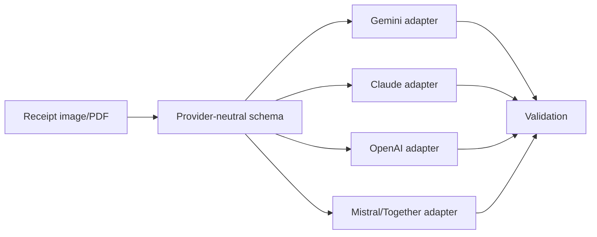

# Additional OCR Source Review

Last updated: 2026-06-10

This document reviews the extra links supplied by the user and adds Anthropic/Claude references. The goal is not to treat every link equally. Primary docs, model cards, papers, and official repos should drive implementation decisions. Blog posts, LinkedIn, Reddit, and private chat links are useful leads but should not be treated as authoritative without reproduction.

## Source Quality Tiers

| Tier | Source type | How to use |
| --- | --- | --- |
| A | Official docs, official repos, model cards, papers | Use for architecture, adapter design, and citations. |
| B | Vendor/platform tutorials and reputable technical blogs | Use for patterns and candidate discovery; verify claims. |
| C | LinkedIn, Reddit, Medium opinion posts, private chat links | Use as leads and prompts for experiments; do not cite for product decisions. |

## Anthropic / Claude Additions

Anthropic is relevant because Claude can be another multimodal extraction provider. The important docs are:

- Claude vision: image inputs, image size/token behavior, quality guidance, Files API patterns, and limitations around low-quality/rotated/tiny images and precise spatial reasoning.[^anthropic-vision]
- Claude PDF support: relevant for e-receipts, invoices, and uploaded statements.[^anthropic-pdf]
- Claude structured outputs: JSON schema outputs and strict tool use for schema-compliant tool parameters, with grammar compilation/caching and schema complexity constraints.[^anthropic-structured]
- Claude prompting best practices: useful for XML-tagged prompts, examples, long-document ordering, and agentic workflows.[^anthropic-prompting]

Design implication:

Claude should be considered a cross-check provider, not a replacement for app-level validation. Anthropic's own docs warn that image interpretation can fail on low-quality/rotated/small images and that spatial precision is limited.[^anthropic-vision]

## User Link Triage

| Link | Tier | Relevance | Notes |
| --- | --- | --- | --- |
| Together OCR quickstart | B | High | Good example of receipt image to Markdown/JSON via vision model and schema.[^together-ocr] |
| Hugging Face OCR open models blog | B | High | Useful landscape summary; cites modern open OCR models, output formats, benchmarks, and evaluation ideas.[^hf-ocr-blog] |
| AllenAI olmOCR | A | High | Already included; strong PDF/Markdown parser candidate.[^olmocr-github] |
| rednote-hilab dots.ocr + HF card | A | High | Already included; compact VLM parser and dots.mocr evolution.[^dots-github][^dots-hf] |
| PaddleOCR | A | High | Already included; major open OCR/document stack.[^paddle-github] |
| PaddleOCR-VL-1.6 HF + paper | A | Very high | Current 2026 compact document VLM; keep model card, paper, and PaddleOCR docs together.[^paddlevl16-hf][^paddlevl16-paper] |
| GLM-OCR | A | High | Compact 0.9B document OCR model with HF card, SDK, vLLM/SGLang/Ollama options, and technical report.[^glm-ocr-hf][^glm-ocr-paper] |
| DeepSeek-OCR | A | High | 3B OCR model and optical context compression paper; useful open-model parser benchmark.[^deepseek-ocr-hf][^deepseek-ocr-paper] |
| DeepSeek-OCR-2 | A | High research relevance | 2026 visual causal flow follow-up with GitHub repo, paper, image/PDF inference, and Markdown prompts.[^deepseek-ocr2-github][^deepseek-ocr2-paper] |
| Surya | A | Medium-high | Useful OCR/layout/table local baseline.[^surya-github] |
| Surya-OCR-2 | A | High | 650M Datalab OCR model with layout, tables, bboxes, confidence, vLLM/llama.cpp, and JSON/HTML outputs.[^surya-ocr-2-hf] |
| Chandra-OCR-2 | A | Medium-high | 5B Datalab high-accuracy OCR model for Markdown/HTML/JSON with layout; license/commercial review needed.[^chandra-ocr-2-hf] |
| Hugging Face trending OCR search | B | High discovery value | Use to discover current candidates; not an accuracy source.[^hf-ocr-trending] |
| LlamaIndex OCR software comparison | B/C | Medium | Useful 2026 market taxonomy around agentic document processing vs legacy OCR; vendor-biased toward LlamaParse.[^llamaindex-ocr-blog] |
| LlamaIndex document parsing comparison | B/C | Medium | Useful broader parser taxonomy; adds Landing AI/LandingDocument and reinforces parser-vs-OCR distinction.[^llamaindex-parsing-blog] |
| LlamaIndex document parsing APIs comparison | B/C | Medium | Useful API-selection frame for LlamaParse, Textract, Google Document AI, Azure Document Intelligence, Docling, and PyMuPDF.[^llamaindex-parser-api-blog] |
| LiteParse blog/docs/repo/dataset | A/B | Medium-high | Local parser for agents with Rust core, Node/Python/Rust/WASM bindings, spatial text reconstruction, screenshots, bundled Tesseract/tesseract-rs OCR, and pluggable OCR servers.[^liteparse-blog][^liteparse-v2-blog][^liteparse-github][^liteparse-docs][^liteparse-dataset] |
| ParseBench blog/dataset/code/paper | A/B | High | Strong benchmark/evaluation source for parser quality: tables, charts, content faithfulness, semantic formatting, visual grounding.[^parsebench-blog][^parsebench-hf][^parsebench-github][^parsebench-paper] |
| Fastio OCR tools for AI agents | B/C | Medium | Useful agent workflow framing: API integration, confidence, storage/RAG, handoffs; verify pricing/claims elsewhere.[^fastio-ocr-blog] |
| Qianfan-OCR | A | Medium-high | Baidu 4B end-to-end document intelligence with Layout-as-Thought and KIE claims.[^qianfan-ocr-hf] |
| Nemotron-OCR-v2 | A | Medium | NVIDIA detector/recognizer/relational OCR pipeline with boxes/confidence; useful OCR baseline.[^nemotron-ocr-v2-hf] |
| Typhoon-OCR-7B | A | Medium for Thai/English | Thai/English document parser that explicitly includes receipts/menus/tickets.[^typhoon-ocr-7b-hf] |
| Nanonets-OCR-s | A/B | Medium | Candidate open model; needs license and receipt benchmark review.[^nanonets-ocr-s] |
| OCRFlux-3B | A/B | Medium | Candidate OCR model; especially interesting for document-level/cross-page continuity claims.[^ocrflux-3b] |
| RapidOCR | A | Medium-high | Local fast OCR backend; relevant through Docling integration.[^rapidocr-github] |
| Docling + full-page OCR + RapidOCR examples | A | High | Confirms Docling can force OCR and swap OCR backends.[^docling-full-page-ocr][^docling-rapidocr] |
| Docling/RapidOCR GoPenAI blog | B/C | Low-medium | Mostly repeats official Docling example; use official docs instead.[^gopenai-docling] |
| Modal open-source OCR comparison | B | Medium | Useful secondary comparison; benchmark claims should be reproduced locally.[^modal-ocr] |
| EasyOCR | A | Medium | Local OCR baseline with 80+ languages.[^easyocr-github] |
| docTR | A | Medium | Local deep OCR baseline.[^doctr-github] |
| Donut | A | Medium | Important OCR-free document understanding lineage.[^donut-github] |
| Qwen2.5-VL / Qwen3-VL | A | High | Strong open VLM base for OCR/document parsing; current repo redirects to Qwen3-VL.[^qwen-vl] |
| Roboflow Llama 3.2 Vision OCR blog | B | Low-medium | Useful as a VLM OCR tutorial; not a primary model source.[^roboflow-llama] |
| Zerox | A/B | Medium | Vision-model OCR/document extraction wrapper pattern.[^zerox-github] |
| Mistral structured OCR cookbook | A | Medium-high | Practical structured OCR notebook; pair with Mistral docs/API.[^mistral-cookbook] |
| Japanese-Receipt-VL-3B-JSON | A/B | High for Japanese receipts | Good case study for receipt-specific fine-tuning on Qwen2.5-VL.[^japanese-receipt-vl] |
| LlamaParse / LlamaExtract | B/A depending source | Medium-high | Managed agentic parser/extractor to compare against Docling/Mistral/cloud APIs; use official docs for implementation details.[^llamaindex-ocr-blog][^llamaindex-parsing-blog] |
| LiteParse | A/B | Medium-high | Local LlamaIndex parser option; compare against PyMuPDF, pypdf, Docling, and custom PDF prepass tools.[^liteparse-blog][^liteparse-v2-blog][^liteparse-github] |
| Landing AI / LandingDocument | B/A depending source | Medium | Agentic visual parser/extractor surfaced by the parsing comparison; verify with official docs before implementation.[^llamaindex-parsing-blog] |
| ABBYY / UiPath / PyMuPDF / pypdf | B/A depending source | Medium | Useful market and workflow comparison set: legacy OCR, RPA validation, and PDF preprocessing utilities.[^llamaindex-ocr-blog] |
| Medium API4AI receipt OCR article | C | Low | Good product framing; not needed for architecture decisions.[^api4ai-medium] |
| LinkedIn posts | C | Lead only | Treat as pointers to ideas; posts can change/disappear and are often not reproducible. |
| Reddit LocalLLaMA OCR discussion | C | Lead only | Useful practitioner anecdotes; not authoritative. |
| ChatGPT/Gemini/Grok conversation links | C | Not accessible/reproducible | Need exported text or summaries to cite/use. |

## New Candidates To Add To A Benchmark

If we build a provider/model benchmark later, include these:

1. Gemini current app provider.
2. Claude vision/PDF structured output.
3. OpenAI vision structured output.
4. Mistral OCR structured cookbook/API path.
5. Together-hosted VLM OCR using schema outputs.
6. Docling with Tesseract, EasyOCR, RapidOCR, and Surya backends.
7. PaddleOCR / PaddleOCR-VL-1.6.
8. GLM-OCR.
9. DeepSeek-OCR and DeepSeek-OCR-2.
10. Surya-OCR-2.
11. Chandra-OCR-2.
12. olmOCR.
13. dots.mocr.
14. Nanonets-OCR-s.
15. OCRFlux-3B.
16. Qianfan-OCR.
17. Nemotron-OCR-v2.
18. Typhoon-OCR-7B for Thai/English subset.
19. Qwen3-VL direct or hosted.
20. Japanese-Receipt-VL-3B-JSON for Japanese-specific test subset.

## What The Extra Links Change

The biggest change is not the number of OCR tools; it is the need for a repeatable evaluation harness. The list confirms there are too many plausible options to choose by reputation. The app should define a stable receipt schema, a gold dataset, and a benchmark harness, then test providers against the same validation rules.

## Suggested Experiments From These Links

| Experiment | Source inspiration | Decision it informs |
| --- | --- | --- |
| Claude vs Gemini structured extraction | Anthropic structured outputs + vision docs | Whether a second premium provider improves accuracy. |
| Together open-model OCR | Together quickstart | Whether hosted open VLMs are good enough without self-hosting. |
| Docling OCR backend comparison | Docling full-page OCR and RapidOCR examples | Best local OCR backend for scanned PDFs. |
| Qwen fine-tuning path | Japanese-Receipt-VL model card | Whether a receipt-specific LoRA is worth future investment. |
| Open OCR model bakeoff | HF OCR blog, Nanonets, OCRFlux, dots, olmOCR | Which open model deserves worker integration. |
| Agentic parser comparison | LlamaIndex and Fastio blogs | Whether managed parser/extractor APIs offer enough traceability and workflow value to justify cost. |
| PDF preprocessing comparison | PyMuPDF, pypdf, Docling | Which layer should render/split/redact PDFs before OCR. |
| Spatial document extraction comparison | Landing AI, LlamaParse, multimodal APIs | Whether visual grounding improves receipts with unusual layouts or dense tables. |
| Parser API selection | LlamaIndex parser API comparison | Whether managed APIs, local parsers, or cloud-native document AI best fit v1/v2 workflows. |
| Local parser prepass | LiteParse / PyMuPDF / Docling | Whether a fast local text/screenshot pass helps before VLM extraction. |
| Agentic parser benchmark | ParseBench | Which ParseBench dimensions should become receipt-specific checks. |

## References

[^anthropic-vision]: Anthropic, "Vision", accessed 2026-06-10. https://platform.claude.com/docs/en/build-with-claude/vision
[^anthropic-pdf]: Anthropic, "PDF support", accessed 2026-06-10. https://platform.claude.com/docs/en/build-with-claude/pdf-support
[^anthropic-structured]: Anthropic, "Structured outputs", accessed 2026-06-10. https://platform.claude.com/docs/en/build-with-claude/structured-outputs
[^anthropic-prompting]: Anthropic, "Prompting best practices", accessed 2026-06-10. https://platform.claude.com/docs/en/build-with-claude/prompt-engineering/claude-prompting-best-practices
[^together-ocr]: Together AI, "Quickstart: How to do OCR", accessed 2026-06-10. https://docs.together.ai/docs/quickstart-how-to-do-ocr
[^hf-ocr-blog]: Hugging Face, "Supercharge your OCR Pipelines with Open Models", 2025-10-21, accessed 2026-06-10. https://huggingface.co/blog/ocr-open-models
[^olmocr-github]: AllenAI, "olmOCR", GitHub, accessed 2026-06-10. https://github.com/allenai/olmocr
[^dots-github]: rednote-hilab, "dots.ocr", GitHub, accessed 2026-06-10. https://github.com/rednote-hilab/dots.ocr
[^dots-hf]: rednote-hilab, "dots.ocr", Hugging Face, accessed 2026-06-10. https://huggingface.co/rednote-hilab/dots.ocr
[^paddle-github]: PaddlePaddle, "PaddleOCR", GitHub, accessed 2026-06-10. https://github.com/PaddlePaddle/PaddleOCR
[^paddlevl16-hf]: PaddlePaddle, "PaddleOCR-VL-1.6", Hugging Face, accessed 2026-06-10. https://huggingface.co/PaddlePaddle/PaddleOCR-VL-1.6
[^paddlevl16-paper]: Zelun Zhang et al., "PaddleOCR-VL-1.6: Expanding the Frontier of Document Parsing with Under-Optimized Region Refinement and Progressive Post-Training", arXiv, 2026. https://arxiv.org/abs/2606.03264
[^glm-ocr-hf]: zai-org, "GLM-OCR", Hugging Face, accessed 2026-06-10. https://huggingface.co/zai-org/GLM-OCR
[^glm-ocr-paper]: Shuaiqi Duan et al., "GLM-OCR Technical Report", arXiv, 2026. https://arxiv.org/abs/2603.10910
[^deepseek-ocr-hf]: DeepSeek AI, "DeepSeek-OCR", Hugging Face, accessed 2026-06-10. https://huggingface.co/deepseek-ai/DeepSeek-OCR
[^deepseek-ocr-paper]: Haoran Wei et al., "DeepSeek-OCR: Contexts Optical Compression", arXiv, 2025. https://arxiv.org/abs/2510.18234
[^deepseek-ocr2-github]: DeepSeek AI, "DeepSeek-OCR-2", GitHub, accessed 2026-06-10. https://github.com/deepseek-ai/DeepSeek-OCR-2
[^deepseek-ocr2-paper]: Haoran Wei, Yaofeng Sun, Yukun Li, "DeepSeek-OCR 2: Visual Causal Flow", arXiv, 2026. https://arxiv.org/abs/2601.20552
[^surya-github]: Datalab, "surya", GitHub, accessed 2026-06-10. https://github.com/datalab-to/surya
[^surya-ocr-2-hf]: Datalab, "surya-ocr-2", Hugging Face, accessed 2026-06-10. https://huggingface.co/datalab-to/surya-ocr-2
[^chandra-ocr-2-hf]: Datalab, "chandra-ocr-2", Hugging Face, accessed 2026-06-10. https://huggingface.co/datalab-to/chandra-ocr-2
[^hf-ocr-trending]: Hugging Face, "Models search: ocr sorted by trending", accessed 2026-06-10. https://huggingface.co/models?sort=trending&search=ocr
[^llamaindex-ocr-blog]: LlamaIndex, "Best OCR Software of 2026: Agentic AI vs. Legacy Solutions", 2026-03-18, accessed 2026-06-10. https://www.llamaindex.ai/insights/best-ocr-software
[^llamaindex-parsing-blog]: LlamaIndex, "Best Document Parsing Software 2026: Agentic AI vs. Legacy OCR", 2026-03-18, accessed 2026-06-10. https://www.llamaindex.ai/insights/best-document-parsing-software
[^llamaindex-parser-api-blog]: LlamaIndex, "Top Document Parsing APIs for 2026", 2026-03-17, accessed 2026-06-10. https://www.llamaindex.ai/insights/top-document-parsing-apis
[^liteparse-blog]: Logan Markewich, "LiteParse: Local Document Parsing for AI Agents", LlamaIndex, 2026-03-19, accessed 2026-06-10. https://www.llamaindex.ai/blog/liteparse-local-document-parsing-for-ai-agents
[^liteparse-v2-blog]: Logan Markewich, "LiteParse v2.0 Runs Everywhere", LlamaIndex, 2026-05-27, accessed 2026-06-10. https://www.llamaindex.ai/blog/liteparse-v2-0-runs-everywhere
[^liteparse-github]: run-llama, "liteparse", GitHub, accessed 2026-06-10. https://github.com/run-llama/liteparse
[^liteparse-docs]: LlamaIndex, "What is LiteParse?", accessed 2026-06-10. https://developers.llamaindex.ai/liteparse/
[^liteparse-dataset]: LlamaIndex, "liteparse_bench_small", Hugging Face dataset, accessed 2026-06-10. https://huggingface.co/datasets/llamaindex/liteparse_bench_small
[^parsebench-blog]: LlamaIndex, "Introducing ParseBench: The First Document Parsing Benchmark for AI Agents", 2026-04-13, accessed 2026-06-10. https://www.llamaindex.ai/blog/parsebench
[^parsebench-hf]: LlamaIndex, "ParseBench", Hugging Face dataset, accessed 2026-06-10. https://huggingface.co/datasets/llamaindex/ParseBench
[^parsebench-github]: run-llama, "ParseBench", GitHub, accessed 2026-06-10. https://github.com/run-llama/ParseBench
[^parsebench-paper]: Boyang Zhang et al., "ParseBench: A Document Parsing Benchmark for AI Agents", arXiv, 2026. https://arxiv.org/abs/2604.08538
[^fastio-ocr-blog]: Fastio, "Best OCR Tools for AI Agents - Top Vision APIs 2026", accessed 2026-06-10. https://fast.io/resources/best-ocr-tools-ai-agents/
[^qianfan-ocr-hf]: Baidu, "Qianfan-OCR", Hugging Face, accessed 2026-06-10. https://huggingface.co/baidu/Qianfan-OCR
[^nemotron-ocr-v2-hf]: NVIDIA, "nemotron-ocr-v2", Hugging Face, accessed 2026-06-10. https://huggingface.co/nvidia/nemotron-ocr-v2
[^typhoon-ocr-7b-hf]: Typhoon AI, "typhoon-ocr-7b", Hugging Face, accessed 2026-06-10. https://huggingface.co/typhoon-ai/typhoon-ocr-7b
[^nanonets-ocr-s]: Nanonets, "Nanonets-OCR-s", Hugging Face, accessed 2026-06-10. https://huggingface.co/nanonets/Nanonets-OCR-s
[^ocrflux-3b]: ChatDOC, "OCRFlux-3B", Hugging Face, accessed 2026-06-10. https://huggingface.co/ChatDOC/OCRFlux-3B
[^rapidocr-github]: RapidAI, "RapidOCR", GitHub, accessed 2026-06-10. https://github.com/RapidAI/RapidOCR
[^docling-full-page-ocr]: Docling documentation, "Force full page OCR", accessed 2026-06-10. https://docling-project.github.io/docling/examples/full_page_ocr/
[^docling-rapidocr]: Docling documentation, "RapidOCR with custom OCR models", accessed 2026-06-10. https://docling-project.github.io/docling/examples/rapidocr_with_custom_models/
[^gopenai-docling]: Alain Airom, "Using Docling's OCR features with RapidOCR", GoPenAI/Medium, 2025-04-03, accessed 2026-06-10. https://blog.gopenai.com/using-doclings-ocr-features-with-rapidocr-a757fbc1e7c8
[^modal-ocr]: Modal, "8 Top Open-Source OCR Models Compared", accessed 2026-06-10. https://modal.com/blog/8-top-open-source-ocr-models-compared
[^easyocr-github]: JaidedAI, "EasyOCR", GitHub, accessed 2026-06-10. https://github.com/JaidedAI/EasyOCR
[^doctr-github]: Mindee, "docTR", GitHub, accessed 2026-06-10. https://github.com/mindee/doctr
[^donut-github]: CLOVA AI, "Donut", GitHub, accessed 2026-06-10. https://github.com/clovaai/donut
[^qwen-vl]: QwenLM, "Qwen3-VL", GitHub, accessed 2026-06-10. https://github.com/QwenLM/Qwen2.5-VL
[^roboflow-llama]: Roboflow, "How to Use Llama 3.2 Vision for OCR", accessed 2026-06-10. https://blog.roboflow.com/how-to-use-llama-3-2-vision-for-ocr/
[^zerox-github]: getomni-ai, "zerox", GitHub, accessed 2026-06-10. https://github.com/getomni-ai/zerox
[^mistral-cookbook]: Mistral AI Cookbook, "structured_ocr.ipynb", GitHub, accessed 2026-06-10. https://github.com/mistralai/cookbook/blob/main/mistral/ocr/structured_ocr.ipynb
[^japanese-receipt-vl]: sabaridsnfuji, "Japanese-Receipt-VL-3B-JSON", Hugging Face, accessed 2026-06-10. https://huggingface.co/sabaridsnfuji/Japanese-Receipt-VL-3B-JSON
[^api4ai-medium]: API4AI, "Receipt OCR Mastery", Medium, accessed 2026-06-10. https://medium.com/@API4AI/receipt-ocr-mastery-turning-paper-slips-into-real-time-retail-data-8e0c0878e6d0
