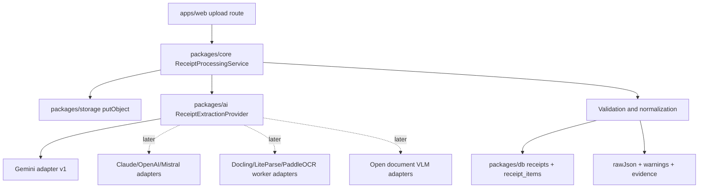

# Conversation Restart Summary

Last updated: 2026-06-10

Use this file to restart the OCR/document parsing research thread in a fresh conversation.

## Repo Context

This repo is a pnpm/Turborepo Receipt OCR MVP.

- `apps/web`: Next.js App Router app with Clerk, shadcn-style UI, Tailwind v4, and route handlers.
- `packages/ai`: OCR/provider abstraction boundary. Gemini is the v1 provider, but orchestration should stay provider-neutral.
- `packages/core`: Effect TS services and receipt processing workflow. Route handlers should remain thin HTTP adapters.
- `packages/db`: Drizzle/Postgres schema and database client.
- `packages/storage`: S3/R2-compatible storage helpers.

Research deliverables live in `research/`.

## User Goal

The user asked for a deep principal-research-engineer-style investigation into OCR/document parsing tools, including:

- Docling, dots.ocr/dots.mocr, PaddleOCR, and all plausible alternatives.
- Latest-to-oldest timeline and market landscape.
- How OCR systems work internally.
- Agentic OCR, structured generation, and document parsing for modern AI workflows.
- Receipt-specific recommendations for this app.
- Organized Markdown files with inline citations, references, and Mermaid diagrams.
- An index and a restart summary.

## Files Created

- [ocr-research-index.md](./ocr-research-index.md): navigation, executive takeaways, research questions, and near-term decision.
- [ocr-tool-landscape-and-timeline.md](./ocr-tool-landscape-and-timeline.md): taxonomy, timeline, latest-to-oldest ranking, and market shifts.
- [ocr-architectures-and-workflows.md](./ocr-architectures-and-workflows.md): classic OCR, modular OCR, document conversion, VLM OCR, structured output, and agentic loops.
- [ocr-tool-profiles.md](./ocr-tool-profiles.md): detailed tool/provider profiles and practical matrix.
- [ocr-exploration-catalog.md](./ocr-exploration-catalog.md): organized tool/model catalog with links, domains, outputs, priority, and benchmark shortlist.
- [receipt-ocr-evaluation-playbook.md](./receipt-ocr-evaluation-playbook.md): receipt-specific dataset plan, metrics, validation rules, provider benchmark phases, and repo architecture.
- [research-questions-and-follow-ups.md](./research-questions-and-follow-ups.md): exploration backlog.
- [additional-ocr-source-review.md](./additional-ocr-source-review.md): user-provided link triage and secondary-source review.
- [conversation-restart-summary.md](./conversation-restart-summary.md): this file.

## Major Tools And Sources Covered

Open/document VLM and OCR models:

- PaddleOCR / PaddleOCR-VL / PaddleOCR-VL-1.6.
- GLM-OCR.
- DeepSeek-OCR and DeepSeek-OCR-2.
- dots.ocr / dots.mocr.
- Surya, Surya-OCR-2, Chandra-OCR-2.
- olmOCR.
- MinerU.
- Marker.
- Qianfan-OCR.
- NVIDIA Nemotron-OCR-v2.
- Typhoon-OCR.
- Nanonets-OCR-s.
- OCRFlux-3B.
- Qwen2.5-VL / Qwen3-VL lineage.
- Japanese-Receipt-VL-3B-JSON.
- Donut, MonkeyOCR, GOT-OCR2.0, Vary, OneChart.
- EasyOCR, docTR, RapidOCR, Tesseract.

Commercial/API/provider tools:

- Gemini structured extraction.
- Claude vision/PDF/structured outputs.
- OpenAI vision and structured outputs.
- Mistral OCR and structured OCR cookbook.
- Together AI OCR/VLM quickstart.
- AWS Textract.
- Google Document AI.
- Azure Document Intelligence.
- LlamaParse / LlamaExtract.
- Landing AI / LandingDocument.
- ABBYY FineReader/Vantage.
- UiPath Document Understanding.

Document parsing/preprocessing utilities:

- Docling and Docling OCR backend examples.
- LiteParse v1 and LiteParse v2.0.
- PyMuPDF.
- pypdf.
- Zerox.

Benchmark/comparison sources:

- ParseBench.
- OmniDocBench and Real5-OmniDocBench.
- MDPBench.
- olmOCR-bench.
- Hugging Face OCR open models blog.
- Hugging Face trending OCR search.
- Modal open-source OCR comparison.
- LlamaIndex OCR software comparison.
- LlamaIndex document parsing software comparison.
- LlamaIndex document parsing APIs comparison.
- Fastio OCR tools for AI agents.

## Main Conclusions

1. OCR is now a stack, not a single tool. It includes acquisition, preprocessing, OCR/layout perception, document structure reconstruction, schema extraction, validation, persistence, and review.
2. Modern "OCR" is increasingly document parsing for agents: Markdown/JSON, tables, reading order, visual grounding, and structured generation matter as much as text recognition.
3. For the Receipt OCR MVP, the best near-term path is Gemini structured extraction behind `packages/ai`, with field-level evidence and validation in `packages/core`.
4. Route handlers should stay thin. Shared backend workflow belongs in `packages/core`.
5. Store raw provider JSON and warnings for replay/debugging.
6. Use a receipt-specific schema with evidence fields: `value`, `sourceText`, `confidence`, optional `bbox/page`, and alternatives.
7. Evaluate providers by receipt outcomes, not OCR text similarity alone.

## Recommended Architecture Direction



## First Benchmark Shortlist

Start with a small anonymized gold dataset and test:

1. Gemini structured extraction.
2. Claude structured extraction.
3. Mistral OCR structured extraction.
4. PaddleOCR-VL-1.6.
5. GLM-OCR.
6. DeepSeek-OCR.
7. DeepSeek-OCR-2 if practical.
8. Surya-OCR-2.
9. Chandra-OCR-2 if model size/cost is acceptable.
10. dots.mocr.
11. olmOCR.
12. Docling with RapidOCR or another OCR backend.
13. LiteParse local prepass.
14. PaddleOCR 3.x non-VL pipeline.

## Receipt-Specific Metrics To Preserve

- Total exact match.
- Money mean absolute error.
- Merchant normalized match.
- Date exact match.
- Item row F1.
- Schema validity.
- Evidence coverage.
- Visual grounding accuracy.
- Table/row record match.
- Faithfulness violations.
- Semantic formatting preservation.
- Retry rate and human review rate.
- Latency p50/p95 and cost per 1k receipts.

## Important Caveats

- Many blog posts are discovery sources, not neutral benchmarks.
- Vendor/model-card benchmark claims must be reproduced on receipt data.
- Hugging Face trending rank is a discovery signal only.
- OpenRAIL/commercial licensing must be reviewed for Datalab models and similar candidates.
- Local/GPU deployment feasibility matters as much as model accuracy.
- Receipt-specific correctness is not the same as OCR/document benchmark performance.

## Good Next Prompt For A Fresh Chat

```text
Continue the Receipt OCR research from research/conversation-restart-summary.md.
First read research/ocr-research-index.md and research/ocr-exploration-catalog.md.
Then help me turn the research into an implementation plan for packages/ai and packages/core:
provider-neutral receipt schema, Gemini adapter improvements, validation rules, and a benchmark harness.
Preserve AGENTS.md rules and keep route handlers thin.
```

