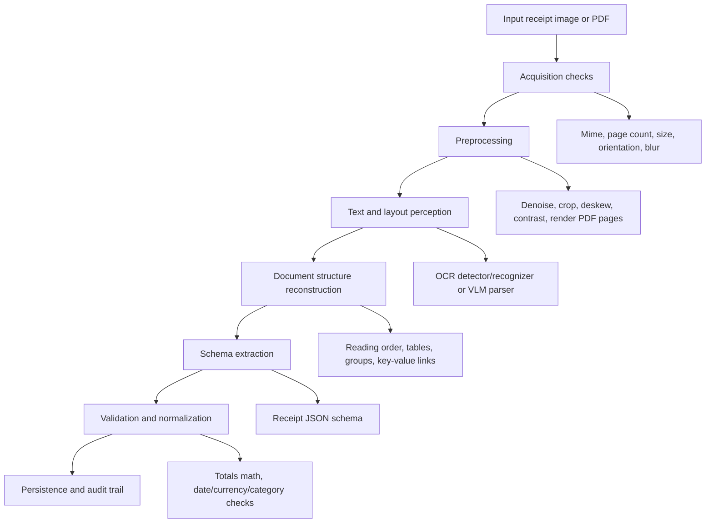
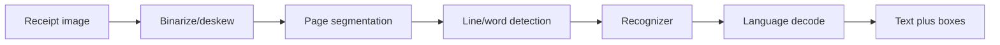
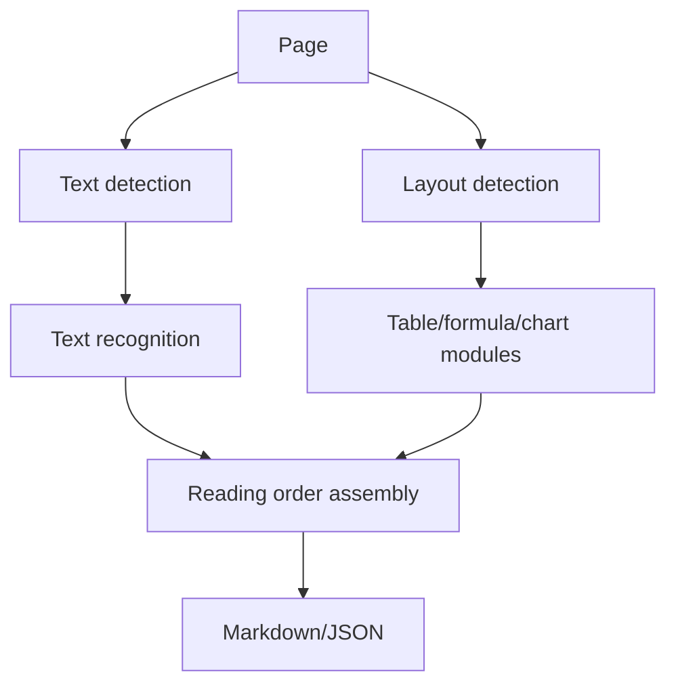
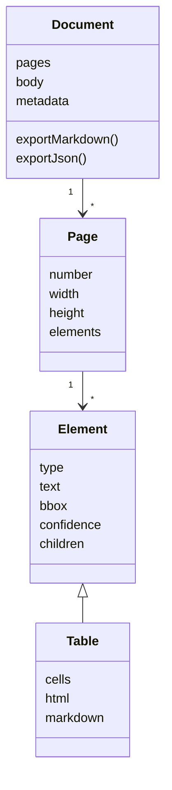
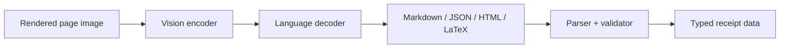
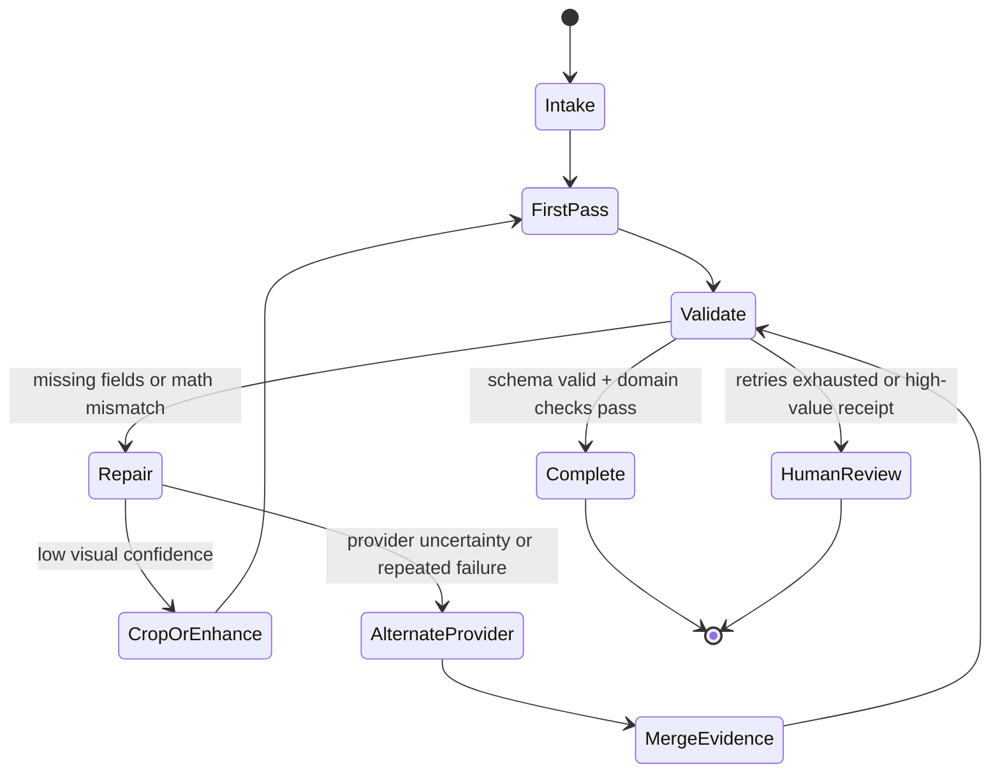

# OCR Architectures And Workflows

Last updated: 2026-06-10

## Mental Model

OCR is best understood as a stack, not a single model call.



For receipts, the stack must be judged by the final financial record, not just character accuracy.

## Architecture 1: Classic OCR Pipeline

Classic OCR engines usually decompose the page into engineered stages:

1. Normalize image quality.
2. Detect page orientation and text regions.
3. Segment text into blocks, lines, words, or characters.
4. Recognize text using a character/sequence model.
5. Decode with language models or dictionaries.
6. Emit plain text, hOCR, TSV, ALTO XML, or similar coordinate-bearing formats.



Tesseract remains a useful baseline because it is local, mature, and supports structured OCR outputs, but it is not a receipt-understanding system by itself.[^tesseract-docs] It gives the app evidence. Another layer must decide which text is merchant, which is tax, which total is final, and whether `12/03/26` means March 12 or December 3.

## Architecture 2: Deep Modular OCR

Modern deep OCR toolkits keep the modular structure but replace individual pieces with neural models:

- Text detector: finds oriented text boxes or polygons.
- Orientation/classifier: fixes rotated lines.
- Text recognizer: converts cropped text regions to strings.
- Layout detector: classifies regions as title, text, table, formula, image, etc.
- Table/formula/chart recognizer: produces structured markup.
- Postprocessor: assembles reading order and exports JSON/Markdown.

PaddleOCR 3.x is the canonical example. Its docs describe PP-OCRv5 for scene text recognition, PP-StructureV3 for complex document parsing into Markdown/JSON, PP-ChatOCRv4 for key information extraction, and PaddleOCR-VL for multilingual document parsing through a compact VLM.[^paddle-home]



This architecture is still attractive in production because it can expose coordinates, confidence, module-level failures, and visualizations. The tradeoff is integration effort.

## Architecture 3: Document Conversion Layer

Docling, Marker, MinerU, and similar systems sit above raw OCR. They aim to convert messy documents into useful intermediate representations.

Docling's architecture is explicitly converter-oriented: a document converter chooses a format-specific backend and a pipeline, then returns a `DoclingDocument` that can be exported, serialized, or chunked.[^docling-architecture] Its feature set includes multi-format parsing, PDF layout/reading order/table structure, a unified document representation, Markdown/HTML/JSON export, local execution, OCR support, and integrations with agentic/RAG frameworks.[^docling-docs]

The conversion layer is useful because it creates a stable internal object:



For a receipt app, this is overkill for a single photo, but very valuable when supporting PDFs, e-receipts, invoices, email attachments, and audit exports.

## Architecture 4: End-To-End Document VLM OCR

Document VLMs treat the page image as input and generate a structured sequence: Markdown, JSON layout objects, table HTML, formula LaTeX, or field JSON.

Examples:

- dots.ocr asks the model to output layout elements with bounding boxes, categories, text content, and reading order; tables can be HTML and formulas LaTeX.[^dots-github]
- olmOCR converts PDF/image documents into clean Markdown and explicitly targets equations, tables, handwriting, complex formatting, header/footer removal, and natural reading order.[^olmocr-github]
- Mistral OCR emphasizes interleaved text and images, tables, equations, multilingual support, document-as-prompt, structured output, and RAG use cases.[^mistral-ocr]
- PaddleOCR-VL uses a compact document VLM for multilingual parsing and complex elements such as text, tables, formulas, and charts.[^paddlevl-paper]



The upside is semantic power. The model can infer that a value near "TOTAL" is more important than a subtotal, or that a negative line is a discount. The downside is that generation can hallucinate, omit fields, reorder rows incorrectly, or produce invalid/partial JSON unless constrained and validated.

## Architecture 5: Structured Generation

Structured generation constrains the model output to an application schema. OpenAI's Structured Outputs guide describes JSON-Schema adherence as a way to avoid missing required keys or invalid enum values, while noting that validation/retry still matters for refusals, truncation, and unrelated inputs.[^openai-structured] Gemini's structured output docs similarly support JSON Schema, with use cases including data extraction, classification, and agentic workflows.[^gemini-structured] Anthropic's structured outputs docs add the same broad pattern for Claude: JSON outputs for schema-shaped responses and strict tool use for schema-compliant tool parameters.[^anthropic-structured]

For receipt OCR, the schema should not only contain final values. It should contain evidence:

```json
{
  "merchant": {
    "value": "Target",
    "sourceText": "TARGET STORE T-1234",
    "confidence": 0.86
  },
  "total": {
    "value": 42.18,
    "currency": "USD",
    "sourceText": "TOTAL $42.18",
    "confidence": 0.94
  },
  "items": [
    {
      "name": "Milk",
      "quantity": 1,
      "unitPrice": 3.49,
      "totalPrice": 3.49,
      "sourceText": "MILK 1 3.49"
    }
  ]
}
```

The important design choice: structured generation is not the only validation layer. It makes output parseable. Domain validation makes it trustworthy.

## Architecture 6: Agentic OCR

"Agentic OCR" means the system can plan and repair extraction, not merely call one model once. A practical agentic OCR workflow has bounded autonomy:



Bounded agentic behaviors useful for receipts:

- Rotate/deskew and retry when orientation confidence is low.
- Crop likely receipt region from background.
- Ask a layout/OCR model for raw text, then ask a structured model for fields.
- Reconcile totals: `subtotal + tax + tip - discounts ~= total`.
- Compare two providers and choose the value with stronger evidence.
- Ask a follow-up extraction focused only on missing fields.
- Flag human review when confidence is low or totals disagree.

Behaviors to avoid in v1:

- Unlimited retries.
- Provider-specific orchestration embedded in route handlers.
- Blindly trusting a model's confidence without domain checks.
- Collapsing raw evidence into only normalized database columns.

## Recommended Internal Contract

Use a provider-neutral intermediate result:

```ts
type ReceiptExtraction = {
  status: "completed" | "needs_review" | "failed";
  provider: string;
  model: string;
  merchant?: EvidenceString;
  receiptDate?: EvidenceDate;
  currency?: EvidenceString;
  subtotal?: EvidenceMoney;
  tax?: EvidenceMoney;
  tip?: EvidenceMoney;
  total?: EvidenceMoney;
  items: EvidenceLineItem[];
  warnings: ExtractionWarning[];
  rawText?: string;
  rawMarkdown?: string;
  rawProviderJson: unknown;
};
```

Evidence fields should support:

- `value`: final normalized value.
- `sourceText`: original text span.
- `confidence`: provider/model confidence or calibrated app confidence.
- `bbox`: optional `{ page, x1, y1, x2, y2 }`.
- `alternates`: optional list for ambiguous totals/dates.

This contract keeps the app ready for Gemini today, Mistral/Docling/PaddleOCR tomorrow, and a future BullMQ worker without schema churn.

## References

[^tesseract-docs]: Tesseract OCR documentation, accessed 2026-06-10. https://tesseract-ocr.github.io/tessdoc/
[^paddle-home]: PaddleOCR documentation, "Home", accessed 2026-06-10. https://www.paddleocr.ai/latest/en/index.html
[^docling-architecture]: Docling documentation, "Architecture", accessed 2026-06-10. https://docling-project.github.io/docling/concepts/architecture/
[^docling-docs]: Docling documentation, "Index", accessed 2026-06-10. https://docling-project.github.io/docling/
[^dots-github]: rednote-hilab, "dots.ocr", GitHub, accessed 2026-06-10. https://github.com/rednote-hilab/dots.ocr
[^olmocr-github]: AllenAI, "olmOCR", GitHub, accessed 2026-06-10. https://github.com/allenai/olmocr
[^mistral-ocr]: Mistral AI, "Mistral OCR", 2025-03-06, accessed 2026-06-10. https://mistral.ai/news/mistral-ocr/
[^paddlevl-paper]: Cheng Cui et al., "PaddleOCR-VL: Boosting Multilingual Document Parsing via a 0.9B Ultra-Compact Vision-Language Model", arXiv, 2025. https://arxiv.org/abs/2510.14528
[^openai-structured]: OpenAI, "Structured model outputs", accessed 2026-06-10. https://platform.openai.com/docs/guides/structured-outputs
[^gemini-structured]: Google AI for Developers, "Structured outputs", accessed 2026-06-10. https://ai.google.dev/gemini-api/docs/structured-output
[^anthropic-structured]: Anthropic, "Structured outputs", accessed 2026-06-10. https://platform.claude.com/docs/en/build-with-claude/structured-outputs
