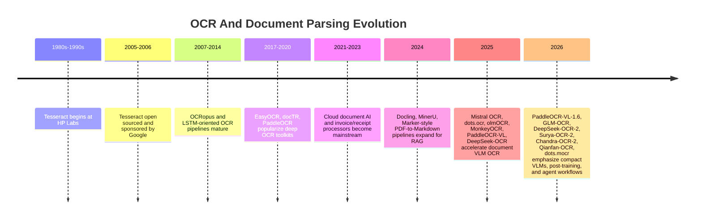
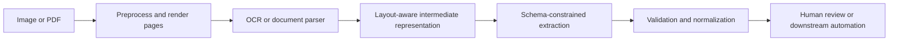

# OCR Tool Landscape And Timeline

Last updated: 2026-06-10

## Scope

This document maps OCR/document AI tools from oldest to newest, with emphasis on how the field moved from character recognition to agent-ready document parsing. It intentionally includes more than Docling and dots.ocr because receipt OCR can benefit from several layers: image preprocessing, OCR, layout parsing, field extraction, validation, and human/audit workflows.

## Taxonomy

| Category | Primary output | Typical strengths | Typical weaknesses | Examples |
| --- | --- | --- | --- | --- |
| Classic OCR engines | Plain text, hOCR, TSV, bounding boxes | Cheap, local, deterministic, mature | Weak semantic parsing, fragile on complex layouts | Tesseract, OCRopus, Kraken |
| Deep OCR toolkits | Text regions, recognized text, layout modules | Strong multilingual OCR, trainable, deployable | More setup; extraction still needs orchestration | PaddleOCR, EasyOCR, docTR |
| Document conversion/parsing | Markdown, JSON, layout tree, tables | LLM/RAG-ready output, reading order, table/formula handling | May mix heuristics/models; quality varies by document type | Docling, LlamaParse, Marker, MinerU |
| Specialized document VLM OCR | Markdown/JSON with layout and reasoning | Handles complex pages, tables, formulas, multilingual layouts | GPU/API cost, hallucination risk, long-output latency | PaddleOCR-VL, GLM-OCR, DeepSeek-OCR, Surya-OCR-2, Chandra-OCR-2, dots.ocr/dots.mocr, olmOCR, MonkeyOCR |
| Cloud document AI | Typed fields, tables, key-values, processors | Managed scale, pretrained receipts/invoices/IDs | Vendor lock-in, cost, privacy/regional constraints | AWS Textract, Google Document AI, Azure Document Intelligence |
| Enterprise/RPA OCR suites | Workflows, validation stations, PDF editing | Human review, established business integrations | Heavy setup, cost, less developer-native | ABBYY, UiPath Document Understanding |
| General multimodal LLM extraction | Typed JSON from images/PDFs | Flexible schema extraction, reasoning, fewer moving parts | Harder to guarantee localization; needs validation | Gemini, OpenAI vision models, Mistral OCR |

## Representative Timeline

## Chronological Notes

### 1980s-2006: Classic OCR Becomes Open

Tesseract started as an HP Labs OCR engine and was later open-sourced; modern Tesseract remains a local OCR baseline with language models, layout analysis options, hOCR/TSV-style outputs, and a mature training story.[^tesseract-docs] Its key architectural idea is still recognizable: image normalization, layout segmentation, text line recognition, language-aware decoding, and output formatting.

This generation is still useful for receipts when:

- Data privacy requires local processing.
- We need text boxes or searchable text at low cost.
- Input is relatively clean, single-column, and printed.
- We want a fallback OCR pass to support a VLM/LLM extractor.

It is less ideal when:

- The receipt is crumpled, photographed at an angle, or low contrast.
- Merchant logos, item tables, coupons, and totals require semantic interpretation.
- We need robust field-level normalization.

### 2007-2020: Modular Deep OCR Toolkits

OCRopus introduced a modular document-analysis lineage; later projects such as Kraken and Calamari improved trainability for historical scripts and line-recognition workflows. PaddleOCR then popularized a practical open-source, production-oriented deep OCR stack. The original PP-OCR paper described an ultra-lightweight system with detector, angle classifier, and recognizer models; later PP-OCR versions improved detection/recognition, speed, and multilingual support.[^ppocr-paper][^ppocrv3-paper]

Modern PaddleOCR 3.x is broader than text recognition. It includes PP-OCRv5, PP-StructureV3, PP-ChatOCRv4, and PaddleOCR-VL, with documentation positioning it as a way to convert PDFs/images into JSON/Markdown for RAG and agentic applications.[^paddle-home][^paddle-github]

### 2021-2024: Managed Document AI And RAG-Ready Parsing

Cloud vendors moved beyond raw OCR into processors:

- Amazon Textract provides text detection, forms/tables, queries, receipts/invoices through AnalyzeExpense, IDs, and lending workflows.[^aws-textract]
- Google Document AI uses processors for OCR, extraction, classification, splitting, form parsing, custom extractors, layout parser, and document objects.[^google-docai]
- Azure Document Intelligence provides read/layout/general document models, prebuilt receipt/invoice/ID/etc. models, custom extraction/classification, field typing, and add-on OCR features.[^azure-docint]

In parallel, RAG pressure created document conversion tools. Docling emphasizes multi-format parsing, advanced PDF understanding, a unified `DoclingDocument`, Markdown/HTML/JSON export, local execution, OCR support, and integrations with LangChain/LlamaIndex/CrewAI/Haystack.[^docling-docs] Marker and MinerU focused on converting PDFs and office documents into clean Markdown/JSON with layout preservation and model-assisted OCR/table/formula handling.[^marker-github][^mineru-github]

Comparison posts from LlamaIndex and Fastio reflect the broader market split: agentic/VLM parsers for complex documents and AI workflows, managed document AI for standardized forms, open-source OCR for local/privacy-sensitive workflows, PDF utilities for preprocessing, and RPA/enterprise suites for human-in-the-loop automation.[^llamaindex-ocr-blog][^llamaindex-parsing-blog][^llamaindex-parser-api-blog][^fastio-ocr-blog]

ParseBench makes that shift more concrete: it argues that parser evaluation for agents should measure semantic correctness across tables, charts, content faithfulness, semantic formatting, and visual grounding rather than relying only on text similarity.[^parsebench-paper]

### 2025-2026: Document VLMs And Agentic OCR

The newest wave treats OCR as multimodal sequence generation or document parsing:

- Mistral OCR launched in March 2025 as an API for images/PDFs, ordered interleaved text/images, tables, math, multilingual content, and document-as-prompt structured output.[^mistral-ocr]
- dots.ocr released in July 2025 as a multilingual document parser based on a compact VLM and later rebranded/advanced to dots.mocr in March 2026; the GitHub project describes layout JSON with bounding boxes, categories, text in Markdown/HTML/LaTeX, and reading order.[^dots-github]
- olmOCR moved from a 2025 PDF linearization toolkit to an RL-trained document OCR system; the repository describes conversion to clean Markdown with support for equations, tables, handwriting, complex formatting, header/footer removal, and natural reading order.[^olmocr-github]
- PaddleOCR-VL introduced a compact 0.9B VLM for multilingual document parsing; PaddleOCR-VL-1.6 was released in May/June 2026 with a technical report, Apache-2.0 model card, PaddleOCR usage, JSON/Markdown export, and claims of 96.33% on OmniDocBench v1.6.[^paddle-home][^paddlevl-paper][^paddlevl16-hf][^paddlevl16-paper]
- GLM-OCR is a 2026 compact multimodal OCR model from Z.ai/zai-org. The model card and paper describe a 0.9B system built with CogViT visual encoding, GLM decoding, Multi-Token Prediction, reinforcement learning, PP-DocLayout-V3 layout analysis, and parallel region recognition.[^glm-ocr-hf][^glm-ocr-paper]
- DeepSeek-OCR framed OCR as optical context compression, using a vision encoder and decoder to compress long contexts into fewer vision tokens; the paper reports high precision at lower compression ratios and practical large-scale page generation.[^deepseek-ocr][^deepseek-ocr-hf]
- DeepSeek-OCR-2 extends that line with "Visual Causal Flow," exploring dynamic visual-token reordering driven by image semantics rather than fixed raster-scan order. Its GitHub repo supports image/PDF inference, Markdown conversion prompts, vLLM, and Transformers usage.[^deepseek-ocr2-paper][^deepseek-ocr2-github]
- Surya-OCR-2 is a 650M Datalab document OCR model with layout analysis, reading order, table recognition, OCR output with bboxes/confidence, vLLM/llama.cpp serving, and an OpenRAIL model-weight license.[^surya-ocr-2-hf]
- Chandra-OCR-2 is Datalab's higher-accuracy 5B OCR model for Markdown, HTML, and JSON with layout information, table/math/form support, 90+ languages, and vLLM/Transformers usage.[^chandra-ocr-2-hf]
- Qianfan-OCR is Baidu's 4B end-to-end document intelligence model with prompt-driven parsing, table extraction, chart/document QA, key information extraction, 192 languages, and a "Layout-as-Thought" mode.[^qianfan-ocr-hf]
- Hugging Face's OCR model search sorted by trending is useful as a discovery signal. On 2026-06-10 it surfaced GLM-OCR, Chandra-OCR-2, Surya-OCR-2, Nemotron-OCR-v2, DeepSeek-OCR-2, DeepSeek-OCR, Qianfan-OCR, dots.ocr, Falcon-OCR, and Typhoon-OCR among the top results.[^hf-ocr-trending]
- MonkeyOCR proposed a structure-recognition-relation triplet: "where is it," "what is it," and "how is it organized," which is a useful mental model for agentic OCR even if the implementation is a research system.[^monkeyocr]

## Latest-To-Oldest Practical Ranking For This Repo

This is not a leaderboard; it is a relevance ranking for a synchronous receipt OCR MVP with future worker support.

| Era | Candidate | Use now? | Why |
| --- | --- | --- | --- |
| 2026 | PaddleOCR-VL-1.6 / PaddleOCR 3.x | Spike later | Strong open-source parser, but local deployment complexity is higher than an API-first MVP. |
| 2026 | GLM-OCR | Spike later | Compact 0.9B OCR model with layout-analysis plus parallel recognition; promising for high-throughput parsing. |
| 2026 | DeepSeek-OCR-2 | Research spike | Important architecture direction for visual token ordering and document-to-Markdown; practical repo maturity still needs evaluation. |
| 2026 | Surya-OCR-2 / Chandra-OCR-2 | Spike later | Datalab models are strong candidates for local/hosted document parsing; license/commercial constraints must be checked. |
| 2026 | Qianfan-OCR / Nemotron-OCR-v2 / Typhoon-OCR | Watchlist | Good discovery candidates from HF trending; prioritize only if eval goals match. |
| 2026 | dots.mocr / dots.ocr | Spike later | Very interesting for multilingual layout parsing and JSON layout output; GPU/VLM ops need evaluation. |
| 2025 | DeepSeek-OCR | Research spike | Strong open model popularity and OCR compression angle; needs receipt-specific validation. |
| 2025 | Mistral OCR | Consider as API fallback | Strong document-to-Markdown/structured-output story; useful for complex PDFs and RAG. |
| 2025 | olmOCR | Spike for PDF/long receipts | Good fit for clean Markdown linearization and batch conversion. |
| 2024-2026 | Docling | Spike for document preprocessing | Excellent wrapper/converter layer, especially if the app grows beyond receipts. |
| 2024-2026 | MinerU / Marker + Surya | Spike for open parser pipeline | Useful when we want local Markdown/JSON, table extraction, and visual diagnostics. |
| Current cloud | Google Document AI / AWS Textract / Azure Document Intelligence | Consider for enterprise | Managed receipt/invoice processors reduce engineering, but cost/privacy/vendor concerns matter. |
| Current VLM | Gemini / OpenAI vision | Use now through provider boundary | Fastest path for typed receipt extraction when paired with schema validation and retries. |
| Classic | Tesseract / PaddleOCR OCR modules | Keep as fallback concept | Cheap local OCR and bounding boxes; not sufficient alone for robust receipt semantics. |

## Main Strategic Observation

The field is converging on a layered contract:

Older tools focus on `C`. Newer tools increasingly merge `C`, `D`, and `E`. A robust product still needs `B`, `F`, and `G`.

## References

[^tesseract-docs]: Tesseract OCR documentation, accessed 2026-06-10. https://tesseract-ocr.github.io/tessdoc/
[^ppocr-paper]: Yuning Du et al., "PP-OCR: A Practical Ultra Lightweight OCR System", arXiv, 2020. https://arxiv.org/abs/2009.09941
[^ppocrv3-paper]: Chenxia Li et al., "PP-OCRv3: More Attempts for the Improvement of Ultra Lightweight OCR System", arXiv, 2022. https://arxiv.org/abs/2206.03001
[^paddle-home]: PaddleOCR documentation, "Home", accessed 2026-06-10. https://www.paddleocr.ai/latest/en/index.html
[^paddle-github]: PaddlePaddle, "PaddleOCR", GitHub, accessed 2026-06-10. https://github.com/PaddlePaddle/PaddleOCR
[^aws-textract]: AWS, "What is Amazon Textract?", accessed 2026-06-10. https://docs.aws.amazon.com/textract/latest/dg/what-is.html
[^google-docai]: Google Cloud, "Document AI overview", last updated 2026-06-04, accessed 2026-06-10. https://cloud.google.com/document-ai/docs/overview
[^azure-docint]: Microsoft Learn, "What is Azure Document Intelligence in Foundry Tools?", accessed 2026-06-10. https://learn.microsoft.com/en-us/azure/ai-services/document-intelligence/overview
[^docling-docs]: Docling documentation, "Index", accessed 2026-06-10. https://docling-project.github.io/docling/
[^marker-github]: Datalab, "marker", GitHub, accessed 2026-06-10. https://github.com/datalab-to/marker
[^mineru-github]: OpenDataLab, "MinerU", GitHub, accessed 2026-06-10. https://github.com/opendatalab/MinerU
[^llamaindex-ocr-blog]: LlamaIndex, "Best OCR Software of 2026: Agentic AI vs. Legacy Solutions", 2026-03-18, accessed 2026-06-10. https://www.llamaindex.ai/insights/best-ocr-software
[^llamaindex-parsing-blog]: LlamaIndex, "Best Document Parsing Software 2026: Agentic AI vs. Legacy OCR", 2026-03-18, accessed 2026-06-10. https://www.llamaindex.ai/insights/best-document-parsing-software
[^llamaindex-parser-api-blog]: LlamaIndex, "Top Document Parsing APIs for 2026", 2026-03-17, accessed 2026-06-10. https://www.llamaindex.ai/insights/top-document-parsing-apis
[^fastio-ocr-blog]: Fastio, "Best OCR Tools for AI Agents - Top Vision APIs 2026", accessed 2026-06-10. https://fast.io/resources/best-ocr-tools-ai-agents/
[^parsebench-paper]: Boyang Zhang et al., "ParseBench: A Document Parsing Benchmark for AI Agents", arXiv, 2026. https://arxiv.org/abs/2604.08538
[^mistral-ocr]: Mistral AI, "Mistral OCR", 2025-03-06, accessed 2026-06-10. https://mistral.ai/news/mistral-ocr/
[^dots-github]: rednote-hilab, "dots.ocr", GitHub, accessed 2026-06-10. https://github.com/rednote-hilab/dots.ocr
[^olmocr-github]: AllenAI, "olmOCR", GitHub, accessed 2026-06-10. https://github.com/allenai/olmocr
[^paddlevl-paper]: Cheng Cui et al., "PaddleOCR-VL: Boosting Multilingual Document Parsing via a 0.9B Ultra-Compact Vision-Language Model", arXiv, 2025. https://arxiv.org/abs/2510.14528
[^paddlevl16-hf]: PaddlePaddle, "PaddleOCR-VL-1.6", Hugging Face, accessed 2026-06-10. https://huggingface.co/PaddlePaddle/PaddleOCR-VL-1.6
[^paddlevl16-paper]: Zelun Zhang et al., "PaddleOCR-VL-1.6: Expanding the Frontier of Document Parsing with Under-Optimized Region Refinement and Progressive Post-Training", arXiv, 2026. https://arxiv.org/abs/2606.03264
[^glm-ocr-hf]: zai-org, "GLM-OCR", Hugging Face, accessed 2026-06-10. https://huggingface.co/zai-org/GLM-OCR
[^glm-ocr-paper]: Shuaiqi Duan et al., "GLM-OCR Technical Report", arXiv, 2026. https://arxiv.org/abs/2603.10910
[^deepseek-ocr]: Haoran Wei et al., "DeepSeek-OCR: Contexts Optical Compression", arXiv, 2025. https://arxiv.org/abs/2510.18234
[^deepseek-ocr-hf]: DeepSeek AI, "DeepSeek-OCR", Hugging Face, accessed 2026-06-10. https://huggingface.co/deepseek-ai/DeepSeek-OCR
[^deepseek-ocr2-paper]: Haoran Wei, Yaofeng Sun, Yukun Li, "DeepSeek-OCR 2: Visual Causal Flow", arXiv, 2026. https://arxiv.org/abs/2601.20552
[^deepseek-ocr2-github]: DeepSeek AI, "DeepSeek-OCR-2", GitHub, accessed 2026-06-10. https://github.com/deepseek-ai/DeepSeek-OCR-2
[^surya-ocr-2-hf]: Datalab, "surya-ocr-2", Hugging Face, accessed 2026-06-10. https://huggingface.co/datalab-to/surya-ocr-2
[^chandra-ocr-2-hf]: Datalab, "chandra-ocr-2", Hugging Face, accessed 2026-06-10. https://huggingface.co/datalab-to/chandra-ocr-2
[^qianfan-ocr-hf]: Baidu, "Qianfan-OCR", Hugging Face, accessed 2026-06-10. https://huggingface.co/baidu/Qianfan-OCR
[^hf-ocr-trending]: Hugging Face, "Models search: ocr sorted by trending", accessed 2026-06-10. https://huggingface.co/models?sort=trending&search=ocr
[^monkeyocr]: Zhang Li et al., "MonkeyOCR: Document Parsing with a Structure-Recognition-Relation Triplet Paradigm", arXiv, 2025. https://arxiv.org/abs/2506.05218
