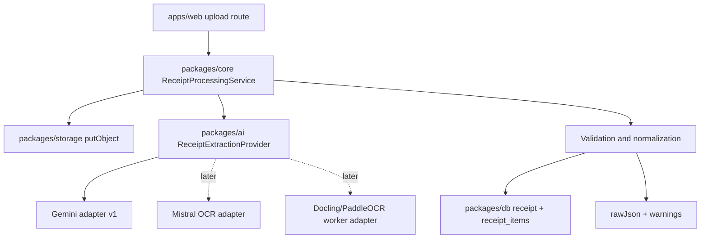

# Receipt OCR Evaluation Playbook

Last updated: 2026-06-10

## Product-Specific Goal

The Receipt OCR MVP should not optimize for raw OCR accuracy alone. It should optimize for a correct, auditable receipt record:

- Merchant.
- Receipt date.
- Currency.
- Category.
- Subtotal, tax, tip, discounts, total.
- Line items with names, quantities, unit prices, totals.
- Confidence and evidence.
- Original image storage key.
- Raw provider output for debugging.

## Recommended Architecture For This Repo



Keep the route handler thin. `packages/core` should orchestrate storage, extraction, validation, and DB writes. `packages/ai` should expose the provider abstraction. `packages/storage` should own object keys and S3/R2 behavior. `packages/db` should own schema and repository construction.

## Extraction Contract

Use a strict schema, but include uncertainty:

```ts
type Evidence<T> = {
  value: T | null;
  sourceText?: string;
  confidence?: number;
  bbox?: {
    page: number;
    x1: number;
    y1: number;
    x2: number;
    y2: number;
  };
  alternatives?: Array<{
    value: T;
    sourceText?: string;
    confidence?: number;
  }>;
};
```

Important receipt-specific normalizers:

- Money: parse currency symbols, decimal separators, negative discounts, and thousands separators.
- Date: preserve original string; normalize with locale assumptions only when evidence supports it.
- Merchant: distinguish brand, legal entity, branch, and address.
- Tax/tip: allow absent values; never infer tax by subtraction unless marked as derived.
- Total: prefer explicit total labels over largest number.
- Items: allow uncertain grouping and confidence per row.

## Validation Rules

| Rule | Severity | Notes |
| --- | --- | --- |
| `total >= 0` | error | Negative total is almost always bad. |
| `subtotal + tax + tip - discounts ~= total` | warning/error | Use tolerance for rounding and missing fields. |
| `sum(items.totalPrice) ~= subtotal` | warning | Many receipts include non-item fees/discounts. |
| `receiptDate <= today + 1 day` | warning | Future dates may be timezone or parsing errors. |
| Currency present when money exists | warning | Defaulting silently is dangerous. |
| Merchant present | warning | User can still save draft. |
| Raw image persisted before extraction | error | Auditability requires original artifact. |
| Provider raw JSON stored | warning | Critical for debugging and replay. |

## Test Dataset Matrix

Build a small gold dataset before changing providers.

| Set | Count | Purpose |
| --- | ---: | --- |
| Clean mobile photos | 25 | Happy path, common receipts. |
| Crumpled/curved receipts | 20 | Warped thermal paper. |
| Low light/blur | 20 | Mobile capture failures. |
| Long receipts | 15 | Many item rows, pagination/cropping. |
| E-receipts/PDFs | 15 | Digital text and HTML/PDF layouts. |
| Multilingual/multicurrency | 20 | Locale/date/currency stress. |
| Restaurant receipts | 20 | Tax, tip, subtotal, split payments. |
| Grocery receipts | 20 | Many abbreviated item names. |
| Returns/discounts/coupons | 15 | Negative lines and nontrivial totals. |
| Adversarial/non-receipts | 15 | Avoid hallucinated records. |

Minimum first evaluation: 50 receipts. Useful provider comparison: 150-200 receipts.

## Metrics

Use field-level and record-level metrics.

| Metric | Definition | Why it matters |
| --- | --- | --- |
| Total exact match | Parsed total equals gold total after currency normalization | Most important financial field. |
| Money MAE | Mean absolute error across subtotal/tax/tip/total | Captures near misses. |
| Merchant normalized match | Case/punctuation-insensitive merchant match | Useful for categorization. |
| Date exact match | ISO date equals gold | Needed for expense tracking. |
| Item row F1 | Correct line item grouping and amounts | Hardest part of receipts. |
| Schema validity | Provider response parses without repair | Operational reliability. |
| Evidence coverage | % fields with source text/bbox | Audit/debug value. |
| Visual grounding accuracy | Extracted fields point to the correct image/page region | Inspired by ParseBench; critical for review UX. |
| Table/row record match | Item rows preserve name/quantity/unit/total relationships | Receipt adaptation of ParseBench table-record thinking. |
| Faithfulness violations | Omitted visible fields, hallucinated fields, digit drops, reading-order errors | Parser failures that downstream agents cannot safely fix. |
| Semantic formatting preservation | Discounts, struck-through values, bold totals, section hierarchy are preserved when meaningful | Prevents old prices/discounts/section headers from becoming false totals. |
| Retry rate | % receipts needing repair pass | Cost and latency. |
| Human review rate | % receipts below confidence threshold | UX impact. |
| Latency p50/p95 | End-to-end extraction time | Synchronous upload feasibility. |
| Cost per 1k receipts | Provider + infra cost | Pricing model. |

## Provider Benchmark Plan

ParseBench is a useful external benchmark reference because it evaluates document parsers on tables, charts, content faithfulness, semantic formatting, and visual grounding.[^parsebench-paper] Receipts do not need all of ParseBench, but the same philosophy applies: evaluate whether the parsed output preserves enough structure and evidence for an agent or accounting workflow to act safely.

### Phase 1: Current Gemini Baseline

Run a single structured extraction prompt against the gold set:

- Image input.
- Strict schema.
- "Do not infer; use null when missing."
- Require `sourceText` for every non-null value.
- Return warnings for ambiguity.

Measure field accuracy, schema validity, latency, and raw failure modes.

### Phase 2: Gemini With Repair

Add one bounded repair loop:

1. First extraction.
2. Validate.
3. If missing critical fields or totals mismatch, send a second focused prompt with validation errors.
4. Accept only if validation improves.

Do not add unlimited agent behavior.

### Phase 3: Add OCR/Text Prepass

Compare:

- Image-only VLM extraction.
- OCR text plus image extraction.
- OCR text only extraction.

This determines whether a local raw OCR fallback helps.

### Phase 3b: Local Parser Prepass

Compare PyMuPDF, pypdf, LiteParse, and Docling as fast local prepass tools for PDFs/e-receipts:

- Digital PDF text extraction.
- Spatial text preservation.
- Screenshot/page rendering support.
- OCR fallback behavior on scanned pages.
- Output usefulness for the same receipt schema extractor.

LiteParse is especially interesting for an agentic workflow because it supports a fast text-first pass plus screenshot fallback for deeper visual reasoning. The v2.0 Rust rewrite also makes it plausible as a local worker utility across Node, Python, Rust, and WASM/browser/edge contexts, but its speed claims should be measured on our own receipt dataset.[^liteparse-blog][^liteparse-v2-blog]

### Phase 4: Parser And Open-Model Candidates

Evaluate Docling, PaddleOCR 3.x, PaddleOCR-VL-1.6, GLM-OCR, DeepSeek-OCR, DeepSeek-OCR-2, Surya-OCR-2, Chandra-OCR-2, dots.mocr, Marker/Surya, MinerU, and olmOCR on receipt PDFs/images. Use their Markdown/JSON outputs as input to the same structured extractor. This isolates parsing quality from extraction quality.

### Phase 5: Cloud/Alternative APIs

Evaluate Mistral OCR, Claude vision/PDF structured outputs, Together-hosted open VLMs, AWS Textract AnalyzeExpense, Google Document AI receipt/invoice processors, and Azure prebuilt receipt if enterprise features become important.

## Prompting And Structured Output Guidelines

Use typed schemas because OpenAI, Gemini, and Claude now support JSON-Schema-style structured outputs for predictable data extraction workflows.[^openai-structured][^gemini-structured][^anthropic-structured]

Schema prompt principles:

- Ask for `null` instead of guessing.
- Ask for `sourceText` exactly as visible.
- Separate observed values from derived values.
- Require decimal money numbers, not strings, after extraction.
- Include warnings.
- Allow alternates for dates and totals.
- Keep schema shallow enough to avoid model/API rejection.

Bad pattern:

```text
Extract all data from this receipt and return JSON.
```

Better pattern:

```text
Extract a receipt record from the image. Return only fields supported by visible evidence.
For each non-null value, include the source text. Use null for missing or unreadable fields.
Do not calculate tax, tip, or total unless the field is explicitly present; if you derive
anything, add a warning and mark it as derived.
```

## Failure Modes To Track

1. Largest-number trap: model picks cash paid or balance instead of total.
2. Date ambiguity: `03/04/25` interpreted incorrectly.
3. Merchant/address confusion: address line becomes merchant.
4. Tax/tip inference: model invents missing values to satisfy arithmetic.
5. Coupon handling: discounts counted as items or ignored.
6. Item row merging: two physical rows become one item or one item becomes two.
7. Currency hallucination: model assumes USD from `$`.
8. Low-quality photo hallucination: model outputs plausible receipt fields despite unreadable input.
9. Header/footer noise: loyalty IDs, survey codes, and payment tokens become items.
10. Multipage/e-receipt truncation: only first page processed.

## Decision Matrix

| Need | Best first choice | Why |
| --- | --- | --- |
| Ship MVP quickly | Gemini structured extraction | Already planned; lowest integration burden. |
| Cross-check premium model output | Claude or OpenAI structured extraction | Different model family, useful for disagreement analysis. |
| Improve PDFs/e-receipts | Docling or olmOCR prepass | Produces cleaner text/Markdown for extraction. |
| Add local/self-hosted OCR | PaddleOCR 3.x | Rich open-source OCR/document stack. |
| Add compact open document VLMs | PaddleOCR-VL-1.6 / GLM-OCR / DeepSeek-OCR / Surya-OCR-2 | Current 2026 model direction; benchmark before adopting. |
| Add managed enterprise extraction | Google Document AI / Textract / Azure | Prebuilt receipt/invoice models and scale. |
| Multilingual layout research | dots.mocr / PaddleOCR-VL / GLM-OCR | Current compact document VLM direction. |
| Strong audit UX | Any provider plus evidence schema | Product schema matters more than provider. |

## Recommended Next Engineering Steps

1. Define a provider-neutral receipt extraction schema in `packages/ai`.
2. Return field evidence and warnings from the Gemini adapter.
3. Add validation/normalization in `packages/core`.
4. Persist raw provider JSON and validation warnings.
5. Build a local gold dataset folder outside production fixtures, with anonymized receipts.
6. Create a provider benchmark script later, ideally runnable from `packages/ai` or `packages/core`.

## References

[^openai-structured]: OpenAI, "Structured model outputs", accessed 2026-06-10. https://platform.openai.com/docs/guides/structured-outputs
[^gemini-structured]: Google AI for Developers, "Structured outputs", accessed 2026-06-10. https://ai.google.dev/gemini-api/docs/structured-output
[^anthropic-structured]: Anthropic, "Structured outputs", accessed 2026-06-10. https://platform.claude.com/docs/en/build-with-claude/structured-outputs
[^parsebench-paper]: Boyang Zhang et al., "ParseBench: A Document Parsing Benchmark for AI Agents", arXiv, 2026. https://arxiv.org/abs/2604.08538
[^liteparse-blog]: Logan Markewich, "LiteParse: Local Document Parsing for AI Agents", LlamaIndex, 2026-03-19, accessed 2026-06-10. https://www.llamaindex.ai/blog/liteparse-local-document-parsing-for-ai-agents
[^liteparse-v2-blog]: Logan Markewich, "LiteParse v2.0 Runs Everywhere", LlamaIndex, 2026-05-27, accessed 2026-06-10. https://www.llamaindex.ai/blog/liteparse-v2-0-runs-everywhere
